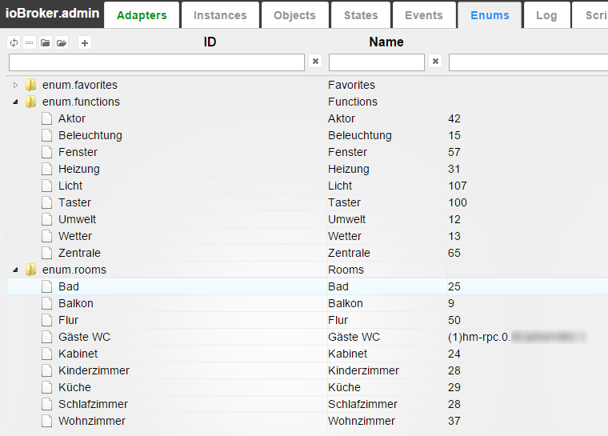

# ioBroker.text2command

**Dieser Adapter nutzt die Sentry-Bibliotheken, um Ausnahmen und Codefehler automatisch an die Entwickler zu melden.** Weitere Details und Informationen zum Deaktivieren der Fehlerberichterstattung finden Sie in [der Sentry-Plugin-Dokumentation](https://github.com/ioBroker/plugin-sentry#plugin-sentry) . Die Sentry-Berichterstattung wird ab js-controller 3.0 verwendet.

## Beschreibung

Dieser Adapter kann normale Sätze umwandeln, wie zum Beispiel `Switch light in kitchen on` auf einen bestimmten Befehl und legt den Zustand fest `adapter.0.device.kitchenLight` Zu `true` Die

Dieser Adapter ist im Standalone-Betrieb sinnlos. Er sollte zusammen mit anderen Adaptern wie Telegram oder einer Android-App verwendet werden.** `iobroker.vis` ** Die

## Verwendung

Um den Befehl auszuführen, schreiben Sie den Status.** `text2command.<INSTANCE>.text` ** mit Satz. Sie erhalten immer die Antwort in `text2command.<INSTANCE>.response` Die

Wenn Sie **eine Antwort-ID** definieren, wird die Antwort ebenfalls in dieser ID gespeichert. Dies ist beispielsweise erforderlich, um Sprachbestätigungen zu realisieren.

Sie können eine Nachricht senden über `sendTo` aus `javascript` Die Antwort erhalten Sie in der Rücknachricht:

```js
sendTo('text2command', 'Switch light in kitchen on', function (err, response) {
    console.log('Response is: ' + response);
});
```

Es können reguläre Ausdrücke verwendet werden, zum Beispiel: `/^light\son|^lamp\son/` Reguläre Ausdrücke unterscheiden nie zwischen Groß- und Kleinschreibung.

Um die Option „Ein-/Ausschalten nach Funktion“ nutzen zu können, müssen Sie sich um die Funktionen kümmern.

Schlüsselwörter funktionieren wie folgt:

- Leerzeichen trennen Schlüsselwörter
- Alle Schlüsselwörter müssen in einem Satz vorhanden sein, damit eine Regel ausgelöst wird: z. B. Schlüsselwort: `light on` wird ausgelöst bei `switch light on`, `make light on everywhere` und nicht auslösen `switch on`, `make light` Die
- Ein Schlüsselwort kann mehrere Formen haben. Varianten eines Schlüsselworts müssen durch „/“ getrennt werden. Beispiel: Schlüsselwörter: `switch/make/do light on/true` wird ausgelöst bei: `do light true`, `make please light on` Die
- Wenn ein Schlüsselwort in mehreren Fällen vorkommen kann (Nominal, Genitiv, Akkusativ, Plural usw.), müssen alle diese Fälle als Varianten aufgeführt werden, zum Beispiel: `switch light/lights on` Die

Die folgenden Funktionen werden interpretiert als

`enum.functions`:

** `enum.functions.light` ** (Licht | Свет):

- Rollen -`level.dimmer`
- Rollen -`switch.light`

** `enum.functions.backlight` **(Beleuchtung | Beitrag):

- Rollen -`level.backlight`
- Rollen -`switch.backlight`

** `enum.functions.blinds/shutter` **(Rollladen | Жалюзи/окна)

- Rollen -`level.blind`
- Rollen -`switch.blind`

** `enum.functions.curtain` **(Vorhänge | Шторы)

- Rollen -`level.curtain`
- Rollen -`switch.curtain`

** `enum.functions.heating` **(Heizung | Отопление/Подогрев)

- Rollen -`level.temperature`
- Rollen -`switch.temperature`

** `enum.functions.music` **(Musik | Музыка)

- Rollen -`button.play`
- Rollen -`button.stop` /`button.pause`

** `enum.functions.alarm/security` **(Alarmanlage / Alarm | Охрана)

- Rollen -`switch.security`

** `enum.functions.lock` **(Schloß / Schloss | Замок)

- Rollen -`switch.open`
- Rollen -`switch.lock`

Folgende Räume werden unterstützt:

| Schlüsselwort in der Phrase | Mögliche Enumerationsräume in Englisch | auf Deutsch       | auf Russisch     |
| --------------------------- | -------------------------------------- | ----------------- | ---------------- |
| überall                     | überall                                | -                 | -                |
| Leben                       | Wohnzimmer                             | Wohnzimmer        | зал              |
| Schlafzimmer                | Schlafzimmer/Schlafzimmer              | Schlafzimmer      | спальня          |
| Bad                         | Badezimmer/Badewanne                   | Badezimmer/Bad    | ванная           |
| Arbeits-/Büroarbeitsplatz   | Büro                                   | Arbeitszimmer     | Kabinett         |
| Kinder/Kind/Kinderkrippe    | Kindergarten                           | Kinderzimmer      | детская          |
| Gäste-WC/Gästeschrank       | Gästetoilette                          | Gästetoilette     | гостевой туалет  |
| WC/Kleiderschrank           | WC                                     | WC                | туалет           |
| Etage/Eingang               | Boden                                  | diele/gang/flur   | коридор/прихожая |
| Küche                       | Küche                                  | Küche/Kueche      | кухня            |
| Balkon/Terrasse/Patio       | Terrasse                               | Balkon/Terrasse   | терраса/балкон   |
| Essen                       | Esszimmer                              | Esszimmer         | столовая         |
| Garage                      | Garage                                 | Garage            | гараж            |
| Treppe                      | Treppe                                 | trepe/treppenhaus | лестница         |
| Garten                      | Garten                                 | Garten            | Sad              |
| Hof                         | Gericht                                | Hof               | двор             |
| Gästezimmer                 | Gästezimmer                            | Gästezimmer       | гостевая         |
| Dachboden                   | Dachboden                              | Speicher          | кладовка         |
| Dach                        | Dach                                   | Dachstuhl         | крыша            |
| Terminal                    | Terminal                               | Anschlussraum     | сени             |
| Waschraum                   | Waschraum                              | Waschraum         | прачечная        |
| Heizraum                    | Heizraum                               | Heizungsraum      | котельная        |
| Hütte                       | Hütte                                  | schuppen/scheune  | сарай            |
| Gartenhaus                  | Sommerhaus                             | Gartenhaus        | теплица          |

Sie können in Danksagungen Muster verwenden:

- `%s`: Wert
- `%u`: Einheit
- `%n` Name (geplant!)
- `{objectId}` Der Status dieser Objekt-ID wird hier gespeichert. Tatsächlich werden dieselben Bindungen unterstützt wie von [iobroker.vis](https://github.com/ioBroker/ioBroker.vis#bindings-of-objects) , mit Ausnahme spezieller Bindungen.
- `\n` Der Doppelpunkt (:) wird durch einen Zeilenumbruch ersetzt (z. B. nützlich für Telegram). `Line 1\nLine 2` Die

Folgende Befehle werden unterstützt:

### Wie spät ist es?

Antwort: 14:56 (aktuelle Zeit)

### Wie heißt du?

Die Antwort ist anpassbar. Standard: `My name is Alpha`

### Wie hoch ist die Außentemperatur?

Der Benutzer muss die Bundesland-ID angeben, aus der die Außentemperatur abgelesen werden soll. Die Antwort ist anpassbar. Standard: `Outside temperature is %s %u` ** `%s` ** wird durch die auf eine ganze Zahl gerundete Temperatur ersetzt.** `%u` ** werden durch Einheiten dieses Zustands oder durch Systemtemperatureinheiten ersetzt.

### Wie hoch ist die Innentemperatur?

Der Benutzer muss die Bundesland-ID angeben, in der die Innentemperatur abgelesen werden soll. Die Antwort ist anpassbar. Standard: `Inside temperature is %s %u` ** `%s` ** wird durch die auf eine ganze Zahl gerundete Temperatur ersetzt.** `%u` ** werden durch Einheiten dieses Zustands oder durch Systemtemperatureinheiten ersetzt.

### Ein-/Ausschalten per Funktion

Dieser Befehl liest Informationen aus Enumerationen. Er verwendet `enum.functions` um den Gerätetyp (z. B. Licht, Wecker, Musik) zu ermitteln und `enum.rooms` um den Raumnamen zu ermitteln.

Beispiel auf Deutsch:

Schlüsselwörter zum Einschalten sind: _einschalten_ , z. B. `switch rear light in bath on`

Schlüsselwörter zum Ausschalten sind: _ausschalten_ , z. B. `switch light in living room off`

Die Antwort wird auf Wunsch automatisch generiert: `Switch off %function% in %room%`, Wo `%function%` Und `%room%` wird durch den ermittelten Gerätetyp und Standort ersetzt.

Der Befehl akzeptiert auch numerische Werte. Er hat Priorität, z. B. im Befehl `switch light off in living room on 15%` Die Lampe wird auf 15 % eingestellt und ist nicht _ausgeschaltet_ .

Sie können einen Standardraum in \[] definieren. Z.B. `switch the light on[sleepingroom]`

### Jalousien öffnen/schließen

Dieser Befehl liest Informationen aus Enumerationen. Er verwende&#x74;** `enum.functions.blind` ** um den passenden Jalousien- oder Rollladentyp zu finde&#x6E;** `enum.rooms` ** um den Raumnamen zu ermitteln.

Schlüsselwörter zum Hochziehen der Jalousien sind: _Jalousien hochziehen_ , z. B. `set blinds up in sleeping room`

Schlüsselwörter zum Herunterfahren der Jalousien sind: _Jalousien herunter_ , z. B. `move blinds down in office`

Sie können die genaue Position der Jalousie in Prozent angeben, z. B. `move blinds to 40 percent in office`

Die Antwort wird auf Wunsch automatisch generiert: ` in %room%`, wobei %room% durch den ermittelten Gerätetyp und Standort ersetzt wird.

### Etwas ein-/ausschalten

Der Benutzer muss die Status-ID eines zu steuernden Geräts und den zu schreibenden Wert angeben.

Sie sollten für jede Position eine Regel erstellen (z. B. für `on` und für `off`).

Die Antwort ist anpassbar. Standard: `Switched on`

Z.B:

- `Deactivate alarm` Objekt-ID: `hm-rpc.0.alarm`, Wert: `false`, Antwort: `Alarm is deactivated/Deactivated` In diesem Fall wird die Antwort zufällig zwischen _„Alarm deaktiviert“_ und _„Deaktiviert“_ ausgewählt.
- `Activate alarm` Objekt-ID: `hm-rpc.0.alarm`, Wert: `true`, Antwort: `Alarm is activated/Activated/Done` In diesem Fall wird die Antwort zufällig zwischen _„Alarm aktiviert“_ , _„Aktiviert“_ und _„Fertig“_ ausgewählt.

_Die Option „Deaktivieren“_ muss an erster Stelle in der Liste stehen, da sie länger ist.

Sie können Gleitkommazahlen in den Steuerbefehlen verwenden. Wenn ein numerischer Wert im Text enthalten ist, wird dieser als Steuerwert verwendet und der vordefinierte Wert ignoriert.

Beispiel für Regel:

- `Set light level` Objekt-ID: `hm-rpc.0.light.STATE`, Wert: `10`, Antwort: `Level set to %s%` Die

Wenn der Befehl beispielsweise so aussieht `Set light level to 50%` so hinein `hm-rpc.0.light.STATE` wird 50 geschrieben und die Antwort lautet `Level set to 50%` Die

Wenn der Befehl beispielsweise so aussieht `Set light level` so hinein `hm-rpc.0.light.STATE` wird 10 geschrieben und die Antwort lautet `Level set to 10%` Die

### Frag nach etwas

Der Benutzer muss die Status-ID eines Geräts angeben, deren Wert ausgelesen wird. Diese Vorlage liefert dann Informationen aus einem bestimmten Bundesstaat.

Z.B:

- `windows opened` Objekt-ID: `javascript.0.countOpenedWindows`, Anerkennen: `Actual %s windows opened`
- `temperature sleeping room` Objekt-ID: `hm-rpc.0.sleepingRoomSensor.TEMPERATURE`, Anerkennen: `Actual temperature in sleeping room is %s %u/%s %u` In diesem Fall wird die Antwort zufällig zwischen _„Tatsächliche Temperatur im Schlafzimmer beträgt %s %u“_ und _„%s %u“_ ausgewählt.

### Sende eine SMS an den Staat

Sie können Text in das Feld „Status“ eingeben. Der Benutzer muss die Status-ID angeben, um Text hineinzuschreiben.

Beispielregel: `email [to] wife` Objekt-ID: `javascript.0.emailToWife`, Anerkennen: `Email sent` Text: `Send email to my wife: I will be late` Der Adapter sucht nach dem letzten Wort der Schlüsselwörter (in diesem Fall `wife`), extrahiert Text aus dem nächsten Wort (in diesem Fall `I will be late` und schreibt diesen Text in `javascript.0.emailToWife`. Wort `to` ist nicht erforderlich, um die Regel auszulösen, wird aber aus einem Text entfernt.

### Du bist gut (Nur zum Spaß)

Die Antwort ist anpassbar. Standard: `Thank you` oder `You are welcome`

### Danke (Nur zum Spaß)

Die Antwort ist anpassbar. Standard: `No problem` oder `You are welcome`

### Antwort erstellen

Sie können eine Antwort mit Bindungen {objectId} in der Bestätigung generieren. Wird für Alexa verwendet.

Z.B:

- `windows opened`, Anerkennen: `Actual {javascript.0.countOpenedWindows} windows opened`
- `temperature sleeping room`, Anerkennen: `Actual temperature in sleeping room is {t: hm-rpc.0.sleepingRoomSensor.TEMPERATURE; Math.round(t)}/{hm-rpc.0.sleepingRoomSensor.TEMPERATURE; round(1)} degree` In diesem Fall wird die Antwort zufällig ausgewählt. _Die tatsächliche Temperatur im Schlafzimmer beträgt<VALUE>_ Un&#x64;_<VALUE>_ Die

Mehr über Bindungen erfahren Sie hier: (Bindungen von Objekten)\[ <https://github.com/ioBroker/ioBroker.vis#bindings-of-objects> ]

Außerdem können Sie die verstrichene Zeit bis jetzt abrufen, indem Sie `{hm-rpc.0.light.STATE.lc;dateinterval}` (2 Minuten und 12 Sekunden) oder `{hm-rpc.0.light.STATE.lc;dateinterval(true)}` ( **vor** 2 Minuten und 12 Sekunden)

## Externe Regeln mit `javascript`

Es besteht die Möglichkeit zu nutzen `javascript` Engine zur Verarbeitung von Befehlen in `text2command` Dazu müssen Sie in den „Erweiterten Einstellungen“ unter „Prozessorstatus-ID“ einen Zustand festlegen und diesen Zustand in einem JavaScript- oder Blockly-Skript überwachen. Sie können einen Zustand manuell im Adminbereich oder im Skript erstellen. Ein Verarbeitungsskript könnte beispielsweise so aussehen:

```js
createState("textProcessor", '', function () {
    // text2command writes the value with ack=false. Change "any" is important too, to process repeated commands.
    on({id: "javascript.0.textProcessor", ack: false, change: 'any'}, function (obj) {
         var task = JSON.parse(obj.state.val);
         // value looks like
         // {
         //     "command":      "text to process", // command that was received by text2command
         //     "language":     "en",              // language in command or system language
         //     "withLanguage": false              // indicator if language was defined in command (true) or used default language (false)
         // }
         // response to text2command with ack=true
         if (task.command === 'switch light on') {
            setState("hm-rpc.0.light", true);
            setState("javascript.0.textProcessor", 'light is on', true);
         } else {
            // let it process with predefined rules
            setState("javascript.0.textProcessor", '', true);
         }
    });
});
```

In den Einstellungen festlegen `text2command` **Prozessorstatus-ID** al&#x73;_ `javascript.0.textProcessor` _ damit dieses Beispiel funktioniert.

Der erste Befehl wird mit Ihrem verarbeitet. `javascript` und wenn `javascript` Antworten mit '' oder keine Antwort innerhalb der vordefinierten Zeit (standardmäßig 1 Sekunde) führten dazu, dass der Befehl gemäß den Regeln verarbeitet wurde.

### Option: Bei jedem Befehl in die Antwort schreiben

Wenn dies durch jeden Befehl aktiviert wird (unabhängig davon, ob die Anfrage über den Status oder sendTo erfolgte), `text2command.X.response` wird zusammen mit der Antwort schriftlich festgehalten.

## Aufgaben

- Antworten auf Russisch, männlich und weiblich.

<!--
	Placeholder for the next version (at the beginning of the line):
	### **WORK IN PROGRESS**
-->

## Changelog
### 5.0.2 (2026-11-21)
* (@GermanBluefox) Allowed new line (\n) in the answer texts of rules (#220)

### 5.0.1 (2026-10-14)
* (iobroker-bot) Adapter requires node.js >= 22 now.
* (@GermanBluefox) Admin 7.6.20+ is required. Added Ukrainian translations. Older changelog entries are moved to CHANGELOG_OLD.md

### 5.0.0 (2026-08-07)
* (@GermanBluefox) Minimal nodejs version is 22.x
* (@GermanBluefox) Migrated to React 19

### 4.0.0 (2025-11-03)
* (bluefox) GUI was updated to vite
* (bluefox) Minimal nodejs version is 20.x

### 3.0.3 (2023-12-18)
* (bluefox) Corrected GUI

## License

The MIT License (MIT)

Copyright (c) 2014-2026, bluefox <dogafox@gmail.com>

Permission is hereby granted, free of charge, to any person obtaining a copy
of this software and associated documentation files (the "Software"), to deal
in the Software without restriction, including without limitation the rights
to use, copy, modify, merge, publish, distribute, sublicense, and/or sell
copies of the Software, and to permit persons to whom the Software is
furnished to do so, subject to the following conditions:

The above copyright notice and this permission notice shall be included in
all copies or substantial portions of the Software.

THE SOFTWARE IS PROVIDED "AS IS", WITHOUT WARRANTY OF ANY KIND, EXPRESS OR
IMPLIED, INCLUDING BUT NOT LIMITED TO THE WARRANTIES OF MERCHANTABILITY,
FITNESS FOR A PARTICULAR PURPOSE AND NONINFRINGEMENT. IN NO EVENT SHALL THE
AUTHORS OR COPYRIGHT HOLDERS BE LIABLE FOR ANY CLAIM, DAMAGES OR OTHER
LIABILITY, WHETHER IN AN ACTION OF CONTRACT, TORT OR OTHERWISE, ARISING FROM,
OUT OF OR IN CONNECTION WITH THE SOFTWARE OR THE USE OR OTHER DEALINGS IN
THE SOFTWARE.