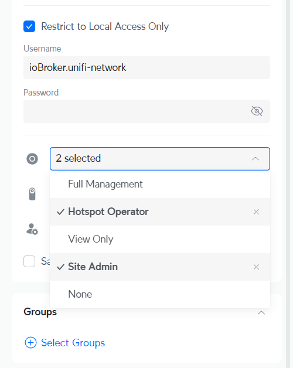

# ioBroker.unifi-network

## UniFi-Netzwerkadapter für ioBroker

Unifi Network nutzt die WebSocket-Schnittstelle, um Echtzeitinformationen von der Unifi-Netzwerk-Anwendung zu empfangen.

## Wichtig

1. Der Adapter wurde ausschließlich auf Basis des UniFi OS entwickelt. Kompatibilität mit einem selbst gehosteten Netzwerkcontroller ist zwar gegeben, kann aber nicht garantiert werden.

2. **Dieser Adapter kann sehr ressourcenintensiv sein!**<br> Dies hängt von Ihrer Umgebung ab, d. h. von der Anzahl der UniFi-Geräte und Clients in Ihrem Netzwerk. Dies lässt sich teilweise über die Echtzeit-API beeinflussen. `debounce time [s]` Dieser Parameter befindet sich in den Adaptereinstellungen. Echtzeitereignisse werden von dieser Einstellung nicht beeinflusst, sondern nur die „zyklische“ Echtzeitaktualisierung von Geräten, Clients usw.

3. **Nicht alle Zustände sind direkt verfügbar, nachdem der Adapter gestartet wurde.**<br> Zustände werden nur erstellt und aktualisiert, wenn die Daten vom Netzwerkcontroller gesendet werden; dies kann einige Zeit dauern, bis die Daten zum ersten Mal gesendet werden.

## Konfiguration

### Lokaler Benutzer (UniFi OS)

Sie benötigen einen lokalen Benutzer, der in Ihrer UniFi OS-Konsole erstellt wurde, um sich anzumelden. Ubiquiti SSO Cloud-Benutzer funktionieren nicht. Es wird empfohlen, den Administrator oder einen Benutzer mit vollständigen Lese-/Schreibrechten zu verwenden, um die Integration optimal zu nutzen; dies ist jedoch nicht zwingend erforderlich.

1. Melden Sie sich auf Ihrem UniFi OS-Gerät im lokalen Portal an und klicken Sie auf Benutzer.\
   &#x20;**Hinweis** : Dies **muss** über das UniFi-Betriebssystem erfolgen, indem Sie direkt über die IP-Adresse (z. B. 192.168.1.1) darauf zugreifen, nicht über unifi.ui.com oder innerhalb der UniFi Network App.

2. Gehen Sie im Menü auf der linken Seite zu **„Admins & Benutzer“** und wählen Sie die Registerkarte „Admins“ aus oder gehen Sie zu \[IP-Adresse]/admins/ (z. B. 192.168.1.1/admins/).

3. Klicken Sie oben rechts auf das Pluszeichen **(+)** und wählen Sie **„Administrator hinzufügen“** .

4. Wählen Sie **„Nur lokalen Zugriff“** und geben Sie einen neuen Benutzernamen und ein neues Passwort ein.

5. Wählen Sie für die Netzwerkrolle **„Hotspot-Operator“** und **„Site-Administrator“** aus.\
   &#x20;**Hinweis:** Dies ist nicht unbedingt erforderlich. Sollten die Berechtigungen nicht ausreichen, werden Sie per Protokollmeldung benachrichtigt.



## Nachrichten für Skripte und KI-Agenten

`sendTo('unifi-network.0', 'help', {})` Antworten `{ help, commands }`: eine Beschreibung aller Nachrichten (`clientList`, `deviceList`, `wlanList`, `lanList`, `firewallGroupList`, ...) und der Zustände zur Steuerung des Netzwerks, geschrieben für KI-Agenten (z. B. ioBroker.pi-agent) und Skriptautoren. `commands` listet jede Nachricht auf `write: true` Wenn es etwas ändert.

## Entwicklung

Tests mit einem realen Controller und aufgezeichneten Testeinrichtungen:

1. Erstelle ein git-ignoriertes `.env` im Projektverzeichnis:

   ```env
   UNIFI_HOST=192.168.1.1
   UNIFI_USER=your-local-user
   UNIFI_PASSWORD=your-password
   # optional
   UNIFI_PORT=443
   UNIFI_SITE=default
   ```

   - `UNIFI_HOST`, `UNIFI_USER`, `UNIFI_PASSWORD`: erforderlich
   - `UNIFI_PORT` HTTPS-Port, Standard `443`
   - `UNIFI_SITE`: Name der Website, Standardwert `default`

2. Protokollieren Sie die API-Antworten (schreibgeschützt, eine Datei pro Endpunkt):

   ```bash
   npm run record:api
   ```

   - `-- --dry-run` Zeigt nur an, welche Dateien geschrieben oder gelöscht würden.
   - `-- --no-anonymize`: Speichert die Rohdaten ohne Anonymisierung

3. Aufzeichnung der Echtzeitereignisse (interaktiv):

   ```bash
   npm run record:events
   ```

   - `-- --only=<ids>`: nur die aufgeführten Szenarien, durch Komma getrennt (IDs in `tools/eventScenarios.ts`)
   - `-- --missing` Nur Szenarien ohne Fixture, bestehende Dateien werden beibehalten
   - `-- --destructive`: auch Szenarien, die Daten auf dem Controller löschen
   - `-- --dry-run` Zeigt nur an, welche Dateien geschrieben würden.
   - `-- --no-anonymize`: Speichert die Rohdaten ohne Anonymisierung

4. Unbekannte Ereignisse protokollieren (interaktiv, `q` + Eingabetaste speichert, Strg+C bricht ab):

   ```bash
   npm run record:events:unknown
   ```

   - `-- --dry-run` Zeigt nur an, welche Dateien geschrieben würden.
   - `-- --no-anonymize`: Speichert die Rohdaten ohne Anonymisierung

5. Führe die Tests aus:

   ```bash
   npm run test:ts        # offline, uses recorded fixtures
   npm run test:live      # against the controller
   npm run test:all       # all of the above
   npm run test:coverage  # runs test:all with coverage report (src/) in coverage/index.html
   ```

Die Einrichtungsgegenstände werden gelagert in `test/fixtures/local/` Diese Dateien werden von Git ignoriert, da sie Controller-Daten enthalten. Die Live-Tests benötigen die Controller-Zugangsdaten in den ignorierten Dateien. `.env` Datei. Der Abdeckungsbericht wird geschrieben in `coverage/` (git ignoriert).

## Changelog

<!--
	Placeholder for the next version (at the beginning of the line):
	### **WORK IN PROGRESS**
-->
### 1.6.1 (2026-11-20)

- (Scrounger) bug fixes found by adapter checker
- (Scrounger) bug fixes
- (@GermanBluefox) Added the message "help": a description of all messages for AI agents (e.g. pi-agent), and common.supportedMessages.help

### 1.6.0 (2026-11-17)

- (Scrounger) enable / disable ports added #150
- (Scrounger) momment replaced with day.js
- (Scrounger) dependencies updated #116
- (Scrounger) revert bug fix for expired token #124
- (Scrounger) channel / device name undefined bug fix #116
- (Scrounger) vpn client handling optimized
- (Scrounger) event messages improved #122 #115

### 1.5.0 (2026-06-23)

- (Scrounger) vpn event handler for network >= 10.3.x added #89
- (Scrounger) event messages improved #109, #91
- (Scrounger) typescript 6.x bug fixes
- (Scrounger) dependencies updated
- (ioBrokerTranslator) spanish language added #98
- (Scrounger) bug fix for expired token since v10.4.57 #108
- (copilot) Adapter requires node.js >= 22 now

### 1.4.0 (2026-04-08)

- (Scrounger) bug fix for speed test event spamming since v.10.2.105
- (Scrounger) event messages improved #68 #54
- (Scrounger) dependencies updated
- (Scrounger) support for Unifi OS on custom port added (e.g. UniFi OS Server) #65
- (Scrounger) bug fix: vpn is wrongly shown as lan
- (Scrounger) system informations added #63
- (Scrounger) port states up, rx/tx error and rx/tx dropped added
- (Scrounger) event messages improved #64
- (Scrounger) read controller version added #59
- (Scrounger) option to set debug level for client connection events added #61
- (Scrounger) property version for devices added
- (Scrounger) satisfaction object create condition removed to prevent create and deletion of object
- (Scrounger) event messages for dream machines compatibility < v10.x added #72
- (Scrounger) weblate translation added
- (Scrounger) downgrade @iobroker/adapter-core to v3.3.1 to prevent conflicts with js-controller < v7.1.0 in rare cases #56

### 1.3.1 (2025-12-01)

- (Scrounger) null bug fix #48
- (Scrounger) dependencies updated
- (Scrounger) event messages improved #46
- (Scrounger) bug fixes

## License

MIT License

Copyright (c) 2025-2026 Scrounger <scrounger@gmx.net>

Permission is hereby granted, free of charge, to any person obtaining a copy
of this software and associated documentation files (the "Software"), to deal
in the Software without restriction, including without limitation the rights
to use, copy, modify, merge, publish, distribute, sublicense, and/or sell
copies of the Software, and to permit persons to whom the Software is
furnished to do so, subject to the following conditions:

The above copyright notice and this permission notice shall be included in all
copies or substantial portions of the Software.

THE SOFTWARE IS PROVIDED "AS IS", WITHOUT WARRANTY OF ANY KIND, EXPRESS OR
IMPLIED, INCLUDING BUT NOT LIMITED TO THE WARRANTIES OF MERCHANTABILITY,
FITNESS FOR A PARTICULAR PURPOSE AND NONINFRINGEMENT. IN NO EVENT SHALL THE
AUTHORS OR COPYRIGHT HOLDERS BE LIABLE FOR ANY CLAIM, DAMAGES OR OTHER
LIABILITY, WHETHER IN AN ACTION OF CONTRACT, TORT OR OTHERWISE, ARISING FROM,
OUT OF OR IN CONNECTION WITH THE SOFTWARE OR THE USE OR OTHER DEALINGS IN THE
SOFTWARE.