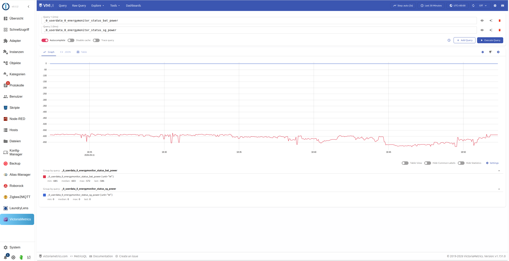

# ioBroker.victoriametrics

<!-- These badges need acceptance into the official ioBroker repository resp. Weblate and
     therefore don't work yet - uncomment once either of these steps has happened:
-->

Schreibt den Verlauf von ioBroker-Datenpunkten nativ in [VictoriaMetrics](https://victoriametrics.com/) – über die [JSON-Lines-Import-API](https://docs.victoriametrics.com/#how-to-import-data-in-json-line-format) – mit echten Prometheus-Labels anstelle von Feldnamensuffixen (wie sie beispielsweise beim Schreiben über die InfluxDB-Kompatibilitätsschicht entstehen). `Living_Room_Temperature_value`).

Puffert und schreibt Datenpunktänderungen an VictoriaMetrics und beantwortet Fragen. `getHistory()` Anfragen (damit vis-Diagramm-Widgets diesen Adapter direkt abfragen können) – Details und bekannte Einschränkungen finden Sie im [Abschnitt „Lesepfad“](#read-path) weiter unten. Für Visualisierungen außerhalb von vis (z. B. Grafana) verwenden Sie stattdessen eine direkte Abfrage von VictoriaMetrics über PromQL. Der Adapter ist im _aktuellen_ (Beta-)Repository von ioBroker verfügbar.

Dokumentation in anderen Sprachen: [Deutsch](https://github.com/seaspotter/ioBroker.victoriametrics/blob/main/docs/de/victoriametrics.md)

## Anforderungen

- Eine laufende VictoriaMetrics-Instanz (Einzelknoten), erreichbar über HTTP(S) – siehe [Installation von VictoriaMetrics](#installing-victoriametrics) unten
- ioBroker js-controller >= 6.0.11, Admin >= 7.7.2, Node.js >= 22.19.0

## Installation von VictoriaMetrics

VictoriaMetrics läuft als einzelne, in sich geschlossene Binärdatei/Docker-Image – eine separate Datenbankserver-Einrichtung wie bei InfluxDB ist nicht erforderlich. Offizielle Installationsanleitungen für alle Plattformen (Linux-Binärdatei, Docker, Kubernetes Helm-Chart usw.) finden Sie in der [VictoriaMetrics-Dokumentation](https://docs.victoriametrics.com/victoriametrics/single-server-victoriametrics/) .

### Über Docker

```bash
docker run -d --name victoriametrics \
  -p 8428:8428 \
  -v victoria-metrics-data:/victoria-metrics-data \
  victoriametrics/victoria-metrics:latest \
  --storageDataPath=/victoria-metrics-data \
  --retentionPeriod=100y
```

VictoriaMetrics ist dann erreichbar unter `http://<docker-host>:8428` (Gesundheitscheck: `http://<docker-host>:8428/health` VMUI: `http://<docker-host>:8428/vmui/` Offizielles Docker-Image: [victoriametrics/victoria-metrics auf Docker Hub](https://hub.docker.com/r/victoriametrics/victoria-metrics/) . Für den dauerhaften Betrieb verwenden Sie bitte ein Volume/Bind-Mount. `-storageDataPath` (siehe oben) und, abhängig von Ihrer Umgebung, ein `docker-compose.yml` mit `restart: unless-stopped` Die

### Docker wird vom Adapter verwaltet

Der Adapter kann, wie die InfluxDB- und SQL-Adapter, einen eigenen VictoriaMetrics-Container starten und verwalten. Docker muss auf dem ioBroker-Host installiert sein. `iobroker` Der Benutzer muss zur Nutzung berechtigt sein (ausführen). `iob fix` (falls dies nicht der Fall ist).

1. Öffnen Sie die Instanzeinstellungen und aktivieren Sie auf der Registerkarte „Verbindung“ die Option „ **Selbstgehostetes VictoriaMetrics in Docker verwenden** “. Die Verbindungsfelder (Protokoll, Host, Port, Authentifizierung) sind dann ausgeblendet, da der Adapter die Verbindung selbst konfiguriert.
2. Passen Sie bei Bedarf das **VictoriaMetrics Docker-** Panel an und speichern Sie die Einstellungen. Der Adapter erstellt und startet den Container.

| Einstellung                                           | Standard    | Beschreibung                                                                                                                                                                                                                                                                                      |
| ----------------------------------------------------- | ----------- | ------------------------------------------------------------------------------------------------------------------------------------------------------------------------------------------------------------------------------------------------------------------------------------------------- |
| Container auf IP-Adresse starten                      | `127.0.0.1` | Der Container ist nur von diesem Host aus erreichbar. `0.0.0.0` oder die IP-Adresse des Hosts, um VictoriaMetrics (VMUI, andere Tools) von einem anderen Computer aus zu erreichen – **nur in einem vertrauenswürdigen Netzwerk** , VictoriaMetrics unterliegt hier keinen Zugriffsbeschränkungen. |
| Hafen                                                 | `8428`      | Port, auf dem der Container auf dem Host veröffentlicht wird                                                                                                                                                                                                                                      |
| Aufbewahrungsfrist                                    | `100y`      | Bestanden als `-retentionPeriod` Eine einfache Zahl bedeutet Monate, andernfalls addieren Sie eine Einheit. `h`, `d`, `w` oder `y` (z.B `12`, `90d`, `100y` Durch die Änderung wird der Container neu erstellt; die Daten bleiben erhalten.                                                           |
| Der Container wird gestoppt, wenn die Instanz stoppt. | aus         | Lassen Sie diese Option deaktiviert, wenn andere Tools dieselben VictoriaMetrics verwenden.                                                                                                                                                                                                       |
| Docker-Image automatisch aktualisieren                | An          | Zieht die neueste `victoriametrics/victoria-metrics` Bild beim Start des Adapters                                                                                                                                                                                                                  |

- Die Daten befinden sich im Docker-Volume. `victoriametrics_data` (mit dem Instanznamen vorangestellt, z. B. `iob_victoriametrics_0_victoriametrics_data`) und übersteht Aktualisierungen und die Neuerstellung des Containers. Das Volume ist in den ioBroker-Backups enthalten.
- Docker ist **standardmäßig deaktiviert** ; für bestehende Installationen wird nichts erstellt.
- Das Deaktivieren dieser Option löscht weder den Container noch die Daten.
- Die Schaltfläche „Verbindung testen“ ist bei aktiviertem Docker ausgeblendet, da der Container vor dem ersten Start nicht existiert. Der Status `info.connection` zeigt an, ob VictoriaMetrics erreichbar ist.
- Der VMUI-Link in der Admin-Seitenleiste funktioniert auch mit der Docker-Option: Solange diese aktiviert ist, synchronisiert der Adapter die (versteckten) Verbindungseinstellungen mit dem Container, sodass der Administrator den Link daraus erstellen kann. Mit **„Container auf IP starten“** `0.0.0.0` Der Hostname des ioBroker-Hosts wird verwendet. Eine Änderung führt zu einem einmaligen Neustart der Instanz. Wenn Sie die Docker-Option später deaktivieren, bleiben diese Werte in den Verbindungseinstellungen erhalten – verwenden Sie dann Ihren eigenen Server.

### Ohne Docker

Laden Sie die statisch gelinkte Binärdatei für Ihre Plattform von der [GitHub-Releases-Seite](https://github.com/VictoriaMetrics/VictoriaMetrics/releases) herunter, entpacken Sie sie und starten Sie sie:

```bash
./victoria-metrics-prod --storageDataPath=/path/to/data --retentionPeriod=100y
```

Ausführliche Installationsanleitungen (inkl. systemd-Dienst, Kubernetes, Cluster-Setup) finden Sie in der [offiziellen Dokumentation](https://docs.victoriametrics.com/victoriametrics/single-server-victoriametrics/#how-to-start-victoriametrics) .

## Konfiguration

### Registerkarte „Verbindung“

| Feld                                      | Beschreibung                                                     |
| ----------------------------------------- | ---------------------------------------------------------------- |
| Protokoll                                 | `http` oder `https`                                               |
| Host / IP-Adresse                         | Hostname/IP-Adresse der VictoriaMetrics-Instanz, ohne Protokoll  |
| Hafen                                     | Standard: `8428`                                                  |
| Verwenden Sie die Basisauthentifizierung. | Aktiviert Benutzername/Passwort (VictoriaMetrics) `-httpAuth.*`) |
| Zeitüberschreitung (ms)                   | HTTP-Anfrage-Timeout                                             |

Die Schaltfläche **„Verbindung testen“** überprüft die Verbindung von VictoriaMetrics. `/health` Der Endpunkt verwendet die aktuell eingegebenen (noch nicht gespeicherten) Werte; im Erfolgsfall wird in der Meldung auch die aktuell konfigurierte Aufbewahrungsdauer angezeigt.

Beim Start des Adapters wird auch die aktuell auf dem VM-Server konfigurierte Aufbewahrungsdauer protokolliert (`VictoriaMetrics reachable at ... (Retention: 100y)`) – Nur-Lese-Anzeige, siehe unten [„Datenspeicherung](#retention) “, warum dies nicht über den Adapter geändert werden kann.

Die linke Seitenleiste von ioBroker.admin erhält ebenfalls einen Menüeintrag **„VictoriaMetrics“** (ähnlich wie bei Node-RED/Zigbee2MQTT), der VMUI (die eigene Web-Oberfläche von VictoriaMetrics zum Ausführen von PromQL-Abfragen, Diagrammen usw.) direkt einbettet. `http://<host>:<port>/vmui/` **Hinweis:** Wenn ioBroker.admin über HTTPS, VictoriaMetrics aber nur über HTTP läuft, blockiert der Browser die Einbettung (Schutz vor gemischten Inhalten) und öffnet stattdessen eine leere Seite. Die einzige Lösung besteht darin, VictoriaMetrics ebenfalls über HTTPS erreichbar zu machen – im Adapter selbst gibt es keine Umgehungslösung.



### Registerkarte „Schreibverhalten“

| Feld                          | Beschreibung                                               |
| ----------------------------- | ---------------------------------------------------------- |
| Intervall eingeben (Sekunden) | Wie oft gepufferte Werte in einem Batch geschrieben werden |
| Maximale Puffergröße (Punkte) | Löst beim Erreichen einen sofortigen Schreibvorgang aus.   |

### Verlauf für einen Datenpunkt aktivieren

Öffnen Sie in der Objektstruktur die Registerkarte **„Verlauf“** für den gewünschten Datenpunkt, wählen Sie diesen Adapter aus und aktivieren Sie ihn über den Schalter **„Aktiviert“** .

| Feld                                         | Beschreibung                                                                                                                                                                                 |
| -------------------------------------------- | -------------------------------------------------------------------------------------------------------------------------------------------------------------------------------------------- |
| Entprellzeit (ms, optional)                  | Der Wert wird erst dann protokolliert, wenn er sich über einen bestimmten Zeitraum nicht verändert hat (es wird auf einen "stabilisierten" Wert gewartet, bevor er gespeichert wird).        |
| Blockzeit (ms, optional)                     | Ignoriert neue Werte für den angegebenen Zeitraum nach dem letzten geschriebenen Wert (Ratenbegrenzung).                                                                                     |
| Werte darunter/darüber ignorieren (optional) | Schwellenwertfilter, z. B. um offensichtliche Ausreißer bei Sensoren zu verwerfen                                                                                                            |
| Nullwerte (0) ignorieren                     | Überspringt Werte, die genau 0 sind.                                                                                                                                                         |
| Metrikname (optional)                        | Überschreibt die Metrik (`__name__`) automatisch aus der Objekt-ID abgeleitet, siehe unten                                                                                                  |
| Auf Dezimalstellen runden (optional)         | Rundet den Wert vor dem Schreiben; leer lassen für keine Rundung                                                                                                                             |
| Mindestwechsel (optional)                    | Werte, die sich um weniger als diesen Betrag vom zuletzt geschriebenen Wert unterscheiden, werden nicht geschrieben; leer lassen für keine Filterung.                                        |
| Nur Protokolländerungen                      | Schreibt nur dann einen Wert, wenn dieser sich vom zuletzt geschriebenen Wert unterscheidet.                                                                                                 |
| Relog-Intervall (ms, optional)               | Wirkt nur, wenn „Nur Änderungen protokollieren“ aktiviert ist: Schreibt spätestens nach dieser Zeit wieder einen unveränderten Wert, sodass in den Diagrammen keine Lücken angezeigt werden. |

Entprellzeit und Blockzeit lassen sich mit den anderen Filtern kombinieren: Die Entprellzeit verzögert das Schreiben, bis der Wert eine Weile stabil ist; die Blockzeit begrenzt die maximale Schreibhäufigkeit eines Datenpunkts, unabhängig davon, ob er sich ändert. „Nur Änderungen protokollieren“ ist unabhängig von „Minimale Änderung“ verwendbar: Erstere schreibt nur bei einer _exakten_ Wertänderung (mit optionaler periodischer Neuprotokollierung), letztere filtert Änderungen unterhalb eines _Schwellenwerts_ heraus.

### Registerkarte „Standardeinstellungen“

Die gleichen Felder (mit Ausnahme des Metriknamens) können auch **instanzweit** im Konfigurationsreiter „Standardeinstellungen“ der Instanz festgelegt werden. Sie gelten für alle Datenpunkte, die im Verlauf-Reiter kein eigenes Feld festlegen – es muss also nicht jeder einzelne Datenpunkt konfiguriert werden. Der Wert eines Datenpunkts überschreibt immer den instanzweiten Standardwert.

## Ableitung des metrischen Namens

Der Prometheus-Metrikname (`__name__`) wird wie folgt bestimmt:

1. Wenn ein **Metrikname** (`aliasId` Wenn im Verlauf-Tab eine Einstellung vorgenommen wird, wird diese verwendet.
2. Andernfalls wird die **ioBroker-Objekt-ID** verwendet (nicht der Objektname, da dieser sich unbemerkt ändern und die Zeitreihe stillschweigend aufteilen könnte).

Der gewählte Name wird dann normalisiert: in Kleinbuchstaben umgewandelt, `.` wird `_` Jede Folge ungültiger Zeichen wird zu einem einzigen Zeichen zusammengefasst. `_`, führende/nachfolgende `_` werden entfernt, und ein `_` wird vorangestellt, wenn das Ergebnis mit einer Ziffer beginnt.

Beispiel: `javascript.0.Room Temperature` →`javascript_0_room_temperature` Für einen kurzen, beschreibenden Namen wie `room_temperature` Verwenden Sie das Feld **„Metrikname“** .

## Datentypverarbeitung

Die Kennzahlen von VictoriaMetrics sind im Wesentlichen numerischer Natur:

- **Die Zahlen** werden unverändert geschrieben.
- **Boolesche Werte** werden umgewandelt in `0.0` /`1.0` Die
- **Zeichenketten** werden als Zahl interpretiert (z. B. `"21.5"` →`21.5` Zeichenketten, die nicht analysiert werden können, werden mit einer Warnung im Protokoll übersprungen (es wird keine Zeichenkettenbezeichnung geschrieben, um eine Kardinalitätsexplosion zu vermeiden).

A `unit` Die Bezeichnung wird auch automatisch gesetzt, wenn das ioBroker-Objekt eine Einheit definiert (`common.unit`).

## Schutz vor Verbindungsverlust und Datenverlust

Die Werte werden zunächst in einem Puffer gesammelt und dann in einem Batch an VictoriaMetrics geschrieben, und zwar im konfigurierten Schreibintervall (oder sobald die maximale Puffergröße erreicht ist).

Schlägt ein Schreibvorgang fehl (z. B. weil die VM nicht erreichbar ist), wird für jeden betroffenen Datenpunkt ein Fehlerzähler erhöht:

- Unterhalb einer Zählung von `10` Der Punkt wird erneut zwischengespeichert und im nächsten Intervall erneut versucht.
- Einmal `10` Wird dieser Punkt erreicht, wird er verworfen und der Zähler zurückgesetzt (verhindert unbegrenztes Pufferwachstum, solange die VM nicht erreichbar ist).

Der Puffer bleibt auch bei einem ordnungsgemäßen Herunterfahren des Adapters erhalten und (auf höchstens einmal pro Minute begrenzt) nach fehlgeschlagenen Schreibversuchen, sodass ein schwerwiegender Absturz (z. B. ein Neustart des Containers) unter normalen Umständen nicht zu Datenverlusten führt.

## Lesepfad

Der Adapter antwortet `getHistory()` Anfragen (die von Visualisierungsdiagramm-Widgets aufgerufen werden) werden durch das Lesen von Datenpunkten der angeforderten Metrik von VictoriaMetrics und deren Übergabe an die gemeinsam genutzte Metrik beantwortet.[`@iobroker/aggregate`](https://github.com/ioBroker/aggregate) Bibliothek – dieselbe Bibliothek `iobroker.influxdb`, `iobroker.sql` Und `iobroker.history` Verwendung für Bucket-Aggregation (Durchschnitt/Minimum/Maximum/Gesamt/Anzahl/Perzentil/...), Lückenbehandlung und Grenzinterpolation. Das bedeutet, dass alle Standardaggregationstypen funktionieren, ohne dass dieser Adapter die Bucket-Logik selbst neu implementieren muss.

**Serverseitiges Pushdown:** für die Aggregationsmethoden `average`, `min`, `max`, `total` Und `count` mit bekannter Zeit `step` VictoriaMetrics berechnet das Ergebnis selbst über PromQL (`avg_over_time`, `min_over_time`, `max_over_time`, `sum_over_time`, `count_over_time`) – Der Adapter überträgt dann nur noch die fertigen Bucket-Werte anstelle jedes einzelnen Rohdatenpunkts. Für `onchange` /`none` /`minmax` sowie `percentile` /`quantile` /`integral` (es gibt kein direktes PromQL-Äquivalent), und wenn Pushdown fehlschlägt, wird transparent auf den Rohdatenpfad zurückgegriffen (`/api/v1/export` + JS-seitige Aggregation).

**Benutzerdefinierte Intervalle:** die `intervalBorders` Option `@iobroker/aggregate` (z. B. Kalendertage mit 23 oder 25 Stunden bei der Sommerzeitumstellung) werden unterstützt. Der Lesebereich wird von den Grenzen abgeleitet und der Rohdatenpfad verwendet, da Pushdown nur mit einem festen Schritt funktioniert.

** `id: '*'`:** Gibt die aktuellsten Rohwerte aller _derzeit in der Administration aktivierten_ Datenpunkte zurück (nicht verwaiste Metriken von zwischenzeitlich deaktivierten Datenpunkten), jeweils mit einem `id` Feld. Eine Aggregation wird in diesem Fall nicht unterstützt (ergibt keinen Sinn bei verschiedenen Metriken) – es werden immer Rohwerte zurückgegeben.

**Weitere bekannte Einschränkungen:**

- Antworten beinhalten nicht `ack` /`q` /`from` – Der Adapter speichert diese Felder überhaupt nicht in VictoriaMetrics.
- Kein Vorab-Flushen noch nicht geschriebener gepufferter Werte vor einer Abfrage (im Gegensatz zu `iobroker.influxdb`) - A `getHistory()` Ein direkt nach einer Zustandsänderung durchgeführter Aufruf erkennt den neuesten Wert möglicherweise erst im nächsten Schreibintervall.

### Zugriff über den JavaScript-Adapter

```javascript
// Last 50 raw values
sendTo('victoriametrics.0', 'getHistory', {
    id: 'javascript.0.exampleValue',
    options: {
        end: Date.now(),
        count: 50,
        aggregate: 'onchange',
    }
}, function (result) {
    for (var i = 0; i < result.result.length; i++) {
        console.log(result.result[i].ts + ' ' + result.result[i].val);
    }
});

// Hourly average of the last 24h
var end = Date.now();
sendTo('victoriametrics.0', 'getHistory', {
    id: 'javascript.0.exampleValue',
    options: {
        start: end - 24 * 3600000,
        end: end,
        aggregate: 'average',
        step: 3600000,
    }
}, function (result) {
    console.log(JSON.stringify(result.result));
});

// Last 20 raw values across all enabled datapoints
sendTo('victoriametrics.0', 'getHistory', {
    id: '*',
    options: {
        end: Date.now(),
        count: 20,
        addId: true,
    }
}, function (result) {
    for (var i = 0; i < result.result.length; i++) {
        console.log(result.result[i].id + ' ' + result.result[i].val);
    }
});
```

Unterstützt `options` Felder und `aggregate` Die Werte entsprechen dem ioBroker-Standard (siehe die [`iobroker.history`(Dokumentation](https://github.com/ioBroker/ioBroker.history#access-values-from-javascript-adapter) für die vollständige Referenz) – mit den oben genannten Einschränkungen.

## Datenverwaltung / Skriptschnittstellen

Der Adapter beantwortet außerdem drei zusätzliche ioBroker-Nachrichtenbefehle (`sendTo` z. B. für Skripte oder Migrationswerkzeuge:

### Merkmale

Fähigkeitserkennung:

```javascript
sendTo('victoriametrics.0', 'features', {}, function (result) {
    console.log(JSON.stringify(result.supportedFeatures)); // ['storeState', 'deleteAll']
});
```

### storeState

Schreibt einen oder mehrere historische Datenpunkte, z. B. um alte Historien aus einer anderen Quelle (z. B. InfluxDB) zu importieren:

```javascript
sendTo('victoriametrics.0', 'storeState', {
    id: 'javascript.0.exampleValue',
    state: { ts: 1690000000000, val: 512.3 },
    rules: true, // apply rounding + threshold/zero filters (see below)
}, result => console.log(JSON.stringify(result)));

// also as a batch for the same id:
sendTo('victoriametrics.0', 'storeState', {
    id: 'javascript.0.exampleValue',
    state: [
        { ts: 1690000000000, val: 512.3 },
        { ts: 1690000060000, val: 498.1 },
    ],
}, result => console.log(JSON.stringify(result)));

// or as an array of multiple ids:
sendTo('victoriametrics.0', 'storeState', [
    { id: 'javascript.0.a', state: { ts: 1690000000000, val: 1 } },
    { id: 'javascript.0.b', state: { ts: 1690000000000, val: 2 } },
], result => console.log(JSON.stringify(result)));
```

`rules: true` Wendet Rundungs- und Schwellenwert-/Nullfilter an (Wertgültigkeit, auch für Importe nützlich); Entprellzeit/Blockzeit/Mindeständerung werden **immer** ignoriert, da diese für Live-Statusänderungen konzipiert sind und für rückdatierte Massenimporte keinen Sinn ergeben. Erfordert nicht, dass der Datenpunkt aktuell für den Live-Verlauf aktiviert ist. Bei einem Teilfehler ist die Antwort `{error, errors: [...], successCount}` bei vollem Erfolg`{success: true,
successCount}` Die

### deleteAll

Löscht den gesamten Verlauf eines Datenpunkts, der in VictoriaMetrics gespeichert ist:

```javascript
sendTo('victoriametrics.0', 'deleteAll', { id: 'javascript.0.exampleValue' },
    result => console.log(JSON.stringify(result)));

// also as an array of multiple ids:
sendTo('victoriametrics.0', 'deleteAll', [
    { id: 'javascript.0.a' },
    { id: 'javascript.0.b' },
], result => console.log(JSON.stringify(result)));
```

**Absichtlich nicht umgesetzt:** `delete` /`deleteRange` /`update` (Einzelpunktlöschung/-bearbeitung, wie sie die InfluxDB-Admin-Oberfläche beim Klicken auf einen Diagrammpunkt anbietet). VictoriaMetrics kann technisch gesehen keine einzelnen Datenpunkte löschen oder bearbeiten – nur ganze Zeitreihen per Label-Matching, da die Speicherung auf unveränderlichen, zeitlich sortierten Blöcken basiert (ähnlich wie bei Prometheus). Das „Löschen eines einzelnen Punktes“ würde in Wirklichkeit die gesamte Zeitreihe löschen – das wäre überraschend und gefährlich, daher wird diese Funktion bewusst weggelassen.

## Zurückbehaltung

Die Datenspeicherung bei VictoriaMetrics ist ein **serverseitiges Startflag** (`-retentionPeriod` des VM-Prozesses selbst, der zur Laufzeit nicht über die HTTP-API geändert werden kann (im Gegensatz zu z. B. InfluxDB, wo der Adapter aktiv einen Wert festlegen kann über `ALTER RETENTION POLICY` Dieser Adapter zeigt daher nur die aktuell konfigurierte Aufbewahrungsdauer schreibgeschützt an – um sie zu ändern, muss die VM mit einer anderen Aufbewahrungsdauer neu gestartet werden. `-retentionPeriod` Wert (eigener Docker: ändern Sie den `--retentionPeriod=...` Parameter in `docker run` /`docker-compose.yml` und den Container neu erstellen; mit der [Docker-Option des Adapters](#docker-managed-by-the-adapter) : das Feld **Aufbewahrungsdauer** ändern).

Die aktuelle Speicherdauer ist an drei Stellen sichtbar (alle schreibgeschützt, einmalig ausgelesen). `/flags` Endpunkt beim Start des Adapters):

- Datenpunk&#x74;** `<instance>.info.retention` ** (Zeichenkette, z. B.) `"100y"`) – für Skripte/vis
- Logeintrag beim Start (`VictoriaMetrics reachable at ... (Retention: 100y)`)
- Erfolgsmeldung der Schaltfläche **„Verbindung testen“** auf der Registerkarte „Verbindung“.

**Details:**

- **Standardaufbewahrungsdauer** , falls `-retentionPeriod` ist nicht festgelegt: **1 Monat (31 Tage)** .
- **Minimum** : 24 Stunden/1 Tag. VictoriaMetrics unterstützt keine „unbegrenzte“ Datenspeicherung im engeren Sinne, aber beliebig hohe Werte sind möglich, z. B. `-retentionPeriod=100y` Die
- Die Daten werden **monatsweise partitioniert** und jeweils am ersten Tag des neuen Monats gelöscht – nicht sofort nach Erreichen des Limits. Die maximale Festplattennutzung beträgt daher `retentionPeriod + 1 month` Die
- Eine bestehende Aufbewahrungsfrist kann jederzeit **verlängert** werden, ohne dass Daten verloren gehen. Wird sie **verkürzt** , werden Daten außerhalb des neuen Zeitraums mit dem nächsten Monatswechsel gelöscht.
- Vollständige Details: [VictoriaMetrics-Dokumentation, Abschnitt „Aufbewahrung“](https://docs.victoriametrics.com/victoriametrics/single-server-victoriametrics/#retention) .

## Weitere bekannte Einschränkungen

- Keine Unterstützung für mehrere Cluster (vminsert/vmselect) – nur Einzelknoten-Ziel.
- Kostenlose, pro Datenpunkt konfigurierbare Zusatzbezeichnungen (über die `unit`) sind nicht implementiert.

## Entwicklung

| Skript                     | Beschreibung                                                                                                                                                               |
| -------------------------- | -------------------------------------------------------------------------------------------------------------------------------------------------------------------------- |
| `npm run build`            | Kompiliert die TypeScript-Quellen in `src/` Zu `build/` (Vor dem Starten des Adapters erforderlich)                                                                          |
| `npm run lint`             | ESLint                                                                                                                                                                     |
| `npm run check`            | Typprüfung (`tsc --noEmit`)                                                                                                                                               |
| `npm test`                 | Unit-Tests (`npm run test:js`) und Paketprüfungen (`npm run test:package`)                                                                                               |
| `npm run test:integration` | Startet den erstellten Adapter in einem Test-JS-Controller gegen ein simuliertes VictoriaMetrics-Objekt.                                                                   |
| `npm run dev-server`       | Beginnt[`dev-server`](https://github.com/ioBroker/dev-server) für einen lokalen Testlauf inkl. Admin-Oberfläche                                                            |
| `npm run release`          | Erstellt eine Release-Version (Versionserhöhung, Changelog-/News-Synchronisierung, Git-Tag) über[`@alcalzone/release-script`](https://github.com/AlCalzone/release-script) |

### Codestruktur

| Datei                       | Zweck                                                                                           |
| --------------------------- | ----------------------------------------------------------------------------------------------- |
| `src/main.ts`               | Adapterklasse: Lebenszyklus, Abonnements, Pufferung, Leerung, Nachrichtenverteilung             |
| `src/lib/filters.ts`        | Wertfilter pro Datenpunkt (Schwellenwerte, Rundung, Mindeständerung, nur Änderungen, Blockzeit) |
| `src/lib/vmClient.ts`       | HTTP-Client für die VictoriaMetrics-API                                                         |
| `src/lib/history.ts`        | `getHistory` einschließlich PromQL-Pushdown                                                     |
| `src/lib/dataManagement.ts` | `storeState`, `deleteAll`, `features`                                                          |
| `src/lib/buffer.ts`         | Schreibpuffer und Importnutzlast                                                                |
| `src/lib/metricName.ts`     | Ableitung von Metriknamen und -bezeichnungen                                                    |
| `src/lib/config.ts`         | Konstanten- und Timervalidierung                                                                |

## Changelog
### 0.7.0 (2026-11-16)
* (SeaSpotter) Code review and cleanup: removed unused code, merged duplicated logic (value filters in `lib/filters.ts`, HTTP error handling, datapoint lookups, timer validation), shortened and translated code comments; no functional changes except the two items below
* (SeaSpotter) `getHistory`: supports the `intervalBorders` option of `@iobroker/aggregate`; an aggregate name like `constructor` no longer selects a non-existent PromQL pushdown
* (SeaSpotter) Added unit tests for filters, buffer, HTTP client and `getHistory`, and an integration test that writes a state change to a mock VictoriaMetrics
* (SeaSpotter) Dependency updates (axios 1.21.1, `@iobroker/aggregate` 1.1.0, `@iobroker/testing` 6.3.2, TypeScript 6.0, others); README and German manual updated

### 0.6.1 (2026-11-08)
* (SeaSpotter) Raised the minimum Node.js version to 22.19.0, as required by `@iobroker/plugin-docker` (flagged by the repository checker, W0069)

### 0.6.0 (2026-11-05)
* (SeaSpotter) New: optional self-hosted VictoriaMetrics in Docker, managed by the adapter like in the InfluxDB and SQL adapters (retention period configurable, default `100y`); Admin >= 7.7.2 required (feature request #26)
* (SeaSpotter) Set `common.nogit` in `io-package.json`: the compiled `build/` directory is not committed, so the adapter is installable from npm only (flagged by the repository checker, E5019)

### 0.5.0 (2026-11-04)
* (SeaSpotter) Rewrote the adapter in TypeScript (sources in `src/`, compiled to `build/`); no functional changes

### 0.4.5 (2026-10-02)
* (SeaSpotter) Translated one remaining German error string in `getHistory`'s invalid-id response (`lib/history.js`) that the review's log/sendTo/errors.push sweep had missed - it's returned to the caller via `sendTo`, same category as the `dataManagement.js` fix in 0.4.4
* (SeaSpotter) Added full i18n names for the `info` channel and the `adminTab` (flagged by the official repo review's object-structure check)

Older changelog entries can be found in CHANGELOG_OLD.md.

## License
MIT License

Copyright (c) 2026 SeaSpotter <seatowage@gmail.com>

Permission is hereby granted, free of charge, to any person obtaining a copy
of this software and associated documentation files (the "Software"), to deal
in the Software without restriction, including without limitation the rights
to use, copy, modify, merge, publish, distribute, sublicense, and/or sell
copies of the Software, and to permit persons to whom the Software is
furnished to do so, subject to the following conditions:

The above copyright notice and this permission notice shall be included in all
copies or substantial portions of the Software.

THE SOFTWARE IS PROVIDED "AS IS", WITHOUT WARRANTY OF ANY KIND, EXPRESS OR
IMPLIED, INCLUDING BUT NOT LIMITED TO THE WARRANTIES OF MERCHANTABILITY,
FITNESS FOR A PARTICULAR PURPOSE AND NONINFRINGEMENT. IN NO EVENT SHALL THE
AUTHORS OR COPYRIGHT HOLDERS BE LIABLE FOR ANY CLAIM, DAMAGES OR OTHER
LIABILITY, WHETHER IN AN ACTION OF CONTRACT, TORT OR OTHERWISE, ARISING FROM,
OUT OF OR IN CONNECTION WITH THE SOFTWARE OR THE USE OR OTHER DEALINGS IN THE
SOFTWARE.