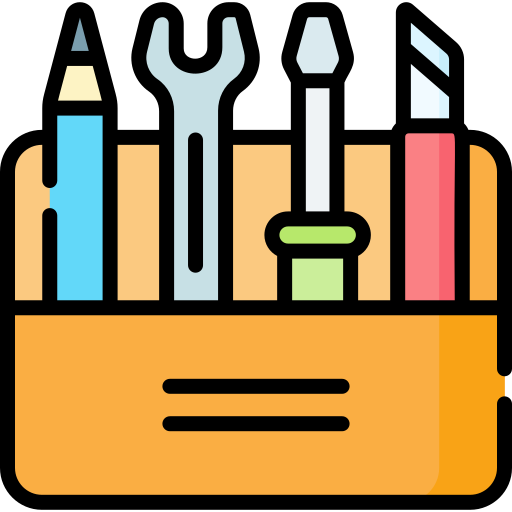

# Sammlung von Widgets für ioBroker.vis 2.0

<h2 align="center">Widgets for ioBroker.vis 2.0</h2>

📖 **[Ausführliche Dokumentation im GitHub Wiki](https://github.com/Steiger04/ioBroker.vis-2-widgets-collection/wiki)**

## Widgets

### Zustand

### Schaltflächengruppe

### Schieberegler

### Eingang

### Schalten

### Kontrollkästchen

### Dialog

### Wählen

### RadioGroup

### Messgerät

### Licht

### JsonTable

### ECharts

---

## Anmerkungen

### KI-Assistent

Der KI-Assistent des vis-2-Editors (und externer MCP-Clients wie Claude Desktop) kann Ansichten mit Sammlungs-Widgets erstellen und deren Design ändern; benennen Sie die Menge `vis-2-widgets-collection` in Ihrer Anfrage. Die Sammlung selbst enthält keine KI. Zugriff, Beispielaufforderungen, Vorlagen und Einschränkungen: [KI-Assistent im Wiki](https://github.com/Steiger04/ioBroker.vis-2-widgets-collection/wiki/En-AI-Assistant) ( [Deutsch](https://github.com/Steiger04/ioBroker.vis-2-widgets-collection/wiki/De-AI-Assistant) ).

### ECharts: Werte aus Zeichenketten

Diagramme mit Zuständen vom Typ Zeichenkette werden nun korrekt dargestellt: `'23.5'`, `'23.5 °C'`, `'23,5'` Und `'true'` /`'false'` Alle Werte werden bei der gemeinsamen Eingabe aller Datenquellen (Verlauf, JSON-Serien, Tabellenspalten, gebundene Markierungszeilen) als Zahlen gelesen. Text ohne Zahlenwert wird als Lücke anstelle einer simulierten Nullzeile dargestellt. Eine Besonderheit bei der Eingabe im deutschen Format: Sobald die Zeichenkette einen Punkt enthält, wird dieser als Punkt-Dezimal-Zeichen interpretiert – ein Tausendertrennzeichen wie in …`'1.234,5'` Es handelt sich nicht um eine Hin- und Rückreise.

**Verlaufsaggregation von Zeichenkettenzuständen** : die serverseitigen Aggregationen (`average`, `max`, …) behalten möglicherweise keine Zeichenkettenwerte bei. Bis dies empirisch auf einem Live-Server überprüft wurde, konfigurieren Sie Zeichenketten-OIDs mit der `none` oder `onchange` Die Aggregation erfolgt so, dass die Rohdaten in die Tabelle gelangen – die Eingabe liest sie von dort aus.

---

## Changelog

### 3.3.1 (2026-11-17)

- (steiger04) Same content as 3.3.0, whose release build failed before it reached npm

### 3.3.0 (2026-11-17)

- (steiger04) Theme Studio: the new "Widget frame" section sets the frame of all widgets at once
- (steiger04) Attribute panel: frame settings show the value they inherit from the theme
- (steiger04) Existing widgets keep their frame settings and look unchanged
- (steiger04) The vis-2 AI assistant can set the widget frame of all widgets with the theme
- (steiger04) A widget without card no longer shows a shadow

### 3.2.0 (2026-11-15)

- (steiger04) Node.js 22 or newer is required
- (steiger04) Light: new light type `dimmer` for lamps that only dim (#22)

### 3.1.0 (2026-11-15)

- (steiger04) The vis-2 AI assistant can now build pages with these widgets
- (steiger04) The vis-2 AI assistant can now also change the theme if you name the set `vis-2-widgets-collection`
- (steiger04) Every widget shows a short tooltip in the palette
- (steiger04) Grid layout: widgets keep the height of their grid rows
- (steiger04) The theme now accepts only hex, `rgb()` and `hsl()` colors
- (steiger04) An open theme studio without unsaved changes now follows theme changes made elsewhere
- (steiger04) Many fixes across all widgets

### 3.0.2 (2026-11-11)

- (steiger04) Same content as 3.0.0; the release builds of 3.0.0 and 3.0.1 failed before they reached npm

## License

The MIT License (MIT)

Copyright (c) 2026 Steiger04 <steiger04@posteo.de>

Permission is hereby granted, free of charge, to any person obtaining a copy
of this software and associated documentation files (the "Software"), to deal
in the Software without restriction, including without limitation the rights
to use, copy, modify, merge, publish, distribute, sublicense, and/or sell
copies of the Software, and to permit persons to whom the Software is
furnished to do so, subject to the following conditions:

The above copyright notice and this permission notice shall be included in
all copies or substantial portions of the Software.

THE SOFTWARE IS PROVIDED "AS IS", WITHOUT WARRANTY OF ANY KIND, EXPRESS OR
IMPLIED, INCLUDING BUT NOT LIMITED TO THE WARRANTIES OF MERCHANTABILITY,
FITNESS FOR A PARTICULAR PURPOSE AND NONINFRINGEMENT. IN NO EVENT SHALL THE
AUTHORS OR COPYRIGHT HOLDERS BE LIABLE FOR ANY CLAIM, DAMAGES OR OTHER
LIABILITY, WHETHER IN AN ACTION OF CONTRACT, TORT OR OTHERWISE, ARISING FROM,
OUT OF OR IN CONNECTION WITH THE SOFTWARE OR THE USE OR OTHER DEALINGS IN
THE SOFTWARE.