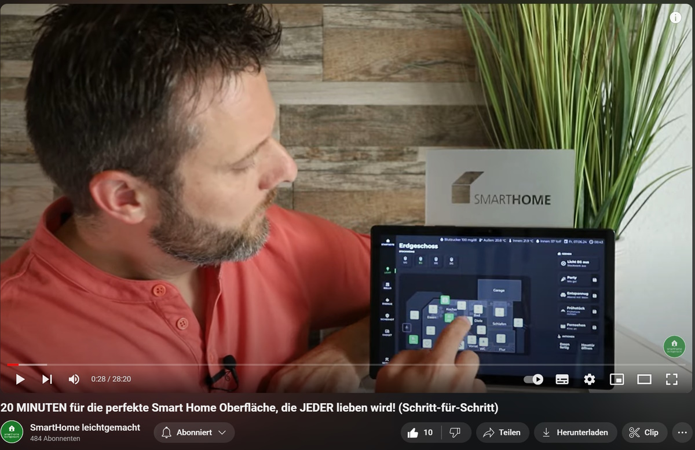
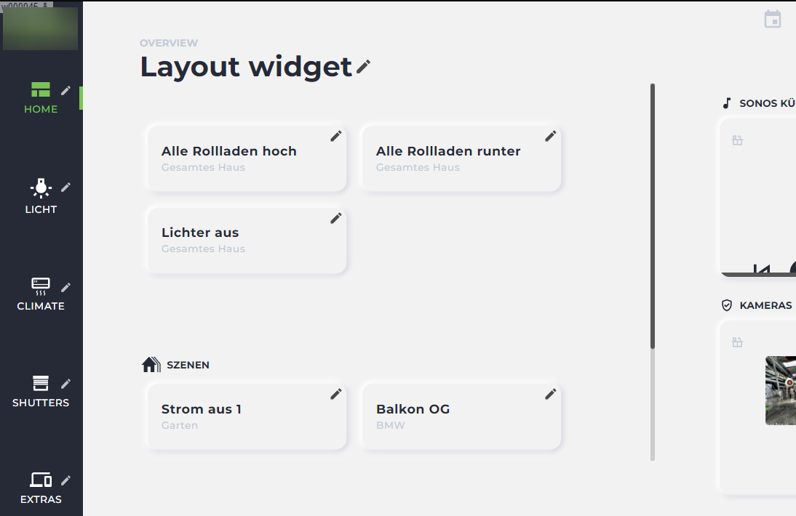
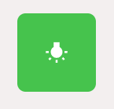
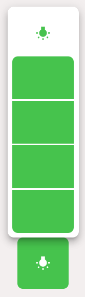
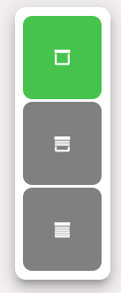
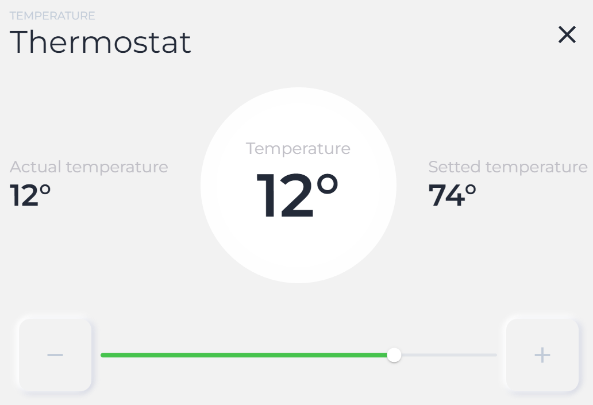
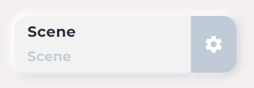
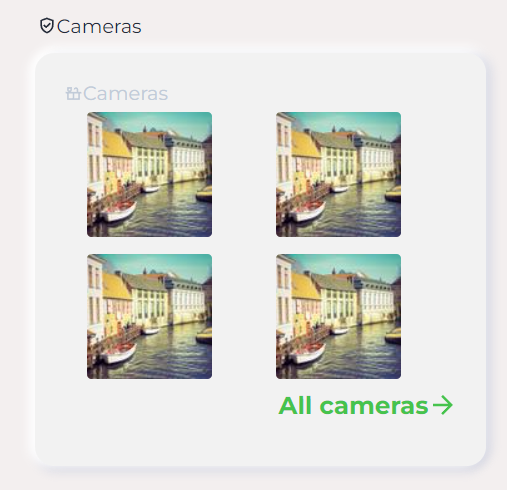
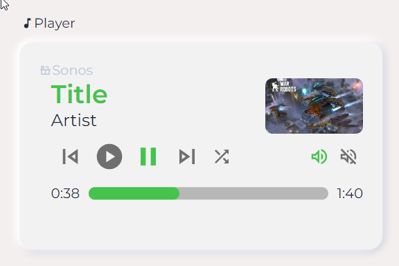

# Spezielle Jaeger Design-Widgets für ioBroker.vis 2.0

[Hier](https://www.youtube.com/playlist?list=PLddhldeLVrtl5Bhj6AAbkLabuIuyV0bVe) finden Sie Videos (auf Deutsch), die Ihnen die Verwendung der Widgets erklären.

Videos wie die Widgets verwendet werden können, kann man [hier](https://www.youtube.com/playlist?list=PLddhldeLVrtl5Bhj6AAbkLabuIuyV0bVe) finden.

Die englische Version finden Sie [hier](/#/docs/adapterref/iobroker.vis-2-widgets-jaeger-design/docs/README_de.md)

## Kommerzielle Nutzung

Bitte beachten Sie, dass es für diesen Adapter keine kostenlose Version gibt. Zum Verwenden dieser Widgets muss eine Lizenz erworben werden (aktueller Preis: 50 € inkl. MwSt.).\
&#x20;Sie können sie jedoch kostenlos installieren und im Editor ausprobieren.

## Überblick über die Erstellung einer Smart-Home-Schnittstelle mit dem „VIS-2 JAEGER Design Adapter“

### Anforderungen

- Ein ioBroker-System
- Der JAEGER Design Adapter (ca. 50 €)
- Grundkenntnisse in der Verwendung von ioBroker

### Einführung

Der JAEGER Design Adapter basiert auf dem vis-2 Adapter und ermöglicht die Erstellung von Benutzeroberflächen per Drag & Drop. Verschiedene Widgets können hinzugefügt und individuell angepasst werden, um Smart-Home-Geräte zu steuern.

### Grundstruktur der Schnittstelle

Die Benutzeroberfläche besteht aus mehreren Bereichen:

- **Hauptmenü** : Auf der linken Seite befindet sich eine Spalte mit Hauptmenüpunkten, die sich leicht erstellen lassen.
- **Statusleiste** : Oben können Sie verschiedene wichtige Statusanzeigen hinzufügen.
- **Mittlerer Bereich** : Hier können Szenen, Aktionen und Benachrichtigungen angezeigt werden. Die rechte Seite ist frei konfigurierbar und kann Informationen wie Sicherheit, Wetter, Haushaltsgeräte und Energieverbrauch anzeigen.

### Beleuchtung

Im Hauptmenü können verschiedene Etagen ausgewählt werden. Der Grundriss des Erdgeschosses zeigt alle Leuchten, dargestellt durch Symbole. Einige Symbole lassen sich nur ein- oder ausschalten, andere sind dimmbar. Durch langes Drücken auf ein Symbol öffnet sich ein Fenster mit einem Schieberegler zur Helligkeitsanpassung. Die Lichtszenen auf der rechten Seite sind leicht zugänglich, und die Lichteinstellungen können auch gespeichert werden:

### Jalousie

Im Menü „Jalousien“ wird der Beschattungsstatus angezeigt. Symbole zeigen die Position der Jalousien an. Durch Klicken auf ein Symbol öffnet sich ein Fenster, in dem Sie Höhe und Lamellenwinkel anpassen können.

### Energie

Im Menü „Energie“ sehen Sie die Raumtemperaturen der einzelnen Räume. Symbole zeigen die Ist- und Solltemperaturen sowie den Status von Heizung und Fenstern an. Durch Klicken auf ein Symbol öffnet sich ein Fenster, in dem Sie die Solltemperaturen ändern und weitere Funktionen wie Klimaanlage oder Warmluftheizung steuern können.

### Sicherheit

Im Menü „Sicherheit“ kann der Status der Fenster angezeigt werden. Geöffnete Fenster werden rot dargestellt.

### Zusätzliche Funktionen

Sie können auch frei definierbare Benutzeroberflächen erstellen, beispielsweise die Verbrauchsanzeige des „Verbrauchs“-Adapters oder die Anzeige von Nightscout für Diabetiker. Im Menü „Einstellungen“ lassen sich verschiedene Einstellungen vornehmen.

### YouTube-Tutorials

Für detaillierte Anweisungen und weitere Informationen wird empfohlen, die verlinkten YouTube-Tutorials anzusehen.

## Die Widgets

Der Adapter fügt der vis-2-Palette neun Widgets im **Designset „Jaeger“** hinzu. Beim Überfahren eines Widgets in der Palette mit der Maus wird unter dessen Vorschau eine Kurzbeschreibung angezeigt.

Alle Widgets verwenden dasselbe Farbschema. Nur das Layout-Widget enthält das vollständige Schema; alle anderen Widgets übernehmen entweder dessen Farben ( _Palette → Vom Widget_ ) oder definieren ihre eigenen. Fünf Schemata sind integriert: `green`, `blue`, `green-dark`, `blue-dark` Und `aurora` (Nachtblau mit Mintgrün).

### Layout

Der Rahmen um alles andere. Er stellt die komplette Benutzeroberfläche dar: das Hauptmenü links, die Statusleiste oben, die Etagenauswahl, die Startseite mit ihren Szenen und Aktionen, die frei konfigurierbare rechte Spalte und – auf einem Smartphone oder Tablet – eine ausziehbare Schublade anstelle der Menüspalte.

Es verfügt über ein einziges Attribut, **„Einstellungen“** , das den Editor öffnet, in dem die gesamte Benutzeroberfläche beschrieben wird: Menüeinträge, Etagen und deren Ansichten, Szenen, Aktionen, Infogruppen und die Farben. Verwenden Sie genau ein Layout-Widget pro Ansicht; standardmäßig füllt es die Ansicht vollständig aus.

### Zustand

Ein quadratisches Symbol für ein Objekt – den Baustein der Grundrisse. Ein Klick ändert den Wert; mit _„Bestimmten Wert schreiben“_ wird stattdessen ein fester Wert geschrieben, und _„Anzeigen, ob Wert festgelegt ist“_ hebt das Symbol hervor, solange dieser Wert aktiv ist.

- **Anzahl der Werte** — mehrere Werte, jeder mit eigenem Symbol, eigener Farbe, eigener Hintergrundfarbe und eigenem Tooltip.
- **Steuerungsdialog anzeigen** – anstatt eines Umschalters wird ein Dialog mit allen Werten geöffnet.
- **Keine Steuerung** – nur Anzeige, der Knopf kann nicht gedrückt werden.
- **Bitten Sie um eine Bestätigung** in Form eines eigenen Textes, bevor irgendetwas geschrieben wird.
- Eine optionale Bildunterschrift oberhalb oder unterhalb des Symbols.

### Dimmer

Helligkeitsregelung für eine dimmbare Lampe. Das Widget selbst zeigt die aktuelle Stufe als vertikalen Balken an; durch langes Drücken ( _Drückdauer_ ) öffnet sich das Popup mit dem Schieberegler, der in die konfigurierte Anzahl von **Abschnitten** unterteilt ist.

- **Speichertasten** – Tasten unterhalb des Schiebereglers für feste Helligkeitswerte, jeweils mit eigenem Symbol und Text. Der Wert stammt entweder aus einem Objekt oder wird direkt eingegeben.
- **Objekt-ID für EIN/AUS** und **Wert bei EIN** für Leuchten, deren Ein-/Ausschalter ein separates Objekt ist.
- Optional kann der Wert im Widget angezeigt, das Symbol gedreht und das Popup nach der Einstellung geschlossen werden.

### Verschluss

Das gleiche Prinzip gilt für Rollläden und Jalousien. Das Symbol zeigt die aktuelle Position an, wobei ein Rollladen-, Jalousien- oder Schattensymbol ausgewählt ist. **Die Schattenrollladen-ID** fügt ein zweites Objekt für den Lamellenwinkel hinzu, sodass Höhe und Lamellen im selben Popup eingestellt werden können.

Da die Aktuatoren unterschiedliche Interpretationen von 0 % haben, können Wert und Anzeige unabhängig voneinander invertiert werden – separat für die Höhe und für den Lamellenwinkel. Speichertasten speichern Höhe und Lamellenwinkel gemeinsam.

### Thermostat

Die Zieltemperatur wird als Drehregler angezeigt. Im Dialogfeld werden neben dem Zielwert die Ist-Temperatur, die Luftfeuchtigkeit und die Ventilstellung angezeigt. Zusätzlich stehen Plus-/Minus-Tasten und ein Schieberegler zur Verfügung. Minimal- und Maximalwert, Schrittweite und Einheit sind konfigurierbar; als Dezimaltrennzeichen kann ein Komma verwendet werden.

Darunter befindet sich Platz für weitere **Schaltflächen** – Boost, Abwesenheit, Klimaanlage, Heizungsfunktionen. Jede Schaltfläche hat ihr eigenes Objekt, ihren eigenen Wert, ihr eigenes Symbol, ihre eigene Beschriftung und ihren eigenen Stil.

### Szene

Ein breiter Button mit Titel und Untertitel, der eine Szene startet `scenes` Der Adapter schreibt einfach einen Wert. **Speichern** fügt rechts eine zweite Schaltfläche hinzu (das Zahnrad im Bild): Dadurch werden die aktuellen Zustände aller Elemente wieder in der Szene gespeichert.

Weitere Optionen: kein aktiver Zustand, schreiben `false` anstatt `true` Bitten Sie um eine Bestätigung per SMS und geben Sie den Zeitpunkt der letzten Änderung an.

### Kameras

Eine Karte mit einem Raster aus Kamerabildern. Jede Kamera stammt entweder von der `cameras` Adapter oder von einer freien URL, die auch aus einem Objekt gelesen werden kann und über ein eigenes Aktualisierungsintervall verfügt.

_Die Vollbildansicht_ öffnet ein einzelnes großes Kamerabild mit separater URL und eigenem Aktualisierungsintervall – so bleiben die Vorschaubilder klein. „Mehr anzeigen“ verlinkt zu einem anderen Widget oder einer anderen Seite.

### Aktuelle Nachrichten

Eine Karte mit RSS-Feed: Bild, Überschrift und Teaser pro Eintrag, scrollbar. Die Feed-URL wird direkt eingegeben oder aus einem Objekt gelesen und kann daher zur Laufzeit gewechselt werden. Das Aktualisierungsintervall ist konfigurierbar, und „Mehr“ führt zu einem Widget oder einer Seite.

### Spieler

Eine Mediaplayer-Karte mit Titel, Interpret, Cover, Wiedergabe/Pause, vorheriger/nächster Titel, Zufallswiedergabe, Stummschaltung, Lautstärkeregler und Anzeige der verstrichenen/Gesamtzeit. Jedes Element ist einem eigenen Objekt zugeordnet, sodass das Widget mit jedem Player-Adapter kompatibel ist – Sonos, Squeezebox, Alexa usw. Elemente, deren Objekt leer ist, werden nicht angezeigt.

<!--
    Placeholder for the next version (at the beginning of the line):
    ### **WORK IN PROGRESS**
-->

## Changelog
### 1.5.9 (2026-11-11)
* (bluefox) Info entries can show a symbol in front of the name or instead of it

### 1.5.8 (2026-11-10)
* (bluefox) The background of a floor or page view now reaches to the end when the view is scrolled
* (bluefox) Scenes and actions with "No active state" are shown pressed for a moment after a click
* (bluefox) Redesigned the layout editor: grouped navigation, lists with search, drag & drop, duplicate and delete, fields in cards, theme previews, undo/redo (Ctrl+Z/Ctrl+Y) and animated icons
* (bluefox) Added the dark theme "Aurora" (night blue with mint)
* (bluefox) Dark themes: popovers of dimmer and shutter, the thermostat mode menu and the player sliders take the theme colors; a custom theme with a dark background is detected as dark

### 1.5.7 (2026-11-04)
* (bluefox) Copying a submenu gives its items new IDs, so the copied pages no longer take the settings (e.g., included or excluded scenes) of the original pages
* (bluefox) Menu items with the same ID are repaired when the layout settings are opened or imported from JSON

### 1.5.6 (2026-11-03)
* (bluefox) Scene widgets placed in a page no longer get a too big font and save button on mobile phones

### 1.5.5 (2026-11-03)
* (bluefox) Dimmer: the popup shows the value in percent on the bar (can be hidden in the widget settings)
* (bluefox) Pages with "Include scenes" or "Include actions" show only the scenes and actions of the current floor, the same as with "Exclude"
* (bluefox) Menu settings: "Include scenes/actions" offers only the items assigned to floors and shows which ones are visible on every floor
* (bluefox) Updated packages

Older changes can be found in CHANGELOG_OLD.md

## License
Copyright (c) 2022-2026 bluefox <dogafox@gmail.com>
All rights reserved.

This is a commercial adapter. Use requires a license, see https://www.iobroker.com/productoverview.
The full license text can be found in the [LICENSE](https://github.com/ioBroker/ioBroker.vis-2-widgets-jaeger-design/blob/master/LICENSE) file.