# Material-Widgets für ioBroker.vis 2.0

## Widgets

### Knöpfe und Schalter

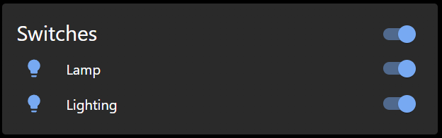

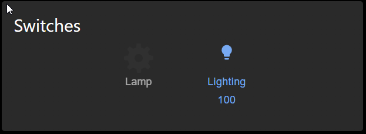

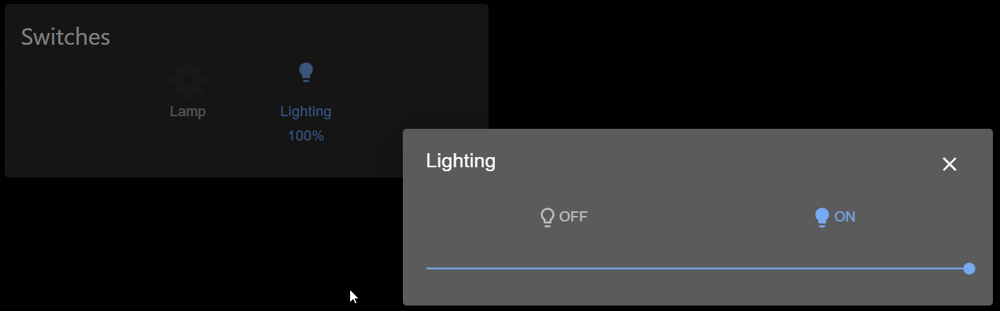

### Uhr

- Analog

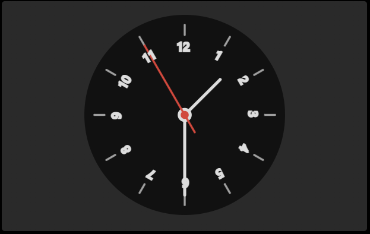

- Analoge Variante

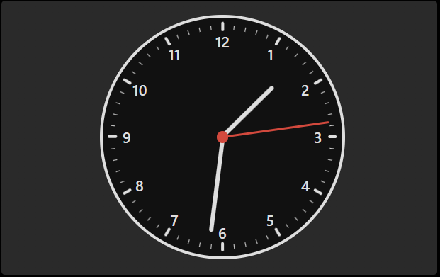

- Digital

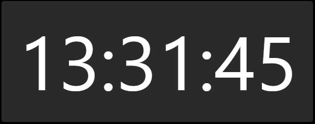

- Digital2 (SVG-Text)

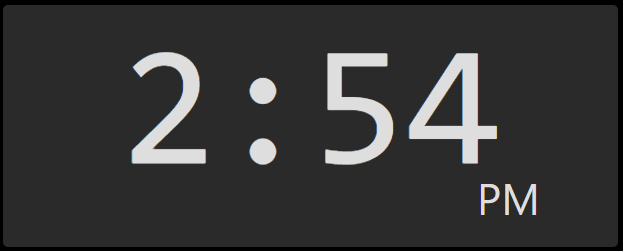

### Einfacher Zustand

Mit diesem Widget können Sie ein Gerät steuern. Boolescher Wert oder Zahl.

- Nummer

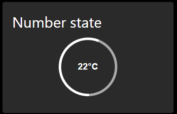

- Kontrolle

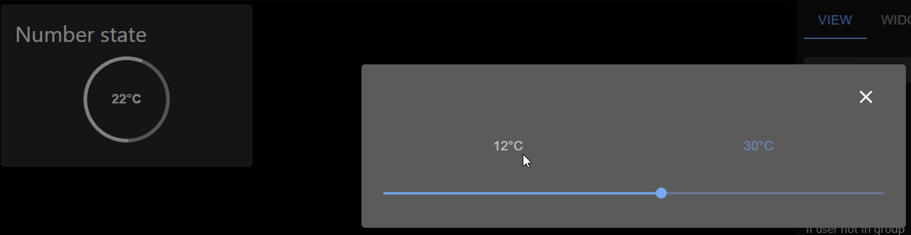

### Im Widget anzeigen

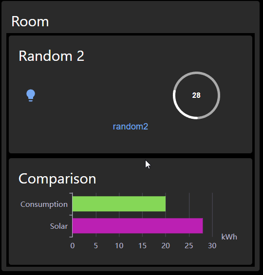

Nicht als Schaltfläche: Die Ansicht kann in voller Größe angezeigt werden, und Sie können die Elemente in der Ansicht steuern.

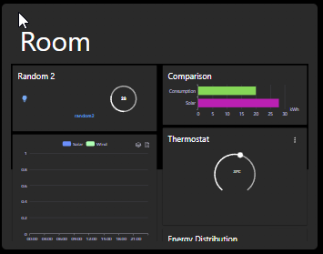

Als Schaltfläche: Sie können eine kleine Miniaturansicht anzeigen lassen, die durch Anklicken in voller Größe angezeigt wird.

### Thermostat

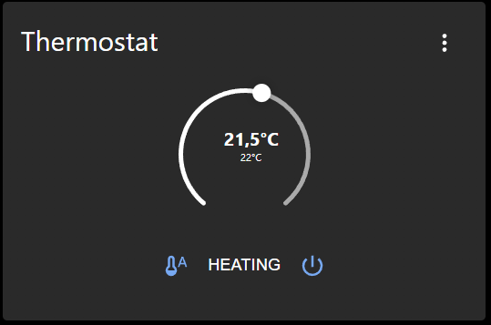

Zusätzlich kann, falls aktiviert, ein Verlauf angezeigt werden.

### Tatsächlicher Wert mit Diagramm

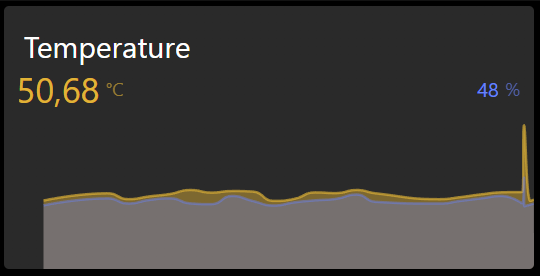

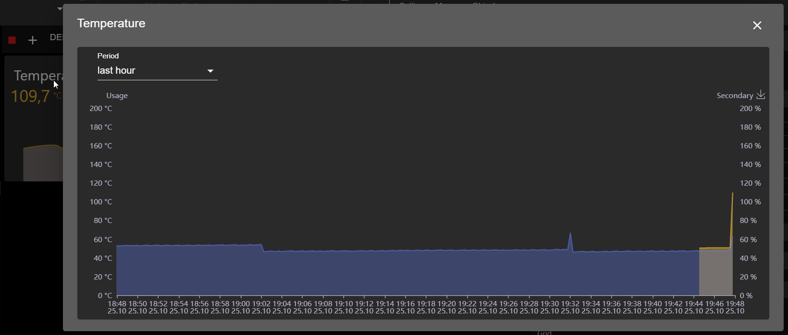

### Sicherheitskontrolle

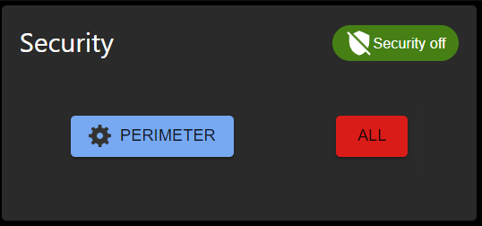

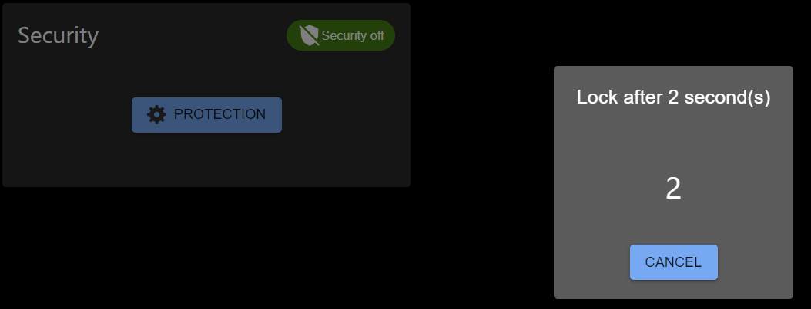

Sie können die Verzögerung in Sekunden angeben.

Bei Aktivierung wird die definierte ID mit der Anzahl der Verzögerungssekunden beschrieben. Nach Ablauf der Verzögerung wird die definierte ID auf 0 gesetzt und die Alarm-ID auf „true“ gesetzt.

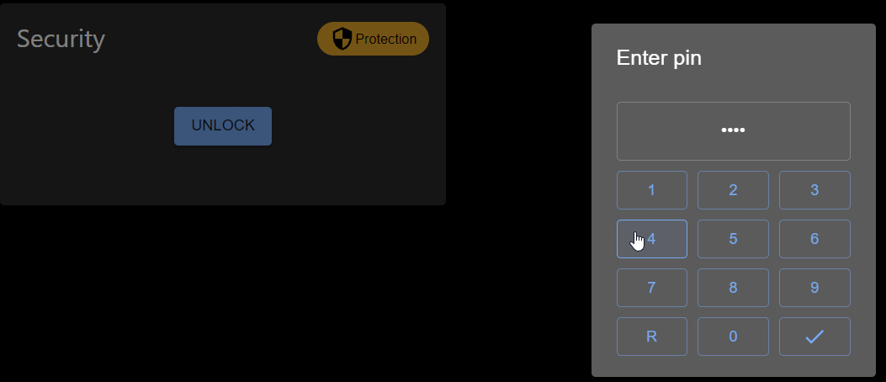

### Spieler

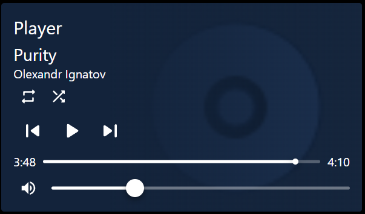

### Karte

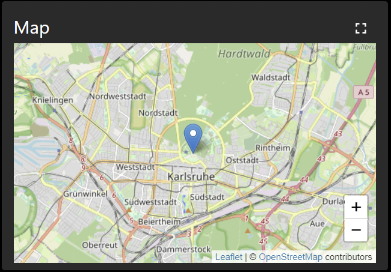

Position könnte als ein kombinierter Zustand definiert werden, wie zum Beispiel `9.2344;41.374652` -`longitude;latitude` oder als zwei getrennte Staaten.

### Kamera

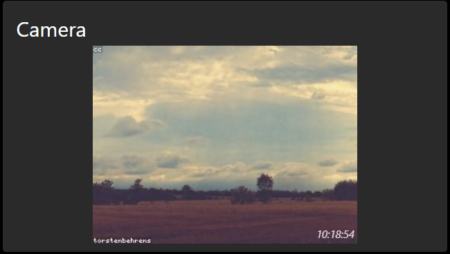

### HTML-Vorlage

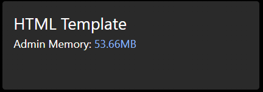

Mit der HTML-Vorlage kann beliebiger HTML-Code angezeigt werden. Zusätzlich können Sie mit diesem Widget auch ein Bild oder einen iFrame einbinden.

### Jalousie

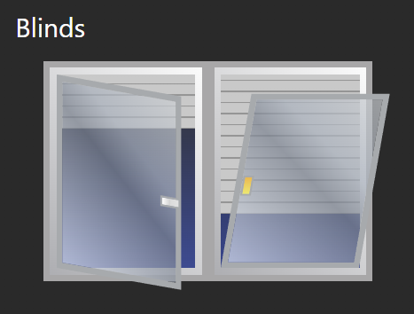

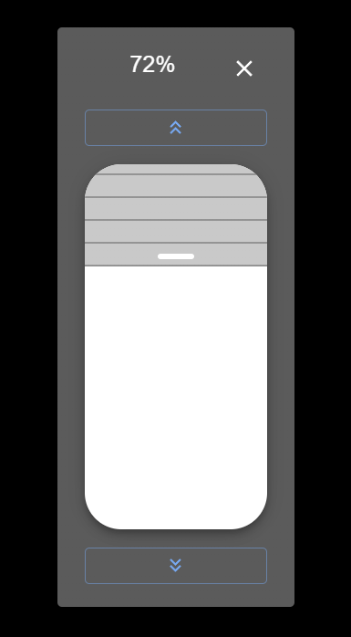

### Farblampe

Mit dem RGB-Lampen-Widget können Sie verschiedene Arten von RGB-Lampen steuern. Hier einige Beispiele:

- RGB-Farben werden in einem Zustand wie '#RRGGBB' festgelegt.
- Die R/G/B-Farben werden in verschiedenen Zuständen von 0 bis 255 eingestellt.
- RGBW als eine Variable wie '#RRGGBBWW'
- Die Farben R/G/B/W werden in verschiedenen Zuständen von 0 bis 255 eingestellt.
- Farbton/Sättigung/Helligkeit als 3 verschiedene Zustände
- Farbtemperatur als ein Zustand von 2700 bis 6500 oder definiert durch Minimum/Maximum des Objekts
- Der Weißmodus kann über einen speziellen Zustand verwendet werden, um zwischen RGB- und Weißmodus umzuschalten.

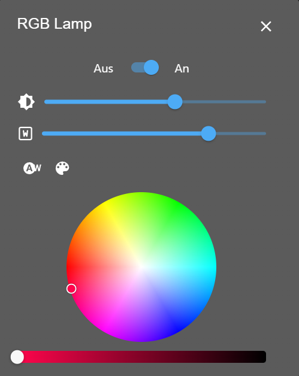

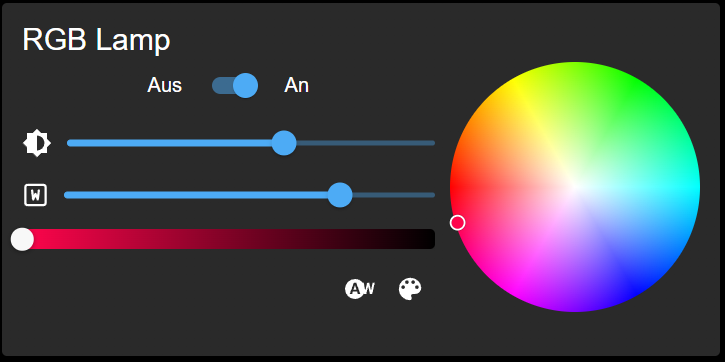

### Türschloss

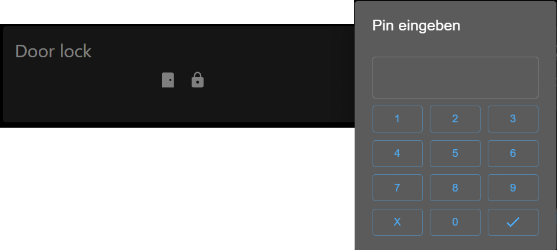

### Staubsauger

Dieses Widget ist primär für Xiaomi-Staubsauger gedacht. Es kann aber auch für jeden anderen Staubsauger verwendet werden.

Der einzige Unterschied besteht darin, dass Xiaomi die Zimmerreinigung unterstützt.

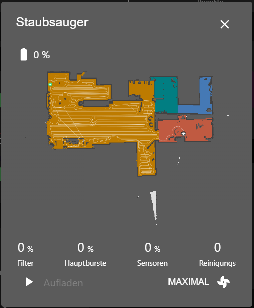

### Fernseher

Fernbedienung für einen Fernseher des Gerätetyps `tv` (z. B. vom Adapter) `samsungtv` Wählen Sie einen beliebigen Zustand des Fernsehers aus, und die anderen Zustände werden automatisch erkannt.

- **Kachel** : Name, Status, Ein-/Ausschalter und App-Tasten; ein Klick öffnet die Fernbedienung in einem Dialogfenster.
- **Fernbedienung** : Die vollständige Fernbedienung im Widget

Alle Funktionen der Fernbedienung (Eingänge, Pfeiltasten, Lautstärke, Ziffernblock, Apps usw.) lassen sich deaktivieren, und die angezeigten Apps und Eingänge können ausgewählt werden. Wenn der Fernseher ausgeschaltet ist, wird nur der Ein-/Ausschalter angezeigt.

### Zeitauswahl

## Todo

- Verlängern Sie Ihre Jalousien mit einem Rollladen

<!--
    Placeholder for the next version (at the beginning of the line):
    ### **WORK IN PROGRESS**
-->

## Changelog
### **WORK IN PROGRESS**

-   (@GermanBluefox) Added the TV widget, see [TV](#tv)
-   (@GermanBluefox) The icon of a device is shown again in "Actual", "Simple state", "Static", "Switches", "Security" and "Map", and in the widgets the wizard creates. An adapter writes `common.icon` relative to its own files (e.g. `icons/shellyplugsg3.png` of a Shelly plug), and the widgets looked for it next to the page of vis-2, so they showed a broken image
-   (@GermanBluefox) Switches: a click on the window of a line with type "blinds" opens the blinds dialog (#706)

### 2.0.4 (2026-10-19)

-   (@GermanBluefox) RGB light: the auto-detection does not overwrite the selected state anymore and takes the first matching state (#381)
-   (@GermanBluefox) Switches: brightness and white sliders use the maximum of the object, color temperature limits can be below 500 (#475)
-   (@GermanBluefox) Switches: the "switch" state is visible again for RGB and thermostat (#449)
-   (@GermanBluefox) Switches: boolean states with `read: false` or role `button` are detected as button, buttons work with touch and send only `true` (#614, #609)
-   (@GermanBluefox) Switches: `common.states` in the format "0:off;1:on" and numeric states are supported in the select (#607)
-   (@GermanBluefox) Charts read aggregated (min/max) values for periods over 30 minutes instead of raw data (#412)
-   (@GermanBluefox) Switches, Map and theme switcher unsubscribe correctly on unmount (#530)
-   (@GermanBluefox) Lock: added options to invert the lock state and the door sensor (#633)
-   (@GermanBluefox) Camera: the image is updated even if the cache refresh fails (#340)
-   (@GermanBluefox) Player: fixed the display conditions of "repeat" and "next"
-   (@GermanBluefox) Blinds: clear labels for the sash type, touch support for the slider (#627, #292)
-   (@GermanBluefox) Corrected German translations (#552)

### 2.0.3 (2026-10-19)

-   (@GermanBluefox) Fixed the crash of the charts (React error #130) in "Actual", "Switches" and the chart dialog (#694)
-   (@GermanBluefox) Fixed the endless re-rendering (React error #185) of the chart in "Actual" in the grid layout

### 2.0.2 (2026-10-16)

-   (@GermanBluefox) Added `tslib` and `esbuild` to the widget packages, because the build on GitHub could not resolve them

### 2.0.1 (2026-10-16)

-   (@GermanBluefox) Corrected the TypeScript configuration for TypeScript 7 and the widget test

### 2.0.0 (2026-10-15)

-   (@GermanBluefox) Migrated to React 19 and vis-2@2.20.x

## License

The MIT License (MIT)

Copyright (c) 2022-2026 Denis Haev <dogafox@gmail.com>

Permission is hereby granted, free of charge, to any person obtaining a copy
of this software and associated documentation files (the "Software"), to deal
in the Software without restriction, including without limitation the rights
to use, copy, modify, merge, publish, distribute, sublicense, and/or sell
copies of the Software, and to permit persons to whom the Software is
furnished to do so, subject to the following conditions:

The above copyright notice and this permission notice shall be included in
all copies or substantial portions of the Software.

THE SOFTWARE IS PROVIDED "AS IS", WITHOUT WARRANTY OF ANY KIND, EXPRESS OR
IMPLIED, INCLUDING BUT NOT LIMITED TO THE WARRANTIES OF MERCHANTABILITY,
FITNESS FOR A PARTICULAR PURPOSE AND NONINFRINGEMENT. IN NO EVENT SHALL THE
AUTHORS OR COPYRIGHT HOLDERS BE LIABLE FOR ANY CLAIM, DAMAGES OR OTHER
LIABILITY, WHETHER IN AN ACTION OF CONTRACT, TORT OR OTHERWISE, ARISING FROM,
OUT OF OR IN CONNECTION WITH THE SOFTWARE OR THE USE OR OTHER DEALINGS IN
THE SOFTWARE.