# ioBroker.vis-2-widgets-sigenergy

## vis-2-widgets-sigenergy-Adapter für ioBroker

VIS-2 Widget-Set für den Sigenergy Energiespeicheradapter (`ioBroker.sigenergy` Enthält 11 Widgets zur Visualisierung und Steuerung des Energieflusses, des Energiehauses, des Batteriestatus, der Echtzeitleistung, der Tagesstatistik, des AC-Ladegeräts, des DC-Ladegeräts, des Wechselrichters, der Übersicht des SigenMicro-Mikrowechselrichters, der PV-Strings und des Ladezustands des Fahrzeugs.

Seit Version 2.0.0 handelt es sich bei den Widgets um ein natives vis-2 React Widget-Set (React 19, MUI 9).

## Anforderungen

- ioBroker mit dem `sigenergy` Adapter installiert und konfiguriert
- ioBroker VIS-2-Adapter (≥ 2.20.0) — vis-2 2.20 ist die erste Version, die auf React 19 und MUI 9 basiert.
- Das klassische VIS (vis-1) wird nicht unterstützt.

## Upgrade von Version 1.x

- Vorhandene Widgets funktionieren weiterhin, ohne dass sie erneut platziert werden müssen: Die Widget-IDs und alle Einstellungen (Objekt-IDs, Titel, Dunkelmodus, Namen) sind die gleichen wie zuvor.
- vis-2 muss zuerst auf Version 2.20.0 oder neuer aktualisiert werden. Ältere vis-2-Versionen verwenden React 18 und können dieses Widget-Set nicht laden.
- Alle Texte folgen der Sprache von vis-2 (11 Sprachen). Selbst eingegebene Titel bleiben erhalten; ein leerer Titel zeigt den Standardtitel in der Sprache des Benutzers an.
- Statuserklärungen (AC/DC-Ladegerät) werden als Tooltip angezeigt, der nicht mehr vom Widget abgeschnitten wird und bei jeder Widget-Größe lesbar bleibt.

## Widgets

### Energieflussdiagramm

Zeigt den aktuellen Energiefluss zwischen Solarmodulen, Batterie, Stromnetz und Haus als animiertes SVG-Diagramm an. Animierte Pfeile visualisieren die aktiven Verbindungen in Echtzeit.

**OIDs:** `pvPower`, `essPower`, `gridActivePower`, `housePower`, `essSoc`

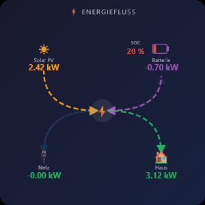

#### Strömungsrichtungen

| Datenpunkt        | Wert > 0                                                | Wert < 0                                             |
| ----------------- | ------------------------------------------------------- | ---------------------------------------------------- |
| `essPower`        | Akkuladung → Pfeil von der Mitte zum Akku               | Batterieentladung → Pfeil von der Batterie zur Mitte |
| `gridActivePower` | Netzverbrauch → Pfeil vom Netz zur Mitte                | Netzeinspeisung → Pfeil von der Mitte zum Netz       |
| `pvPower`         | PV-Anlage erzeugt → Pfeil von der PV-Anlage zum Zentrum | —                                                    |
| `housePower`      | Hausverbrauch → Pfeil von der Mitte zum Haus            | —                                                    |

### Energiehaus

Die Darstellung visualisiert den Energiefluss als isometrisches Hausmodell mit Garage, Auto und den Sigenergy-Geräten: Photovoltaikanlage auf dem Dach, SigenStor-Batterie und Gateway an der Hauswand, AC-Wallbox an der Garage, DC-Ladegerät davor, eine Balkonanlage mit SigenMicro auf dem Garagendach und der Netzanschluss. Animierte Linien verlaufen entlang der Kabel in Richtung des Energieflusses – je höher die Leistung, desto schneller. Tag und Nacht folgen dem Sonnenstand am Standort der ioBroker-Systemeinstellungen. Alle Elemente sind als Vektorgrafiken dargestellt, sodass das Widget in jeder Größe scharf bleibt und seine Proportionen beibehält.

**OIDs:** `pvPower`, `housePower`, `essPower`, `essSoc`, `gridActivePower`, `acCharger.chargingPower`, `acCharger.systemState`, `dcCharger.outputPower`, `dcCharger.runningState`, `sigenmicro.totalPower`; optional: Außentemperatur (`oid_temp`) und eine Statusmeldung (`oid_status`)

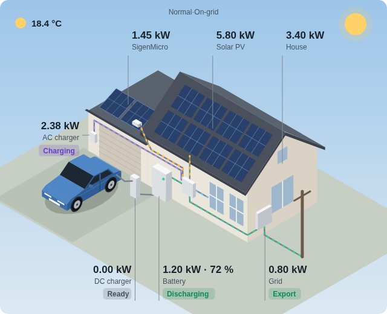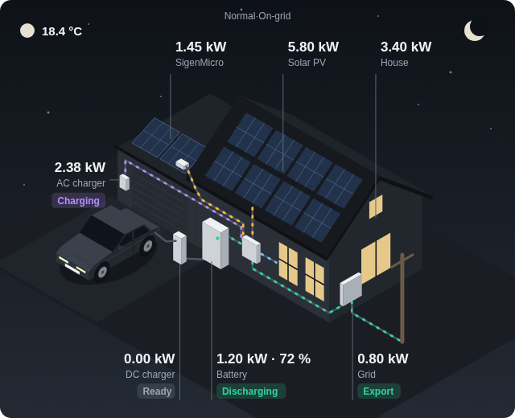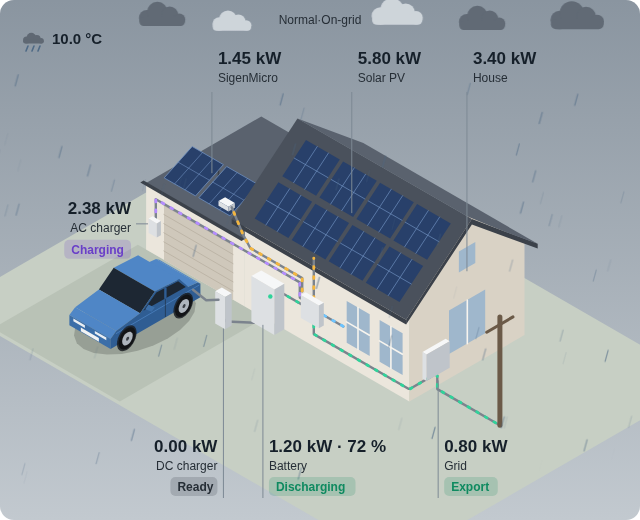

| Einstellung                                                                       | Standard    | Beschreibung                                                                                                                                                                       |
| --------------------------------------------------------------------------------- | ----------- | ---------------------------------------------------------------------------------------------------------------------------------------------------------------------------------- |
| sig\_daynight                                                                     | Automatisch | Automatisch (Sonnenstand), immer Tag oder immer Nacht                                                                                                                              |
| sig\_animation                                                                    | An          | Animierter Fluss entlang der Kabel                                                                                                                                                 |
| `sig_show_garage`, `sig_show_car`, `sig_show_ac`, `sig_show_dc`, `sig_show_micro` | An          | Garage, Auto, AC-Ladegerät, DC-Ladegerät und Balkonstromanlage ein- oder ausblenden. Die Balkonstromanlage benötigt die Garage; ohne Garage hängt die AC-Wanddose an der Hauswand. |

**Wetter (optional):** Mit einer Wetterangabe passt sich der Himmel dem tatsächlichen Wetter an – Sonne, Wolken, Regen, Schnee, Nebel oder Gewitter; ohne Angabe bleibt es klar. Verwenden Sie den sprachunabhängigen Code des Wetteradapters; englische Zustandsbeschreibungen werden ebenfalls berücksichtigt.

| Adapter        | Wetterbedingungen                          | Bewölkung (%)                  | Niederschlag (mm/h)              | Numerischer Wettercode |
| -------------- | ------------------------------------------ | ------------------------------ | -------------------------------- | ---------------------- |
| offenes Wetter | `…weather.current.weather_code`            | `…weather.current.cloud_cover` | `…weather.current.precipitation` | Automatisch            |
| OpenWeatherMap | `forecast.current.icon`                    | `forecast.current.clouds`      | `forecast.current.precipitation` | Automatisch            |
| daswetter      | `location_1.ForecastHourly.Current.symbol` | `…Current.clouds`              | `…Current.rain`                  | DasWetter-Symbol       |

daswetter schreibt die `Current` Kanal nur mit der Option, die aktuelle Stunde zu kopieren; ansonsten verwenden `ForecastHourly.Hour_1` Die `symbol_URL` Funktioniert auch mit der Codeeinstellung „Automatisch“.

Wolkenbedeckung und Niederschlag präzisieren die Bedingungen oder ersetzen sie; Niederschlag bei oder unter 1 °C wird als Schnee dargestellt.

### Batteriestatus & Prognosen

Zeigt den Ladezustand (SOC), den Gesundheitszustand (SOH), die Ladeleistung und Prognosen für die Zeit bis zur vollständigen Aufladung, die verbleibende Laufzeit, den Eigenverbrauch und die Autarkierate an.

**OIDs:** `essSoc`, `essSoh`, `essPower`, `batteryTimeToFull`, `batteryTimeRemaining`, `selfConsumptionRate`, `autarkyRate`

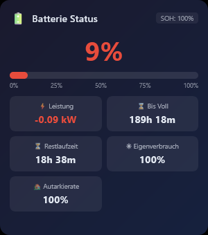

### Echtzeitleistung

Kompakte Listenansicht aller aktuellen Leistungswerte mit farbcodierten Richtungsindikatoren.

**OIDs:** `pvPower`, `essPower`, `gridActivePower`, `housePower`, `essSoc`

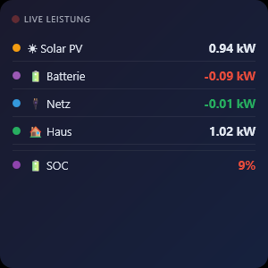

### Energiestatistik

Tägliche Übersicht mit Autarkierate, Eigenverbrauch, SOC-Verlauf, Lade-/Entladeenergie und Batterieabdeckung.

**OIDs:** `autarkyRate`, `selfConsumptionRate`, `dayMaxSoc`, `dayMinSoc`, `essDailyChargeEnergy`, `essDailyDischargeEnergy`, `batteryCoverageToday`, `batteryDailyChargeTime`

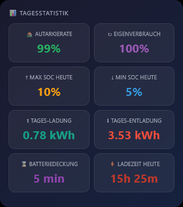

### Netzladegerät (Sigen EVAC)

Überwachung und Steuerung des Sigenergy-Netzladegeräts (EVAC). Angezeigt werden Ladeleistung, Systemstatus, Nennleistung, Nennstrom und Gesamtenergieverbrauch. Alarme werden farblich hervorgehoben. Die Statusanzeige zeigt den vereinfachten Ladestatus gemäß IEC 61851-1 (Initialisierung, Frei, Verbunden, Laden, Fehler). Beim Überfahren mit der Maus wird eine detaillierte Beschreibung des aktuellen Status angezeigt. Der Ladestrom kann direkt über einen Schieberegler eingestellt werden (6 A bis zum Nennstrom des Ladegeräts). Die Obergrenze kann zusätzlich über die Widget-Einstellung festgelegt werden. `sig_maxCurrent` Während des Ladevorgangs ist die Starttaste gesperrt und die Stopptaste hervorgehoben.

**OIDs:** `acCharger.systemState`, `acCharger.chargingPower`, `acCharger.totalEnergyConsumed`, `acCharger.ratedPower`, `acCharger.ratedCurrent`, `acCharger.alarm1/2/3`, `acCharger.control.startStop`, `acCharger.control.outputCurrent`

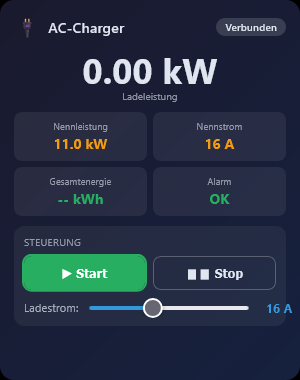

### Gleichstromladegerät

Überwachung und Steuerung des Sigenergy DC-Ladegeräts. Zeigt Ausgangsleistung, Ladezustand des Fahrzeugs mit Fortschrittsanzeige, Fahrzeugbatteriespannung, Ladestrom sowie Energie und Dauer der aktuellen Ladesitzung an. Das Statussymbol zeigt den Betriebszustand der Ladestation an (`dcCharger.runningState`: frei, verbunden/in Vorbereitung, geplant, wird geladen, wird entladen, beendet, Warnung, Fehler/nicht verfügbar); beim Überfahren mit der Maus wird eine detaillierte Erklärung angezeigt. Während des Lade- oder Entladevorgangs ist die Start-Taste gesperrt und die Stopp-Taste hervorgehoben. Ist die Status-OID nicht gesetzt, wird sie von der Ausgangsleistungs-OID abgeleitet; ohne Statuswert wird die Ausgangsleistung als Anzeige verwendet, und der Tooltip erklärt den Grund dafür, abhängig von der vom Adapter erkannten Protokollversion.

**OIDs:** `dcCharger.runningState`, `dcCharger.outputPower`, `dcCharger.vehicleSoc`, `dcCharger.vehicleBatteryVoltage`, `dcCharger.chargingCurrent`, `dcCharger.currentChargingCapacity`, `dcCharger.currentChargingDuration`, `dcCharger.control.startStop`, `info.protocolVersion` (`oid_protocol`)

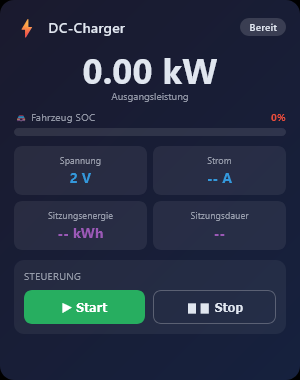

### Wechselrichter

Umfassende Überwachung und Steuerung des Wechselrichters mit Registerkartennavigation. Anzeige von Betriebszustand, Leistungsdaten, Batterietemperaturen, Phasenspannungen, allen 5 Alarmregistern und Geräteinformationen (Modell, Seriennummer, Firmware).

| Tab          | Inhalt                                                                                              |
| ------------ | --------------------------------------------------------------------------------------------------- |
| **Leistung** | Wirkleistung, PV-Leistung, Batterielade-/Entladeleistung, Lastverteilungsregler (−100 % bis +100 %) |
| **Batterie** | SOC & SOH mit Balken, durchschnittliche Zelltemperatur/-spannung, maximale/minimale Temperatur      |
| **Netz**     | Phasenspannungen L1/L2/L3, Netzfrequenz, Leistungsfaktor, PCS-Innentemperatur                       |
| **Alarm**    | 5 Alarmregister (PCS ×2, ESS, Gateway, DC-Ladegerät) mit Hexadezimalcode und Farbkennzeichnung      |
| **Info**     | Modelltyp, Seriennummer, Firmware-Version, Remote-EMS-Umschalter                                    |

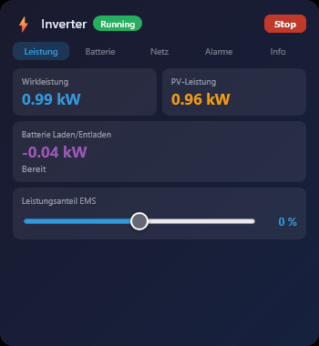

**OIDs:** `inverter.activePower`, `inverter.pvPower`, `inverter.essChargeDischargePower`, `inverter.runningState`, `inverter.essBatterySoc/Soh`, `inverter.essAvgCellTemperature/Voltage`, `inverter.phaseA/B/CVoltage`, `inverter.gridFrequency`, `inverter.pcsInternalTemp`, `inverter.alarm1–5`, `inverter.firmwareVersion`, `inverter.modelType`, `inverter.serialNumber`, `inverter.control.startStop`, `inverter.control.remoteEmsDispatchEnable`, `inverter.control.activePowerPercent`

### PV-Strom

Anzeige von bis zu 3 PV-Strings mit aktuellen Leistungswerten und animierten Flusspfeilen zum Hybridwechselrichter. Die Pfeilfarben ändern sich dynamisch je nach Leistungsniveau (orange <1 kW, gelb <2 kW, grün >2 kW).

#### Widget-Einstellungen

| Parameter               | Typ              | Standard                              | Beschreibung                           |
| ----------------------- | ---------------- | ------------------------------------- | -------------------------------------- |
| oid\_pv1 … oid\_pv3     | OID              | sigenergy.0.plant.pv1Power … pv3Power | PV-String-Leistungs-OIDs               |
| oid\_pvtotal            | OID              | sigenergy.0.plant.pvPower             | Gesamt-PV-Leistung OID                 |
| Signaturtitel           | Text             | PV-Strom                              | Widget-Titel                           |
| sig\_name1 … sig\_name3 | Text             | Zeichenkette 1 … Zeichenkette 3       | Konfigurierbare Namen pro Zeichenkette |
| sig\_darkmode           | Kontrollkästchen | WAHR                                  | Dunkel-/Hellmodus                      |

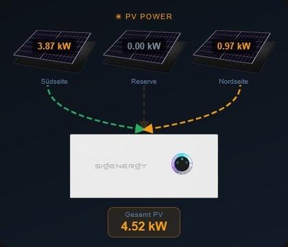

**OIDs:** `plant.pv1Power`, `plant.pv2Power`, `plant.pv3Power`, `plant.pvPower`

### SigenMicro Übersicht

Übersicht und Detailansicht der SigenMicro-Mikrowechselrichter. `ioBroker.sigenergy` 3.5.0 Der Adapter liest die Daten aus der Sigenergy-Cloud (Registerkarte „SigenMicro (Cloud)“ in den Adaptereinstellungen) und erstellt ein Gerät pro Mikro-Wechselrichter unter `sigenergy.0.sigenmicro.<serial>`. **Erfordert `ioBroker.sigenergy` ≥ 3.5.0 mit aktivierter Cloud.** Die Cloud wird alle 300 Sekunden (OpenAPI) bzw. 60 Sekunden (App-Oberfläche) abgefragt, daher kann das Widget nicht schneller aktualisiert werden.

| Tab                   | Inhalt                                                                                                                                                                                                                             |
| --------------------- | ---------------------------------------------------------------------------------------------------------------------------------------------------------------------------------------------------------------------------------- |
| **Überblick**         | Alle Geräte als animierter Wechselstrombus mit Status pro Gerät; Kacheln für Wechselstrom (Adapter gesamt) `sigenmicro.totalPower` (ansonsten die Summe der Geräte), heutiger Ertrag, Lebenszeitertrag und online verfügbare Geräte |
| **ein Tab pro Gerät** | Bild, Name, Nennleistung, Seriennummer, Firmware, Zeitpunkt des letzten Cloud-Updates, Statusanzeige, alle Live-Werte mit Einheit und OID sowie die PV-Eingänge pv1 … pv4, die der Adapter meldet                                  |

#### Status

| Status      | Zustand                              | Anzeige                |
| ----------- | ------------------------------------ | ---------------------- |
| Produktion  | `online` = wahr, `activePower` > 0    | grüner, animierter Bus |
| Online      | `online` = wahr, `activePower` = 0    | Blau                   |
| Offline     | `online` = falsch — normal bei Nacht | grau                   |
| Keine Daten | Es wurde noch kein Wert empfangen.   | grau                   |

Wenn `info.cloudConnection` Ist `false` Das Widget zeigt die Warnung „Cloud-Verbindung verloren“ an, da die Werte möglicherweise veraltet sind.

#### Dynamisches Layout

| Geräte | Reihen   | Bildgröße     |
| ------ | -------- | ------------- |
| 1–5    | 1 Zeile  | 80 × 90 px    |
| 6–10   | 1 Zeile  | 52 × 60 px    |
| 11–15  | 2 Zeilen | 46 × 52 Pixel |
| 16–20  | 2 Zeilen | 40 × 46 Pixel |

#### Widget-Einstellungen

| Parameter                        | Typ              | Standard                        | Beschreibung                                                                                                                                                                                                                 |
| -------------------------------- | ---------------- | ------------------------------- | ---------------------------------------------------------------------------------------------------------------------------------------------------------------------------------------------------------------------------- |
| Mikro-Zählung                    | Nummer (1–20)    | 3                               | Anzahl der anzuzeigenden Mikro-Wechselrichter                                                                                                                                                                                |
| Signaturtitel                    | Text             | SigenMicro Mikro-Wechselrichter | Widget-Titel                                                                                                                                                                                                                 |
| sig\_darkmode                    | Kontrollkästchen | WAHR                            | Dunkel-/Hellmodus                                                                                                                                                                                                            |
| micro\_device1 … micro\_device20 | Auswahl          | —                               | Mikro-Wechselrichter aus der Liste der SigenMicro-Geräte der sigenergy-Instanzen (Seriennummer und Name). Das Widget liest alle Zustände des Geräts aus. Widgets ab Version 1.x behalten ihre bisherige Zustandsauswahl bei. |
| micro\_take\_all                 | Taste            | —                               | Übernimmt alle SignMicro-Geräte des Kontos gleichzeitig (Anzahl und Auswahl).                                                                                                                                                |
| micro\_name1 … micro\_name20     | Text             | —                               | Anzeigename des Geräts (Standard: Micro 01, Micro 02, …)                                                                                                                                                                     |

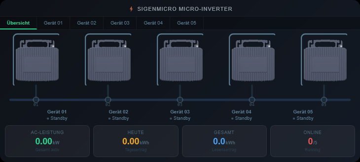

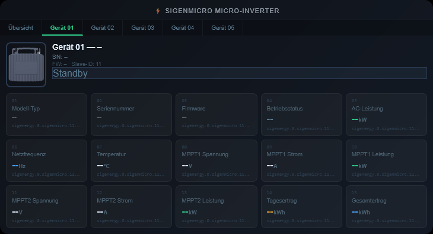

**Zustände pro Gerät (`sigenergy.0.sigenmicro.<serial>` Online** , Wirkleistung, Blindleistung, PV-Leistung, PV1…PV4-Spannung/-Strom/-Leistung, Netzspannung, Netzstrom, Netzfrequenz, Leistungsfaktor, Temperatur, Isolationswiderstand, Tagesertrag, Gesamtertrag, Seriennummer, Firmware, Nennleistung, letzte Aktualisierung

**Zusätzlich:** `sigenergy.0.sigenmicro.totalPower`, `sigenergy.0.info.cloudConnection` — Die Instanz wird aus der ausgewählten OID entnommen.

> **Upgrade von 1.8.x:** die ehemaligen Modbus-Zustände (`runningState`, `outputPower`, `mppt*`, `modelType` …) sind im Adapter nicht mehr vorhanden. Wählen Sie die Mikro-Wechselrichter in den Widget-Einstellungen erneut aus – entweder aus der Liste oder mit „Alle SigenMicro übernehmen“.

### Fahrzeugladezustand (EV SOC)

Zeigt ein konfigurierbares Fahrzeugbild (z. B. Fiat 500e) als zentrales visuelles Element an. Ein farbcodiertes Symbol in der oberen rechten Ecke zeigt einen Blitz, den aktuellen Ladestand in Prozent und die Bezeichnung „LADEN“. Ein Fortschrittsbalken am unteren Rand zeigt den aktuellen Ladezustand (SOC) an. Im optionalen Lademodus leuchtet das Symbol pulsierend grün.

#### Farblogik

| Ladeniveau | Farbe          |
| ---------- | -------------- |
| ≤ 15 %     | Rot (#f87171)  |
| ≤ 35 %     | Gelb (#fbbf24) |
| > 35 %     | Grün (#4ade80) |

#### Widget-Einstellungen

| Parameter       | Typ              | Standard                                 | Beschreibung                                                   |
| --------------- | ---------------- | ---------------------------------------- | -------------------------------------------------------------- |
| oid\_ev\_soc    | OID              | —                                        | Ladezustand 0–100                                              |
| oid\_charging   | OID              | —                                        | Ladezustand (optional) – grünes Leuchten im aktiven Zustand    |
| Signaturtitel   | Text             | — (leer: "Fahrzeugladestand", übersetzt) | Fahrzeugname unterhalb des Bildes                              |
| sig\_car\_image | Bild             | —                                        | Fahrzeugbild aus dem ioBroker-Dateibrowser (z. B. /vis-2/img/) |
| sig\_darkmode   | Kontrollkästchen | WAHR                                     | Dunkel-/Hellmodus                                              |

**OIDs:** `oid_ev_soc`, `oid_charging`

## Aussehen

Alle Widgets unterstützen einen **hellen und einen dunklen Modus** , die über die Widget-Einstellungen umgeschaltet werden können. `Dark mode` Die Widgets skalieren mit ihrer Größe: Breite und Höhe passen sich dem Widget unabhängig voneinander an, während der Text seine Proportionen beibehält.

## Dokumentation

- 🇬🇧 [Englisch](/#/adapters/vis-2-widgets-sigenergy) — diese Datei
- 🇩🇪 [Deutsch](https://github.com/ssbingo/ioBroker.vis-2-widgets-sigenergy/blob/main/doc/de/README.md)
- 🇷🇺 [Русский](https://github.com/ssbingo/ioBroker.vis-2-widgets-sigenergy/blob/main/doc/ru/README.md)
- 🇳🇱 [Niederländisch](https://github.com/ssbingo/ioBroker.vis-2-widgets-sigenergy/blob/main/doc/nl/README.md)
- 🇫🇷 [Französisch](https://github.com/ssbingo/ioBroker.vis-2-widgets-sigenergy/blob/main/doc/fr/README.md)
- 🇮🇹 [Italiano](https://github.com/ssbingo/ioBroker.vis-2-widgets-sigenergy/blob/main/doc/it/README.md)
- 🇪🇸 [Español](https://github.com/ssbingo/ioBroker.vis-2-widgets-sigenergy/blob/main/doc/es/README.md)
- 🇵🇱 [Polski](https://github.com/ssbingo/ioBroker.vis-2-widgets-sigenergy/blob/main/doc/pl/README.md)
- 🇵🇹 [Português](https://github.com/ssbingo/ioBroker.vis-2-widgets-sigenergy/blob/main/doc/pt/README.md)

## Changelog
### 2.2.0 (2026-11-18)
* (ssbingo) **Energy house shows the real weather:** with a weather state (WMO code of open-meteo-weather, OpenWeatherMap icon or id, DasWetter symbol, AccuWeather icon or an English text), optionally cloud cover and precipitation, the sky shows sun, clouds, rain, snow, fog or thunderstorm instead of always the sun; the symbol next to the temperature follows the weather

### 2.1.0 (2026-11-18)
* (ssbingo) **New widget "Energy house":** the energy flow as an isometric house with garage, car, PV on the roof, SigenStor and gateway on the house wall, AC wallbox, DC charger, a balcony power plant with SigenMicro on the garage roof and the grid connection; animated cables in the direction of the flow, day and night after the position of the sun, optional outdoor temperature and status text, every part can be hidden

### 2.0.2 (2026-11-18)
* (ssbingo) SigenMicro: new tab bar — "Overview" keeps its width, the device tabs share the rest in equal columns and no longer run out of the widget; up to 3 devices the tabs show the names, with more devices compact numbers 01, 02 … (as on the nodes, name as tooltip); above 10 devices two rows like the nodes
* (ssbingo) SigenMicro: the labels sit exactly below their nodes, each label row directly below its node row; a click on a node or label opens the detail tab of the device; better contrast of the tile texts; if several selected devices report the same device name, the serial number is shown
* (ssbingo) Stretched widgets: texts are no longer squeezed twice, centred texts stay centred, and the titles of AC/DC charger, inverter and battery as well as the SigenMicro status badge and section header keep their proportions

### 2.0.1 (2026-11-17)
* (ssbingo) README screenshots renewed: all widgets as rendered by the React widget set in vis-2 2.20, with English texts
* (ssbingo) Dependencies updated (vite 7.3.8, `@iobroker/gui-components` 10.4.6, `@iobroker/testing` 6.3.2)

### 2.0.0 (2026-11-17)
* (ssbingo) **Breaking:** the widgets are now a native vis-2 React widget set (React 19, MUI 9) and require vis-2 2.20.0 or newer. The classic VIS (vis-1) is no longer supported
* (ssbingo) Existing widgets keep working without being placed again: the widget IDs and all settings are unchanged
* (ssbingo) All texts are translated into the 11 ioBroker languages (previously mostly German). Titles you entered are kept; an empty title shows the default title in the user's language
* (ssbingo) AC/DC charger: the status explanation is a MUI tooltip that is no longer cut off by the widget; the charging current and the EMS power share are MUI sliders that write when released
* (ssbingo) No commands are sent from the vis-2 editor anymore; a click there only selects the widget
* (ssbingo) Energy flow: the setting "Animated flow" now takes effect
* (ssbingo) SigenMicro: the detail tab shows the values in three columns, the object ID on one line
* (ssbingo) SigenMicro: the micro-inverters are chosen in the editor by device (serial number and name) from the SigenMicro devices of the sigenergy instances; the widget reads all states itself. New button "Take all SigenMicro" takes over all devices at once. Widgets from 1.x keep working with their former state selection
* (ssbingo) Build with Vite and module federation; the widgets were tested in vis-2 2.20.11

### 1.9.1 (2026-11-17)
* (ssbingo) vis-2 2.20.x: the widgets apply `box-sizing: border-box` to their own content again. vis-2 2.20 no longer loads MUI's `CssBaseline`, which used to switch the whole document to border-box, so padded cards, tiles and buttons could grow wider than designed. The rule is scoped to this widget set; the widget set itself contains no React/MUI code and runs as a classic vis widget set on vis-2 2.20 (React 19, MUI 9)

### 1.9.0 (2026-11-17)
* (ssbingo) **SigenMicro Overview reworked for the new cloud connection of `ioBroker.sigenergy` 3.5.0.** The widget now reads `sigenergy.0.sigenmicro.<serial>.*` (online, activePower, pvPower, PV inputs pv1…pv4, grid values, temperature, insulation resistance, yield, firmware, rated power, last update), the account total `sigenmicro.totalPower` and `info.cloudConnection`. The former Modbus register model (`runningState`, `outputPower`, `mppt*`, `modelType`) is gone
* (ssbingo) SigenMicro: status derived from `online` and the AC power (Producing / Online / Offline / No data), warning when the cloud connection is lost, time of the last cloud update and rated power in the detail tab, PV inputs shown only when reported, new optional display name per device (`micro_nameN`), all widget texts in English
* (ssbingo) SigenMicro: the anchor OID may be any state of the micro-inverter; derived states are now subscribed via `vis.conn.subscribe` (VIS only subscribes attribute OIDs) and released again when the widget is removed. **After updating, select a state under `sigenergy.0.sigenmicro.<serial>` again for each `oid_microN`**
* (ssbingo) CI: Dependabot auto-merge workflow updated from the ioBroker template — it uses `pull_request` instead of `pull_request_target` (#46, #47); `@iobroker/testing` updated from 6.2.1 to 6.3.1

### 1.8.11 (2026-09-12)
* (ssbingo) CI: the package tests now run on Node.js 22, 24 and 26 (new `adapter-tests` job, repository checker #41); `@iobroker/testing` updated from 5.3.0 to 6.2.1

### 1.8.10 (2026-09-07)
* (ssbingo) Removed the `admin` entry from `globalDependencies`: a widget set has no admin UI, so no admin version needs to be required (repository checker S1091)

### 1.8.9 (2026-09-07)
* (ssbingo) DC charger: a station that marks its running state register as not valid no longer shows up as a red "Unbekannt" badge. The Sigenergy protocol signals "register not valid" by setting all bits, and a SigenStor EC **with** a DC charger answers that way for register 31513 while its neighbouring registers (rated power, PV yield, meters) read normally. The badge is now derived from the output power in that case and the tooltip states that this is neither an adapter nor a configuration problem
* (ssbingo) DC charger: the raw sentinel 65535 is recognised as well, so the badge is also correct on adapter versions before 3.3.1, which pass the value through instead of reporting no value
* (ssbingo) DC charger: new OID setting `oid_protocol` (default `sigenergy.0.info.protocolVersion`). The protocol version was previously derived from the instance prefix only, and such an OID is never subscribed by VIS, so `vis.states` stayed empty and the tooltip claimed "Protokollversion noch nicht erkannt" even though the adapter had detected V2.9 at startup. Declared as a regular `/id` attribute it is subscribed like every other OID
* (ssbingo) DC charger: when the protocol version cannot be read, the tooltip no longer asserts that none was detected — it says the version is not readable here and points at the new setting
* (ssbingo) DC charger: reworded the tooltip shown when the adapter reports no state although the device announces protocol V2.8 or newer — it no longer claims an adapter update is needed, since the station itself may be marking the register as not valid

### 1.8.8 (2026-09-07)
* (ssbingo) DC charger: if the state OID is not set, it is derived from the output power OID (…dcCharger.outputPower → …dcCharger.runningState), so widgets placed before 1.8.7 show the operating state without editing them
* (ssbingo) DC charger: when no operating state is available, the tooltip explains why depending on the protocol version detected by the adapter (`info.protocolVersion` / `info.protocolLevel`): register 31513 requires Sigenergy protocol V2.8; with V2.8 or newer it points to the adapter log or an adapter update; negative output power is shown as discharging

### 1.8.7 (2026-09-07)
* (ssbingo) DC charger: new state OID `dcCharger.runningState` (default) – the state badge now shows the operating state of the charging station (free, connected/preparing, scheduled, charging, discharging, ended, warning, fault/unavailable) with a detailed explanation as tooltip; without the OID the badge is derived from the output power as before
* (ssbingo) DC charger: while charging or discharging is active, the Start button is locked and the Stop button is highlighted; negative output power (discharging) is shown in purple

### 1.8.6 (2026-09-07)
* (ssbingo) AC charger: the tooltip on the state badge is now rendered as a separate popup with a fixed font size and opaque background, so it is readable regardless of widget size and is no longer overlapped by widget content
* (ssbingo) AC charger: while charging is active, the Start button is locked and the Stop button is highlighted
* (ssbingo) Widget set now reports the correct version in the browser console

### 1.8.5 (2026-09-07)
* (ssbingo) AC charger: the charging current slider is now limited to the charger's rated current; new widget setting `sig_maxCurrent` for a manual upper limit (prevents Modbus errors when setting more than the rated current)
* (ssbingo) AC charger: system state now covers all IEC 61851-1 states (0–7: initialising, free, connected, charging, error); hovering over the state badge shows a detailed explanation

### 1.8.4 (2026-09-04)
* (ssbingo) Lowered minimum admin requirement to >=7.8.23 (admin 8 is no longer required)
* (ssbingo) CI: locked ioBroker/testing-action-deploy to major version v1; fixed Dependabot auto-merge workflow
* (ssbingo) Updated dependencies: @tsconfig/node22 22.0.6, @alcalzone/release-script-plugin-license 5.2.2

### 1.8.3 (2026-08-05)
* (ssbingo) Declared minimum requirements: js-controller >=6.0.11, admin >=8.0.0, Node.js >=22
* (ssbingo) Updated dependencies: actions/checkout 7.0.1, ioBroker/testing-action-deploy 1.5.2, @iobroker/testing 5.3.0

### 1.8.2 (2026-06-28)
* (ssbingo) Updated CI actions: actions/checkout to v7.0.0, ioBroker/testing-action-deploy to v1.5.0

### 1.8.1 (2026-06-08)
* (ssbingo) Fixed JSON syntax error in io-package.json; added widget screenshot to documentation

### 1.8.0 (2026-06-08)
* (ssbingo) New widget: "Fahrzeug-Ladestand" — shows a configurable EV image with animated SOC bar, color-coded charge level (red/yellow/green), and optional blinking charging badge

### 1.7.9 (2026-05-27)
* (ssbingo) Removed obsolete .eslintrc.json and .prettierignore

### 1.7.8 (2026-05-27)
* (ssbingo) Added ESLint linting, updated CI to Node.js 24; adapter requires node.js >= 22

### 1.7.7 (2026-04-20)
* (ssbingo) Text no longer distorts under non-uniform scaling — letters keep their proportions while containers continue to fill the widget area

### 1.7.6 (2026-04-20)
* (ssbingo) Scaling is now non-uniform: width and height react independently to container changes, keeping both axes individually adjustable

### 1.7.5 (2026-04-20)
* (ssbingo) Widget scaling now also reacts to height changes — content scales proportionally on both axes and is centered within the widget

### 1.7.4 (2026-04-20)
* (ssbingo) All 9 widgets now scale their content responsively with the widget size (fonts, padding, SVG, images)

### 1.7.3 (2026-04-20)
* (ssbingo) All 9 widgets now share a unified background based on the PV-Power widget design

Older changelog entries can be found in CHANGELOG_OLD.md

## License
MIT License

Copyright (c) 2026 ssbingo <s.sternitzke@online.de>

Permission is hereby granted, free of charge, to any person obtaining a copy
of this software and associated documentation files (the "Software"), to deal
in the Software without restriction, including without limitation the rights
to use, copy, modify, merge, publish, distribute, sublicense, and/or sell
copies of the Software, and to permit persons to whom the Software is
furnished to do so, subject to the following conditions:

The above copyright notice and this permission notice shall be included in all
copies or substantial portions of the Software.

THE SOFTWARE IS PROVIDED "AS IS", WITHOUT WARRANTY OF ANY KIND, EXPRESS OR
IMPLIED, INCLUDING BUT NOT LIMITED TO THE WARRANTIES OF MERCHANTABILITY,
FITNESS FOR A PARTICULAR PURPOSE AND NONINFRINGEMENT. IN NO EVENT SHALL THE
AUTHORS OR COPYRIGHT HOLDERS BE LIABLE FOR ANY CLAIM, DAMAGES OR OTHER
LIABILITY, WHETHER IN AN ACTION OF CONTRACT, TORT OR OTHERWISE, ARISING FROM,
OUT OF OR IN CONNECTION WITH THE SOFTWARE OR THE USE OR OTHER DEALINGS IN THE
SOFTWARE.