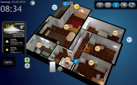
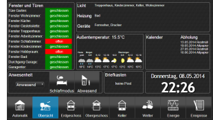
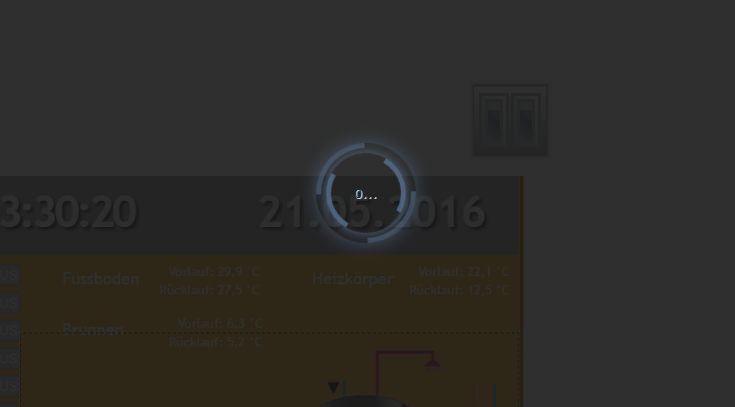

# Visualisierung der nächsten Generation für ioBroker: vis-2

Webvisualisierung für die ioBroker-Plattform.

## Überblick

- [Lizenzanforderungen](#license-requirements)
- [Installation & Dokumentation](#installation--documentation)
- [Bindungen von Objekten](#bindings-of-objects)
- [Filter](#filters)
- [Steuerungsschnittstelle](#control-interface)
- [Standardansicht](#default-view)
- [Navigation](#navigation)
- [Berechtigungssystem](#permissions-system)
- [Einstellungen](#settings)
- [SVG und aktuelle Farbe](#svg-and-currentcolor)

## Lizenzanforderungen

Um diesen Adapter zu verwenden in `ioBroker` Sie müssen die Quellcodelizenz des Adapters akzeptieren. Der Quellcode dieses Adapters ist unter der CC BY-NC-Lizenz verfügbar.

Zusätzlich benötigen Sie eine Lizenz zur Nutzung des Adapters. Die folgenden Lizenzversionen sind auf <https://iobroker.net/www/pricing> verfügbar.

- **Community-Lizenz: Kostenlos für den privaten Gebrauch!** Registrieren Sie sich auf <https://iobroker.net> , um eine kostenlose Lizenz zu erhalten. Die Lizenz wird beim Start des vis-2-Adapters online auf dem ioBroker-Lizenzserver überprüft. Daher ist zu diesem Zeitpunkt eine Internetverbindung erforderlich!
- **Offline-Lizenz für den privaten Gebrauch** : Gegen eine geringe Supportgebühr können Sie die obligatorische Online-Lizenzprüfung beim Start des Adapters umgehen. **Nur für den privaten Gebrauch!**
- **Kommerzielle Lizenz** : Diese Lizenz ist für Sie geeignet, wenn Sie Vis in einer kommerziellen Umgebung einsetzen oder Vis als Bestandteil von ioBroker-Paketen an Ihre Kunden verkaufen. Die Lizenzprüfung erfordert keine Internetverbindung.

## Installation & Dokumentation



### Widgets

- [Standard-Widgets](/#/docs/adapterref/iobroker.vis-2/packages/iobroker.vis-2/docs/widgets-standard.md) – die Geräte eines Hauses, wie Karten für eine Seite mit Abschnitten (`relative`) und als Markierungen für einen Grundriss (`absolute`), mit einem Bild von jedem einzelnen von ihnen
- [jQui-Widgets](/#/docs/adapterref/iobroker.vis-2/packages/iobroker.vis-2/docs/widgets-jQui.md) – die Widgets, die von vis-1 übernommen wurden.

## Bindungen von Objekten

Normalerweise verfügen die meisten Widgets über ein ObjectID-Attribut, das mit einer Objekt-ID verknüpft werden kann. Es gibt jedoch noch eine weitere Möglichkeit, _ein beliebiges_ Widget-Attribut an eine ObjectID zu binden.

Schreiben Sie einfach in das Attribut. `{object.id}` z.B `{hm-rpc.0.OEQ1880105.4.ACTUAL_TEMPERATURE}` und es wird an den Wert dieses Objekts gebunden. Wenn Sie das spezielle Format verwenden, können Sie damit sogar einfache Operationen durchführen, z. B. Multiplikation oder Formatierung.

Die CSS-Attribute einer Ansicht können auf die gleiche Weise gebunden werden, z. B. die Hintergrundfarbe einer Ansicht. `{a:javascript.0.alarm;a ? 'red' : 'green'}` Die

Beispiel: Berechnung der Hypotenuse eines Dreiecks:

`{h:javascript.0.myCustom.height;w:javascript.0.myCustom.width;Math.max(20, Math.sqrt(h*h + w*w))}` wird als Funktion interpretiert:

```js
value = await (async function () {
    var h = (await getState('javascript.0.myCustom.height')).val;
    var w = (await getState('javascript.0.myCustom.width')).val;
    return Math.max(20, Math.sqrt(h * h + w * w));
})();
```

oder

`{h:javascript.0.myCustom.height;w:javascript.0.myCustom.width;h*w}` multipliziert einfach Höhe mit Breite.

Sie können _beliebige_ JavaScript-Funktionen (Browserfunktionen) verwenden. Argumente müssen mit ':' definiert werden, andernfalls werden sie als Formel interpretiert.

Achten Sie auf die Datentypen. Alle sind als Zeichenketten definiert. Um sicherzustellen, dass der Wert als Zahl behandelt wird, verwenden Sie die Funktion \`parseFloat\`.

Unsere Hypotenusenberechnung lautet also:

```
{h:javascript.0.myCustom.height;w:javascript.0.myCustom.width;Math.max(20, Math.sqrt(Math.pow(parseFloat(h), 2) + Math.pow(parseFloat(w), 2)))}
```

### Veraltetes Format

Patten hat folgendes Format:

```
{objectID;operation1;operation2;...}
```

Folgende Operationen werden unterstützt:

- `*` Multiplikation. Das Argument muss in Klammern stehen, z. B. "\*(4)". In diesem Beispiel multiplizieren wir den Wert mit 4.
- `+` - addieren. Das Argument muss in Klammern stehen, z. B. "+(4,5)". In diesem Beispiel addieren wir den Wert 4,5.
- `-` - Subtrahieren. Das Argument muss in Klammern stehen, z. B. "-(-674,5)". In diesem Beispiel subtrahieren wir vom Wert -674,5.
- `/` - Division. Das Argument muss in Klammern stehen, z. B. "/(0,5)". In diesem Beispiel teilen wir den Wert durch 0,5.
- `%` Modulo. Das Argument muss in eckigen Klammern stehen, z. B. "%(5)". In diesem Beispiel berechnen wir den Modulo von 5.
- `round` - Runden Sie den Wert.
- `round(N)` - Runde den Wert auf N Nachkommastellen, z. B. 34,678;round(1) => 34,7
- `hex` - Wert in Hexadezimalwert umwandeln. Alle Buchstaben sind kleingeschrieben.
- `hex2` - Wert in Hexadezimalwert umwandeln. Alle Buchstaben werden kleingeschrieben. Ist der Wert kleiner als 16, wird eine führende Null hinzugefügt.
- `HEX` - Dasselbe wie Hexadezimal, nur in Großbuchstaben.
- `HEX2` - das Gleiche wie hex2, aber in Großbuchstaben.
- `date` - Datum gemäß dem angegebenen Format formatieren. Das Format ist dasselbe wie in [iobroker.javascript.](https://github.com/iobroker/iobroker.javascript/blob/master/README.md#formatdate)
- `min(N)` - Wenn der Wert kleiner als N ist, nimm N, sonst den Wert
- `max(M)` - Wenn der Wert größer als M ist, nimm M, ansonsten den Wert
- `sqrt` - Quadratwurzel
- `pow(n)` - Potenz von N.
- `pow` - Zweierpotenz.
- `floor` - Math.floor
- `ceil` - Math.ceil
- `json` - Operation zum Abrufen von JSON- oder Objekteigenschaften. Z. B. `{id;json(common.name.en)}`
- `random(R)` - Math.random() \* R, oder einfach Math.random(), wenn kein Argument angegeben wird
- `formatValue(decimals)` - Wert gemäß Systemeinstellungen formatieren und Dezimalstellen verwenden
- `date(format)` - Wert als Datum formatieren. Das Format ist etwa so: "YYYY-MM-DD hh:mm:ss.sss"
- `momentDate(format, useTodayOrYesterday)` - Wert mithilfe von Moment.js als Datum formatieren. [Zulässige Formate müssen gemäß der Moment.js-Bibliothek eingegeben werden](https://momentjs.com/docs/#/displaying/format/) . `useTodayOrYesterday=true` Die `moment.js` Format `ddd` /`dddd` werden mit heute / gestern überschrieben
- `array(element1,element2[,element3,element4])`- Gibt das Element mit dem angegebenen Index zurück. Beispiel: `{id.ack;array(ack is false,ack is true)}` Ein boolescher Wert nimmt das zweite Element an, wenn er wahr ist, und das erste, wenn er falsch ist. `{id;array(off,on)}` funktioniert an einem Schalter
- `states` - der Text des Wertes in `common.states` des Objekts, z.B. `{hm-rpc.0.ABC.STATE;states}` zeigt „Offen“ anstelle von `1` Ein Wert, der nicht in der Liste enthalten ist, bleibt unverändert; `states(unknown)` zeigt stattdessen den Text in Klammern an. Ein Text in mehreren Sprachen wird in der Sprache von vis angezeigt. Das Objekt wird einmal gelesen, wenn die Bindung zum ersten Mal angezeigt wird; bis dahin zeigt die Bindung den Klartextwert an. Nur in diesem Format: im Format mit Variablen (`{v:id;...}` Die Formel ist JavaScript, das nichts von … weiß. `common.states`

Sie können dieses Muster in jedem beliebigen Text verwenden, zum Beispiel

```
My calculations with {objectID1;operation1;operation2;...} are {objectID2;operation3;operation4;...}
```

oder Farbberechnungen:

```
#{objectRed;/(100);*(255);HEX2}{objectGreen;HEX2}{objectBlue;HEX2}
```

Um den Zeitstempel eines Objekts anzuzeigen, schreiben Sie `.ts` oder `.lc` (für die letzte Änderung) am Ende der Objekt-ID, z. B.:

```
Last change: {objectRed.lc;date(hh:mm)}
```

### Spezielle Bindungen

Es gibt eine Reihe unterschiedlicher interner Bindungen, um zusätzliche Informationen in Ansichten bereitzustellen:

- `username` - zeigt den angemeldeten Benutzer an
- `view` - Name der aktuellen Ansicht
- `wname` - Widget-Name
- `widget` - ist ein Objekt mit allen Daten des Widgets. Kann nur im JS-Teil verwendet werden, wie z. B. `{a:a;widget.data.name}`
- `widgetOid` - Verwenden Sie die OID des Widgets, um dem Widget im Zuweisungsabschnitt einen Wert zuzuweisen, wie zum Beispiel `{t:widgetOid.val;t}`
- `wid` - Name des eigentlichen Widgets
- `language` - kann sein `de`, `en` oder `ru` Die
- `instance` - Browserinstanz
- `login` - ob eine Anmeldung erforderlich ist oder nicht (z. B. zum Ein-/Ausblenden des Abmeldebuttons)
- `local_*` - wenn der Staatsname mit folgendem beginnt `local_` Es wird nicht an ioBroker gemeldet, aktualisiert aber alle Widgets, die von diesem Zustand abhängen. (Lokale Variable der aktuellen Browsersitzung)

Hinweis: Um ":" in Berechnungen (z. B. in einer Zeichenkettenformel) zu verwenden, verwenden Sie stattdessen "::" .

**Denken Sie daran** , dass Stildefinitionen als Bindungen interpretiert werden, also verwenden Sie `{{style: value}}` oder einfach

```
{
	style: value
}
```

dafür.

## Filter

Um die Gesamtzahl der Widgets in einer einzigen Ansicht zu visualisieren, können Sie Filter verwenden, um die Anzahl der gleichzeitig in der Ansicht angezeigten Widgets zu reduzieren.

Jedes Widget hat ein Feld `filter` Wenn Sie es auf einen bestimmten Wert setzen, z.B. `light` Sie können also auch andere Widgets verwenden. `(bars - filters, filter - dropdown)` um zu steuern, welcher Filter tatsächlich aktiv ist.

Die Einträge der `filter - dropdown` Widgets (Schaltflächen und Dropdown-Elemente) haben die CSS-Klasse `vis-filter-item` und zusätzlich die aktuell aktiven Einträge `vis-filter-item-active` sodass sie im Projekt-CSS formatiert werden können, z. B.:

```css
/* buttons (horizontal / vertical) */
.vis-filter-item-active {
    background-color: #ff0000;
}

/* entries of the dropdown */
.vis-filter-item-active.Mui-selected {
    background-color: #ff0000;
}
```

Es sind zwei Regeln erforderlich, da der aktive Eintrag des Dropdown-Menüs zusätzlich die Klasse besitzt. `Mui-selected` und seine eigene Hintergrundfarbe ist spezifischer als `.vis-filter-item-active` allein.

Bitte beachten Sie:

- Wenn für einen Eintrag im Widget selbst eine Farbe konfiguriert ist, wird diese als Inline-Stil geschrieben und kann nicht überschrieben werden. `color` Diese Eigenschaft stammt aus dem Projekt-CSS. Lassen Sie das Feld für die Farbe des Eingabefelds leer, wenn Sie die Farbe über CSS festlegen möchten.
- Die Einträge des Dropdown-Menüs werden außerhalb des Widgets (in einem Popup auf Seitenebene) gerendert, daher können sie nur global und nicht mit einem Selektor für ein einzelnes Widget angesprochen werden, wie z. B. `#w00001 .vis-filter-item-active` Die Schaltflächen sind Teil des Widgets und können auf diese Weise angesprochen werden.

## Steuerungsschnittstelle

Vis erstellt 3 Variablen:

- `control.instance` - Hier sollte die Browserinstanz angegeben werden oder `FFFFFFFF` wenn jeder Browser kontrolliert werden muss.
- `control.data` - Parameter für den Befehl. Siehe die spezifische Befehlsbeschreibung.
- `control.command` - Befehlsname. Schreiben Sie diese Variable, um den Befehl auszulösen. Das bedeutet, dass die Variablen „instance“ und „data“ vor dem Ausführen des Befehls mit Daten vorbereitet werden müssen.

Befehle:

- `alert` - Zeigt ein Warnfenster in vis-2 an. "control.data" hat das Format "message;title;jquery-icon". Titel und jquery-icon sind optional. Die Namen der Icons finden Sie [hier](http://jqueryui.com/themeroller/) . Um das Icon "ui-icon-info" anzuzeigen, schreiben Sie `Message;;info` Die
- `changeView` - Wechseln Sie zur gewünschten Ansicht. "control.data" muss den Namen der Ansicht enthalten. Sie können auch den Projektnamen angeben. `project/view` Das Standardprojekt ist `main` Die
- `refresh` - Laden Sie beispielsweise vis-2 neu, nachdem das Projekt so geändert wurde, dass es in allen Browsern neu geladen wird.
- `reload` - Dasselbe wie beim Aktualisieren.
- `dialog` - Dialogfenster anzeigen. Der Dialog muss in der Ansicht vorhanden sein. Eine der folgenden Optionen:

  - `static    - HTML    - Dialog`,
  - `static    - Icon    - Dialog`,
  - `container - HTML    - view in jqui Dialog`,
  - `container - ext cmd - view in jqui Dialog`,
  - `container - Icon    - view in jqui Dialog`,
  - `container - Button  - view in jqui Dialog` Die

  `control.data` muss die ID des Dialog-Widgets haben, z. B. `w00056` Die
- `dialogClose`
- `popup`- öffnet ein neues Browserfenster. Der Link muss angegeben werden in `control.data` z. B. <http://google.com>
- `playSound` - Audiodatei abspielen. Der Link zur Datei ist angegeben in `control.data` z. B. <http://www.modular-planet.de/fx/marsians/Marsiansrev.mp3> . Sie können Ihre eigene Datei in vis-2 hochladen und sie beispielsweise abspielen lassen. `/vis-2.0/main/img/myFile.mp3` **Wichtig** : Ihr Browser kann erst dann Audio abspielen, wenn Sie mindestens einmal auf die Seite geklickt haben. Dies ist eine Sicherheitsrichtlinie Ihres Browsers. [Hier](https://github.com/Hugo22O/chrome-autoplay) erfahren Sie mehr.

Wenn der Benutzer die Ansicht ändert oder beim Start, werden die Variablen von vis-2 mit

- `control.instance`: Browserinstanz und `ack=true`
- `control.data`: Projekt- und Ansichtsname im Formular `project/view` z.B. `main/view` (Und `ack=true`)
- `control.command`: `changedView` Und `ack=true`

Sie können die JSON-Zeichenfolge oder das Objekt in Folgendes schreiben: `control.command` als `{instance: 'AABBCCDD', command: 'cmd', data: 'ddd'}` In diesem Fall werden die Instanz und die Daten aus dem JSON-Objekt übernommen.

Beispiel für einen JavaScript-Adapter:

```js
setState('vis-2.0.control.command', JSON.stringify({ instance: '*', command: 'refresh', data: '' }));
```

Übergeben Sie das Objekt als JSON-Zeichenfolge: `setState()` Der JavaScript-Adapter nimmt ein Objekt ohne `val` Es geht um den Staat selbst, nicht um seinen Wert, und der Befehl kommt nie an.

Wenn Sie das JSON als Zeichenkette schreiben, stellen Sie sicher, dass es parsbar ist, z. B. `{"instance": "*", "command": "refresh", "data": ""}` Beachten Sie die `"` Die

Ein KI-Agent (z. B. pi-agent oder der MCP-Server mit `send_to`) lernt all dies von vis-2 selbst: die Nachricht `help` (`sendTo('vis-2.0', 'help', {}, answer => …)`) Antworten `{help, commands}` - diese Schnittstelle mit den Daten jedes Befehls, den Projekten mit ihren Ansichten und Dialogen sowie den Browsern, die seit dem Start der Instanz ihre Ansicht gemeldet haben, mit ihren IDs.

## Standardansicht

Sie können für jede Ansicht die gewünschte Auflösung festlegen (Menü => Werkzeuge => Auflösung). Dies ist lediglich der visuelle Rahmen im Bearbeitungsmodus, der Ihnen die Bildschirmgröße auf einem bestimmten Gerät anzeigt. Im Echtzeitmodus ist dieser Rahmen nicht sichtbar, und alle Widgets außerhalb des Rahmens sind sichtbar.

Zusätzlich können Sie festlegen, ob diese Ansicht für diese Auflösung als Standard verwendet werden soll.

Also jedes Mal, wenn `index.html` (ohne `#viewName` Wird die entsprechende Option aufgerufen, wird die für diese Bildschirmauflösung am besten geeignete Ansicht geöffnet. Ist nur eine Ansicht als _„Standard“_ gekennzeichnet, wird diese unabhängig von Bildschirmauflösung und -ausrichtung geöffnet.

Sie können beispielsweise zwei Ansichten erstellen, „Querformat-Mobil“ und „Hochformat-Mobil“, und zwischen diesen beiden Ansichten wird automatisch umgeschaltet, wenn Sie die Ausrichtung oder die Bildschirmgröße ändern.

Es gibt ein Hilfs-Widget namens „basic - Screen Resolution“, das die aktuelle Bildschirmauflösung und die für diese Auflösung am besten geeignete Standardansicht anzeigt.

## Navigation

Jedes Widget, das zu einer Ansicht führt – das `Go to view` Option der jQui-Widgets, `basic - HTML navigation`, … - erhält die CSS-Klasse `vis-nav-active` Solange die Ansicht, auf die verwiesen wird, auch die angezeigte Ansicht ist. Daher kann der Eintrag der aktuellen Ansicht im CSS des Projekts hervorgehoben werden:

```css
.vis-nav-active button {
    border: 1px solid #0d72b8;
}
```

## Berechtigungssystem

### Projekt

Im Projektmanagement-Dialog können Sie konfigurieren `read` Und `write` Berechtigungen für jeden ioBroker-Benutzer.

Der `read` Das Flag bedeutet, dass das Projekt für diesen Benutzer in der Laufzeitumgebung zugänglich ist. `write` Dieses Flag bedeutet, dass das Projekt für diesen Benutzer im Bearbeitungsmodus zugänglich ist.

Wenn ein neuer Benutzer über den ioBroker Admin-Adapter erstellt wird, verfügt er standardmäßig über beide Berechtigungen.

### Sicht

Sie können außerdem festlegen, auf welche Ansichten der Benutzer im Laufzeit- und Bearbeitungsmodus zugreifen darf. Wenn eine der Zugriffsrechte auf Projektebene nicht gewährt wird, hat die Angabe auf Ansichtsebene keine Auswirkung, da das gesamte Projekt dann nicht zugänglich ist.

Beachten Sie, dass dem Benutzer immer dann das Projektauswahlfeld angezeigt wird, wenn er versucht, auf eine Ansicht zuzugreifen, für die er keine Berechtigung hat.

### Widget

Wenn der Benutzer keine `read` Fehlende Berechtigungen führen dazu, dass das Widget zur Laufzeit nicht gerendert wird. Wenn der Benutzer keine Berechtigungen hat, wird das Widget nicht gerendert. `write` Ohne Berechtigungen wird das Widget im Bearbeitungsmodus nicht angezeigt.

## Einstellungen

### Neu laden, wenn die Wartezeit länger als

Wenn sich der Bildschirm eines Tablets ausschaltet, stoppt der Browser die Seite. Beim Aufwachen verarbeitet die Seite alle verpassten Zustandsänderungen und ist daher für einige Sekunden sehr langsam. Mit der Option „Neu laden, wenn länger als (Sekunden) pausiert“ in den Projekteinstellungen lädt die Laufzeitumgebung die Seite stattdessen nach einer entsprechenden Pause neu und liest die Zustände einmalig ein. Auch eine im Hintergrund laufende Seite gilt ab dem Zeitpunkt ihrer Wiederanzeige als pausiert.

Die Wartezeit beträgt mindestens 30 Sekunden; ein leerer Wert oder 0 bedeutet „nie“, was der Standardeinstellung entspricht. Die Laufzeitumgebung wartet auf die Antwort des Servers, bevor sie neu geladen wird, damit Geräte, deren WLAN-Verbindung noch nicht wiederhergestellt ist, nicht auf einer Fehlerseite landen. Der Editor lädt sich niemals selbstständig neu.

### Zurück zur Ansicht ohne Eingabe

In den Projekteinstellungen können Sie unter „Zurück zur Ansicht ohne Eingabe“ eine Ansicht und eine Anzahl von Sekunden auswählen. Wenn die Laufzeitumgebung so lange nicht genutzt wurde, wird diese Ansicht automatisch wieder geöffnet – beispielsweise kehrt ein Bedienfeld an der Wand selbstständig zur Startseite zurück. Jeder Tastendruck, Klick, jede Berührung oder Drehung des Mausrads startet die Zeit neu; die Bewegung der Maus allein hingegen nicht.

Dies geschieht nur zur Laufzeit, nicht im Editor.

### Dunkler Wiederverbindungsbildschirm

Manchmal (nachts) ist ein dunkler Ladebildschirm erforderlich. Mit dieser Option können Sie dies einstellen.

Beachten Sie, dass diese Einstellungen nur für die Wiederverbindung und nicht für die erste Verbindung gelten.



## SVG und currentColor

Das CSS-Schlüsselwort \`currentColor\` ermöglicht es Elementen, die aktuelle Textfarbe ihres Elternelements zu übernehmen. Dies ist besonders nützlich bei SVGs (Scalable Vector Graphics), da es dynamischere Formatierungen und eine einfachere Integration in HTML-Inhalte ermöglicht.

Sie können das Schlüsselwort \`currentColor\` anstelle eines spezifischen Farbwerts für jede Eigenschaft innerhalb eines SVG-Elements verwenden, die einen Farbwert akzeptiert. Hier ist ein einfaches Beispiel mit einem Kreis in einem SVG-Element:

```xml
<svg width="100" height="100" xmlns="http://www.w3.org/2000/svg">
    <circle cx="50" cy="50" r="40" fill="currentColor" />
</svg>
```

In diesem Fall übernimmt das SVG die Farbe des übergeordneten Elements. Wenn es beispielsweise in einem Menü verwendet wird und das Menü rot ist, wäre der Kreis ebenfalls rot.

## Hintergrunddienste von Widget-Sets

Die Laufzeitumgebung rendert nur die geöffnete Ansicht und Ansichten mit der Option „Immer rendern“. Ein Widget ist also nur so lange aktiv, wie seine Ansicht angezeigt wird. Ein Widget-Set kann **Hintergrunddienste** aufrufen, die unabhängig von der Ansicht ausgeführt werden müssen – beispielsweise ein Telefon, das angemeldet bleiben muss, um Anrufe entgegenzunehmen, und das den Dialog eines eingehenden Anrufs über der jeweils geöffneten Ansicht anzeigt.

Ein Service ist eine React-Komponente, die von der Modulföderation des Sets wie ein Widget (Standardexport) bereitgestellt und benannt wird. `io-package.json`:

```json
"visWidgets": {
    "vis2IntercomWidgets": {
        "url": "intercom/customWidgets.js",
        "components": ["Phone"],
        "services": ["PhoneService"]
    }
}
```

Die Laufzeitumgebung rendert jeden Dienst einmalig neben den Ansichten, solange das Projekt geöffnet ist – nicht im Editor. Sie ruft die Eigenschaften ab. `VisServiceProps` von `@iobroker/types-vis-2`:

- `widgets` - die Widgets des Sets (ihre `widgetSet` ist einer der Namen des Sets (siehe unten) in allen Ansichten des Projekts, die der Benutzer sehen kann: mit Leseberechtigung für das Projekt, die Ansicht und das Widget und nicht ausgeschlossen durch `visibility-groups` Jeder ist `{ view, id, tpl, data }`, mit `data` Wie im Projekt gespeichert, sind die Bindungen nicht aufgelöst.
- `adapter`, `socket`, `user` (ohne `system.user.`), `lang` Und `changeView(view)` Die

Der `visSet` dass die Widgets einer Menge in `getWidgetInfo()` Benennt das Set; die Laufzeitumgebung lädt nur die vom Projekt verwendeten Sets. Ein Set kann nach dem Adapter, dem Schlüssel oder dem benannt werden. `name` seiner Sammlung in `visWidgets` - sodass ein Adapter mehrere Sets mit jeweils eigenem Anschluss verbinden kann. `visSet` Die

Ein Dienst wird nur mit seinem zugehörigen Set geladen, d. h. wenn das Projekt ein Widget aus diesem Set verwendet. Ein abstürzender Dienst wird nicht geladen, die Ansichten und die anderen Dienste funktionieren weiterhin.

Ein älteres Vis-2 ignoriert `services` Die Widgets müssen also auch ohne sie funktionieren, z. B. das Telefon selbst halten. Ob der laufende vis-2-Prozess Dienste rendert, fragt ein Widget mit `window.visRxWidget.FEATURES?.includes('services')` - z. B. um dem Benutzer im Editor mitzuteilen, dass die Ansicht "Immer rendern" muss, nur wenn dies nicht der Fall ist.

## Entwicklung und Fehlersuche

Um Anpassungen am vis-2-Editor selbst vorzunehmen, nach Fehlern zu suchen und diese zu beheben, müssen die folgenden Schritte durchgeführt werden.

1. Forken Sie das Repository iobroker/iobroker.vis-2 über die Benutzeroberfläche von GitHub in Ihr eigenes Konto.

2. Klonen Sie das Repository in ein Verzeichnis. Kopieren Sie die URL aus Ihrem GitHub-Repository. Der Befehl sieht folgendermaßen aus:

```shell
git clone https://github.com/<your profile name>/ioBroker.vis-2.git
```

3. Öffnen Sie das heruntergeladene Repository mit Ihrer IDE.

4. Um alle notwendigen Bibliotheken zu installieren und herunterzuladen, führen Sie den folgenden Befehl in einem Terminal im Stammverzeichnis des Repositorys aus.

```shell
npm run install-monorepo
```

5. Um den Editor im Browser zu starten, führen Sie bitte folgenden Befehl aus. Eine separat laufende iobroker-Serverinstanz muss auf Port 8082 verfügbar sein.

```shell
npm run start
```

Der Entwicklungsserver lauscht auf Port 3000 und fragt: `http://localhost:8082` für alles, was es nicht selbst dient. Beides kann geändert werden, wo das nicht passt:

```shell
VIS_PORT=3005 npm run start                       # another port, if 3000 is taken
IOB_URL=http://192.168.178.45:8082 npm run start  # an ioBroker on another machine
```

- Debugging-Funktionen sind im Browser verfügbar, z. B. in Chrome (F12).
- Wenn Sie eine Datei ändern, wird das automatische Neuladen des Editors unterstützt.

## Todo

- KI-Assistent
- Navigation verbessern
- Backup-Konzept (Projektverlauf)

<!--
    Placeholder for the next version (at the beginning of the line):
    ### **WORK IN PROGRESS**
-->

## Changelog
### **WORK IN PROGRESS**
* (@GermanBluefox) Editor: the dialog "Import project" got a clearer drop zone - an icon, the allowed file type, the selected file as a card with its real size (base64 size before) and a long file name wrapped instead of running over the border. While the server unpacks the project, which can take a while, a spinner shows it in the dialog and in the button "Import"
* (@GermanBluefox) Editor: palette and attributes can be pinned as columns beside the view. Since 2.20.3 they float over the view with a fixed width as soon as its resolution does not fit between them - with a view as wide as the screen always, so the attributes had to be opened over the view for every widget. The pin in the head of both panels keeps them as columns, and the view scrolls between them; a window narrower than 1200 pixels still lets them float
* (@GermanBluefox) servConn._socket.emit forwards sendTo again and throws on unknown commands (#749)
* (@GermanBluefox) vis-2 answers the message `help` (`common.supportedMessages.help`): an AI agent such as pi-agent learns how to steer the browsers through `control.command` (the data of every command), the projects with their views and dialogs, and the IDs of the browsers that reported their view (to be written into `instance` exactly as listed)
* (@GermanBluefox) Fully Kiosk Browser and other Android WebViews no longer darken the views on their own in the dark mode. Since 2.20 the page declared no color scheme any more, so the WebView darkened it itself and the vis-1 widgets (hqwidgets, jqui-mfd) came out with swapped light and dark colors, while Chrome showed them right. The page declares `color-scheme: only light` now, which looks the same in every other browser; iframes stay transparent. The workaround `:root { color-scheme: only light !important; }` in the project CSS is no longer needed
* (@GermanBluefox) Standard widgets: a colour from the colour picker of the editor (`rgb(20, 123, 248)`) works for the faint fill of jump marks, buttons, lists, media players, locks and vacuum cleaners. The opacity was appended as two hex digits, which made `rgb(...)` invalid, and the buttons came out grey
* (@GermanBluefox) Standard widgets: a text that only begins with a number is shown as text - `07:24` was shown as 7, `17.11.2026, 09:46` as 17,11. A number with a unit behind it (`21,4 °C`, `45%`) is still a number
* (@GermanBluefox) Chart: the value axes are as wide as their labels, so the top label with the unit keeps its first digits (`5,0 km/h` instead of `35,0 km/h`)
* (@GermanBluefox) Window widget: the lines of the drawing stay fine at every size, like those of the blind beside it, instead of growing several pixels thick on a large card
* (@GermanBluefox) Editor: "Show all views" no longer crashes the editor with "Maximum update depth exceeded". It listed the views that were open already a second time and saved that in the project, so the editor crashed again on every load; such a project is repaired when it is loaded
* (@GermanBluefox) "Limit screen size": a page that is higher or wider than the window starts at the top left and can be scrolled; only a page that fits is centred. Before, what stuck out above and on the left could not be reached - a page of 1280 px in a window of 738 px lost its first 271 px

### 2.20.11 (2026-11-17)
* (@GermanBluefox) Safari 27 (macOS, iOS, iPadOS) and the ioBroker app no longer load the whole page again after every change of the view when vis-2 is opened over plain HTTP: the view changes without a navigation now. Links to a view (`<a href="#view">`) in HTML widgets and link buttons to `#view` do the same (#743)

### 2.20.10 (2026-11-17)
* (@GermanBluefox) Grid layout: a section can have its own background for the light and for the dark theme. While such a theme is active, it wins over the background of the section and over the colour of the panel, e.g. to set a section apart from its widgets in both themes
* (@GermanBluefox) The widgets whose ID contains "_" are shown again: since 2.20.2 the runtime took every such widget for a copy of a widget of another view ("multi-views") and dropped it, which left the views of generated projects empty and took out every widget whose ID contained a space. Saving in the editor dropped them too. A copy is now known by a mark, not by its ID, and the editor names the widget it comes from correctly even when its ID contains "_" (#744)
* (@GermanBluefox) The widgets of the vis-1 widget sets (e.g. hqwidgets, materialdesign, trashschedule) are rendered again after a view change in the editor: a new engine takes over `vis.binds` with the sets already registered instead of starting with empty binds (#741)
* (@GermanBluefox) Removed the unnecessary vertical scrollbar in runtime (4px overflow caused by inline-block body) (#734)
* (@GermanBluefox) Runtime: the widget sets without widgets, which bring only styles or fonts (e.g. google-fonts of vis-google-fonts), are loaded again, so the chosen font is shown in the runtime and not only in the editor (#735)
* (@GermanBluefox) The button of the AI assistant is in the tabs bar of the editor. As a floating button it covered controls in the attributes, e.g. the signal images (#739)
* (@GermanBluefox) Web components: the setting types `selectSendTo` and `autocompleteSendTo` (`@iobroker/web-components` 0.8) - the options of a select or the suggestions of a text field are asked from an instance of the adapter. Without an instance to ask or without an answer the field stays a text field and says why
* (@GermanBluefox) Fixed ticks in gauge widget and missing tooltip translation (#732)
* (@GermanBluefox) Navigation: the header of the menu can show an icon or an image - a logo - in front of its text. It belongs to the project and is the same on every page with a menu, wherever it is set: in the attributes of any view or in the project settings
* (@GermanBluefox) Grid layout: a section can be its header alone ("Only the header"). The runtime shows none of its widgets and keeps it even without any, so a heading over the page needs no invisible widget any more
* (@GermanBluefox) Grid layout: the space between the header of a section and its widgets can be set, and the subtitle can be written in italics
* (@GermanBluefox) Runtime: a theme switched in the runtime (theme widget) also switches the colour of the page under the views. A light theme stood on a black page wherever nothing covered it, e.g. under a menu without its own colour, and the page took the colour of the system on loading instead of the chosen theme
* (@GermanBluefox) Standard widgets: the clock has no symbol in its corner any more, unless one is set, and a long date like "Mittwoch, 11. November" is made smaller instead of being cut off at both ends
* (@GermanBluefox) Standard widgets: the theme switcher can leave out the word Light / Dark
* (@GermanBluefox) Editor: the projects dialog reads the list of projects from the server every time it opens, so a project added, renamed or deleted elsewhere shows up without reloading the editor. A list that cannot be read keeps the one shown before instead of offering to create a first project
* (@GermanBluefox) Standard widgets, set relative: the header of a card can be switched to "Only the name", "Only the icon" or "Nothing". What it leaves out makes room: without a name the icon moves in front of the value and that row moves up, so a tile one row high shows icon, value and switch; without both the content starts at the top edge
* (@GermanBluefox) Standard widgets: the size of the value can be set (set relative). A long name takes a second line instead of being cut off after a few letters, and shows in full as a tooltip. A word and a value that do not fit side by side are put under each other instead of breaking in the middle ("Noch 1:28" over a lonely "h" on a washing machine), and a long word as the value is broken at a syllable on a narrow tile instead of losing its end ("Unterw"). The size of the icon can also be a share ("60%"), and the photo of a person follows it; on a wide card the photo stands beside name and value over the whole height
* (@GermanBluefox) Standard widgets: new widget "Energy flow" - panels, grid, battery and house with moving dots on the lines between them, faster the more power flows. Three states are enough; the flows and the consumption of the house are worked out, a state in kW is read as kW, and grid and battery can count the other way round
* (@GermanBluefox) Standard widgets: new widget "Status count" - how many of a group of states are on and which ("3 windows open"), with a sentence for some and one for none, a colour, an alarm option and the names of those that are on
* (@GermanBluefox) Sensor widget: new kind "Person (presence)" with a large round photo that turns grey while the person is away. Without a photo the own symbol of the widget is shown, without that the initials of the name
* (@GermanBluefox) Alarm widget: the names of the zones get the whole width of their tile and two lines. A zone can say open / closed instead of on / off (yellow while open), and the texts for on and off can be set
* (@GermanBluefox) Table widget: a column that holds a time can be written as time, date, date and time, weekday and time, "Today 14:30 / Tomorrow 09:00" or with an own pattern like `W DD.MM. hh:mm`, and the rows can be filtered: not over yet, today, or the rest of today. The table checks again every minute
* (@GermanBluefox) Thermostat widget: the dial fills its card instead of keeping a margin around it, the knob follows the finger also in a card wider than the dial, and presets that do not fit into one row wrap instead of being cut to "1…"
* (@GermanBluefox) Weather widget: the large picture of OpenWeatherMap is loaded in its largest size and shown at most at its own size, so it stays sharp, and the picture behind the card stays inside the card
* (@GermanBluefox) Navigation: the menu at the bottom edge shows four pages and a "More" button for the rest when there are more than five; a hand-made page with links to the others is no longer needed. Without an app bar, the button that opens a hidden menu has a background and a shadow of its own and is found on a dark page too
* (@GermanBluefox) Editor: a setting of the menu changed in the project settings says how many pages still carry a value of their own, and "Use for all pages" makes them follow the project when it is saved. The attributes of a view show the value the page gets from the project instead of an empty field

### 2.20.9 (2026-11-10)
* (@GermanBluefox) Editor: a whole view can be exported and imported with the new buttons in the toolbar of the views, not only from the views dialog. The export saves the view as a file or copies it, the import takes a file, opened or dropped on the field, or pasted JSON. It also takes any view out of a whole project (`vis-views.json`), proposes a free name and warns before a view is replaced
* (@GermanBluefox) Editor, grid layout: a pasted widget goes into a section - into the selected one, after the selected widget, or next to the widget it is a copy of; a cut widget goes back to its place. Ctrl+V now also works while widgets are selected, and a duplicated widget follows its original
* (@GermanBluefox) Editor, grid layout: a whole section can be copied, cut and pasted (Ctrl+C / Ctrl+X / Ctrl+V on a selected section), duplicated with a button under it, and exported and imported in the attributes of the section. The import also offers the sections of an exported view or of a whole project
* (@GermanBluefox) Editor: a deleted widget leaves its section. A new widget that got the same ID turned up in that section
* (@GermanBluefox) Editor: a widget that shows another one in itself keeps showing its copy when the view is copied or imported, and the widgets the editor only shows because another view shares them are no longer copied along
* (@GermanBluefox) Editor: the buttons of the toolbar are as wide as their label, so "Einstellungen" no longer runs into "Projekte"
* (@GermanBluefox) Editor: a view that is copied or imported keeps the order of its widgets and their sections in the grid layout. The widgets get new IDs, but the sections still listed the old ones, so all widgets ended up in one section at the end. An invalid JSON in the import no longer breaks the dialog
* (@jkvarel) Attributes of type `widget` show the name given to a widget in the "General" group in the list of widgets instead of its type
* (@GermanBluefox) If the widgets of an adapter on another host cannot be fetched because the js-controller is too old, the log names the host vis-2 runs on, whose js-controller has to be updated
* (@GermanBluefox) A formula of a binding that fails is reported once in the console instead of in three lines every time the widget is rendered, and not at all while one of its values has not been received yet, e.g. `{v:id;v.toFixed(2)}` while the page loads
* (@GermanBluefox) A widget from the palette can be dropped on a view again when the view is taller than the editor and scrolled down: the section under the cursor was marked, but letting go did nothing. The palette no longer scrolls by itself while a widget is dragged out of it
* (@GermanBluefox) Standard widgets (relative and absolute): the size of the name and of the icon can be set, and the CSS settings of a widget now reach its content: font size, colour, font style and the other text settings apply to the value, also inside dials and gauges, and background, border, corner radius, shadow and padding apply to the card
* (@GermanBluefox) Thermostat and knob: the control can be round, horizontal or vertical. The sliders of the thermostat show the same scale from cold to warm as its dial
* (@GermanBluefox) The check of a license of a widget set asks iobroker.net at most every 5 minutes per license instead of once per page, and accepts only the name of an adapter
* (@GermanBluefox) Editor: dragging a color picker quickly no longer crashes the page with "Maximum update depth exceeded". The field handed a color back while the picker already showed the next one, and the two pushed each other back and forth
* (@GermanBluefox) jQui inputs for time and date: on a touch screen a touch on the value opens the picker again, as a touch on the symbol does, and no number stays marked after it is closed. The value is no longer typed there, so the keyboard of the device does not come up, and if the input can be emptied, the picker has a button for it
* (@GermanBluefox) Editor: on the Mac the delete key removes the selected widgets, because that key sends `Backspace`. On other keyboards `Backspace` now does the same as `Delete`
* (@GermanBluefox) Editor: on the Mac `Cmd` now works where `Ctrl` does: undo, redo, copy, cut, paste and select all, adding a widget to the selection with a click, and moving or resizing a widget by 10 pixels with the arrow keys
* (@GermanBluefox) Weather widget: the accent colour and the colour of the sun can be set. The pictures of OpenWeatherMap are now drawn by the widget, with a yellow sun that has rays and a glow, and the picture behind the card is larger. A new option keeps the pictures of the adapter
* (@GermanBluefox) Editor and widgets use the animated icons of `@iobroker/gui-components`: the lid of the trash can opens over delete buttons, what is copied to the clipboard is confirmed with a check mark, folders open and close, play and pause turn into each other, the sun and the moon of the theme widget too, and the bell of an alarm rings
* (@GermanBluefox) Standard widgets: colours that change run into each other instead of jumping, and the sun of the weather widget turns its rays, the rain falls and the lightning flickers. All of it stops when the system is set to reduce motion

### 2.20.8 (2026-11-07)
* (@GermanBluefox) The widgets of an adapter that is installed on another host than vis-2 are shown now: vis-2 fetches its `widgets` folder from that host (js-controller 8.0 or newer on both hosts) and keeps a copy in its data directory, which is fetched again only when the version of the adapter changes and is used while that host is not running

### 2.20.7 (2026-11-06)
* (@GermanBluefox) Added the binding operation `states`: `{hm-rpc.0.ABC.STATE;states}` shows the text of the value in `common.states` of the object instead of the value, e.g. "Open" instead of `1`; `states(unknown)` gives a text for a value that is not in the list
* (@GermanBluefox) Web components of adapters (`common.webComponents`, see [`@iobroker/web-components`](https://github.com/ioBroker/web-components)) are offered as widgets: their settings become the attributes of the widget, the module of a component is loaded when it is shown, and its dialogs open as dialogs of vis. See [packages/iobroker.vis-2/docs/web-components.md](/#/docs/adapterref/iobroker.vis-2/packages/iobroker.vis-2/docs/web-components.md)
* (@GermanBluefox) Web components are sorted into the palette set of their adapter, beside the widgets of the adapter if it has some, instead of all into one set "Web components". The runtime loads them when the project shows one, without the widgets of their adapter
* (@GermanBluefox) An object setting of a web component with `root` (e.g. `"types": "config", "root": "flow.0.diagrams"`) offers only the objects below it. Widget sets can give an `id` attribute a `root` too
* (@GermanBluefox) The dev server forwards `/lib/esm/` to ioBroker, where web components written with React import it from
* (@GermanBluefox) A section of the grid layout can show the values of up to two states at the right end of its header, each with a name, a unit and an icon - or only the icon, with the name as its tooltip. Picking a state fills in its name and unit; a value from `common.states` is shown as its text
* (@GermanBluefox) Under web the object dialog of a field with `root` lists the objects of the types `config`, `user` and `group` again (`@iobroker/gui-components` 10.4.0), e.g. the diagrams of flow
* (@GermanBluefox) If an adapter brings a vis-2 widget and a web component of the same name, like the "Flow diagram" of flow, the palette offers only the vis-2 widget; widgets of the component already placed stay
* (@GermanBluefox) Web components get the colors, the font and the corners of the theme of vis-2 (`@iobroker/web-components` 0.5.0), not only light or dark
* (@typhosj) vis-2 takes over a widget adapter that is installed or deleted while it runs again: the widgets of a deleted adapter disappear from the editor, and a new one shows up, without a restart of vis-2. Since 2.11.0 vis-2 noticed both only at its next start (#726)

## License
 Copyright (c) 2021-2026 Denis Haev, https://github.com/GermanBluefox <dogafox@gmail.com>,
  
 Creative Common Attribution-NonCommercial (CC BY-NC)

 http://creativecommons.org/licenses/by-nc/4.0/


Short content:
Licensees may copy, distribute, display and perform the work and make derivative works based on it only if they give the author or licensor the credits in the manner specified by these.
Licensees may copy, distribute, display, and perform the work and make derivative works based on it only for noncommercial purposes.
(Free for non-commercial use).