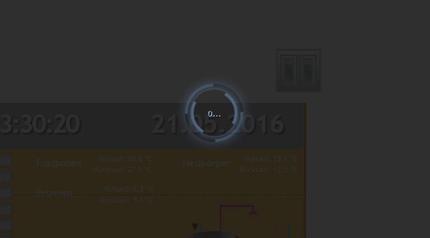

# Visualisierung

Webvisualisierung für die ioBroker-Plattform.

_**Die Entwicklung dieser Version wurde eingestellt. Bitte migrieren Sie Ihre Projekte auf vis-2.**_

## Lizenzanforderungen

Der Adapter ist für alle Verwendungszwecke kostenlos.

## Installation & Dokumentation


[Online-Demos](https://iobroker.click/)

## Bindungen von Objekten

Normalerweise verfügen die meisten Widgets über ein ObjectID-Attribut, das mit einem Objekt-ID-Wert verknüpft werden kann. Es gibt jedoch noch eine weitere Möglichkeit, _ein beliebiges_ Widget-Attribut an eine ObjectID zu binden.

Schreiben Sie einfach in das Attribut. `{object.id}` und es wird (nicht im Bearbeitungsmodus) an den Wert dieses Objekts gebunden. Bei Verwendung des speziellen Formats können Sie sogar einfache Operationen damit durchführen, z. B. Multiplikation oder Formatierung. Das Muster hat folgendes Format:

```
{objectID;operation1;operation2;...}
```

Folgende Operationen werden unterstützt:

- `\*` Multiplikation. Das Argument muss in Klammern stehen, z. B. "\*(4)". In diesem Beispiel multiplizieren wir den Wert mit 4.
- `\+` - addieren. Das Argument muss in Klammern stehen, z. B. "+(4,5)". In diesem Beispiel addieren wir den Wert 4,5.
- `\-` - Subtrahieren. Das Argument muss in Klammern stehen, z. B. "-(-674,5)". In diesem Beispiel subtrahieren wir vom Wert -674,5.
- `/` - Division. Das Argument muss in Klammern stehen, z. B. "/(0,5)". In diesem Beispiel teilen wir den Wert durch 0,5.
- `%` Modulo. Das Argument muss in eckigen Klammern stehen, z. B. "%(5)". In diesem Beispiel berechnen wir den Modulo von 5.
- `round` - Runden Sie den Wert.
- `round(N)` - Runde den Wert auf N Nachkommastellen, z. B. 34,678;round(1) => 34,7
- `hex` - Wert in Hexadezimalwert umwandeln. Alle Buchstaben sind kleingeschrieben.
- `hex2` - Wert in Hexadezimalwert umwandeln. Alle Buchstaben werden kleingeschrieben. Ist der Wert kleiner als 16, wird eine führende Null hinzugefügt.
- `HEX` - Dasselbe wie Hexadezimal, nur in Großbuchstaben.
- `HEX2` - das Gleiche wie hex2, aber in Großbuchstaben.
- `date` - Datum gemäß dem angegebenen Format formatieren. Das Format ist dasselbe wie in [iobroker.javascript.](https://github.com/iobroker/iobroker.javascript/blob/master/README.md#formatdate)
- `min(N)` - Wenn der Wert kleiner als N ist, nimm N, sonst den Wert
- `max(M)` - Wenn der Wert größer als M ist, nimm M, ansonsten den Wert
- `sqrt` - Quadratwurzel
- `pow(n)` - Potenz von N.
- `pow` - Zweierpotenz.
- `floor` - Math.floor
- `ceil` - Math.ceil
- `json` - Operation zum Abrufen von JSON- oder Objekteigenschaften. Z. B. `{id;json(common.name.en)}`
- `random(R)` - Math.random() \* R, oder einfach Math.random(), wenn kein Argument angegeben wird
- `formatValue(decimals)` - Wert gemäß Systemeinstellungen formatieren und Dezimalstellen verwenden
- `date(format)` - Wert als Datum formatieren. Das Format sieht folgendermaßen aus: `YYYY-MM-DD hh:mm:ss.sss`
- `momentDate(format, useTodayOrYesterday)` - Wert mithilfe von Moment.js als Datum formatieren. [Zulässige Formate müssen gemäß der Moment.js-Bibliothek eingegeben werden](https://momentjs.com/docs/#/displaying/format/) . `useTodayOrYesterday=true` das momentjs-Format `ddd` /`dddd` werden mit heute / gestern überschrieben
- `array(element1,element2[,element3,element4])` - Gibt das Element mit dem angegebenen Index zurück. Beispiel: `{id.ack;array(ack is false,ack is true)}`

Sie können dieses Muster in jedem beliebigen Text verwenden, zum Beispiel

```
My calculations with {objectID1;operation1;operation2;...} are {objectID2;operation3;operation4;...}
```

oder Farbberechnungen:

```
#{objectRed;/(100);*(255);HEX2}{objectGreen;HEX2}{objectBlue;HEX2}
```

Um den Zeitstempel eines Objekts anzuzeigen, schreiben Sie `.ts` oder `.lc` (für die letzte Änderung) am Ende der Objekt-ID, z. B.:

```
Last change: {objectRed.lc;date(hh:mm)}
```

Es gibt noch eine weitere Möglichkeit, das Muster zu schreiben:

```
Hypotenuse of {height} and {width} = {h:height;w:width;Math.max(20, Math.sqrt(h*h + w*w))}
```

`{h:height;w:width;h*w}` wird als Funktion interpretiert:

```
value = (function () {
    var h = "10";
    var w = "20";
    return Math.max(20, Math.sqrt(h*h + w*w));
})();
```

Sie können _beliebige_ JavaScript-Funktionen verwenden. Argumente müssen mit ':' definiert werden, andernfalls werden sie als Formel interpretiert.

Achten Sie auf die Datentypen. Alle sind als Zeichenketten definiert. Um sicherzustellen, dass der Wert als Zahl behandelt wird, verwenden Sie die Funktion \`parseFloat\`.

```
Hypotenuse of {height} and {width} = {h:height;w:width;Math.max(20, Math.sqrt(Math.pow(parseFloat(h), 2) + Math.pow(parseFloat(w), 2)))}
```

### Spezielle Bindungen

Es gibt eine Reihe unterschiedlicher interner Bindungen, um zusätzliche Informationen in Ansichten bereitzustellen:

- `username` - zeigt den angemeldeten Benutzer an
- `view` - Name der aktuellen Ansicht
- `wname` - Widget-Name
- `widget` - ist ein Objekt mit allen Daten des Widgets. Kann nur im JS-Teil verwendet werden, wie z. B. `{a:a;widget.data.name}`
- `wid` - Name des eigentlichen Widgets
- `language` - kann sein `de`, `en` oder `ru` Die
- `instance` - Browserinstanz
- `login` - ob eine Anmeldung erforderlich ist oder nicht (z. B. zum Ein-/Ausblenden des Abmeldebuttons)
- `local_*` - wenn der Staatsname mit folgendem beginnt `local_` Es wird nicht an ioBroker gemeldet, aktualisiert aber alle Widgets, die von diesem Zustand abhängen. (Lokale Variable der aktuellen Browsersitzung)

Hinweis: Um ":" in Berechnungen (z. B. in einer Formel) zu verwenden, verwenden Sie stattdessen "::" .

**Denken Sie daran** , dass Stildefinitionen als Bindungen interpretiert werden, also verwenden Sie `{{style: value}}` oder einfach

```
{
	style: value
}
```

dafür.

## Filter

Um die Gesamtzahl der Widgets in einer einzigen Ansicht darzustellen, können Sie Filter verwenden, um die Anzahl der gleichzeitig in der Ansicht angezeigten Widgets zu reduzieren.

Jedes Widget hat ein Feld `filter` Wenn Sie es auf einen bestimmten Wert setzen, z.B. `light` Sie können also auch andere Widgets verwenden. `(bars - filters, filter - dropdown)` um zu steuern, welcher Filter tatsächlich aktiv ist.

## Steuerungsschnittstelle

Vis erstellt 3 Variablen:

- `control.instance` - Hier sollte die Browserinstanz angegeben werden oder `FFFFFFFF` wenn jeder Browser kontrolliert werden muss.
- `control.data` - Parameter für den Befehl. Siehe die spezifische Befehlsbeschreibung.
- `control.command` - Befehlsname. Durch Schreiben dieser Variable wird der Befehl ausgelöst. Das bedeutet, dass vor der Ausführung des Befehls die Variablen „Instanz“ und „Daten“ mit Daten vorbereitet werden müssen.

Befehle:

- `alert` - Zeigt ein Warnfenster in der Visualisierung an. "control.data" hat das Format "message;title;jquery-icon". Titel und jquery-icon sind optional. Die Namen der Icons finden Sie [hier](http://jqueryui.com/themeroller/) . Um das Icon "ui-icon-info" anzuzeigen, schreiben Sie `Message;;info` Die
- `changeView` - Wechseln Sie zur gewünschten Ansicht. "control.data" muss den Namen der Ansicht enthalten. Sie können auch den Projektnamen als "project/view" angeben. Das Standardprojekt ist "main".
- `refresh` - die Ansicht neu laden, beispielsweise nachdem ein Projekt geändert wurde, sodass sie in allen Browsern neu geladen wird.
- `reload` - Dasselbe wie beim Aktualisieren.
- `dialog` - Dialogfenster anzeigen. Der Dialog muss in der Ansicht vorhanden sein. Eine der folgenden Optionen:

  - `static    - HTML    - Dialog`,
  - `static    - Icon    - Dialog`,
  - `container - HTML    - view in jqui Dialog`,
  - `container - ext cmd - view in jqui Dialog`,
  - `container - Icon    - view in jqui Dialog`,
  - `container - Button  - view in jqui Dialog` Die

  `control.data` muss die ID des Dialog-Widgets haben, z. B. `w00056` Die
- `dialogClose`
- `popup` - öffnet ein neues Browserfenster. Der Link muss angegeben werden in `control.data` z. B. <http://google.com>
- `playSound` - Audiodatei abspielen. Der Link zur Datei ist angegeben in `control.data` z. B. <http://www.modular-planet.de/fx/marsians/Marsiansrev.mp3> . Sie können Ihre eigene Datei in vis hochladen und sie beispielsweise abspielen lassen. `/vis.0/main/img/myFile.mp3` Die

Wenn der Benutzer die Ansicht ändert oder beim Start, werden die Variablen von der Ansicht mit

- `control.instance`: Browserinstanz und `ack=true`
- `control.data`: Projekt- und Ansichtsname im Formular `project/view` z.B. `main/view` (Und `ack=true`)
- `control.command`: `changedView` Und `ack=true`

Sie können die JSON-Zeichenfolge oder das Objekt in Folgendes schreiben: `control.command` als `{instance: 'AABBCCDD', command: 'cmd', data: 'ddd'}` In diesem Fall werden die Instanz und die Daten aus einem JSON-Objekt entnommen.

Beispiel für einen JavaScript-Adapter:

```
setState('vis.0.control.command', {"instance": "*", "command": "refresh", "data": ""});
```

## Standardansicht

Sie können für jede Ansicht die gewünschte Auflösung festlegen (Menü => Werkzeuge => Auflösung). Dies ist lediglich der visuelle Rahmen im Bearbeitungsmodus, der Ihnen die Bildschirmgröße auf einem bestimmten Gerät anzeigt. Im Echtzeitmodus ist er nicht sichtbar, und alle Widgets außerhalb des Rahmens sind sichtbar.

Zusätzlich können Sie festlegen, ob diese Ansicht für diese Auflösung als Standard verwendet werden soll.

Also jedes Mal, wenn `index.html` (ohne `#viewName` Wird die entsprechende Option aufgerufen, wird die für diese Bildschirmauflösung am besten geeignete Ansicht geöffnet. Ist nur eine Ansicht als _„Standard“_ gekennzeichnet, wird diese unabhängig von Bildschirmauflösung und -ausrichtung geöffnet.

Sie können beispielsweise zwei Ansichten erstellen, „Querformat-Mobil“ und „Hochformat-Mobil“, und zwischen diesen beiden Ansichten wird automatisch umgeschaltet, wenn Sie die Ausrichtung oder die Bildschirmgröße ändern.

Es gibt ein Hilfs-Widget namens „basic - Screen Resolution“, das die aktuelle Bildschirmauflösung und die am besten geeignete Standardansicht für diese Auflösung anzeigt.

## Webkomponenten

Adapter können [ioBroker-Webkomponenten](https://github.com/ioBroker/web-components) einbinden: benutzerdefinierte Elemente, die von vis, vis-2, admin und anderen Hosts einheitlich angezeigt werden. Ein Adapter listet diese auf in `common.webComponents` seiner `io-package.json` Die

vis findet die Webkomponenten aller installierten Adapter beim Start des Editors oder der Laufzeitumgebung (nach der Installation eines solchen Adapters ist kein Neustart von vis erforderlich) und zeigt sie als Widgets des Widget-Sets "webcomponents" an:

- Die Einstellungen einer Komponente sind die Attribute des Widgets mit ihren Bezeichnungen, Standardwerten, Optionen und den Zuständen „ausgeblendet“ und „deaktiviert“.
- Die Gruppe „Webkomponente“ verwendet das Design der Komponente: „auto“ verwendet Dunkel, wenn die Textfarbe des Widgets hell ist. Optional kann eine Primärfarbe festgelegt werden.
- Die Laufzeitumgebung lädt die Komponenten nur, wenn eine Ansicht eine solche Komponente anzeigt. Eine Komponente, die einen Wert bearbeitet (`editsValue`) wird nicht angeboten, da vis keine Werte speichert.
- Die Veranstaltung `iob-navigate` Eine Komponente öffnet die Ansicht mit dem entsprechenden Namen.

Ein Browser ohne ES-Module und benutzerdefinierte Elemente zeigt anstelle der Komponente einen Hinweis an. Die Ansichten und alle anderen Widgets funktionieren wie zuvor.

## Einstellungen

### Neu laden, wenn die Wartezeit länger als

Es gibt eine Regel, nach der die gesamte VIS-Seite nach einer gewissen Zeit der Verbindungsunterbrechung neu geladen wird, um das Projekt zu synchronisieren. Sie können dies im Menü „Einstellungen…“ konfigurieren. Wenn Sie ein Intervall auf „Nie“ setzen, wird die Seite nie neu geladen.

### Wiederverbindungsintervall

Legen Sie das Intervall zwischen den Verbindungsversuchen bei Verbindungsabbruch fest. Bei einer Einstellung von 2 Sekunden wird alle 2 Sekunden versucht, die Verbindung wiederherzustellen.

### Dunkler Wiederverbindungsbildschirm

Manchmal (nachts) ist ein dunkler Ladebildschirm erforderlich. Mit dieser Option können Sie dies einstellen.

Beachten Sie, dass diese Einstellungen nur für die Wiederverbindung und nicht für die erste Verbindung gelten.



<!--
    Placeholder for the next version (at the beginning of the line):
    ### **WORK IN PROGRESS**
-->

## Changelog
### 1.6.1 (2026-11-20)
* (bluefox) Added support of ioBroker web components (`@iobroker/web-components`): the components of the installed adapters are shown as widgets of the set "webcomponents"

### 1.6.0 (2026-11-19)
* (bluefox) Modern look of the editor for the themes "Light" and "Dark" (only the editor, the runtime and the views are not changed). "Dark-Hive" and "redmond" keep the classic look.
* (bluefox) Modern loading screen in the editor for the themes "Light" and "Dark"
* (bluefox) Fixed the error "Unexpected non-whitespace character after JSON" if the browser instance ID was stored as plain text
* (bluefox) Fixed changing of the browser instance ID in the editor
* (bluefox) The pages with the installed widget sets are generated only at the start of the instance and not by "npm install" anymore
* (bluefox) Backend migrated to TypeScript
* (bluefox) Fixed: the settings "always" and "dependencies" of widget sets found outside of the ioBroker "node_modules" directory were ignored

### 1.5.7 (2026-10-04)
* (bluefox) Global `let`/`const` variables of widget sets are visible again if the widget sets are loaded dynamically (e.g. via cloud).
* (ioBroker-Bot) Adapter requires js-controller >= 6.0.11 now.
* (bluefox) Removed usage of `storage` and uses localStorage instead.

### 1.5.5 (2024-04-12)
* (bluefox) Corrected small warning

### 1.5.4 (2023-11-29)
* (agav99) added the new binding operation for getting property of JSON or object
* (agav99) Checked the initialization of the `local_` variables
* (agav99) fixed subscribeOidAtRuntime
* (stephanritscher) Added dynamic web manifest
* (agav99) Optimization for basic-view in widget8
* (oweitman) Changed binding regex to accept umlauts
* (mcm1957) Corrected first installation of vis

## License
The MIT License (MIT)

Copyright (c) 2013-2026 Denis Haev <dogafox@gmail.com>,
Copyright (c) 2013      hobbyquaker

Permission is hereby granted, free of charge, to any person obtaining a copy
of this software and associated documentation files (the "Software"), to deal
in the Software without restriction, including without limitation the rights
to use, copy, modify, merge, publish, distribute, sublicense, and/or sell
copies of the Software, and to permit persons to whom the Software is
furnished to do so, subject to the following conditions:

The above copyright notice and this permission notice shall be included in
all copies or substantial portions of the Software.

THE SOFTWARE IS PROVIDED "AS IS", WITHOUT WARRANTY OF ANY KIND, EXPRESS OR
IMPLIED, INCLUDING BUT NOT LIMITED TO THE WARRANTIES OF MERCHANTABILITY,
FITNESS FOR A PARTICULAR PURPOSE AND NONINFRINGEMENT. IN NO EVENT SHALL THE
AUTHORS OR COPYRIGHT HOLDERS BE LIABLE FOR ANY CLAIM, DAMAGES OR OTHER
LIABILITY, WHETHER IN AN ACTION OF CONTRACT, TORT OR OTHERWISE, ARISING FROM,
OUT OF OR IN CONNECTION WITH THE SOFTWARE OR THE USE OR OTHER DEALINGS IN
THE SOFTWARE.