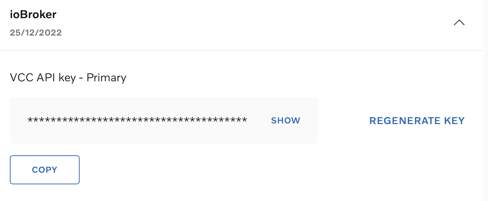

# ioBroker.volvo

## Volvo Cars Adapter für ioBroker

Dieser Adapter verbindet Ihr Volvo-Fahrzeug mit ioBroker über die [Volvo Connected Vehicle API](https://developer.volvocars.com/apis/) und [die Energy API v2](https://developer.volvocars.com/apis/energy/v2/overview/) .

### Unterstützte Funktionen

- 🔋 Batterieladestand, elektrische Reichweite, Ladestatus (PHEV / BEV)
- ⛽ Kraftstoffstand, Kilometerzähler, Reisestatistik
- 🚪 Tür-, Fenster- und Schlossstatus
- 📍 GPS-Standort
- 🔧 Diagnose (Servicewarnungen, Bremsflüssigkeit, Öl, Reifen, Beleuchtung)
- 🔑 Fernbedienungsfunktionen (Verriegeln/Entriegeln, Hupen, Blinken, Klimatisierung)
- 🔌 Volvo Wallbox (Energy Device API): Wallbox-Informationen, Ladevorgänge, Starten/Pausieren des Ladevorgangs, Lade-/Entladestrombegrenzung
- 🔄 Automatische Datenaktualisierung in konfigurierbaren Intervallen
- 🔐 Token-Persistenz – übersteht Adapterneustarts ohne erneute Anmeldung

---

## Einrichtungsanleitung

### 1. Einen VCC-API-Schlüssel anfordern

1. Gehen Sie zu [developer.volvocars.com](https://developer.volvocars.com/account/) und melden Sie sich an (mit Ihrem Google- oder GitHub-Konto).
2. Erstellen Sie eine neue **Anwendung** .
3. Kopieren Sie den **VCC-API-Schlüssel (Primär)** .

### 2. Konfigurieren Sie den Adapter

1. Öffnen Sie die Adaptereinstellungen in ioBroker.
2. Geben Sie Ihre **Volvo ID-E-Mail-Adresse** und **Ihr Passwort** ein (die gleichen Anmeldedaten, die Sie in der Volvo Cars App verwenden).
3. Fügen Sie den **VCC-API-Schlüssel** ein.
4. Stellen Sie das **Aktualisierungsintervall** ein (Standard: 5 Minuten).

### 3. Mit OTP anmelden

Die Volvo-API verwendet einen Zwei-Faktor-Authentifizierungsprozess mit einem Einmalpasswort (OTP):

1. Klicken Sie in den Adaptereinstellungen auf **„Anmeldung starten (OTP senden)“** .
2. Prüfen Sie Ihre E-Mails auf den OTP-Code von Volvo.
3. Geben Sie den Code ein und klicken Sie auf **„OTP senden“** .
4. Der Adapter speichert die Anmeldedaten und erneuert sie automatisch. Sie müssen die OTP-Anmeldung nur dann wiederholen, wenn der Adapter etwa 90 Tage lang nicht verwendet wurde oder Volvo die Sitzung beendet (z. B. nach einer Passwortänderung).

> **Hinweis:** Sollte die Anmeldung ungültig sein, protokolliert der Adapter einen Fehler und pausiert die Aktualisierungen. Wiederholen Sie einfach die OTP-Anmeldung in den Adaptereinstellungen.

---

## Datenpunkte

Der Adapter erzeugt die folgende Datenpunktstruktur unter `volvo.0.<VIN>`:

| Weg                                | Beschreibung                                                       |
| ---------------------------------- | ------------------------------------------------------------------ |
| `energy.batteryChargeLevel.*`      | Akkuladestand (%), aktualisierter Zeitstempel                      |
| `energy.electricRange.*`           | Elektrische Reichweite (km)                                        |
| `energy.chargingStatus.*`          | Ladestatus (LEERLAUF, LÄDT, etc.)                                  |
| `energy.chargerConnectionStatus.*` | Ladeanschluss (VERBUNDEN, GETRENNT)                                |
| `status.doors.*`                   | Türstatus (OFFEN/GESCHLOSSEN), Zentralverriegelung                 |
| `status.windows.*`                 | Fensterzustände einschließlich Schiebedach                         |
| `status.fuel.*`                    | Kraftstoffmenge (Liter)                                            |
| `status.odometer.*`                | Kilometerstand (km)                                                |
| `status.diagnostics.*`             | Servicehinweise, Entfernung/Zeit bis zum Service                   |
| `status.statistics.*`              | Kraftstoff-/Energieverbrauch, Tageskilometerzähler                 |
| `status.engine-status.*`           | Motor läuft                                                        |
| `status.warnings.*`                | Lichtwarnleuchten (Bremslichter, Nebelscheinwerfer, Blinker usw.). |
| `location.*`                       | GPS-Koordinaten, Richtung, Zeitstempel                             |
| `remote.*`                         | Fernbedienungsbefehle (Tasten)                                     |

## Fernbefehle

Verwenden Sie die Schaltflächen unten `volvo.0.<VIN>.remote` um Ihr Fahrzeug zu steuern:

- `lock` /`unlock` — Auto verriegeln oder entriegeln
- `climatization-start` /`climatization-stop` — Vorkonditionierung starten oder beenden
- `honk` /`flash` /`honk-flash` — Hupe betätigen, Lichthupe einsetzen oder beides
- `lock-reduced-guard` — Verriegelung mit reduziertem Schutz
- `refresh` — Alle Daten manuell aktualisieren

## Volvo Wallbox (optional)

Es werden ausschließlich Volvo-Wallboxen unterstützt (Energy Device API). Da die Volvo-API Ihre Wallboxen nicht auflisten kann, geben Sie bitte die **EVSE-ID** aus dem von Volvo mitgelieferten Dokument in den Adaptereinstellungen ein (mehrere IDs durch Kommas getrennt). Lassen Sie das Feld leer, falls Sie keine Volvo-Wallbox besitzen – der Adapter sendet dann keine Wallbox-Anfragen.

Wenn Sie nach Ihrer letzten Anmeldung eine Wallbox hinzufügen, melden Sie sich einmalig mit dem OTP an, damit der Adapter die Wallbox-Berechtigungen erhält.

Datenpunkte unter `volvo.0.wallbox.<EVSE ID>` (Charaktere wie `*` werden ersetzt durch `_`):

| Weg                                                     | Beschreibung                         |
| ------------------------------------------------------- | ------------------------------------ |
| `info.*`                                                | Wallbox-Informationen aus der API    |
| `chargingSessions.count` /`totalEnergy` /`json`         | Ladevorgänge der letzten 7 Tage      |
| `chargingSessions.last.*`                               | Letzte Ladesitzung                   |
| `remote.start` /`remote.pause`                          | Ladevorgang starten oder pausieren   |
| `remote.chargingAmpLimit` /`remote.dischargingAmpLimit` | Schreiben Sie eine Stromgrenze in A. |
| `remote.refresh`                                        | Aktualisieren Sie die Wallbox-Daten. |
| `remote.lastCommandStatus`                              | Ergebnis des letzten Befehls (JSON)  |

> **Hinweis:** Die Wallbox-Unterstützung wurde anhand der API-Dokumentation von Volvo ohne Testgerät implementiert. Bitte melden Sie Probleme in einem GitHub-Issue.

---

## Changelog

### 4.0.1
- Fix: remote commands (lock, unlock, climatization, …) failed with error 415, Volvo now requires a JSON body for commands

### 4.0.0
- **Breaking:** Volvo ID moves to a new login system (Keycloak) and the old one stops working after January 2027. The adapter now logs in like the current Volvo Cars app. **Please log in again once:** click "Start Login (Send OTP)" in the adapter settings and submit the OTP from the email
- Change: the login stays valid as long as the adapter runs; a new OTP login is only needed after about 90 days without the adapter running
- New: Volvo wallbox support via the Energy Device API (wallbox info, charging sessions, start/pause, current limits); enter the EVSE ID in the settings. Built from the documentation without a test device
- Removed: the warning before the fixed 180-day login limit, Volvo no longer has such a limit
- Fix: when a car is removed from the Volvo ID (e.g. replaced by a new one), the adapter logs one warning and reloads the vehicle list instead of logging 403 errors every few minutes until a restart

### 3.1.0
- New: login method of the Volvo Cars app (Authorization Code with PKCE, DPoP-bound tokens). Volvo disabled the client the adapter used before, see [#155](https://github.com/TA2k/ioBroker.volvo/issues/155). **Please log in again once:** click "Start Login (Send OTP)" in the adapter settings and submit the OTP from the email
- Change: the OTP email is only sent when you click "Start Login (Send OTP)", no longer automatically on adapter start
- Change: the OTP is submitted with the "Submit OTP" button only; it is no longer saved in the settings

### 3.0.4
- Fix: Volvo disabled the login client used by this adapter on 2026-10-26 (`invalid_client`). The adapter now logs one clear error and pauses updates instead of repeating errors every few minutes. Login does not work until a new login method is implemented, see [#155](https://github.com/TA2k/ioBroker.volvo/issues/155)
- Chore: dependency updates
  - `json2iob` 2.6.26 → 2.6.28
  - `qs` 6.16.0 → 6.16.1
  - `@iobroker/testing` 6.2.2 → 6.3.1, `@types/node` 22.20.4 → 22.20.5

### 3.0.3
- Fix: no more log spam after the Volvo login (refresh token, ~180 days) expired; updates pause until you log in again
- New: warning 7 days before the login expires
- Chore: dependency updates

### 3.0.2
- Chore: dependency updates
  - `axios` 1.16.1 → 1.19.0
  - `qs` 6.15.2 → 6.16.0
  - `@iobroker/adapter-core` 3.3.2 → 3.4.3
  - `json2iob` 2.6.22 → 2.6.25
  - dev: `@iobroker/testing` 5.3.0, `@tsconfig/node22` 22.0.6, `@types/node` 22.20.1, `@alcalzone/release-script` 5.2.1, `@alcalzone/release-script-plugin-license` 5.2.2
  - transitive: `brace-expansion`, `adm-zip`, `deepl-node`, `browserslist`, `js-yaml`, `form-data`

### 3.0.1
- Fix: address ioBroker repo checker findings:
  - `eslint.config.mjs` now imports `@iobroker/eslint-config`
  - Added `prettier.config.mjs`
  - License copyright line updated to `(c)` format
  - All `setInterval`/`setTimeout` migrated to `this.setInterval`/`this.setTimeout`
  - i18n migrated to short format (`{lang}.json`)

Older changes: CHANGELOG_OLD.md

## License

MIT License

Copyright (c) 2020-2026 TA2k <tombox2020@gmail.com>

Permission is hereby granted, free of charge, to any person obtaining a copy
of this software and associated documentation files (the "Software"), to deal
in the Software without restriction, including without limitation the rights
to use, copy, modify, merge, publish, distribute, sublicense, and/or sell
copies of the Software, and to permit persons to whom the Software is
furnished to do so, subject to the following conditions:

The above copyright notice and this permission notice shall be included in all
copies or substantial portions of the Software.

THE SOFTWARE IS PROVIDED "AS IS", WITHOUT WARRANTY OF ANY KIND, EXPRESS OR
IMPLIED, INCLUDING BUT NOT LIMITED TO THE WARRANTIES OF MERCHANTABILITY,
FITNESS FOR A PARTICULAR PURPOSE AND NONINFRINGEMENT. IN NO EVENT SHALL THE
AUTHORS OR COPYRIGHT HOLDERS BE LIABLE FOR ANY CLAIM, DAMAGES OR OTHER
LIABILITY, WHETHER IN AN ACTION OF CONTRACT, TORT OR OTHERWISE, ARISING FROM,
OUT OF OR IN CONNECTION WITH THE SOFTWARE OR THE USE OR OTHER DEALINGS IN THE
SOFTWARE.