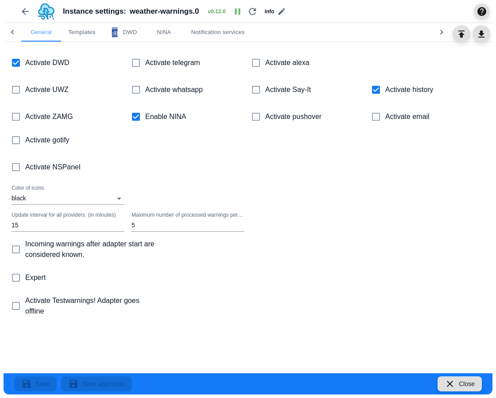
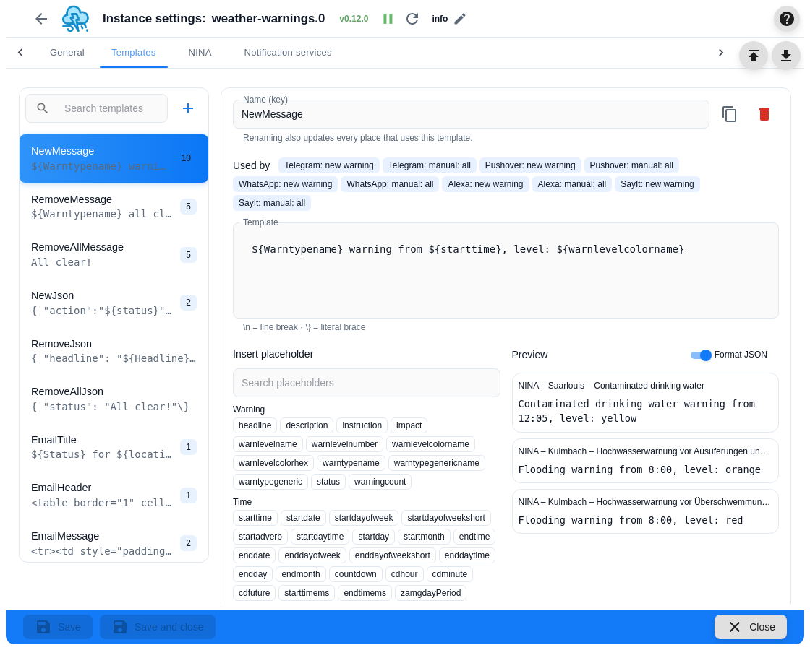
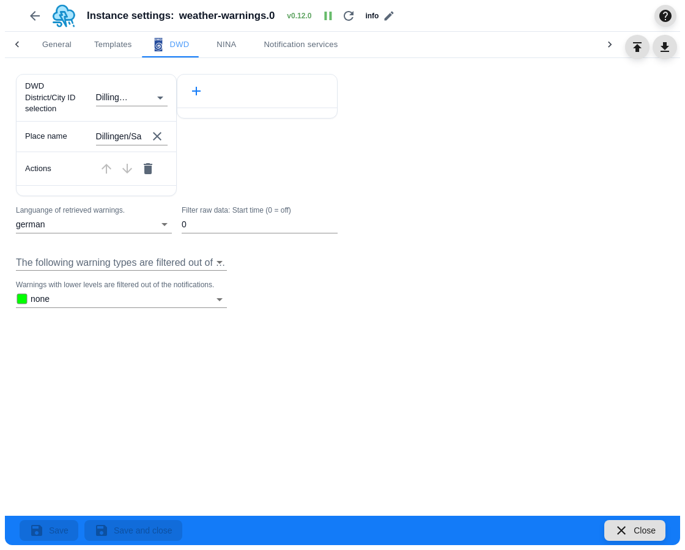
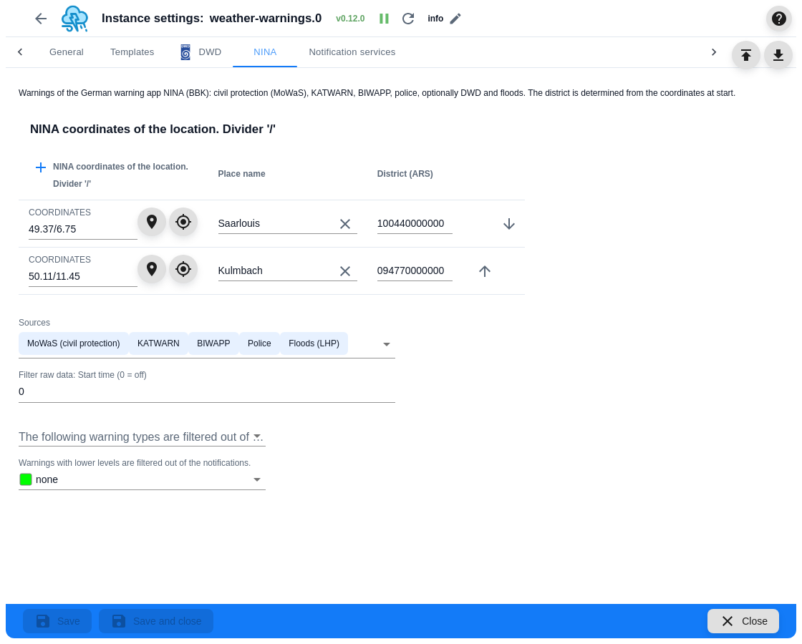
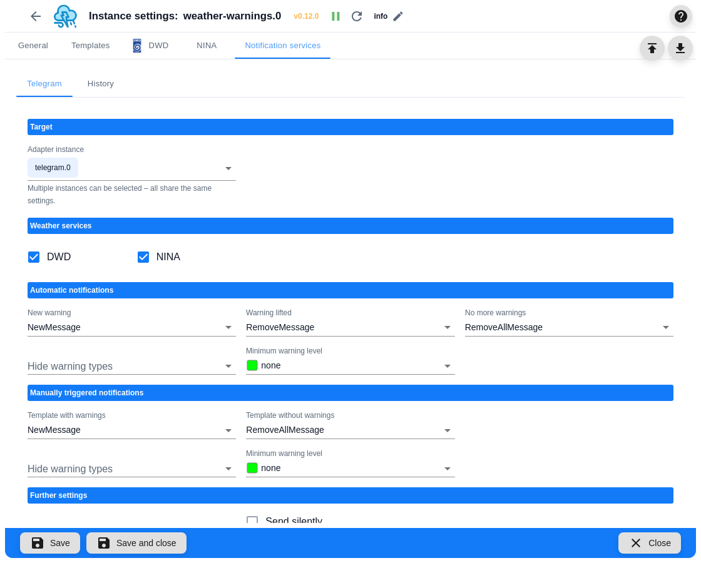

# ioBroker.weather-warnings

## Wetterwarnungsadapter für ioBroker

[Deutsche Readme](/#/docs/adapterref/iobroker.weather-warnings/README_DE.md)

Dieser Adapter sammelt offizielle Wetter- und Katastrophenschutzwarnungen für Ihre Standorte und

- sendet sie als Text- oder Sprachnachrichten (Telegram, WhatsApp, Pushover, Gotify, E-Mail, NSPanel, Alexa, SayIt),
- Schreibt sie in Zustände (Rohdaten, formatierte Werte, Warnungen gruppiert nach Typ) für VIS und Skripte.

Alle Texte basieren auf Vorlagen, die Sie im Adminbereich bearbeiten und in der Live-Vorschau ansehen können.

### Anbieter

| Anbieter                         | Bereich     | Standort                             | Anmerkungen                                                                           |
| -------------------------------- | ----------- | ------------------------------------ | ------------------------------------------------------------------------------------- |
| **DWD** (Deutscher Wetterdienst) | Deutschland | Gemeinde oder Bezirk aus einer Liste | offizielle Wetterwarnungen                                                            |
| **UWZ** (Unwetterzentrale)       | Europa      | Koordinaten                          | Wetterwarnungen                                                                       |
| **ZAMG / GeoSphere**             | Österreich  | Koordinaten                          | Wetterwarnungen                                                                       |
| **NINA** (BBK-Warn-App)          | Deutschland | Koordinaten → Bezirk                 | Zivilschutz: MoWaS, KATWARN, BIWAPP, Polizei; optional DWD und Hochwasserschutz (LHP) |

Mehrere Standorte pro Anbieter sind möglich. Jeder Standort ist ein separates Gerät (siehe unten). `provider.<provider>.<location>` Die

### Benachrichtigungsdienste

Telegram, WhatsApp, Pushover, Gotify, E-Mail, NSPanel (nspanel-lovelace-ui), Alexa (alexa2), SayIt sowie zwei adapterinterne Ausgänge:

- **Historie** : eine Liste der letzten Warnungen in einem Bundesstaat
- **JSON-Array** : die aktuellen Warnungen als JSON für Skripte

Telegram, WhatsApp, Pushover, Gotify und E-Mail können an mehrere Adapterinstanzen gleichzeitig senden.

## Anforderungen

- Node.js 22 oder neuer
- js-controller 6.0.11 oder neuer
- Admin 8.1.0 oder neuer

## Installation

Installieren Sie den Adapter über die ioBroker-Administration. Nach dem ersten Start schreibt die Instanz die Nachrichtenvorlagen in die Systemsprache. Falls die Konfigurationsseite bereits geöffnet war, **laden Sie sie neu,** um die Vorlagen anzuzeigen.

## Konfiguration

### Allgemein

- **DWD / UWZ / ZAMG / NINA aktivieren** : Aktiviert den Datenabruf dieses Anbieters. Jeder Anbieter hat eine eigene Registerkarte.
- **Aktivieren Sie Telegram / Pushover / …** : Dadurch wird ein Benachrichtigungsdienst aktiviert. Die Einstellungen finden Sie auf der Registerkarte _Benachrichtigungsdienste_ .
- **Farbe der Symbole** : Farbsatz, der verwendet wurde für `${iconurl}` Die
- **Aktualisierungsintervall** : in Minuten, für alle Anbieter (mindestens 5).
- **Maximale Anzahl verarbeiteter Warnungen pro Anbieter** : Anzahl der Statusplätze `00`, `01`, … pro Standort.
- **Eingehende Warnungen nach dem Start des Adapters gelten als bekannt** : Warnungen, die bereits beim Start des Adapters vorhanden sind, lösen keine Benachrichtigung aus.
- **Experte** : zeigt zusätzliche Einstellungen an (Ruhezeiten für die Sprachausgabe, alternative Symbol-URLs, in welche Statusordner geschrieben werden, Testoptionen).
- **Testwarnungen aktivieren** : Verwendet integrierte Testdaten anstelle der echten Anbieter.

### Vorlagen

Die Nachrichten werden aus Vorlagen erstellt. Der Editor zeigt

- die Liste der Vorlagen (durchsuchbar) mit der Anzahl der Stellen, an denen die jeweilige Vorlage verwendet wird,
- Wenn eine Vorlage verwendet wird ( **Verwendet von** ), werden durch das Umbenennen einer Vorlage alle diese Stellen aktualisiert.
- eine Palette aller Platzhalter – zum Einfügen anklicken,
- Eine vom Adapter gerenderte **Live-Vorschau** mit den aktuellen Warnungen (oder Beispieldaten, falls keine vorhanden sind).

Vorlagensyntax:

- `${token}` wird durch einen Wert der Warnung ersetzt, z. B. `${headline}`, `${starttime}` Ein großer Anfangsbuchstabe (`${Warntypename}`) kapitalisiert den Wert.
- `${_myTemplate}` Fügt eine weitere Vorlage ein. Vorlagen, deren Schlüssel mit einem `_` werden den Diensten nicht angeboten.
- `${[a,b,c,d,e]warnlevelnumber}` wählt einen Eintrag anhand eines numerischen Tokens aus, z. B. `${[0,🟢,🟡,🟠,🔴]warnlevelnumber}` Die
- `${(value=token)then#else}` oder `${(value=token)then}` – Vergleiche `=`, `!=`, `<`, `>` Die
- `\n` ist ein Zeilenumbruch; in JSON-Vorlagen muss eine schließende Klammer geschrieben werden als `\}` Die

**Durch „Vorlagen wiederherstellen“** werden alle Vorlagen auf die Standardvorlagen der aktuellen Systemsprache zurückgesetzt (Ihre Vorlagen gehen dabei verloren). **Durch „Standardvorlagen hinzufügen“** werden nur fehlende Vorlagen hinzugefügt.

All placeholders

| Platzhalter                                                                                 | Bedeutung                                                              |
| ------------------------------------------------------------------------------------------- | ---------------------------------------------------------------------- |
| `headline`, `description`, `instruction`, `impact`                                          | Texte der Warnung (`impact` (nur ZAMG)                                 |
| `warnlevelname`, `warnlevelnumber`                                                          | Niveau als Text / Zahl 0–4                                             |
| `warnlevelcolorname`, `warnlevelcolorhex`                                                   | Farbe des Levels als Text / Hexadezimaldarstellung                     |
| `warntypename`                                                                              | Warnungstyp, wie vom Anbieter übermittelt                              |
| `warntypegenericname`, `warntypegeneric`                                                    | Einheitlicher Warntyp (siehe unten) als Text/Zahl                      |
| `weatheremoji`, `iconurl`, `htmlicon`                                                       | Emoji, URL des Symbols, Symbol als Base64 ``                       |
| `location`, `locationcustom`, `provider`                                                    | Bereich des Anbieters, Ihr Ortsname, Anbieter                          |
| `starttime`, `startdate`, `startday`, `startmonth`, `startdayofweek`, `startdayofweekshort` | Start                                                                  |
| `endtime`, `enddate`, `endday`, `endmonth`, `enddayofweek`, `enddayofweekshort`             | Ende                                                                   |
| `startdaytime`, `enddaytime`, `startadverb`                                                 | Tageszeit, "heute/morgen/…"                                            |
| `countdown`, `cdhour`, `cdminute`, `cdfuture`                                                | Zeit bis zum Start                                                     |
| `starttimems`, `endtimems`                                                                  | Zeitstempel in ms (`endtimems` (ist 0, wenn die Warnung kein Ende hat) |
| `ceiling`, `altitude`                                                                       | Höhenbereich (DWD, UWZ)                                                |
| `status`, `warningcount`                                                                    | Neu / Halten / Alles frei, Anzahl der Warnungen                        |
| `zamgdayPeriod`                                                                             | ZAMG: Ganztägige Warnung                                               |

### Anbieter

- **DWD** : Wählen Sie die Gemeinde oder den Bezirk aus der Liste (ca. 10.000 Einträge). Nachdem Sie einen Ort ausgewählt haben, wechseln Sie bitte zu einem anderen Tab und dann wieder zurück – die Liste ist zu groß, um sofort aktualisiert zu werden.
- **UWZ** : Koordinaten `latitude/longitude` Der Adapter ruft den UWZ-Bereich einmalig ab und speichert ihn.
- **ZAMG** : Koordinaten innerhalb Österreichs.
- **Ortsname** : Ihr eigener Name für den Ort, verfügbar als `${locationcustom}` Die
- **Filter für Rohdaten: Startzeit** : Ignoriert Warnungen, die mehr als X Stunden in der Zukunft beginnen (0 = deaktiviert).
- **Warnungstypen** : Die ausgewählten Typen werden verworfen.
- **Stufe** : Warnungen unterhalb dieser Stufe werden ignoriert. Das farbige Quadrat zeigt die Farbe der Stufe an.

#### NINA

NINA ist die offizielle Warn-App des Bundesamts für Bevölkerungsschutz (BBK). Sie enthält Warnungen, die Wetterdienste nicht bereitstellen: Gefahrstoffe, Trinkwasser, Blindgänger, Stromausfälle, Polizeieinsätze, Überschwemmungen usw.

- **Koordinaten** : Vorbelegt aus den ioBroker-Systemeinstellungen. Beim Start ermittelt der Adapter anhand der Koordinaten den Landkreis und zeigt dessen Schlüssel (ARS) in der Tabelle an. NINA gibt Warnungen pro Landkreis aus, sodass zwei Orte im selben Landkreis nur einmal abgefragt werden.
- **Quellen** : Welche NINA-Quellen werden verwendet? Standardmäßig: MoWaS (Zivilschutz), KATWARN, BIWAPP und Polizei. **DWD** ist als eigener Anbieter verfügbar, und **Hochwasserwarnungen (LHP)** sind sehr lokal, daher sind beide standardmäßig deaktiviert.
- Warnungen ohne Ende (häufig bei MoWaS) werden als „bis auf Weiteres“ angezeigt. `${endtime}` Sie enden, sobald NINA sie entfernt.
- Alle Meldungen zum Löschen beenden die betreffende Warnung; Aktualisierungen einer Warnung ersetzen diese ohne eine neue Benachrichtigung (es sei denn, der Warnpegel steigt).
- Die Texte werden in der Systemsprache wiedergegeben, sofern NINA diese bereitstellt (ansonsten Englisch oder Deutsch; Hochwasserwarnungen sind nur auf Deutsch verfügbar).

### Benachrichtigungsdienste

Jeder aktivierte Dienst hat eine eigene Seite mit denselben Abschnitten:

- **Ziel** : die Adapterinstanz(en), an die gesendet werden soll/n. Ohne ein gültiges Ziel wird der Dienst nicht gestartet (siehe Protokoll).
- **Wetterdienste** : Welche Anbieter werden mit diesem Dienst übermittelt?
- **Automatische Benachrichtigungen** : Vorlagen für _neue Warnungen_ , _aufgehobene Warnungen_ (andere Warnungen weiterhin aktiv) und _keine weiteren Warnungen_ , plus ein Typfilter und eine Mindeststufe. Auswahl `none` da die Vorlage in diesem Fall nichts sendet.
- **Manuell ausgelöste Benachrichtigungen** : Vorlagen, die beim Schreiben verwendet werden `commands.send_message.<service>` – eine für „es gibt Warnungen“, eine für „keine Warnungen“.
- **Weitere Einstellungen** : dienstspezifische Optionen, z. B.
  - Telegram: Benutzernamen, Chat-ID, stille Nachrichten, Analysemodus
  - Pushover / Gotify: Priorität, Ton, Gerät, Inhaltstyp
  - NSPanel: Popup, Bildschirmschoner-Überschrift oder beides, Priorität, immer aktiviert
  - Alexa: Geräte, Lautstärke, Audiodatei vor der Nachricht, Ton pro Warnart (Experte)
  - SayIt: Instanzen und Volumen
  - E-Mail: Empfänger, Betreff, Kopf- und Fußzeilenvorlagen, Zeilenumbruch
  - Verlauf: Jeder formatierte Wert wird in den Verlauf geschrieben.

Die Sprachausgabe (Alexa, SayIt) kann über **Ruhezeitprofile** stummgeschaltet werden (Expertenprofil, Registerkarte _„Zusätzliche Einstellungen_ “), die mit \[hier fehlende Information] umgeschaltet werden können. `commands.silentTime.*` Die

## Warnstufen und -arten

| Ebene | Bedeutung   | Farbe                    |
| ----- | ----------- | ------------------------ |
| 0     | keiner      | Grün                     |
| 1     | unerheblich | Gelb                     |
| 2     | mäßig       | orange                   |
| 3     | schwer      | Rot                      |
| 4     | extrem      | violett (DWD: dunkelrot) |

Jeder Anbieter verwendet seine eigenen Warntypen. Der Adapter ordnet diese einheitlichen Typen zu, die für Filter, Symbole und die … verwendet werden. `alerts` Staaten:

`storm`, `snowfall`, `rain`, `cold`, `forest_fire`, `thunderstorm`, `black_ice_slippery`, `heat`, `hail`, `fog`, `thaw`, `flood`, `civil_protection`, `unknown`

`flood` Und `civil_protection` (Alle Nicht-Wetterereignisse von NINA) stammen von NINA.

## Staaten

| Zustand                                                                                              | Inhalt                                                                                                        |
| ---------------------------------------------------------------------------------------------------- | ------------------------------------------------------------------------------------------------------------- |
| `provider.<provider>.<location>.warning.NN`                                                          | Rohdaten der Warnung, wie sie vom Anbieter geliefert wurden (NINA: bereits bereinigt)                         |
| `provider.<provider>.<location>.formatedKeys.NN`                                                     | alle Platzhalter mit ihrem aktuellen Wert, plus Ihre Vorlagen, beginnend mit `_`                              |
| `provider.<provider>.<location>.alerts.<type>`                                                       | pro Warnungstyp: `level`, `start`, `end`, `headline`, `active`, `type` – die höchste aktive Warnung dieser Art |
| `provider.<provider>.<location>.history`, `.activeWarnings`, `.lastUpdate`                           | pro Standort                                                                                                  |
| `alerts.<type>`                                                                                      | Wie oben beschrieben, gilt dies für alle Anbieter und Standorte.                                              |
| `provider.activeWarnings`, `provider.hasActiveWarning`, `provider.maxLevel`, `provider.maxLevelText` | Zusammenfassung aller Warnungen                                                                               |
| `provider.history`                                                                                   | Historie ( _Servicehistorie_ )                                                                                |
| `commands.send_message.<service>`                                                                    | Mit diesem Dienst die aktuellen Warnungen senden (manuelle Vorlagen)                                          |
| `commands.silentTime.*`                                                                              | Ruhezeitprofil und Automatikmodus                                                                             |
| `commands.clearHistory`                                                                              | löscht die Geschichte                                                                                         |

Die Anzahl der Steckplätze `NN` _Die maximale Anzahl verarbeiteter Warnungen_ ist festgelegt. Leere Slots werden geleert, nicht gelöscht, sodass sich die Objektstruktur nicht bei jeder Warnung ändert.

## Allgemeines Verhalten

- Doppelte Benachrichtigungen zur selben Warnung werden nicht versendet: Aktualisierungen einer Warnung werden nur dann gesendet, wenn es sich um eine neue Warnung für Sie handelt.
- `alerts.<type>` Es wird eine Warnung pro Typ angezeigt: die **aktuell** aktive mit der höchsten Stufe, ansonsten die nächste in der Zukunft.
- Die Zeiten werden in der Zeitzone des ioBroker-Hosts angezeigt – stellen Sie sicher, dass der Host eine echte Zeitzone verwendet, wie z. B. `Europe/Berlin`, kein fester Versatz.

## Symbole

DWD-Symbol: Copyright beim Deutschen Wetterdienst

ZAMG-Symbol: Copyright by GeoSphere Austria

Wettersymbole:

- Schöpfer: [Adri Ansyah](https://www.youtube.com/channel/UChLOv1L-ftAFc2ZizdEAKgw?view_as=subscriber)
- Iconseite: <https://www.flaticon.com/packs/weather-613>
- Lizenz: [CC BY 4.0 Rechtscode](https://creativecommons.org/licenses/by/4.0/legalcode)
- Änderungen: Im Original sind sie blau, andere Farben sind Abwandlungen des Originals.

Flutsymbol (`flood.png`): „Überschwemmungssymbol von Adriansyah, Creative Commons, via ToSVG“ – <https://tosvg.com/icon/flooding-1044958> (umgefärbt)

Gefahrensymbol (`civil_protection.png`): „Danger Triangle icon by Paweł Gleń, Creative Commons, via ToSVG“ - <https://tosvg.com/icon/danger-triangle-1046822> (recolored)

## Changelog
<!--
	Placeholder for the next version (at the beginning of the line):
	### **WORK IN PROGRESS**
-->
### 1.0.0 (2026-11-21)
- (ticaki) **BREAKING**: requires admin 8.1.0 or newer
- (ticaki) **NEW**: NINA, the official German warning app (BBK), is available as a new provider: civil protection warnings (MoWaS), KATWARN, BIWAPP and police, optionally DWD and flood warnings. The location is taken from coordinates, prefilled from the system settings
- (ticaki) **NEW**: new warning types "flood" and "hazard" (civil protection) with icons and alert states
- (ticaki) **NEW**: all notification services are configured on one tab "Notification services" with clearly arranged sections. Existing settings are taken over automatically; the adapter restarts once after the update
- (ticaki) **NEW**: new template editor: search, insert placeholders with a click, see which services use a template, rename it safely and check the result in a live preview with the current warnings
- (ticaki) **NEW**: the level filters show the colour of each warning level
- (ticaki) **NEW**: NSPanel: warnings can be shown as popup, as headline in the screensaver or both
- (ticaki) **FIXED**: NSPanel: the option "always on" is now applied to the popup
- (ticaki) **FIXED**: Telegram: the chat ID entered in the settings is now used
- (ticaki) **FIXED**: an error in one provider no longer stops the updates of all providers
- (ticaki) **FIXED**: times of warnings that start or end on the other side of a daylight saving change are no longer shown one hour off
- (ticaki) **FIXED**: the countdown of warnings that are active for more than a month shows the correct number of days
- (ticaki) **NEW**: documentation rewritten with current screenshots (English and German)

### 0.12.0 (2026-09-20)
- (ticaki) **NEW**: telegram, whatsapp, pushover, gotify and email can now target multiple adapter instances at once; all selected instances share the same settings (#319)

### 0.11.3 (2026-07-19)
- (ticaki) **FIXED**: adapter no longer crashes in a restart loop in compact mode; the trailing `export = WeatherWarnings` overwrote the compact-mode factory export, so js-controller tried to call the class without `new` ("Class constructor WeatherWarnings cannot be invoked without 'new'") (#317)
- (ticaki) **FIXED**: resolved UWZ warncell IDs are now persisted correctly; the wrong (unmodified) copy was written back to `uwzwarncellTable`, so every start re-ran the same lookup and config write, which in turn triggered another restart (#317)

### 0.11.2 (2026-06-18)
- (ticaki) **FIXED**: DWD spoken/written color names (`warnlevelcolorname`) now come from an exact lookup of the official DWD CAP color palette instead of a hue heuristic; light heat violet is now distinguished from dark heat violet, and the extreme-storm, UV and preliminary-information colors are named correctly (adds the color names light violet, dark red, magenta and pink) (#220)

### 0.11.1 (2026-06-18)
- (ticaki) **FIXED**: spoken/written color name for DWD heat warnings (`warnlevelcolorname`) is now correct: the light violet DWD heat color (`#cc99ff`) was misclassified as "green" and is now named "violet", matching email/vis (#220)

## License

MIT License

Copyright (c) 2024-2026 ticaki <github@renopoint.de>

Permission is hereby granted, free of charge, to any person obtaining a copy
of this software and associated documentation files (the "Software"), to deal
in the Software without restriction, including without limitation the rights
to use, copy, modify, merge, publish, distribute, sublicense, and/or sell
copies of the Software, and to permit persons to whom the Software is
furnished to do so, subject to the following conditions:

The above copyright notice and this permission notice shall be included in all
copies or substantial portions of the Software.

THE SOFTWARE IS PROVIDED "AS IS", WITHOUT WARRANTY OF ANY KIND, EXPRESS OR
IMPLIED, INCLUDING BUT NOT LIMITED TO THE WARRANTIES OF MERCHANTABILITY,
FITNESS FOR A PARTICULAR PURPOSE AND NONINFRINGEMENT. IN NO EVENT SHALL THE
AUTHORS OR COPYRIGHT HOLDERS BE LIABLE FOR ANY CLAIM, DAMAGES OR OTHER
LIABILITY, WHETHER IN AN ACTION OF CONTRACT, TORT OR OTHERWISE, ARISING FROM,
OUT OF OR IN CONNECTION WITH THE SOFTWARE OR THE USE OR OTHER DEALINGS IN THE
SOFTWARE.