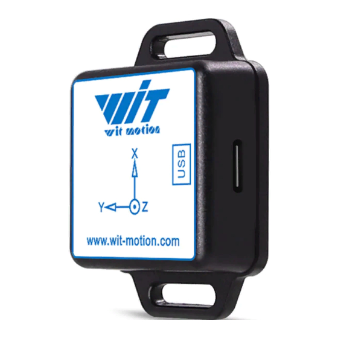

# ioBroker WitMotion

**Dieser Adapter nutzt die Sentry-Bibliotheken, um Ausnahmen und Codefehler automatisch an die Entwickler zu melden.** Weitere Details und Informationen zum Deaktivieren der Fehlerberichterstattung finden Sie in [der Sentry-Plugin-Dokumentation](https://github.com/ioBroker/plugin-sentry#plugin-sentry) . Die Sentry-Berichterstattung wird ab js-controller 3.0 verwendet.

Liest Daten vom WT901blecl 5.0 Bluetooth 5.0 9-Achsen IMU-Sensor (MPU9250) über USB und schreibt sie in ioBroker-Datenpunkte.

Folgende Daten werden in ioBroker gelesen und geschrieben:

- Beschleunigung X/Y/Z
- Gyroskop X/Y/Z
- Magnetometer X/Y/Z

Optional berechnet der Adapter die Wellenhöhe und -periode aus der vertikalen Bewegung des Sensors (siehe [Wellen](#waves) ).

## Unterstützte Geräte

- [WT901blecl 5.0](https://witmotion-sensor.com/products/bluetooth-5-0-accelerometer-inclinometer-wt901blecl-mpu9250-9-axis-imu-sensor)

## Wellen

Wenn **die Wellenfunktion** in den Einstellungen aktiviert ist, misst der Adapter den Seegang anhand der Hubbewegung des Sensors, ähnlich wie eine Wellenboje. Er nutzt jedes Datenpaket des Sensors (unabhängig von den Aktualisierungsintervallen der anderen Zustände): Die Beschleunigung wird mithilfe der Roll- und Nickbewegung des Sensors in die Vertikale umgerechnet, zweimal im Frequenzbereich innerhalb des Wellenperiodenbandes integriert, und die resultierende Hubbewegung wird ausgewertet.

| Zustand            | Einheit | Bedeutung                                                                                          |
| ------------------ | ------- | -------------------------------------------------------------------------------------------------- |
| `waves.height`     | M       | Signifikante Wellenhöhe Hs = 4·σ der Hebung (etwa der Mittelwert des höchsten Drittels der Wellen) |
| `waves.heightMax`  | M       | Höchste Einzelwelle (Tiefpunkt zu Gipfel) im Analysefenster                                        |
| `waves.period`     | S       | Mittlere Periode durch Nulldurchgang                                                               |
| `waves.periodPeak` | S       | Periode des Spektralmaximums, die Periode mit der höchsten Energie                                 |
| `waves.length`     | M       | Länge der Wellen mit der Spitzenperiode im tiefen Wasser, L = g·Tp²/(2π)                           |
| `waves.frequency`  | Hz      | Frequenz des Spektralpeaks, 1/Tp                                                                   |

Einstellungen: **Aktualisierungsintervall** (wie oft die Zustände geschrieben werden, Standard 30 s), **Analysefenster** (Länge des analysierten Datensatzes, Standard 300 s; die ersten Werte erscheinen nach der Hälfte davon), **Kürzeste** und **längste Wellenperiode** (das Band, Standard 2–20 s).

Wissenswertes:

- Montieren Sie den Sensor in der Nähe der Bootsmitte. Weiter entfernt davon verursacht die Stampfbewegung des Bootes zusätzliche vertikale Bewegungen, die nicht von der See herrühren.
- Die Werte geben die Bewegung des Bootes an. Kurze Wellen im Vergleich zum Rumpf (bei einer 13 m langen Yacht etwa unter 3–4 s) heben das Boot weniger an als hohe Wellen, daher wird ein kurzer Seegang unterschätzt.
- Während sich das Boot bewegt, entsprechen die Perioden und die Frequenz den Begegnungsperioden: kürzer bei Anfahrt auf die Wellen, länger bei Fahrt mit ihnen. Die Wellenhöhen hängen davon nicht ab, die Wellenlänge ist nur direkt vor Anker oder beim Driften relevant.
- Die Länge entspricht der von tiefem Wasser. Wo das Wasser flacher als halb so tief ist, sind die Wellen kürzer.
- Unterhalb einer signifikanten Wellenhöhe von 5 cm gilt das Wasser als ruhig: Die Perioden, die Länge und die Frequenz sind 0, da die Aufzeichnung nur das Rauschen des Sensors darstellt.
- Die Winkel allein (Roll- und Nickwinkel) geben nicht die Wellenhöhe auf einem Boot an: Sie zeigen, wie das Boot in seinem eigenen Rhythmus rollt, nicht die Neigung des Wassers.
- Der Sensor sollte mindestens 10 Werte pro Sekunde (Standardeinstellung) senden. Bei weniger als 1,5 Werten pro Sekunde (kürzeste Periode: 2 s) warnt der Adapter, dass Kurzwellen nicht erfasst werden.
- Bei ruhigem Wasser beträgt die Abweichung des Sensors einige Zentimeter.

## Gerätemanager

Im Reiter **„Geräteverwaltung“** der Instanzeinstellungen (bzw. der Geräteverwaltung im Administratorbereich) wird der Sensor als Karte mit seiner Verbindung und den Winkeln (Rollen, Nicken, Gieren) sowie Höhe, Länge und Frequenz der Wellen (jeweils ein Wert pro Zeile) angezeigt. Die Details listen alle aktivierten Werte und die Verbindung auf. Über die Karte können Sie die Verbindung testen und den seriellen Port sowie die Baudrate ändern.

## Visualisierung

### Geräte-App

Fügen Sie ein benutzerdefiniertes Widget vom Typ **„Wit Motion“** hinzu und wählen Sie die Instanz aus. Die Kachel zeigt ein Boot, ein Auto oder Ihr eigenes Bild, das um den gemessenen Winkel geneigt ist, oder einen Kompass für die Draufsicht.

- `1x1` – eine Achse
- `2x½` – nur die Werte
- `2x1` – eine Achse mit ihrem Wert oder zwei Achsen nebeneinander

Ein Klick auf die Kachel öffnet eine große Ansicht.

Wenn die Instanz die [Wellen](#waves) misst, zeigen die Kachel, das VIS-2-Widget und die Webkomponente die signifikante Wellenhöhe an: in der Kompaktansicht neben dem Namen, in der Leiste neben den Werten. Die Breit- und die Großansicht zeigen zusätzlich die Wellenlänge (λ) und die Frequenz an. Die Einstellung **„Wellen anzeigen“** blendet diese Informationen aus.

### vis-2

Das Widget-Set **WitMotion** enthält das Widget „ **Orientierung“** mit denselben Ansichten. Das Layout passt sich der Widget-Größe an (Leiste, Kompakt, Breitbild oder Großbild) oder kann in den Einstellungen fixiert werden. Ein Klick auf die kleineren Layouts öffnet die Großbildansicht.

### Webkomponenten

Die Ausrichtung ist ebenfalls eine Webkomponente (`common.webComponents`,[`@iobroker/web-components`](https://github.com/ioBroker/web-components) ), sodass Aura, Admin und alle anderen Hosts von Webkomponenten es anzeigen können:

- `<iob-witmotion-orientation>` ( **Wit Motion** ) – dieselben Ansichten wie beim vis-2-Widget: ein Boot, ein Auto oder Ihr eigenes Bild, geneigt um eine oder zwei Achsen, oder ein Kompass für die Draufsicht, jeweils als kompakte, Balken-, breite oder große Ansicht, abhängig von der Größe des Rahmens. Ein Klick auf die kleineren Ansichten öffnet die große Ansicht in einem Dialogfeld des Hosts.

Einstellungen:

- **Adapterinstanz** , **Wertmodus** (sofort oder durchschnittlich), **Name** , **Layout** (automatisch oder fest), **Große Ansicht bei Klick öffnen** , **Wellenformen anzeigen**
- **Symboltyp** (Boot, Auto oder benutzerdefiniert; ein benutzerdefiniertes Bild wird durch seine Adresse angegeben)
- **Primärachse** , **Primäransicht** , **visueller Multiplikator** und optional eine **Sekundärachse** mit eigener Ansicht und eigenem Multiplikator

Die Geräte-App bietet ihre eigene Kachel **„Wit Motion“** anstelle der gleichnamigen Webkomponente an.

<!--
	Placeholder for the next version (at the beginning of the line):
	### **WORK IN PROGRESS**
-->

## Changelog
### 2.3.0 (2026-11-17)
* (@GermanBluefox) Added wave height and period from the heave of the sensor (`waves.*`)
* (@GermanBluefox) Added the length and the frequency of the waves (`waves.length`, `waves.frequency`)
* (@GermanBluefox) The devices tile, the vis-2 widget and the web component show the height, length and frequency of the waves
* (@GermanBluefox) The card in the device manager shows each value in a line of its own
* (@GermanBluefox) Added the short form of the web component manifests (tag, name, icon, size) to `common.webComponents`, so that hosts like Aura can list the components before the adapter is installed; the build writes it with `iob-web-components sync-io-package`

### 2.2.0 (2026-11-09)
* (@GermanBluefox) Added the web component `<iob-witmotion-orientation>` for Aura and other hosts (`common.webComponents`)

### 2.1.2 (2026-10-28)
* (@GermanBluefox) Fixed the missing translations of the widget set, the widget name and the help in vis-2

### 2.1.1 (2026-10-14)
* (@GermanBluefox) Added device manager support
* (@GermanBluefox) Added an orientation widget for vis-2
* (@GermanBluefox) The used serial port (and in test mode the UDP port) is reported to js-controller 8 (`registerUsedResource`)
* (@GermanBluefox) Migrated to devices V3
* (@GermanBluefox) Added selection of the serial device by its stable USB ID (vendor/product/serial), so the connection keeps working even if the OS reassigns the port name
* (@GermanBluefox) Better widget
* (@GermanBluefox) Allowed the selection of USB port by path and UUID
* (@GermanBluefox) Added visualisation for "devices" adapter
* (@GermanBluefox) Added offset configuration for magnetometer
* (@GermanBluefox) Fixed the integration test, because of it the versions 0.1.0 - 2.1.0 were never published

### 0.0.4 (2026-03-26)
* (@GermanBluefox) Tests fixed

## License

The MIT License (MIT)

Copyright (c) 2026, Denis Haev <dogafox@gmail.com>

Permission is hereby granted, free of charge, to any person obtaining a copy
of this software and associated documentation files (the "Software"), to deal
in the Software without restriction, including without limitation the rights
to use, copy, modify, merge, publish, distribute, sublicense, and/or sell
copies of the Software, and to permit persons to whom the Software is
furnished to do so, subject to the following conditions:

The above copyright notice and this permission notice shall be included in
all copies or substantial portions of the Software.

THE SOFTWARE IS PROVIDED "AS IS", WITHOUT WARRANTY OF ANY KIND, EXPRESS OR
IMPLIED, INCLUDING BUT NOT LIMITED TO THE WARRANTIES OF MERCHANTABILITY,
FITNESS FOR A PARTICULAR PURPOSE AND NONINFRINGEMENT. IN NO EVENT SHALL THE
AUTHORS OR COPYRIGHT HOLDERS BE LIABLE FOR ANY CLAIM, DAMAGES OR OTHER
LIABILITY, WHETHER IN AN ACTION OF CONTRACT, TORT OR OTHERWISE, ARISING FROM,
OUT OF OR IN CONNECTION WITH THE SOFTWARE OR THE USE OR OTHER DEALINGS IN
THE SOFTWARE.