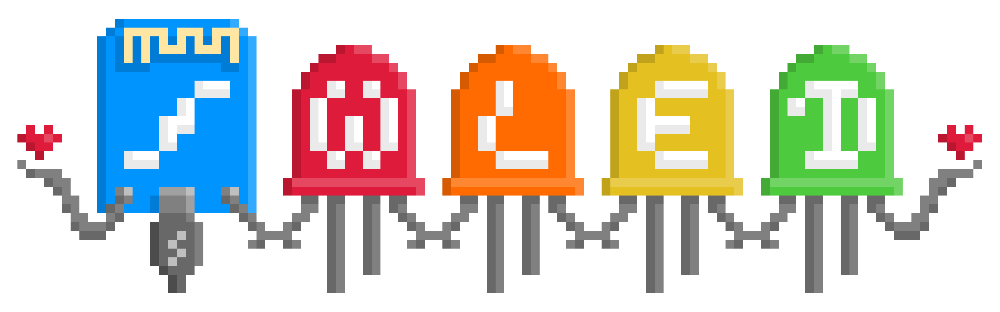

# ioBroker.wled

**Dieser Adapter nutzt den Dienst `Sentry.io` Ausnahmen, Codefehler und neue Geräteschemata werden mir als Entwickler automatisch gemeldet.** Weitere Details finden Sie unten!

## WLED-Adapter für ioBroker

Eine schnelle und funktionsreiche Implementierung eines ESP8266/ESP32-Webservers zur Steuerung von NeoPixel (WS2812B, WS2811, SK6812, APA102)-LEDs oder auch SPI-basierten Chipsätzen wie dem WS2801!

[WLED – GitHub-Projekt](https://github.com/Aircoookie/WLED) von @Aircoookie

## Anweisungen

Der Adapter versucht automatisch, WLED-Geräte in Ihrem Netzwerk mithilfe von Bonjour-Diensten zu finden.\
&#x20;Bekannte Probleme: Netzwerke mit VLAN-Trennung leiten Broadcast-Verkehr meist nicht weiter, was bedeutet, dass die automatische Erkennung fehlschlägt.

Keine Sorge, in diesem Fall können Sie das Gerät manuell über die IP-Adresse hinzufügen.

1. Stellen Sie sicher, dass Ihr WLED-Gerät eingeschaltet und vom Netzwerk erreichbar ist.
2. Installieren Sie den Adapter
3. Konfigurieren Sie das Intervall für die Datenabfrage (Geräte werden einmalig beim Start und über die Schaltfläche „Suchen“ im Geräte-Manager erkannt).\
   &#x20;4 - A) Schalten Sie den Adapter ein, die Geräte sollten automatisch erkannt werden.\
   &#x20;4 - B) Falls A fehlschlägt, verwenden Sie die Schaltfläche „Gerät hinzufügen“ und geben Sie die IP-Adresse des Geräts an.
4. Der Adapter sendet Änderungen sofort und fragt Daten alle x Sekunden ab (konfigurierbar).

## Merkmale

### Kontrollmethoden

Der Adapter bietet vielfältige Möglichkeiten zur Steuerung Ihrer WLED-Geräte:

1. **Standardzustände** - Verwenden Sie individuelle Zustände für Helligkeit, Farbe, Effekte usw.
2. **JSON-Befehle** – Senden Sie vollständige JSON-Befehle über die `action` Zustand für erweiterte Steuerung
3. **Rohe HTTP-API-Befehle** – Senden von Legacy-HTTP-API-Befehlen über die `rawCommand` Zustand

### Verwendung von rohen HTTP-API-Befehlen

Für fortgeschrittene Benutzer, die rohe HTTP-API-Befehle senden müssen (Legacy-Version) `/win` Endpunkt), können Sie den `rawCommand` Zustand:

```javascript
// Example: Set brightness to 255, effect to 0, and colors
setState('wled.0.XXXXXXXXXXXX.rawCommand', 'A=255&FX=0&R=255&G=0&B=0');

// Example: Complex command with multiple parameters
setState('wled.0.XXXXXXXXXXXX.rawCommand', 'SM=0&SS=0&SV=2&S=15&S2=299&GP=7&SP=30&RV=0&SB=255&A=255&W=255&R2=0&G2=0&B2=0&W2=&FX=0&T=1');
```

**Hinweis:** Die `rawCommand` Der Status ist für fortgeschrittene Anwendungsfälle und die Kompatibilität mit der älteren WLED-HTTP-API vorgesehen. Für die meisten Anwendungsfälle reichen die Standardstatus oder JSON-Befehle (über `action` staatlich) werden empfohlen.

Gängige Rohbefehlsparameter:

- `A` - Masterhelligkeit (0-255)
- `R`, `G`, `B` - RGB-Werte der Primärfarbe (0-255)
- `R2`, `G2`, `B2` - Sekundärfarben-RGB-Werte (0-255)
- `W`, `W2` - Weißkanalwerte (0-255)
- `FX` - Effekt-ID
- `SX` - Effektgeschwindigkeit
- `IX` - Effektintensität
- `FP` - Paletten-ID
- `T` - Übergangszeit

Eine vollständige Liste der Parameter finden Sie in der [WLED HTTP API-Dokumentation](https://kno.wled.ge/interfaces/http-api/) .

### Segmentverwaltung via sendTo

Der Adapter bietet leistungsstarke Segmentverwaltungsfunktionen durch `sendTo` Befehle, mit denen Sie Segmente dynamisch zu Ihrem JavaScript-Code hinzufügen und daraus löschen können:

#### Hinzufügen von Segmenten

```javascript
// Add a new segment to a WLED device
sendTo('wled.0', 'addSegment', {
    deviceId: 'AABBCCDDEEFF',  // Device MAC address
    segmentId: 1,              // Segment ID (0-based)
    start: 0,                  // Start LED
    stop: 10,                  // Stop LED (exclusive)
    on: true,                  // Optional: Turn segment on/off
    bri: 255,                  // Optional: Brightness (0-255)
    fx: 0,                     // Optional: Effect ID
    sx: 128,                   // Optional: Effect speed
    ix: 128,                   // Optional: Effect intensity
    pal: 0,                    // Optional: Color palette
    col: [[255,0,0],[0,255,0],[0,0,255]]  // Optional: Colors (RGB arrays)
}, (result) => {
    if (result.success) {
        console.log('Segment added successfully: ' + result.message);
    } else {
        console.error('Failed to add segment: ' + result.error);
    }
});
```

#### Segmente löschen

```javascript
// Delete a segment from a WLED device
sendTo('wled.0', 'deleteSegment', {
    deviceId: 'AABBCCDDEEFF',  // Device MAC address
    segmentId: 1               // Segment ID to delete
}, (result) => {
    if (result.success) {
        console.log('Segment deleted successfully: ' + result.message);
    } else {
        console.error('Failed to delete segment: ' + result.error);
    }
});
```

**Parameter:**

- `deviceId` (erforderlich): Die MAC-Adresse Ihres WLED-Geräts (z. B. 'AABBCCDDEEFF')
- `segmentId` (erforderlich): Die Segment-ID (0-basierte Nummerierung)
- Für `addSegment`:
  - `start` (optional): Erste LED im Segment, Standardwert 0
  - `stop` (optional): Letzte LED im Segment (exklusiv), Standardwert ist 1
  - `on` (optional): Segment ein-/ausschalten
  - `bri` (optional): Helligkeit (0-255)
  - `fx` (optional): Effekt-ID
  - `sx` (optional): Effektgeschwindigkeit (0-255)
  - `ix` (optional): Effektintensität (0-255)
  - `pal` (optional): Farbpaletten-ID
  - `col` (optional): Array von RGB-Farbarrays

**Hinweis:** Der Adapter übernimmt die Kommunikation automatisch über WebSocket (sofern verfügbar) oder HTTP-API und aktualisiert den Gerätestatus nach Segmentierungsoperationen.

## Unterstützt mich

Wenn Ihnen meine Arbeit gefällt, freue ich mich über eine persönliche Spende.\
&#x20;(Dies ist ein persönlicher Spendenlink für DutchmanNL und steht in keiner Verbindung zum ioBroker-Projekt!)\
[](http://paypal.me/DutchmanNL)

## Was ist Sentry.io und was wird an die Server dieses Unternehmens gemeldet?

Sentry.io ist ein Dienst, der Entwicklern einen Überblick über Fehler in ihren Anwendungen bietet. Genau dies wird in diesem Adapter implementiert.

Wenn der Adapter abstürzt oder ein anderer Codefehler auftritt, wird diese Fehlermeldung, die auch im ioBroker-Protokoll erscheint, an Sentry übermittelt. Wenn Sie der iobroker GmbH die Erlaubnis erteilt haben, Diagnosedaten zu erfassen, wird auch Ihre Installations-ID (eine eindeutige ID **ohne** weitere Informationen wie E-Mail-Adresse, Name usw.) übermittelt. Dadurch kann Sentry Fehler gruppieren und die Anzahl der betroffenen Benutzer anzeigen. All dies hilft mir, fehlerfreie Adapter bereitzustellen, die praktisch nie abstürzen.

## Für Entwickler

### Automatisierte Bereitstellung

Dieser Adapter nutzt GitHub Actions mit **NPM Trusted Publishing** für die automatisierte Bereitstellung.

Veröffentlichungen werden von der `deploy` Job von `.github/workflows/test-and-release.yml` Wenn ein Versions-Tag veröffentlicht wird, muss das npm-Paket dieses Repository und diesen Workflow als vertrauenswürdigen Herausgeber auf npmjs.com auflisten. `NPM_TOKEN` Ein Geheimnis ist erforderlich. Informationen zur Einrichtung und Fehlerbehebung finden Sie in der [Dokumentation zu npm Trusted Publishing](https://docs.npmjs.com/trusted-publishers) .

## Changelog
<!--
    Placeholder for the next version (at the beginning of the line):
    ### __WORK IN PROGRESS__
-->
### __WORK IN PROGRESS__
* (DutchmanNL) **FIXED**: `_info.time` is a read-only text again, the command `time` stays a writable number ([#956](https://github.com/DrozmotiX/ioBroker.wled/issues/956))
* (DutchmanNL) **FIXED**: Effect parameters `c1`, `c2` (0–255) and `c3` (0–31) are numbers ([#957](https://github.com/DrozmotiX/ioBroker.wled/issues/957))
* (DutchmanNL) **FIXED**: `addSegment` keeps the white channel of `[r,g,b,w]` colours ([#958](https://github.com/DrozmotiX/ioBroker.wled/issues/958))
* (DutchmanNL) **FIXED**: Bundling no longer merges two individual LED commands (`i`) for the same segment, they are sent one after the other ([#959](https://github.com/DrozmotiX/ioBroker.wled/issues/959))
* (DutchmanNL) **FIXED**: `udpn.recv` also sets the receive groups (`rgrp`), WLED 0.15 and newer ignore `recv` ([#960](https://github.com/DrozmotiX/ioBroker.wled/issues/960))
* (DutchmanNL) **FIXED**: `tt` and `udpn.nn` are sent with the next command to the device, on their own they had no effect ([#961](https://github.com/DrozmotiX/ioBroker.wled/issues/961))
* (DutchmanNL) **FIXED**: All states under `_info` are read-only, `_info.leds.cct` no longer looks like the colour temperature command ([#962](https://github.com/DrozmotiX/ioBroker.wled/issues/962))
* (DutchmanNL) **FIXED**: `nl.on` and `seg.<id>.on` have the role `switch`, only the device `on` keeps `switch.light` ([#963](https://github.com/DrozmotiX/ioBroker.wled/issues/963))
* (DutchmanNL) **FIXED**: Help texts for polling interval, retry attempts and auto discovery in the instance settings ([#964](https://github.com/DrozmotiX/ioBroker.wled/issues/964))
* (DutchmanNL) **FIXED**: The delete confirmation in the Config manager shows the device name with the MAC ([#965](https://github.com/DrozmotiX/ioBroker.wled/issues/965))

### 0.10.0 (2026-11-14)
* (DutchmanNL) **NEW**: Rebuilt instance settings (JSON config): device overview with online status, firmware and link to WLED, add devices by IP or host name with checks, search devices, delete with confirmation, light and dark theme ([#266](https://github.com/DrozmotiX/ioBroker.wled/issues/266))
* (DutchmanNL) **NEW**: Option to switch off automatic Bonjour/mDNS discovery; found devices use the announced IPv4 address instead of the sender (mDNS relay) ([#897](https://github.com/DrozmotiX/ioBroker.wled/issues/897))
* (DutchmanNL) **NEW**: Commands to the same device are bundled for a short time (`bundleDelay`, default 50 ms, 0 = off), switchable per device with `<MAC>.bundleCommands` ([#926](https://github.com/DrozmotiX/ioBroker.wled/issues/926))
* (DutchmanNL) **NEW**: Device Manager: "Edit device" with name, "Take name from WLED" and "Bundle commands" ([#927](https://github.com/DrozmotiX/ioBroker.wled/issues/927))
* (DutchmanNL) **NEW**: Channel `<MAC>.light` with `on`, `dimmer` and `rgb` so the type detector and the iot adapter (Alexa/Google) recognise a light ([#328](https://github.com/DrozmotiX/ioBroker.wled/issues/328))
* (DutchmanNL) **NEW**: Usermod values from `info.u` as states with unit, e.g. buttons, sensors or pins a usermod reports ([#929](https://github.com/DrozmotiX/ioBroker.wled/issues/929), [#928](https://github.com/DrozmotiX/ioBroker.wled/issues/928), [#931](https://github.com/DrozmotiX/ioBroker.wled/issues/931))
* (DutchmanNL) **NEW**: `seg.<id>.last.col/fx/pal` keep the values before the last change, `seg.<id>.last.restore` restores them ([#930](https://github.com/DrozmotiX/ioBroker.wled/issues/930))
* (DutchmanNL) **FIXED**: A command for a device that is offline triggers an immediate reconnect attempt, so a device that was switched on again is used at once instead of after the next watchdog run (up to one hour after several failed attempts) ([#939](https://github.com/DrozmotiX/ioBroker.wled/issues/939))

### 0.9.3-beta.0 (2026-11-14)
* (DutchmanNL) Maintenance: use adapter timer API (this.setTimeout/this.clearTimeout) so all timers are cleared on unload
* (DutchmanNL) Maintenance: translated the delete device confirmation message into all supported languages
* (DutchmanNL) Maintenance: raise Node.js to 22, modernise CI and release tooling, update dependencies, resolve repository checker findings
* (DutchmanNL) **CI/CD**: Fixed deployment failure by adding missing sentry-version-prefix parameter to GitHub Actions workflow
* (DutchmanNL) **CI/CD**: Updated GitHub Copilot instructions template from v0.4.2 to v0.5.6 - adds ESLint configuration, translation management, lint-first CI/CD workflow guidance
* (DutchmanNL) Dependencies updated to current versions
* (arteck) **FIXED**: The `_online` state of a device that cannot be reached is written as boolean `false` again instead of a text, which logged "has to be type boolean but received type string" ([#788](https://github.com/DrozmotiX/ioBroker.wled/issues/788), [#794](https://github.com/DrozmotiX/ioBroker.wled/issues/794), [#792](https://github.com/DrozmotiX/ioBroker.wled/pull/792))
* (DutchmanNL) **FIXED**: A device that stays offline logs "Unable to initialise" as a warning once, further attempts are logged at debug level ([#788](https://github.com/DrozmotiX/ioBroker.wled/issues/788))
* (DutchmanNL) **FIXED**: Devices that are offline can be deleted from the instance settings again ([#787](https://github.com/DrozmotiX/ioBroker.wled/issues/787))
* (DutchmanNL) **ENHANCED**: Tests now also run on Node.js 26 ([#872](https://github.com/DrozmotiX/ioBroker.wled/issues/872))
* (DutchmanNL) **ENHANCED**: Updated @iobroker/testing to 6.3.0
* (DutchmanNL) Removed a broken README link ([#876](https://github.com/DrozmotiX/ioBroker.wled/issues/876))
* (DutchmanNL) **FIXED**: Writing a HEX colour sends the tertiary colour from `2_HEX` instead of `1_HEX` ([#906](https://github.com/DrozmotiX/ioBroker.wled/issues/906))
* (DutchmanNL) **FIXED**: Writing a 6-digit HEX colour keeps the current white channel instead of setting it to 255, an 8-digit HEX sets the white channel ([#907](https://github.com/DrozmotiX/ioBroker.wled/issues/907))
* (DutchmanNL) **FIXED**: `rawCommand` is only acknowledged when the device accepted the command, a failed request is logged as warning ([#908](https://github.com/DrozmotiX/ioBroker.wled/issues/908))
* (DutchmanNL) **FIXED**: Usermod data (`u`) in the state section is removed correctly, the object id contained a tab character ([#921](https://github.com/DrozmotiX/ioBroker.wled/issues/921))
* (DutchmanNL) **FIXED**: Segment mirroring `seg.N.mi` can be written ([#918](https://github.com/DrozmotiX/ioBroker.wled/issues/918))
* (DutchmanNL) **FIXED**: The `time` state can be written to set the module time (unix timestamp) as documented ([#919](https://github.com/DrozmotiX/ioBroker.wled/issues/919))
* (DutchmanNL) **FIXED**: The debug message "State attribute definition missing" is logged once per attribute instead of on every update ([#917](https://github.com/DrozmotiX/ioBroker.wled/issues/917))
* (DutchmanNL) **FIXED**: The websocket ping timer no longer resets the handle of the watchdog timer, so all timers are stopped correctly ([#902](https://github.com/DrozmotiX/ioBroker.wled/issues/902))
* (DutchmanNL) **FIXED**: Device Manager: deleting a device waits for the result, shows an error if it fails and works for instance numbers from 10 ([#914](https://github.com/DrozmotiX/ioBroker.wled/issues/914))
* (DutchmanNL) **FIXED**: Device Manager: adding a device that does not respond shows a message instead of failing silently ([#916](https://github.com/DrozmotiX/ioBroker.wled/issues/916))
* (DutchmanNL) **FIXED**: Adding a device checks the IP address range and reports a device that is already added instead of "failed" ([#915](https://github.com/DrozmotiX/ioBroker.wled/issues/915))
* (DutchmanNL) **FIXED**: An outage of a device is logged as one warning, reconnect attempts are logged at debug level ([#903](https://github.com/DrozmotiX/ioBroker.wled/issues/903))
* (DutchmanNL) **FIXED**: A command for a device that is offline or unknown logs a clear warning instead of an error reported to Sentry; commands sent by websocket are acknowledged ([#904](https://github.com/DrozmotiX/ioBroker.wled/issues/904))
* (DutchmanNL) **FIXED**: When the websocket connection of a device closes, `_info._online` is reset and the disconnect is logged again (regression since 0.7.2) ([#899](https://github.com/DrozmotiX/ioBroker.wled/issues/899))
* (DutchmanNL) **CHANGED**: `on` and `bri` keep their last value when a device goes offline or the adapter starts; the current values are read from the device on reconnect ([#899](https://github.com/DrozmotiX/ioBroker.wled/issues/899))
* (DutchmanNL) **FIXED**: `_info._online` turns `false` when a device did not answer for two polling intervals, as intended ([#900](https://github.com/DrozmotiX/ioBroker.wled/issues/900))
* (DutchmanNL) **FIXED**: Devices that are found or added after the adapter start are monitored by the watchdog (offline detection, reconnect) without a restart ([#901](https://github.com/DrozmotiX/ioBroker.wled/issues/901))
* (DutchmanNL) **FIXED**: Discover in the Device Manager stops the previous Bonjour search before starting a new one; README no longer mentions auto-detect cycles ([#905](https://github.com/DrozmotiX/ioBroker.wled/issues/905))
* (DutchmanNL) **FIXED**: A device name changed in ioBroker is kept; the WLED name is only taken over for new devices or when the name was not changed ([#910](https://github.com/DrozmotiX/ioBroker.wled/issues/910))
* (DutchmanNL) **FIXED**: The effect and palette lists of `fx` and `pal` are refreshed on every reconnect, new effects after a firmware update appear without restart ([#912](https://github.com/DrozmotiX/ioBroker.wled/issues/912))
* (DutchmanNL) **FIXED**: The reboot button `rb` is created for every device; `hp` and `rd` appear when the device provides them ([#911](https://github.com/DrozmotiX/ioBroker.wled/issues/911))
* (DutchmanNL) **FIXED**: Errors are logged once; the Sentry hand-over is only logged at debug level ([#913](https://github.com/DrozmotiX/ioBroker.wled/issues/913))
* (DutchmanNL) **FIXED**: `addSegment` checks segment id, `start` and `stop` (stop greater than start) and accepts numbers given as text ([#920](https://github.com/DrozmotiX/ioBroker.wled/issues/920))
* (DutchmanNL) The labels of the retry settings are part of the i18n translation files ([#922](https://github.com/DrozmotiX/ioBroker.wled/issues/922))
* (DutchmanNL) **FIXED**: Removed the unused setting `devices` from the instance configuration; devices are taken from the object tree ([#923](https://github.com/DrozmotiX/ioBroker.wled/issues/923))
* (DutchmanNL) **FIXED**: A polling interval below 1 second or an invalid number of retries is replaced by the default and logged as warning ([#924](https://github.com/DrozmotiX/ioBroker.wled/issues/924))
* (DutchmanNL) **FIXED**: Small corrections: device names with spaces in the settings table, device model without "undefined", typo in the connection state name ([#925](https://github.com/DrozmotiX/ioBroker.wled/issues/925))
* (DutchmanNL) **FIXED**: Segments added or removed in WLED are synchronised without restart; segment states are stored by their WLED segment id, so writing works when segment numbers have gaps ([#909](https://github.com/DrozmotiX/ioBroker.wled/issues/909))

### 0.9.2 (2026-02-16)
* (DutchmanNL) solve auto deployment issues

### 0.9.0 (2026-02-15)
* (DutchmanNL) **NEW**: Added segment management via sendTo commands - dynamically add and delete WLED segments
* (DutchmanNL) **NEW**: Added Hue Sync control - synchronize WLED colors with Philips Hue lights (hp state: 0-99, 0=off)
* (DutchmanNL) **NEW**: Added Reboot control - restart WLED device remotely (rb state: boolean button)
* (DutchmanNL) **NEW**: Added Realtime UDP control - toggle reception of realtime UDP data (rd state: boolean switch)
* (DutchmanNL) **NEW**: Added support for sending raw HTTP API commands via `rawCommand` state (fixes #677)
* (DutchmanNL) **FIXED**: Corrected online/offline state detection - `_online` state now properly contains boolean values resolves #654
* (DutchmanNL) **FIXED**: Ensure backend processes and stop when device is deleted in ioBroker object tree (fixes #615)
* (DutchmanNL) **ENHANCED**: Reduced code complexity by extracting validation helpers to separate module (lib/validation.js) #777
* (DutchmanNL) **TESTING**: Added comprehensive unit tests for validation helpers (49 test cases covering edge cases and error handling)
* (DutchmanNL) **CI/CD**: Fixed automated deployment failure by removing unused build step for JavaScript-only adapter

### 0.8.0 (2026-02-15)
* (ticaki) allow sending of raw json from state
* (DutchmanNL) **FIXED**: Implement proper Bonjour browser cleanup in onUnload() to prevent resource leaks
* (DutchmanNL) **CI/CD**: Migrated deployment workflow to NPM Trusted Publishing (OIDC) for enhanced security

## License
MIT License

Copyright (c) 2024-2026 DutchmanNL <oss@drozmotix.eu>

Permission is hereby granted, free of charge, to any person obtaining a copy
of this software and associated documentation files (the "Software"), to deal
in the Software without restriction, including without limitation the rights
to use, copy, modify, merge, publish, distribute, sublicense, and/or sell
copies of the Software, and to permit persons to whom the Software is
furnished to do so, subject to the following conditions:

The above copyright notice and this permission notice shall be included in all
copies or substantial portions of the Software.

THE SOFTWARE IS PROVIDED "AS IS", WITHOUT WARRANTY OF ANY KIND, EXPRESS OR
IMPLIED, INCLUDING BUT NOT LIMITED TO THE WARRANTIES OF MERCHANTABILITY,
FITNESS FOR A PARTICULAR PURPOSE AND NONINFRINGEMENT. IN NO EVENT SHALL THE
AUTHORS OR COPYRIGHT HOLDERS BE LIABLE FOR ANY CLAIM, DAMAGES OR OTHER
LIABILITY, WHETHER IN AN ACTION OF CONTRACT, TORT OR OTHERWISE, ARISING FROM,
OUT OF OR IN CONNECTION WITH THE SOFTWARE OR THE USE OR OTHER DEALINGS IN THE
SOFTWARE.