# Adapter auf npm veröffentlichen (Trusted Publishing)

Die erste Version eines Adapters wird einmal von Hand auf npm veröffentlicht. Danach übernimmt GitHub Actions jedes Release über Trusted Publishing (OIDC), ganz ohne gespeicherten npm-Token.

Der Ablauf in sieben Schritten:

1. npm-Account anlegen und 2FA einschalten
2. Adapter lokal bauen und Paketinhalt prüfen
3. Erste Version manuell veröffentlichen
4. Auf npmjs.com die Paket-Einstellungen öffnen
5. Trusted Publisher für `test-and-release.yml` eintragen
6. Deploy-Abschnitt im Workflow prüfen
7. Alpha-Release mit dem Release-Script auslösen

**Voraussetzungen**

- Adapter mit `@iobroker/create-adapter` erstellt (Workflow `.github/workflows/test-and-release.yml`, `@alcalzone/release-script` in den devDependencies)
- Öffentliches GitHub-Repository `ioBroker.<adaptername>`, Paketname in `package.json` = `iobroker.<adaptername>` (klein geschrieben)
- Node.js 22 oder 24 lokal installiert, `git` eingerichtet
- Ein GitHub-gehosteter Runner (`ubuntu-latest`), selbst gehostete Runner unterstützt npm für Trusted Publishing nicht

Warum das Ganze: npm hat am 9. Dezember 2025 alle klassischen Tokens widerrufen. `npm login` liefert seitdem nur noch eine Sitzung von zwei Stunden, und schreibende Tokens laufen nach spätestens 90 Tagen ab ([GitHub Changelog](https://github.blog/changelog/2025-12-09-npm-classic-tokens-revoked-session-based-auth-and-cli-token-management-now-available/)). Ab Januar 2027 dürfen auch Tokens mit 2FA-Umgehung nicht mehr direkt veröffentlichen ([GitHub Changelog](https://github.blog/changelog/2026-07-08-npm-install-time-security-and-gat-bypass2fa-deprecation/)). Trusted Publishing richtet man einmal ein und muss danach nichts mehr erneuern.

## Schritt 1: npm-Account anlegen und 2FA einschalten

Ohne Zwei-Faktor-Authentifizierung lässt npm heute keine Veröffentlichung von Hand mehr zu.

1. [npmjs.com/signup](https://www.npmjs.com/signup) öffnen, Benutzername, E-Mail-Adresse und Passwort (mindestens 10 Zeichen) eingeben, Nutzungsbedingungen ankreuzen, **Create an Account** klicken und die E-Mail bestätigen. Die E-Mail-Adresse steht später öffentlich in den Paket-Metadaten.
2. Oben rechts auf das Profilbild klicken, dann **Account** öffnen.
3. Im Kasten **Two-Factor Authentication** auf **Enable 2FA** klicken (ist 2FA schon an, heißt der Knopf **Modify 2FA**).
4. Eine Authenticator-App oder einen Sicherheitsschlüssel (Passkey, YubiKey) einrichten und die Wiederherstellungscodes sicher ablegen.

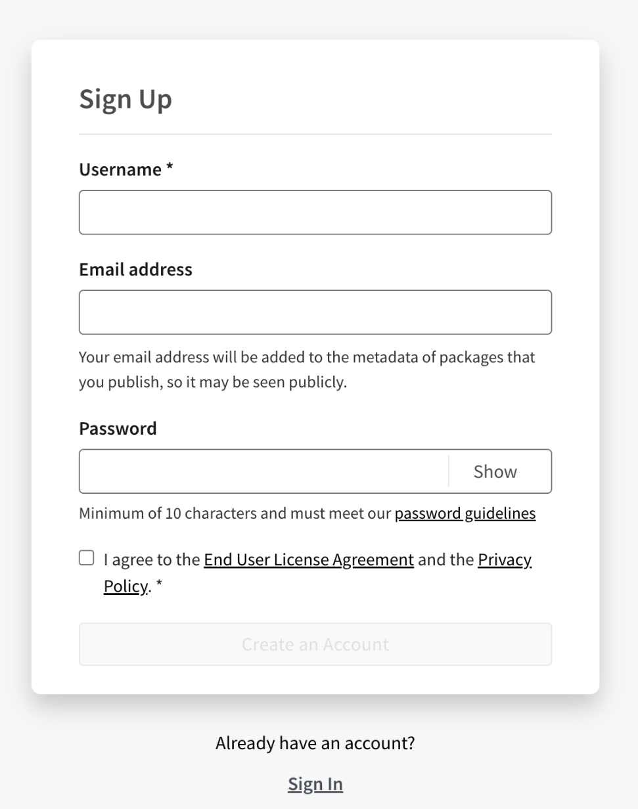

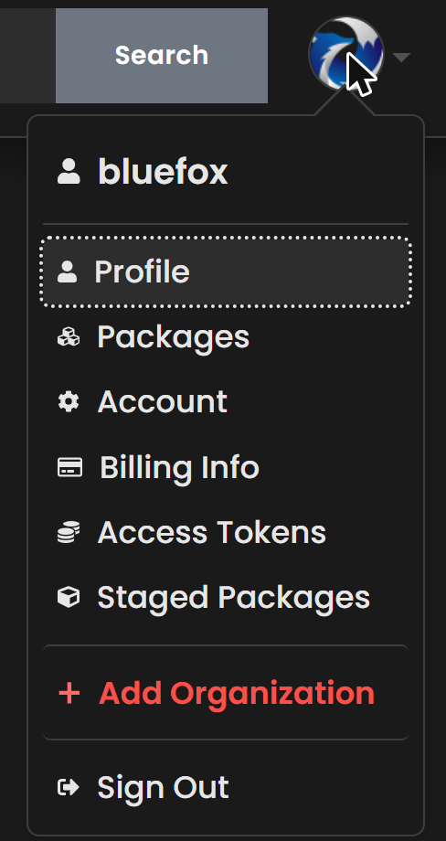

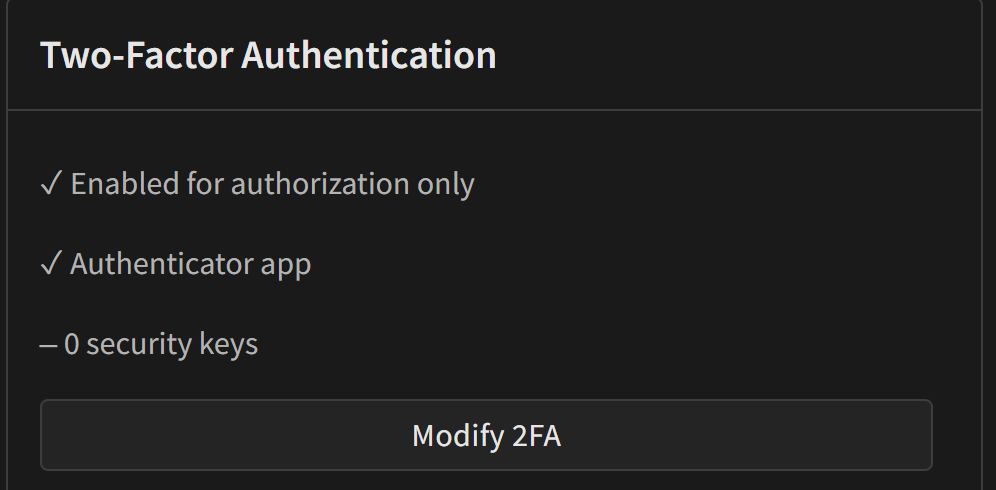

## Schritt 2: Adapter lokal bauen und prüfen

Vor der ersten Veröffentlichung muss der Adapter sauber bauen und die Tests bestehen, sonst landet ein kaputtes Paket dauerhaft auf npm.

```bash
git clone https://github.com/<user>/ioBroker.<adaptername>.git
cd ioBroker.<adaptername>
npm ci
npm run build        # nur bei TypeScript oder React-Admin
npm run lint
npm test
```

Danach den Paketinhalt anschauen, ohne etwas hochzuladen:

```bash
npm pack --dry-run
```

Die Liste muss `io-package.json`, `main.js` bzw. `build/`, `admin/` und `LICENSE` enthalten. `src/`, `test/` und `.github/` gehören nicht hinein, das regelt das Feld `files` in der `package.json`.

Außerdem prüfen:

- `name` in `package.json` ist `iobroker.<adaptername>`
- `version` in `package.json` und `common.version` in `io-package.json` sind gleich (bei neuen Adaptern `0.0.1`)
- `repository.url` zeigt auf das GitHub-Repository, sonst scheitert später die Provenance-Prüfung beim Trusted Publishing

## Schritt 3: Erste Version einmalig manuell veröffentlichen

Trusted Publishing lässt sich nur für ein Paket einrichten, das es auf npm schon gibt. Die erste Version geht deshalb vom eigenen Rechner raus.

```bash
npm login            # öffnet den Browser, Anmeldung mit 2FA
npm whoami           # zeigt den eigenen npm-Benutzernamen
npm run build        # nur bei TypeScript oder React-Admin
npm publish          # fragt im Browser erneut nach 2FA
```

Kurz danach ist das Paket unter `https://www.npmjs.com/package/iobroker.<adaptername>` zu sehen.

Dann bluefox als zweiten Owner eintragen. Das verlangt der ioBroker Repository Checker für die Aufnahme ins Repository (siehe [Veröffentlichen](/docs/dev/adapterpublish.md)):

```bash
npm owner add bluefox iobroker.<adaptername>
npm owner ls iobroker.<adaptername>
```

Alternativ im Browser: Paket-Seite, Reiter **Settings**, Abschnitt **Invite maintainer**, Benutzername `bluefox` eintragen.

Hinweise:

- Die Sitzung von `npm login` gilt zwei Stunden, danach einfach erneut `npm login`.
- Eine einmal veröffentlichte Versionsnummer lässt sich nie wieder verwenden, auch nicht nach `npm unpublish`.
- Lehnt npm den Namen ab (`Package name too similar to existing package`), muss der Adapter umbenannt werden.

## Schritt 4: Auf npmjs.com die Paket-Einstellungen öffnen

1. Auf [npmjs.com](https://www.npmjs.com/login) anmelden.
2. Profilbild oben rechts, dann **Packages**, dann `iobroker.<adaptername>` anklicken.
3. Auf der Paketseite den Reiter **Settings** öffnen. Er ist nur für Maintainer sichtbar.

Beim Öffnen von **Settings** fragt npm erneut nach dem 2FA-Einmalcode aus der Authenticator-App. Danach steht oben der Bereich **Trusted Publisher**, darunter **Package access**, **Publishing access** und **Invite maintainer**.

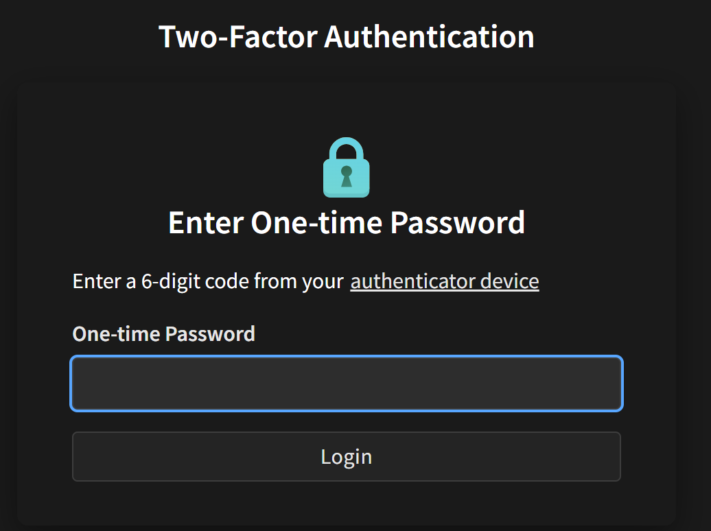

## Schritt 5: Trusted Publisher eintragen

Hier legt man fest, dass nur der Workflow `test-and-release.yml` aus dem eigenen Repository veröffentlichen darf.

1. Unter **Trusted Publisher** als **Publisher** den Eintrag **GitHub Actions** wählen. Gibt es schon eine Verbindung, zuerst **Add trusted publisher** klicken.
2. Die Felder ausfüllen:

| Feld | Eintrag | Beispiel |
| --- | --- | --- |
| Label | optional, frei wählbar | leer lassen |
| Organization or user | GitHub-Benutzer oder Organisation | `ioBroker` |
| Repository | Repo-Name ohne Owner | `ioBroker.openweathermap` |
| Workflow filename | nur der Dateiname, ohne Pfad | `test-and-release.yml` |
| Environment name | leer lassen | |
| Allowed actions | **Allow npm publish** ankreuzen | `npm stage publish` ist immer erlaubt |

3. Mit **Set up connection** speichern.

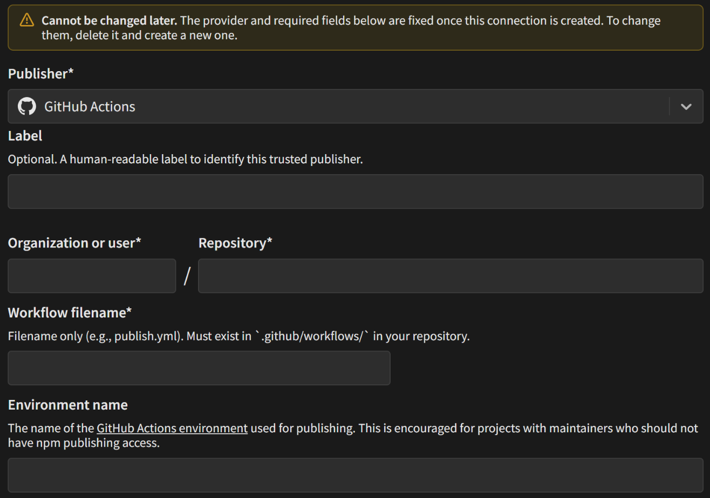

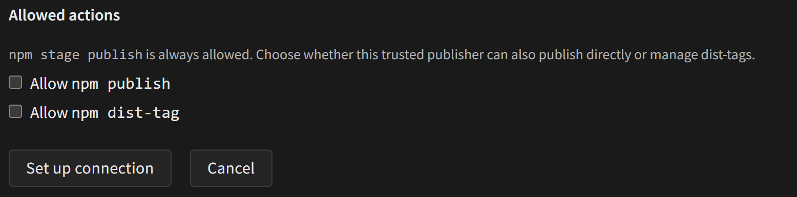

!> **npm publish erlauben.** Seit dem 3. September 2026 erlauben neue Konfigurationen standardmäßig nur `npm stage publish`. Die ioBroker-Deploy-Action ruft aber `npm publish` auf, ohne das Häkchen scheitert das Release ([npm Docs](https://docs.npmjs.com/trusted-publishers)).

!> **Innerhalb von 2 Tagen releasen.** Eine neue Konfiguration verfällt, wenn sie nicht binnen zwei Tagen einmal erfolgreich veröffentlicht hat. Dann löschen und neu anlegen. Also Schritt 5 erst machen, wenn das Alpha-Release (Schritt 7) direkt folgen kann.

npm prüft die Eingaben beim Speichern nicht. Ein Tippfehler zeigt sich erst beim Release als Fehler `404`. Groß- und Kleinschreibung beachten.

Optional, sobald das erste Release über GitHub geklappt hat: unter **Publishing access** die Option **Require two-factor authentication and disallow bypass 2fa tokens (recommended)** wählen und mit **Update Package Settings** speichern. Tokens sind dann gesperrt, Trusted Publishing läuft weiter. Ein altes Secret `NPM_TOKEN` im GitHub-Repository kann gelöscht werden.

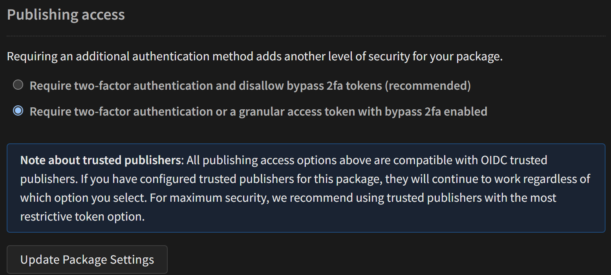

## Schritt 6: Deploy-Abschnitt im Workflow prüfen

In `.github/workflows/test-and-release.yml` muss der Job `deploy` so aussehen. Die zwei entscheidenden Punkte: `id-token: write` ist gesetzt, und es gibt **keine** Zeile `npm-token`.

```yaml
  # Deploys the final package to NPM
  deploy:
    needs: [check-and-lint, adapter-tests]

    # Trigger this step only when a commit on any branch is tagged with a version number
    if: |
      contains(github.event.head_commit.message, '[skip ci]') == false &&
      github.event_name == 'push' &&
      startsWith(github.ref, 'refs/tags/v')

    runs-on: ubuntu-latest

    # Write permissions are required to create Github releases
    permissions:
      id-token: write      # nötig für Trusted Publishing
      contents: write      # nötig für das GitHub-Release

    steps:
      - uses: ioBroker/testing-action-deploy@v1
        with:
          node-version: '24.x'
          # build: true      # bei TypeScript oder React-Admin einkommentieren
          github-token: ${{ secrets.GITHUB_TOKEN }}
          # KEIN npm-token: ${{ secrets.NPM_TOKEN }} mehr!
```

So sieht es im echten Adapter aus, hier ioBroker.openweathermap:

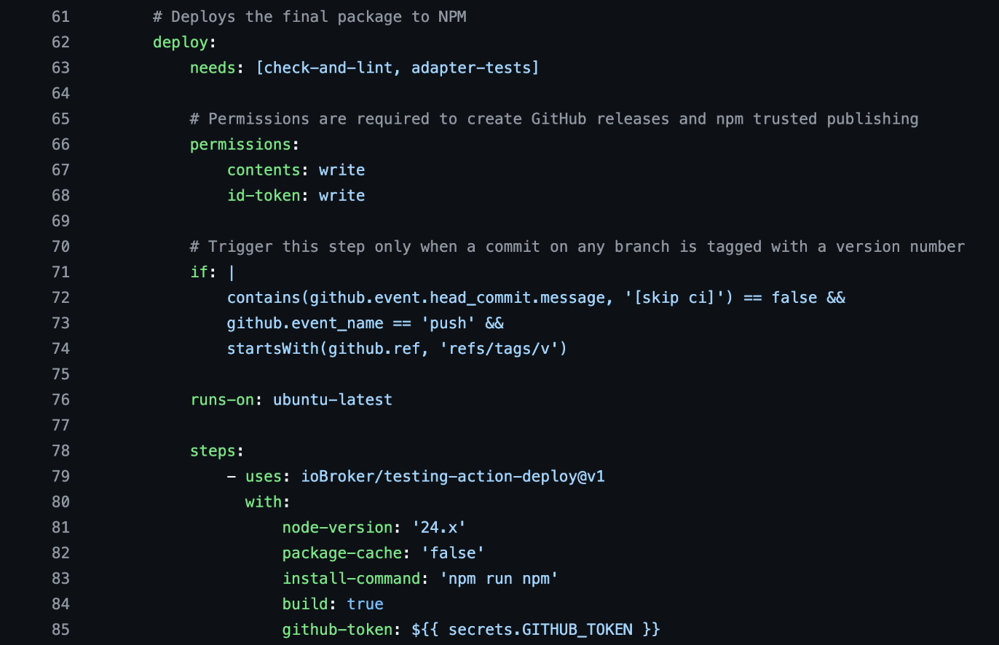

So arbeitet die Action ([action.yml](https://github.com/ioBroker/testing-action-deploy/blob/master/action.yml)):

- Ohne `npm-token` installiert sie npm 11 und meldet sich per OIDC an.
- Enthält die Version einen Bindestrich (`0.0.2-alpha.0`), veröffentlicht sie mit `--tag next`. Nutzer mit `latest` bekommen die Alpha also nicht.
- Sie legt automatisch ein GitHub-Release an, bei Vorabversionen als Pre-release markiert.

Oben in derselben Datei muss unter `on: push: tags:` auch das Muster `"v[0-9]+.[0-9]+.[0-9]+-**"` stehen, sonst startet der Workflow für Alpha-Tags gar nicht. Bei Adaptern aus create-adapter ist das schon drin.

Ältere Adapter migrieren: `id-token: write` ergänzen, die Zeile `npm-token` löschen, committen ([Migrationshinweis von create-adapter](https://github.com/ioBroker/create-adapter/blob/master/docs/updates/20251013_trusted_deploy.md)).

## Schritt 7: Alpha-Release mit dem Release-Script

Das Release-Script erhöht die Version in `package.json` und `io-package.json`, schreibt das Changelog, committet, setzt den Git-Tag und pusht. Der Tag startet den Workflow, der Rest läuft auf GitHub.

**1. Changelog vorbereiten.** In der `README.md` unter `## Changelog` den Platzhalter mit den Änderungen füllen:

```markdown
### **WORK IN PROGRESS**
- (dein-name) Erste Testversion
```

**2. Alles committen und auf den Hauptzweig wechseln.** Das Script bricht bei uncommitteten Änderungen ab.

**3. Probelauf, ändert nichts:**

```bash
npm run release prepatch alpha -- --dry
```

**4. Echtes Alpha-Release:**

```bash
npm run release prepatch alpha
```

Aus `0.0.1` wird `0.0.2-alpha.0`. Das Plugin `manual-review` hält vor dem Commit an, damit man die Änderungen prüfen kann. Mit Enter geht es weiter.

**5. Workflow beobachten.** Im Repository auf **Actions** gehen. Der Lauf zum Tag `v0.0.2-alpha.0` führt erst die Tests aus, dann den Job `deploy`.

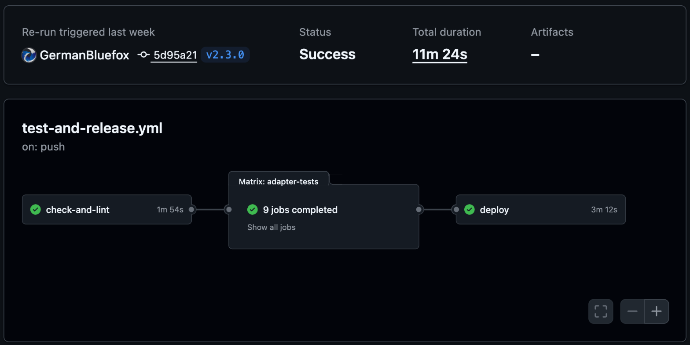

**6. Ergebnis prüfen:**

```bash
npm view iobroker.<adaptername> dist-tags
# { latest: '0.0.1', next: '0.0.2-alpha.0' }
```

Auf npmjs.com zeigt der Reiter **Versions** jetzt die Alpha mit Tag `next`, und die Paketseite zeigt den Kasten **Provenance**. Auf GitHub steht unter **Releases** ein Pre-release.

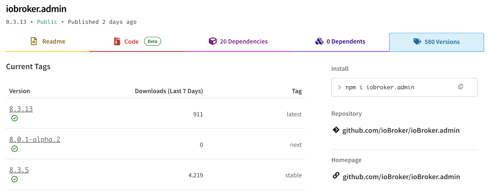

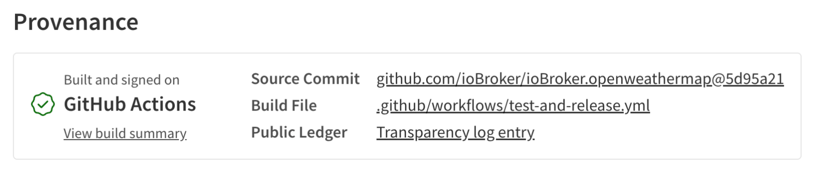

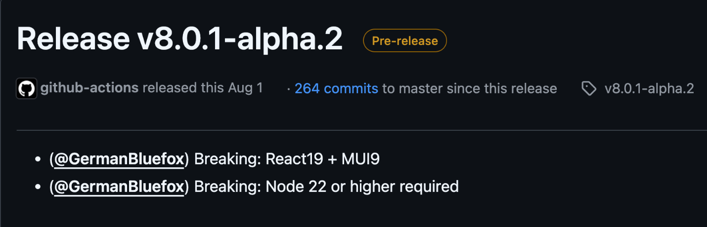

In den Paket-Settings zeigt der Trusted Publisher nach dem ersten erfolgreichen Release **Status: Valid**:

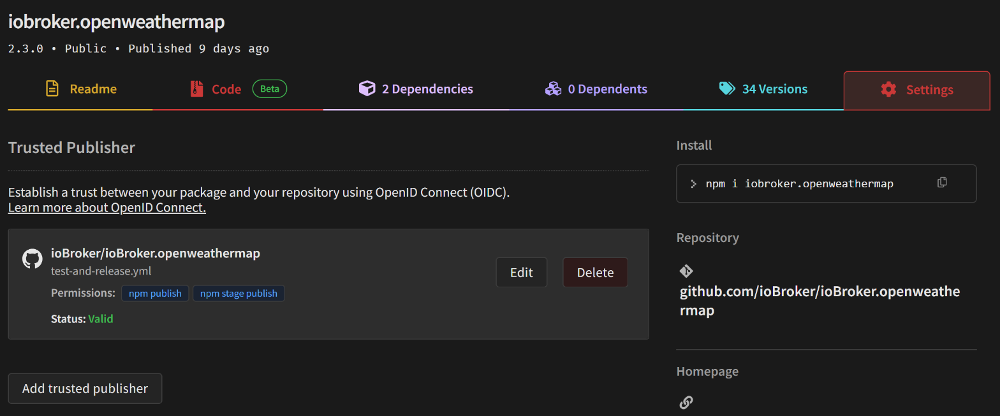

**Weitere Versionen:**

| Ziel | Befehl | Beispiel |
| --- | --- | --- |
| nächste Alpha | `npm run release prerelease` | 0.0.2-alpha.0 → 0.0.2-alpha.1 |
| Beta starten | `npm run release prepatch beta` | 0.0.2 → 0.0.3-beta.0 |
| stabile Version | `npm run release patch` | 0.0.2-alpha.1 → 0.0.2 |
| neue Funktion | `npm run release minor` | 0.0.2 → 0.1.0 |

Quelle der Befehle: [AlCalzone/release-script](https://github.com/AlCalzone/release-script).

## Fehlerbilder und Lösungen

| Meldung im Log | Ursache | Lösung |
| --- | --- | --- |
| `E404 Not Found` bei `npm publish` im Workflow | Owner, Repository oder Workflow-Dateiname im Trusted Publisher falsch geschrieben | Einträge in Schritt 5 mit dem Repo vergleichen, Groß- und Kleinschreibung beachten |
| `ENEEDAUTH` im Workflow | `id-token: write` fehlt im Job `deploy` | Berechtigung ergänzen (Schritt 6) |
| `E403`, Veröffentlichen nicht erlaubt | Bei **Allowed actions** fehlt **Allow npm publish** | Häkchen setzen, speichern, Release erneut anstoßen |
| Trusted Publisher lässt sich nicht mehr bearbeiten | Konfiguration ist nach 2 Tagen ohne Release verfallen | Löschen, neu anlegen, sofort releasen |
| Workflow startet beim Alpha-Tag nicht | Tag-Muster für Vorabversionen fehlt unter `on: push: tags:` | `"v[0-9]+.[0-9]+.[0-9]+-**"` ergänzen |
| `EOTP` beim manuellen `npm publish` | 2FA-Bestätigung fehlt | Im Browser bestätigen oder `npm publish --otp=<code>` |
| `You cannot publish over the previously published versions` | Version gibt es schon auf npm | Mit dem Release-Script neue Version erzeugen |
| Script meldet uncommittete Änderungen | Arbeitsverzeichnis nicht sauber | `git status`, committen, erneut starten |

Erneut anstoßen ohne neue Version: In GitHub unter **Actions** den fehlgeschlagenen Lauf öffnen und **Re-run failed jobs** klicken.
