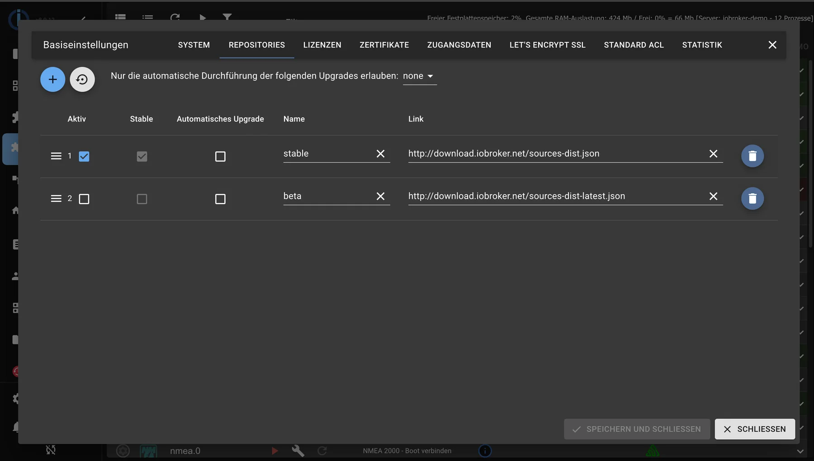

# Updates einspielen

Updates halten ein System lauffähig und sind gleichzeitig der häufigste Grund
dafür, dass es plötzlich nicht mehr läuft. Beides lässt sich versöhnen, wenn man
eine Reihenfolge einhält und nicht alles auf einmal macht.

## Die goldene Regel

!> Vor jedem Update ein
[Backup](/docs/config/backup.md). Nicht
„eines von letzter Woche", sondern eines von jetzt. Der Aufwand ist eine Minute,
der Nutzen im Zweifel ein ganzer Abend.

Dazu zwei weitere Regeln, die sich in der Praxis bewährt haben:

* **Nicht alles gleichzeitig.** Wenn nach fünf Updates etwas klemmt, wissen Sie
  nicht, welches es war.
* **Nicht kurz vor dem Weggehen.** Ein Update, das schiefgeht, braucht Zeit.



*In den Systemeinstellungen unter Repositories steht, aus welcher Quelle
Adapter kommen. Im Alltag bleibt hier stable aktiv.*

## Die Reihenfolge

1. **Adapter**.
2. **js-controller**.
3. **Node.js**, zuletzt und nur bewusst.

Ein neuer js-controller verlangt mitunter neuere Adapter, deshalb kommen die
Adapter zuerst. Ein Wechsel der Node.js-Hauptversion ist der Eingriff mit der
größten Wirkung und hat eine eigene Seite:
[Node.js aktualisieren](/docs/install/updatenode.md). Ausführlicher steht das
unter [Updaten](/docs/install/update.md).

## Wenn ein Adapter eine neuere Node.js-Version verlangt

Manche Adapterversionen setzen eine neuere Node.js- oder js-controller-Version
voraus. Das steht in der Änderungsliste des Adapters bzw. in seinem README unter
den Anforderungen. Dann gibt es zwei Wege:

* **Node.js bewusst vorziehen** - vorher sichern, dann wie unter
  [Node.js aktualisieren](/docs/install/updatenode.md) beschrieben.
* **Vorerst bei der bisherigen Adapterversion bleiben** oder gezielt eine
  ältere, passende Version installieren: im Admin im Expertenmodus über
  *Eine bestimmte Version installieren*
  (siehe [Adapter](/docs/tutorial/adapter.md)) oder auf der Konsole:

```bash
iobroker upgrade <adaptername>@<version>
```

Ab js-controller 6 lässt sich eine unpassende Version ausblenden, damit sie
nicht ständig als Update angeboten wird, und später wieder einblenden:

```bash
iobroker version <adaptername> --ignore <version>
iobroker version <adaptername> --recognize
```

## Adapter aktualisieren

Im Reiter [Adapter](/docs/admin/adapter.md)
werden Adapter mit neuerer Version hervorgehoben. Vor dem Klicken lohnt der
Blick in die Änderungsliste des Adapters: dort steht, ob es sich um eine
Fehlerbehebung handelt oder um einen Umbau, der Nacharbeit erfordert.

Nach dem Update: Instanz ansehen, ob sie läuft, und ins
[Protokoll](/docs/admin/log.md) sehen.

?> Bleiben Sie auf dem Repository **stable**. Die Versionen dort sind geprüft.
*beta* ist zum Helfen beim Testen gedacht, nicht für ein System, das
funktionieren muss. Siehe
[Repositories](/docs/basics/repositories.md).

## Den js-controller aktualisieren

Er wird **nicht** im Reiter Adapter aktualisiert, sondern im Reiter
[Hosts](/docs/admin/hosts.md). Dort
erscheint ein Hinweis, wenn eine neuere Version vorliegt. Auf der Kommandozeile:

```bash
iobroker upgrade self
```

Während des Updates ist die Oberfläche kurz nicht erreichbar. Das ist normal.

## Node.js aktualisieren

Das ist der Schritt mit den größten Folgen und der einzige, der außerhalb von
ioBroker stattfindet. ioBroker bringt dafür einen eigenen Befehl mit:

```bash
iobroker nodejs-update
```

!> Nur **gerade** Versionsnummern verwenden, also die LTS-Fassungen. Ungerade
Versionen werden nicht unterstützt. Einzelheiten unter
[Node.js aktualisieren](/docs/install/updatenode.md).

?> **Unter Docker** (Abbild von buanet) kommt Node.js mit dem Abbild.
`iobroker nodejs-update` ist dort nicht der Weg; stattdessen wird ein neues
Abbild gezogen und der Container neu angelegt (`docker pull` und Container neu
erstellen bzw. `docker compose pull && docker compose up -d`). Die Daten bleiben
im Volume unter `/opt/iobroker` - vorher trotzdem sichern. Siehe
[Docker](/docs/install/docker.md) und die
[buanet-Dokumentation](https://docs.buanet.de/de/iobroker-docker-image/).

## Das Betriebssystem

Unter Linux gehört auch das darunterliegende System gepflegt:

```bash
sudo apt update
sudo apt upgrade
```

Ein System, das jahrelang keine Sicherheitsupdates bekommen hat, ist ein
größeres Risiko als ein Adapter, der eine Version zurückliegt.

?> **Unter Docker** kommt auch das Betriebssystem mit dem Abbild. Statt `apt`
wird ein neues Abbild gezogen und der Container neu angelegt, wie oben bei
Node.js beschrieben. Adapter und js-controller werden weiterhin wie gewohnt im
Admin bzw. auf der Konsole im Container aktualisiert.

## Wenn ein Update schiefgeht

1. Ins [Protokoll](/docs/admin/log.md)
   sehen. Meistens steht dort im Klartext, was fehlt.
2. Die betroffene Instanz stoppen und einzeln neu starten.
3. Hilft das nicht, die Sicherung zurückspielen. Wie das geht, steht unter
   [Konfiguration wiederherstellen](/docs/trouble/restore.md)
   und ausführlich unter
   [Restore](/docs/tutorial/restore.md).

Und dann im [Forum](/docs/trouble/forum.md)
nachfragen. Bei einem Update, das bei mehreren schiefgeht, sind Sie
erfahrungsgemäß nicht allein.
