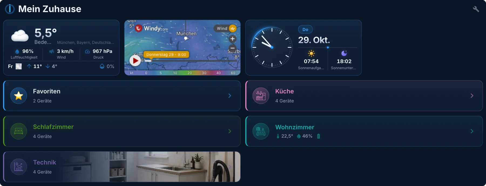
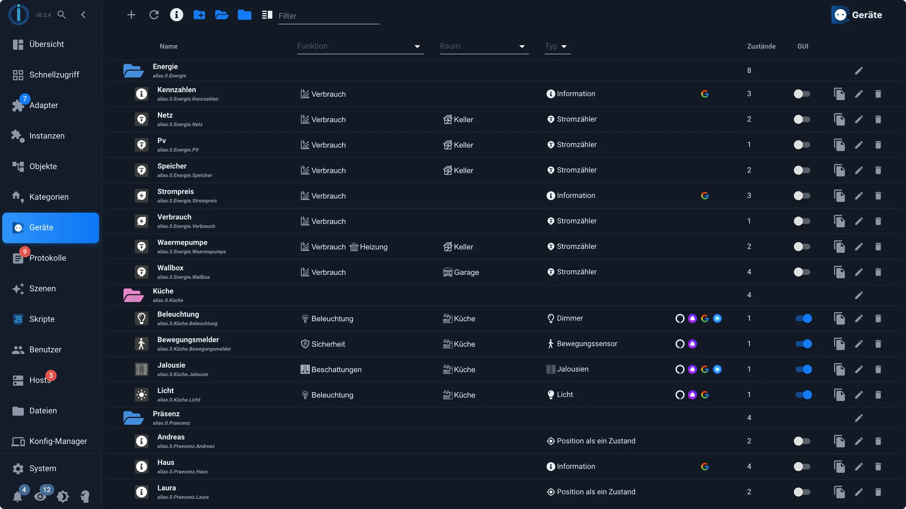
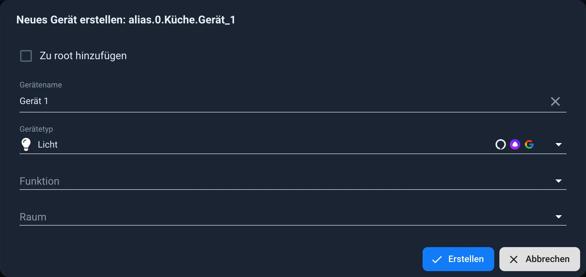
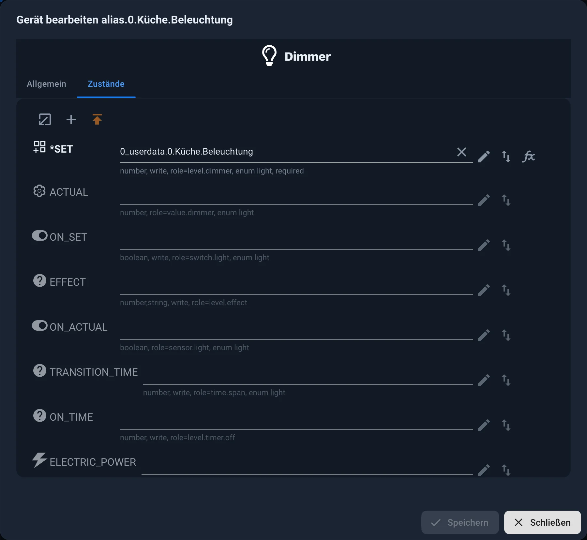
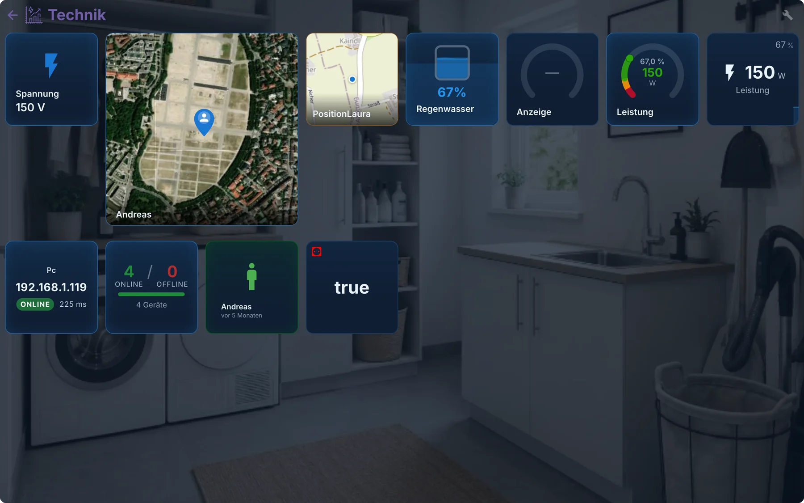
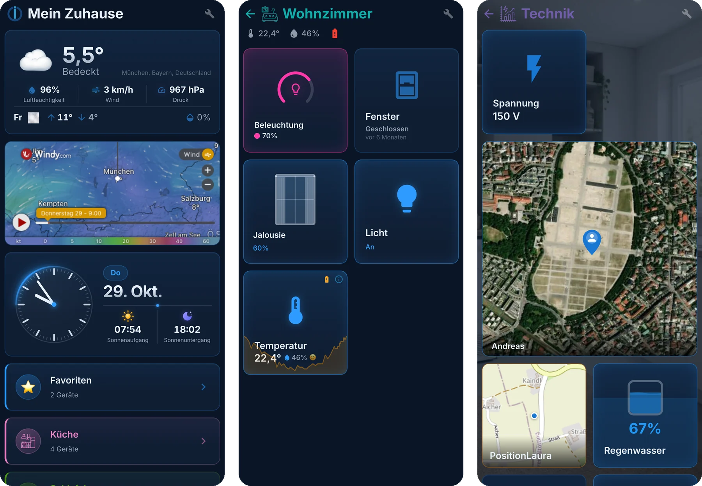
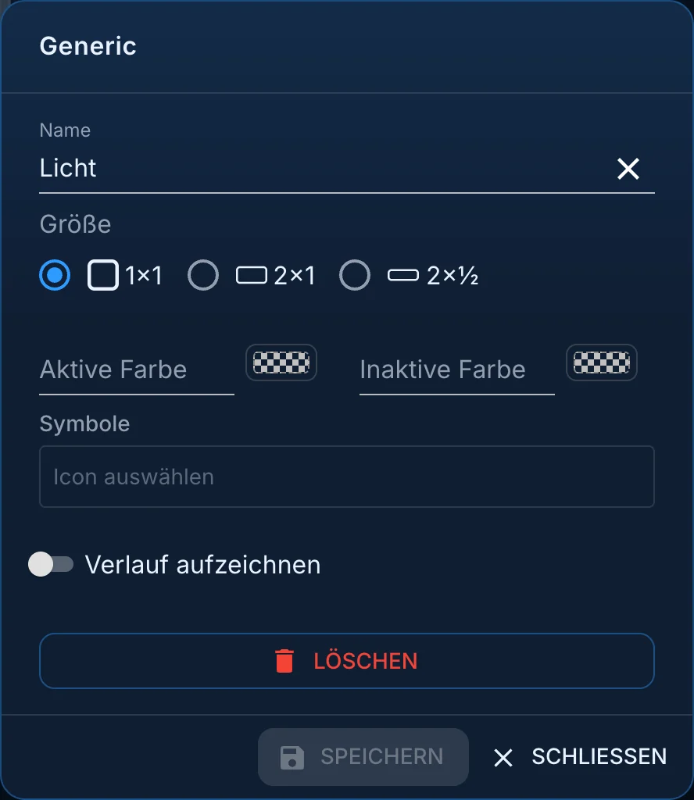
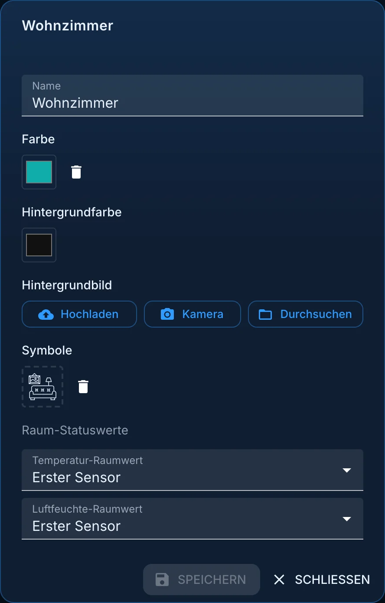
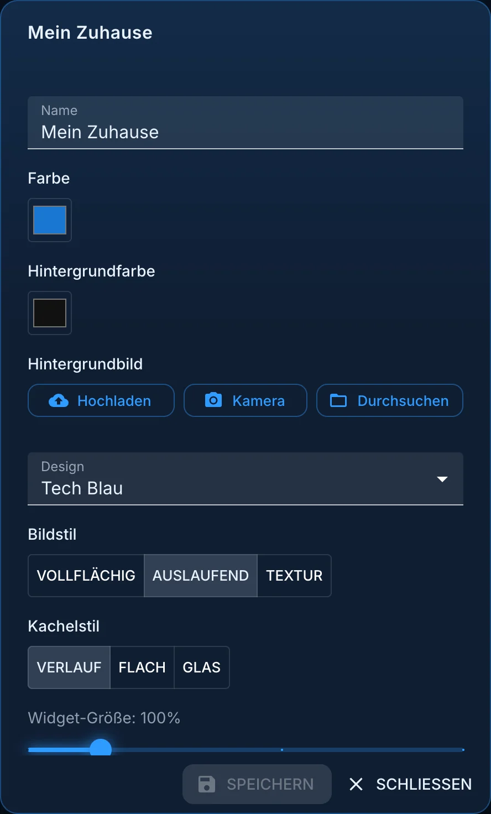
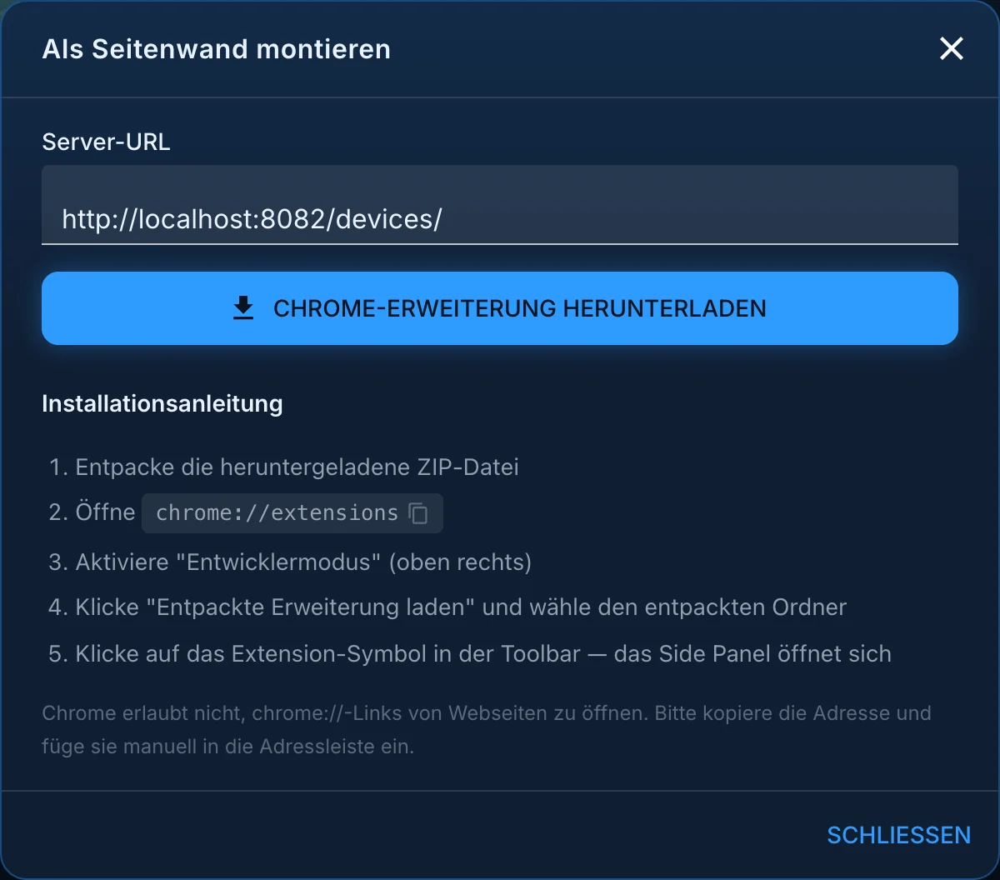

# Oberfläche aus dem Devices-Adapter

Der Adapter [devices](/adapters/devices) ist eigentlich kein
Visualisierungsadapter. Er ordnet Datenpunkte zu **Geräten**: Aus einem Schalter,
einer Rückmeldung und einem Zähler wird eine Lampe, aus vier Werten ein
Thermostat. Seit Version 4 kann er aus diesen Geräten auch gleich eine fertige
Bedienoberfläche erzeugen, und genau darum geht es auf dieser Seite.

?> Der Adapter läuft nur als Reiter im Admin. Er fragt keine Geräte ab und
braucht praktisch keine Rechenzeit. Die Bilder auf dieser Seite zeigen Version
4.2.7 mit dem Design **Tech Blau**, den Admin im Thema **Modern Dark**.

## Warum sich der Umweg lohnt

Ein Datenpunkt allein sagt wenig. `hm-rpc.1.00085A49A3F98C.4.STATE` ist ein
`boolean`, mehr weiß das System nicht. Erst wenn daraus ein Gerät vom Typ
`light` wird, wissen die anderen Adapter, was zu tun ist:

* **vis-2** schlägt beim Anlegen eines Widgets die passenden Datenpunkte vor.
* **[Lovelace](/docs/viz/lovelace.md)** baut seine Oberfläche daraus.
* **iot** meldet das Gerät als Lampe an Alexa oder Google, nicht als Schalter.
* **matter** kann es überhaupt erst weitergeben.
* Ein Skript findet das Gerät über seinen Typ statt über eine kryptische
  Kennung.

Dazu kommt ein zweiter Vorteil, der sich erst später zeigt: Die Geräte liegen
unter `alias.0.<Name>`. Wird das Gerät später ausgetauscht, ändert man die
Zuordnung an einer Stelle. Visualisierung, Skripte und Aufzeichnung merken
nichts davon.

## Die Geräteliste

Der Reiter heißt im Admin **Geräte**. Er muss wie Skripte und Protokolle in den
Einstellungen der Admin-Instanz eingeschaltet sein. Er zeigt entweder die
Oberfläche oder die Liste der Geräte; der Knopf **Geräte** oben rechts und der
Pfeil **Zurück zu Geräten** in der Oberfläche schalten zwischen beiden um.

Die Geräte stehen in Ordnern, meist einer je Raum oder Bereich. Zu jedem Gerät
zeigt die Liste:

* **Funktion** und **Raum** aus den [Kategorien](/docs/basics/enums.md),
* den **Typ**, etwa Dimmer, Jalousie oder Bewegungssensor,
* die Symbole der **Sprachassistenten und Smart-Home-Systeme**, an die das
  Gerät mit diesem Typ weitergegeben werden kann,
* die Zahl der zugeordneten **Zustände**,
* den Schalter **GUI**, ob das Gerät in der Oberfläche erscheint,
* rechts die Knöpfe zum Kopieren, Bearbeiten und Löschen.

## Ein Gerät anlegen

1. Den Ordner wählen, in den das Gerät soll, und auf **+** klicken. Einen Namen
   vergeben und einen **Gerätetyp** wählen, etwa Licht, Jalousie, Thermostat
   oder Temperatur. Funktion und Raum lassen sich gleich mit zuordnen.

2. Im Reiter **Zustände** die Datenpunkte zuordnen. Pflichtfelder sind mit `*`
   gekennzeichnet, optionale Felder wie die Luftfeuchte beim Temperatursensor
   kann man weglassen. Unter jedem Feld steht, was der Typ erwartet: Datentyp,
   ob geschrieben wird, und die Rolle.

3. Speichern. Das Gerät erscheint unter `alias.0.<Name>` im Objektbaum.

Im Reiter **Allgemein** stehen Name, Funktion, Raum und Farbe, dazu der
**Smart-Name**, unter dem das Gerät bei Alexa und Co. heißt. Mit **Die
„intelligente" Funktionalität deaktivieren** bleibt es dort ganz außen vor.

Fast jeder Typ kennt zusätzlich **Anzeigezustände** für Batterie, Verbindung
und Fehler. Sie sind freiwillig, werden von Lovelace und matter aber
ausgewertet.

?> Ein Alias kann mehr, als nur auf einen Datenpunkt zeigen: Lesen und Schreiben
dürfen auf **verschiedene** Datenpunkte gehen (Pfeilsymbol hinter dem Feld), und
für beide Richtungen lässt sich eine Umrechnung hinterlegen (Symbol `fx`). So
wird aus einem Rollladen, der 0 für offen meldet, ein Gerät, das sich wie alle
anderen verhält.

## Woher die Geräte kommen

| Herkunft | Beschreibung |
| --- | --- |
| **Automatisch erkannt** | Adapter wie `zigbee` oder `hm-rpc` liefern bereits eine brauchbare Struktur. Der Devices-Adapter erkennt sie von selbst, **aber nur, wenn ein Raum oder eine Funktion zugeordnet ist.** Ohne Zuordnung passiert nichts. |
| **Alias** | Der empfohlene Weg für alles, was von Hand entsteht. Die Geräte liegen unter `alias.0`. |
| **Linked Devices** | Der Vorgänger über den Adapter `linkeddevices`. Für neue Installationen nicht mehr vorgesehen. |

Welche Typen es gibt und welche Datenpunkte sie erwarten, steht in der Liste des
[type-detector](https://github.com/ioBroker/ioBroker.type-detector/blob/master/DEVICES.md).

## Die eingebaute Oberfläche

Sind die Geräte angelegt, entsteht daraus auf Wunsch eine Bedienoberfläche.
Sie ist über die zugehörige `web`-Instanz erreichbar, üblicherweise unter
`http://<adresse>:8082/devices/`, und steht genauso im Reiter **Geräte** des
Admins.

Die Startseite zeigt die Räume als Leisten, darüber auf Wunsch Wetter, Uhr oder
andere Kacheln. Ein Klick auf einen Raum öffnet seine Geräte. Jede Kachel zeigt
den Zustand und lässt sich direkt bedienen; wo ein Verlauf aufgezeichnet wird,
liegt eine Kurve dahinter.

Auf dem Telefon ordnen sich dieselben Seiten von selbst in zwei Spalten, ohne
dass man etwas einstellen muss:

### Einrichten

Der Schraubenschlüssel oben rechts schaltet in den **Konfigurationsmodus**.
Dann trägt jede Kachel einen Griff zum Verschieben, einen Stern für die
**Favoriten** und ein Zahnrad für ihre Einstellungen. In der Kopfzeile stehen:

| Knopf | Wirkung |
| --- | --- |
| **Widget hinzufügen** | eine zusätzliche Kachel, die kein Gerät ist: Uhr, Wetter, eine Webseite, ein Zeilenumbruch, sogar eine eingebettete vis-2-Ansicht |
| **Nach Typ gruppieren** | ordnet die Geräte eines Raums unter Überschriften wie Lichter, Jalousien, Klima |
| **Kategorieeinstellungen** | Name, Farben, Hintergrundbild und Symbol des Raums oder der Startseite |
| **Als Seitenwand montieren** | richtet die Oberfläche als Seitenleiste in Chrome ein, siehe unten |
| **Wiedergabemodus** | zurück zur normalen Bedienung |

Was sich einstellen lässt:

* **Welche Geräte erscheinen.** Die Spalte **GUI** in der Geräteliste
  entscheidet darüber. Was nicht angehakt ist, bleibt draußen.
* **Kacheln.** Name, Größe (1×1, 2×1 oder 2×½), aktive und inaktive Farbe und
  Symbol sind je Gerät änderbar. Mit **Verlauf aufzeichnen** zeigt die Kachel
  eine Kurve.
* **Räume.** Sie werden aus den Kategorien übernommen und lassen sich benennen,
  einfärben und mit einem Hintergrundbild versehen, über **Hochladen**,
  **Kamera** oder **Durchsuchen**. Welcher Sensor die
  Raumtemperatur und Luftfeuchte in der Kopfzeile liefert, ist wählbar.
* **Favoriten** für die Geräte, die man ständig braucht.
* **Das Aussehen**, in den Einstellungen der Startseite: das **Design**
  (Automatisch nach Systemdesign, Dunkel, Hell, Orange Dunkel, Blau Dunkel,
  Tech Blau, Klar Hell oder Styling Grau), der **Bildstil** der
  Hintergrundbilder (vollflächig, auslaufend oder als Textur), der
  **Kachelstil** (Verlauf, Flach oder Glas) und die **Widget-Größe** von 80 bis
  200 %.
* **Mehrbenutzer-Einstellungen**: Rechte je Benutzergruppe, solange der
  Schalter dafür an ist.

### Als Seitenleiste in Chrome

Über **Als Seitenwand montieren** auf der Startseite lädt man eine
Chrome-Erweiterung herunter, die die Oberfläche in der Seitenleiste des Browsers
öffnet. Der Dialog nennt die Server-Adresse und führt durch die Installation:
ZIP entpacken, `chrome://extensions` öffnen, den Entwicklermodus einschalten und
die entpackte Erweiterung laden. Danach öffnet ein Klick auf das Symbol der
Erweiterung die Geräte neben jeder Webseite.

Auf dem Telefon lässt sich die Oberfläche in die
[ioBroker VisuApp](/docs/cloud/app.md) übernehmen.

!> Diese Oberfläche ersetzt **vis-2 nicht**. Sie ist für schnelle, automatisch
erzeugte Raumansichten gedacht. Wer ein Dashboard genau nach eigenen
Vorstellungen bauen will, nimmt [vis-2](/docs/viz/vis-2.md).

## Ein Video dazu

Der ioBroker-Kanal zeigt den ganzen Ablauf in gut zwanzig Minuten, von den
Aliasen über die Raumansicht bis zur App:
[ioBroker Devices/Geräte-Adapter: Automatische Visualisierung für Smart Home](https://www.youtube.com/watch?v=C-e8j8NHdi0)
(Mai 2026).

## Weiterführend

* [Kategorien](/docs/basics/enums.md) und der Reiter
  [Kategorien](/docs/admin/enums.md): die Grundlage für Räume und Funktionen
* [Rollen von Datenpunkten](/docs/basics/roles.md): woran ein Adapter erkennt,
  was ein Datenpunkt ist
* [Alias](/docs/basics/alias.md): was hinter `alias.0` steckt
* [Überblick](/docs/viz/README.md): die anderen Wege zu einer Oberfläche
