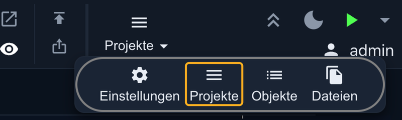
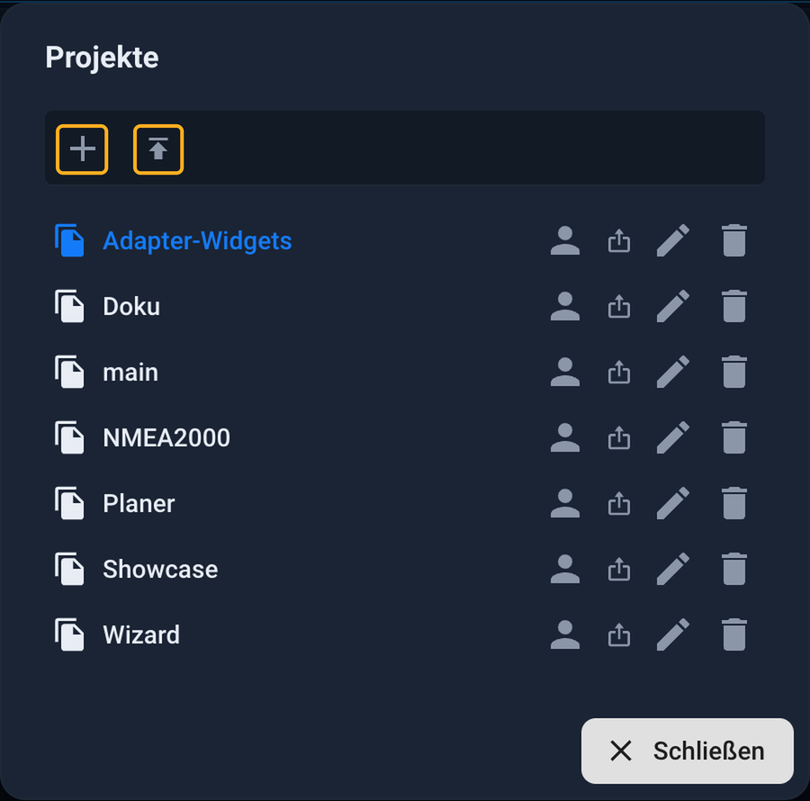
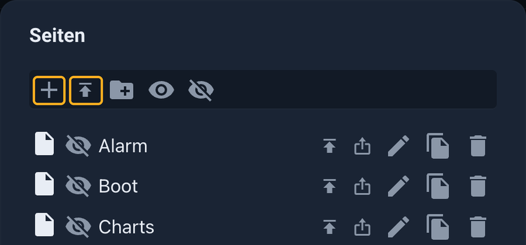

# Demo-Projekt importieren

Unter <https://iobroker.click> läuft ein echtes ioBroker-System. Dort lassen sich
fertige Oberflächen live ansehen und bedienen. Gefällt eine, holt man sie in die
eigene Anlage von **vis-2** und baut sie danach nach Belieben um, statt bei einer
leeren Seite anzufangen.

Diese Seite zeigt den Weg vom Download bis zur laufenden Oberfläche.

## Was man herunterlädt

Zu jeder Oberfläche gehören bis zu zwei Dateien. Beide stehen im Dialog **Projekt
herunterladen und einrichten**, den der Knopf **Projekt herunterladen** neben der
Live-Demo öffnet.

| Datei | Inhalt | Nötig? |
|---|---|---|
| **Projekt für vis-2** (`.zip`) | Seiten, Widgets, Bilder und Einstellungen des Projekts | ja |
| **Datenpunkte** (`.json`) | Die Datenpunkte, die das Projekt benutzt, samt Demo-Werten | optional |

Die Entscheidung ist einfach:

* **Nur das Design** übernehmen: die `.zip` genügt. Die Datenpunkte weglassen.
  Die Widgets sind dann zunächst leer und werden gleich mit den eigenen Geräten
  verbunden.
* **Erst einmal damit spielen**: zusätzlich die Datenpunkte laden. Dann zeigt die
  Oberfläche sofort Werte und lässt sich bedienen, ganz ohne eigene Geräte.

?> Nicht jede Oberfläche auf iobroker.click steht schon zum Herunterladen bereit.
Solche Einträge tragen die Kennzeichnung **Demnächst**.

## Schritt 1: Adapter installieren

In der Admin-Oberfläche unter **Adapter** werden **web** und **vis-2** installiert.
Dazu kommen die Adapter, die zur jeweiligen Oberfläche gehören. Sie stehen im
Download-Dialog. Die Demo mit dem Jäger Design braucht zum Beispiel
`vis-2-widgets-jaeger-design`, dessen Widgets eine eigene Lizenz brauchen, und
`mihome-vacuum` für die Karte des Saugroboters. Fehlt ein solcher Adapter, bleiben
die betroffenen Widgets leer.

## Schritt 2: Datenpunkte importieren (optional)

Nur nötig, wenn die Demo-Werte gewünscht sind:

1. In der Admin-Oberfläche **Objekte** öffnen.
2. Den **Expertenmodus** einschalten.
3. Über das Symbol zum Hochladen die `.json`-Datei mit den Datenpunkten wählen.

Es entsteht ein Ordner unter `0_userdata.0`, im Beispiel `0_userdata.0.Demo`, mit
allen Datenpunkten, die das Projekt benutzt.

## Schritt 3: Das Projekt importieren

Den Editor von vis-2 öffnet man in der Admin-Oberfläche über die Instanz von vis-2.
Direkt im Browser erreicht man ihn unter der Adresse des Web-Adapters mit dem Pfad
`/vis-2/edit.html`.

Oben rechts in der Werkzeugleiste steht das Menü **Projekte**. Ein Klick darauf
klappt vier Einträge auf. **Projekte** öffnet den Dialog mit allen Projekten der
Anlage.

Ganz oben im Dialog stehen zwei Knöpfe nebeneinander. Das **Plus** legt ein neues,
leeres Projekt an. Der Knopf rechts daneben mit dem Pfeil nach oben ist der
**Import**. Er öffnet die Dateiauswahl; dort die heruntergeladene `.zip` wählen. Die
Datei bleibt dabei verpackt, sie wird nicht entpackt.

!> Den **Projektnamen nicht ändern**. Die Bilder und Dateien der Demo werden unter
diesem Namen gesucht, zum Beispiel `jaeger-design-widgets`. Wird das Projekt unter
einem anderen Namen importiert, fehlen die Bilder.

Danach erscheint das Projekt in der Liste. Ein Klick auf den Namen öffnet es im
Editor.

## Nur einen Teil übernehmen

Man muss nicht das ganze Projekt nehmen. Aus einer heruntergeladenen Demo lassen sich
auch einzelne **Seiten** oder einzelne **Widgets** in ein vorhandenes Projekt holen.
Das ist der richtige Weg, wenn nur eine bestimmte Seite oder eine einzelne Kachel
gefällt.

**Einzelne Seiten** importiert man im Dialog **Seiten** (Knopf **Seiten** in der
Werkzeugleiste). Auch hier steht der Import neben dem Plus.

**Einzelne Widgets** importiert man mit dem Knopf **Widgets importieren** in der
Werkzeugleiste. Sein Gegenstück **Widgets exportieren** sichert die Widgets, die auf
der geöffneten Seite markiert sind.

?> Bilder, die ein Widget braucht, liegen im Dateispeicher unter dem Namen des
Demo-Projekts. Wer einzelne Teile übernimmt, sollte darauf achten, dass diese
Dateien im eigenen Projekt ankommen.

## Schritt 4: Eigene Geräte verbinden

Die Demo zeigt Werte der Demo-Datenpunkte. Damit sie die der eigenen Anlage zeigt,
muss jedes Widget auf eigene Datenpunkte zeigen. Zwei Wege führen dahin:

* Im Editor ein Widget anklicken und bei der **Objekt-ID** den Demo-Datenpunkt durch
  den eigenen ersetzen.
* Oder ein Skript schreibt die Werte der eigenen Geräte in die Demo-Datenpunkte. Dann
  bleiben die Widgets unverändert. Das ist praktisch, wenn viele Widgets dieselben
  Datenpunkte benutzen.

?> Solange keine Geräte verbunden sind, bleiben die Werte leer. Zum Ausprobieren
lassen sich Werte in der Admin-Oberfläche unter **Objekte** von Hand setzen.

## Wenn etwas nicht stimmt

| Beobachtung | Ursache |
|---|---|
| Widgets sind leer oder zeigen Platzhalter | Der Adapter der Demo fehlt, oder das Widget-Set ist nicht geladen. Adapter installieren und die Seite neu laden. |
| Widgets zeigen keine Werte | Die Datenpunkte wurden nicht importiert, oder die Widgets zeigen noch auf die Demo-Datenpunkte statt auf eigene. |
| Bilder fehlen | Das Projekt wurde unter einem anderen Namen importiert. Löschen und mit dem ursprünglichen Namen noch einmal importieren. |

Mehr zum Umgang mit Projekten, zum Export und zur Datensicherung steht unter
[vis-2](/docs/viz/vis-2.md#wo-das-projekt-liegt).
