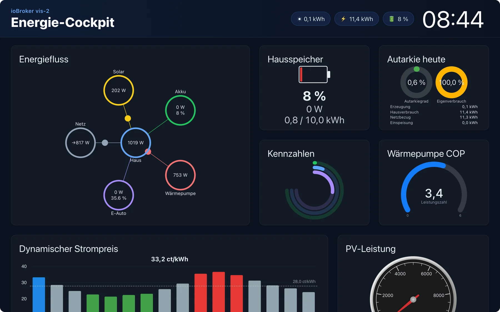
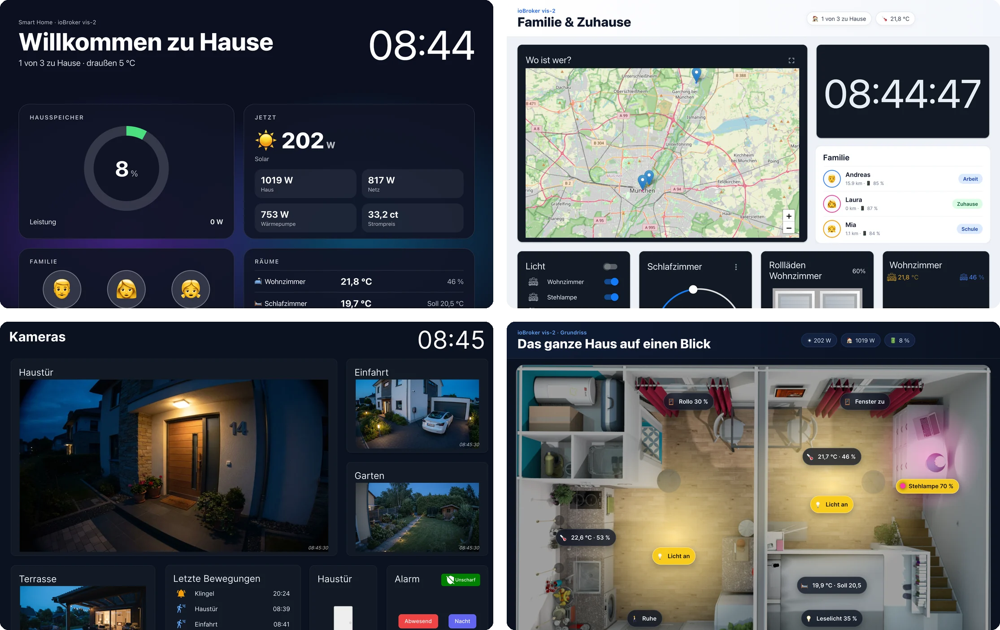
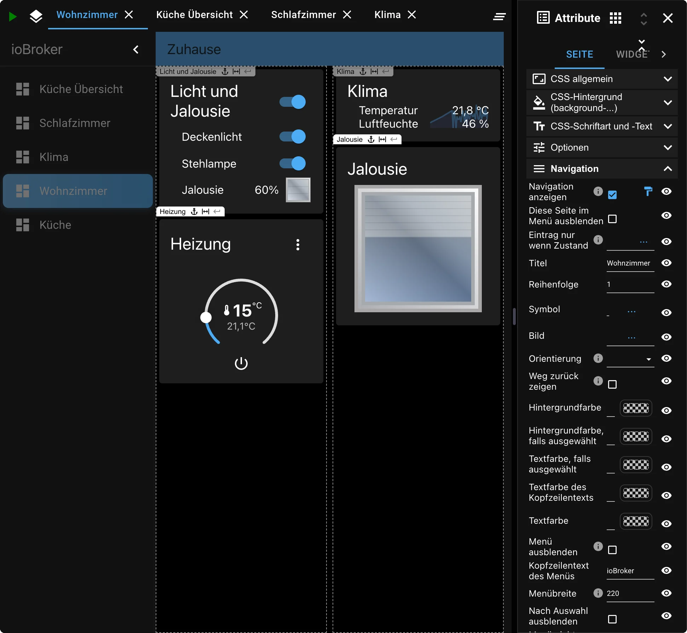
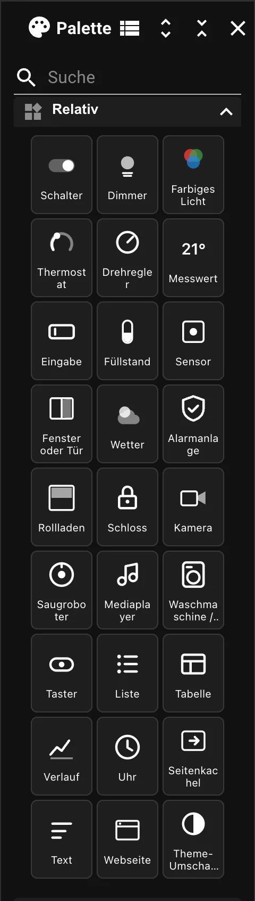
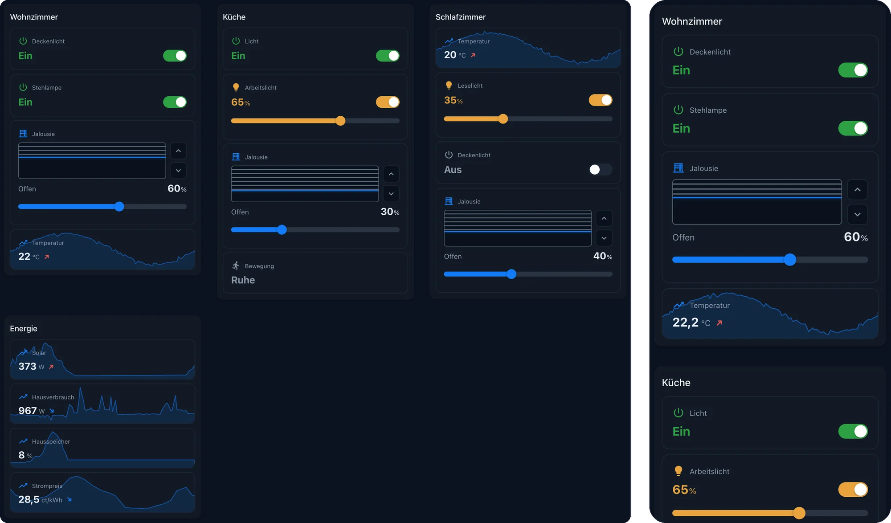
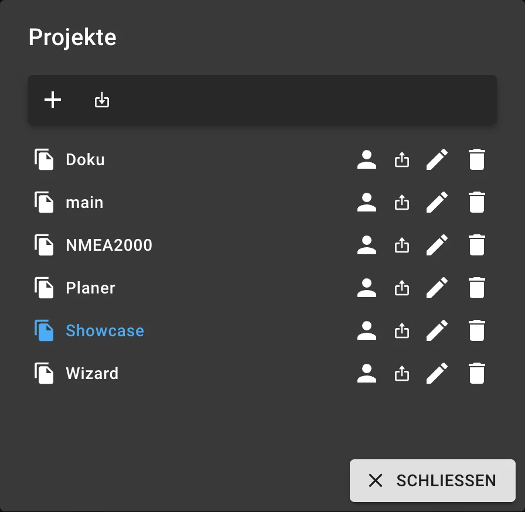

# vis-2

**vis-2** ist die Visualisierung von ioBroker: eine Oberfläche, die man sich aus
Bausteinen selbst zusammenstellt, ohne zu programmieren. Sie ist der Nachfolger
von [vis](/docs/viz/vis.md) und die richtige Wahl für jedes neue Projekt.



Was sie von den anderen Oberflächen unterscheidet: vis-2 baut nichts von selbst.
Der [Devices-Adapter](/docs/viz/devices.md) und
[Lovelace](/docs/viz/lovelace.md) erzeugen ihre Seiten aus den Geräten und
Kategorien; hier bestimmt man jede Kachel selbst. Das kostet etwas Zeit und ist
der einzige Weg, wenn die Oberfläche genau so aussehen soll, wie man sie sich
vorstellt. Ein Wandtablet im Flur, ein Grundriss mit Live-Werten, eine
Kameraübersicht oder eine Seite fürs Telefon: Mit denselben Bausteinen entsteht
jedes Mal etwas ganz anderes.



Fertige Beispiele zum Ausprobieren stehen unter <https://iobroker.click>.

?> Alle Bilder auf dieser Seite stammen aus vis-2 2.20.5 mit den Widgetsätzen,
die vis-2 selbst mitbringt, und einigen der verbreiteten Widget-Adapter.

## Lizenz

vis-2 ist der einzige Teil von ioBroker, der eine Lizenz verlangt. Der Quelltext
steht unter CC BY-NC, was bei der Installation zu bestätigen ist, und zusätzlich
braucht der Adapter eine Lizenz. Drei Fassungen gibt es:

| Lizenz | Für wen |
| --- | --- |
| **Community** | Privat, kostenfrei. Ein Konto auf [iobroker.net](https://iobroker.net) genügt. |
| **Offline** | Privat, gegen eine kleine Gebühr. |
| **Kommerziell** | Gewerbliche Nutzung und Weitergabe an Kunden. |

!> Die **Community-Lizenz wird beim Start des Adapters online geprüft**. Genau
in diesem Moment muss die Anlage ins Internet kommen. Wer das nicht will oder
nicht kann, nimmt die Offline-Lizenz; sie verzichtet auf die Prüfung.
Einzelheiten und Preise unter [Adapterlizenzen](/docs/licenses/adapter.md) und
in der [Produktübersicht](/productoverview).

## Installation

Der Adapter heißt [`vis-2`](/adapters/vis-2). Er braucht den
[web-Adapter](/adapters/web) und läuft als **Singleton**: es kann nur eine
Instanz geben.

Danach gibt es zwei Adressen:

| | Adresse |
| --- | --- |
| Anzeige (Runtime) | `http://<server>:8082/vis-2/index.html` |
| Editor | `http://<server>:8082/vis-2/edit.html` |

Ein bestimmtes Projekt und eine bestimmte Seite erreicht man mit
`index.html?Projekt#Seitenname`. Beide Adressen stehen auch als Verweis im Reiter
**Instanzen**.

?> Auf dem Telefon oder Tablet lässt sich die Anzeige über das Menü des Browsers
als Verknüpfung auf den Startbildschirm legen. Sie öffnet dann genau das Projekt
und die Seite, aus der sie angelegt wurde, und sieht fast aus wie eine eigene App.

## Der Editor


Der Editor teilt sich in fünf Bereiche:

| | Bereich | Inhalt |
| --- | --- | --- |
| **1** | **Werkzeugleiste** | Neue Seite, **Geräte**, Seitenliste, Ausschneiden und Einfügen, Rückgängig und Wiederholen, Ausrichten mehrerer Widgets, Vorschau, dazu rechts **Einstell.**, **Projekte**, **Objekte** und **Dateien** |
| **2** | **Palette** | alle verfügbaren Widgets, nach Widgetsatz gruppiert, mit Suchfeld |
| **3** | **Arbeitsfläche** | die geöffneten Seiten als Reiter |
| **4** | **Attribute** | die Einstellungen des Gewählten, mit den Reitern **Seite**, **Abschnitt**, **Widget**, **CSS** und **Skripte** |
| **5** | **Assistent** | der [KI-Assistent](#der-ki-assistent), der auf Zuruf Seiten baut und ändert |

Palette und Attribute öffnet man über die beiden Symbole links und rechts neben
den Seitenreitern. Ist das Fenster schmal oder passt die eingestellte Auflösung
der Seite nicht zwischen die Seitenleisten, öffnen sie sich als schwebende
Leiste über der Arbeitsfläche, und zwar immer nur eine von beiden. Auf einem
breiten Bildschirm oder bei einer Seite ohne feste Auflösung stehen sie
nebeneinander.

?> **Eine Ansicht heißt in vis-2 „Seite".** In vis 1 hieß dasselbe „View"
beziehungsweise „Ansicht", und in vielen Anleitungen im Netz steht es weiterhin
so. Gemeint ist immer dasselbe: eine Bildschirmseite voller Widgets.

## Seiten

Ein Projekt besteht aus mehreren Seiten. Jede Seite hat unter **Attribute →
Seite** ihre eigenen Einstellungen, gruppiert nach Zweck:

* **CSS allgemein**, **CSS-Hintergrund** und **CSS-Schriftart und -Text** für das
  Aussehen,
* **Optionen** für das Verhalten,
* **Navigation** und **Anwendungsleiste** für das Menü,
* **Responsive Einstellungen** für das Verhalten auf schmalen Bildschirmen.

### Navigation

Statt jede Seite von Hand zu verlinken, nimmt man sie in die **Navigation** auf.
vis-2 baut daraus eine Seitenleiste mit Titel, Symbol und Reihenfolge, dazu
wahlweise eine Anwendungsleiste am oberen Rand. Das ist der schnellste Weg zu
einer Oberfläche, die sich auf dem Telefon bedienen lässt.



Einige Einstellungen, die man kennen sollte:

* **Eintrag nur wenn Zustand**: Der Menüeintrag erscheint nur, solange ein
  Datenpunkt eine Bedingung erfüllt, etwa eine Seite „Gäste" nur bei
  Gastmodus.
* **Weg zurück zeigen**: Die Anwendungsleiste bekommt einen Zurück-Pfeil.
* **Höhe der Anwendungsleiste**: zwischen 24 und 120 Pixel, pro Seite oder für
  das ganze Projekt.

Wie das Menü aussieht, lässt sich unter **Einstell. → Navigationsmenü** für alle
Seiten auf einmal festlegen. Eine Seite darf weiterhin etwas anderes sagen;
alles, was sie leer lässt, kommt aus den Projekteinstellungen.

Wer statt des Menüs eigene Knöpfe baut, kann den Eintrag der gerade offenen Seite
hervorheben: Jedes Widget, das zu einer Seite führt, trägt die CSS-Klasse
`vis-nav-active`, solange diese Seite angezeigt wird.

```css
.vis-nav-active button {
    border: 1px solid #0d72b8;
}
```

### Welche Seite zuerst erscheint

Jeder Seite lässt sich eine **Auflösung** zuordnen und ein Häkchen **Standard**
setzen. Wird `index.html` ohne Seitennamen aufgerufen, öffnet vis-2 die Seite,
die am besten zum Bildschirm passt. So kann man zwei Seiten „Hochkant" und
„Quer" bauen, zwischen denen beim Drehen des Telefons gewechselt wird. Trägt nur
eine einzige Seite das Häkchen, wird immer sie geöffnet.

Die Auflösung ist dabei nur eine Hilfslinie im Editor. In der laufenden Anzeige
ist sie unsichtbar, und Widgets außerhalb davon sind trotzdem zu sehen.

?> Das Widget **basic → Screen Resolution** zeigt die tatsächliche
Bildschirmgröße und die dafür passende Standardseite an. Beim Einrichten ist es
sehr nützlich, danach nimmt man es wieder von der Seite.

## Widgets

Ein Widget wird aus der Palette auf die Seite gezogen und bekommt unter
**Attribute → Widget** seine Datenpunkte zugewiesen. Welche Bausteine zur
Auswahl stehen, hängt davon ab, welche Widgetsätze installiert sind. vis-2
liefert fünf mit, alle weiteren sind eigene Adapter, siehe
[Widgetsätze](/docs/viz/widgetsets.md).




Für die Geräte eines Hauses bringt vis-2 zwei eigene Sätze mit, **Relativ** und
**Absolut**. Beide enthalten dieselben 27 Geräte vom Schalter über Dimmer,
Thermostat, Rollladen und Schloss bis zur Kamera, im selben Stil und mit den
Farben des Themas:

* **Relativ** ist eine Kachel, die ihr Feld in einem Abschnitt ausfüllt. Das ist
  der Satz für Seiten, die sich an jeden Bildschirm anpassen sollen.
* **Absolut** ist so groß, wie man es aufzieht. Auf einem Grundriss wird daraus
  eine kleine runde Markierung mit Symbol und Wert, die in der Farbe ihres
  Zustands leuchtet.

Wählt man den Datenpunkt eines Geräts aus, übernimmt das Widget, was das Objekt
schon weiß: Name, Einheit, Grenzen und das Symbol des Kanals. Abtippen muss man
davon nichts.

Die klassischen Sätze aus vis 1 lassen sich ebenfalls verwenden. Sie sehen dort
allerdings aus wie in vis 1 und folgen nicht dem Thema von vis-2.

### Geräte auf einmal hinzufügen

Auf einer Seite mit Abschnitten öffnet der Knopf **Geräte** in der
Werkzeugleiste einen Assistenten: **Geräte zur Seite hinzufügen**. In vier
Schritten (Umfang, Geräte prüfen, Aufbau, Zusammenfassung) wählt man Geräte
nach Räumen oder Gewerken aus, und vis-2 legt dafür die passenden Kacheln an. Das
setzt voraus, dass die Geräte als solche bekannt sind, am einfachsten über den
[Devices-Adapter](/docs/viz/devices.md).

### Position: fest oder fließend

Standardmäßig liegt ein Widget an festen Koordinaten. Das ist richtig für einen
Grundriss oder ein Wandtablet, dessen Bildschirm sich nie ändert.

Für eine Oberfläche, die auf Tablet und Telefon zugleich funktionieren soll,
gliedert man die Seite stattdessen in **Abschnitte**. Die Widgets darin ordnen
sich von selbst an, und auf einem schmalen Bildschirm laufen die Abschnitte
untereinander. Das ist der einfachere Weg als zwei Seiten mit festen
Koordinaten. Dieselbe Wirkung hat es, die Position eines einzelnen Widgets auf
**relativ** zu stellen.



## Bindungen

Fast jedes Widget hat ein Feld für die Objekt-ID. Darüber hinaus lässt sich
**jedes** Attribut an einen Datenpunkt binden: einfach `{objekt.id}` in das Feld
schreiben, etwa `{hm-rpc.0.OEQ1880105.4.ACTUAL_TEMPERATURE}`. Das kleine
Kettensymbol vor einem Attribut zeigt, dass es sich binden lässt.

Mit mehreren Werten und einer Formel geht auch mehr:

```
{h:javascript.0.myCustom.height;w:javascript.0.myCustom.width;h*w}
```

Vor dem Doppelpunkt steht der Name, unter dem der Wert in der Formel auftaucht.
Der letzte Abschnitt ist die Formel selbst, in der jede JavaScript-Funktion des
Browsers erlaubt ist.

!> **Alle Werte kommen als Zeichenkette an.** Wer rechnet, packt sie in
`parseFloat()`, sonst hängt vis-2 die Zahlen aneinander, statt sie zu addieren.

```
{h:javascript.0.myCustom.height;w:javascript.0.myCustom.width;Math.max(20, Math.sqrt(Math.pow(parseFloat(h), 2) + Math.pow(parseFloat(w), 2)))}
```

Ein Wert mit Anführungszeichen, etwa JSON aus iCal oder MQTT wie
`{"connected":true}`, kommt in der Formel als das Objekt an, das er ist.

Zwei Feinheiten: Ein Doppelpunkt **innerhalb** einer Formel wird als `::`
geschrieben, weil das einfache Zeichen die Namen trennt. Und eine CSS-Angabe wie
`{style: value}` würde als Bindung gelesen; sie gehört deshalb in doppelte
Klammern, `{{style: value}}`.

Neben Datenpunkten gibt es eingebaute Namen:

| Name | Wert |
| --- | --- |
| `username` | der angemeldete Benutzer |
| `view` | Name der aktuellen Seite |
| `wid`, `wname` | Kennung und Name des Widgets |
| `widget` | alle Daten des Widgets, nur im Formelteil, etwa `{a:a;widget.data.name}` |
| `widgetOid` | die Objekt-ID des Widgets, etwa `{t:widgetOid.val;t}` |
| `language` | die eingestellte Sprache |
| `instance` | die Kennung dieses Browsers |
| `login` | ob eine Anmeldung verlangt wird |
| `local_*` | eine Variable, die nur in diesem Browser gilt und nicht nach ioBroker zurückgeschrieben wird |

## Filter

Jedes Widget hat ein Feld **filter**. Trägt man dort einen Begriff ein, etwa
`licht`, lässt sich die Seite mit dem Widget `filter - dropdown` auf diese Gruppe
einschränken. So passen viele Widgets auf eine Seite, ohne dass alle gleichzeitig
zu sehen sind.


Die Einträge tragen die CSS-Klasse `vis-filter-item`, der aktive zusätzlich
`vis-filter-item-active`:

```css
/* Knöpfe, waagerecht oder senkrecht */
.vis-filter-item-active {
    background-color: #ff0000;
}

/* Einträge des Klappfelds */
.vis-filter-item-active.Mui-selected {
    background-color: #ff0000;
}
```

Zwei Dinge sind dabei zu wissen: Eine Farbe, die im Widget selbst eingestellt
ist, steht als Inline-Stil und lässt sich vom Projekt-CSS nicht überschreiben;
wer über CSS färben will, lässt sie leer. Und die Einträge eines Klappfelds
werden außerhalb des Widgets gezeichnet, sind also nur allgemein ansprechbar,
nicht über die Kennung eines einzelnen Widgets. Die Knöpfe dagegen gehören zum
Widget und lassen sich gezielt ansprechen.

## Der KI-Assistent

Seit Version 2.20 hat der Editor einen Assistenten, dem man in eigenen Worten
sagt, was auf die Seite soll. Er sieht sich die Datenpunkte an, baut die Seite
und öffnet sie. War es nicht das Gewünschte, macht ein Tastendruck alles
rückgängig.


Typische Aufträge:

* „Bau eine Seite für die Küche mit Licht, Rollladen und Temperatur."
* „Füge dieser Seite die Außentemperatur hinzu."
* „Welche Datenpunkte dieser Seite werden nicht aufgezeichnet?"

Damit er arbeiten kann, braucht vis-2 den Zugang zu einem Sprachmodell. Er wird in
den Einstellungen der Instanz im Reiter **KI-Assistent** hinterlegt: ein
Schlüssel für OpenAI, Anthropic, Gemini oder DeepSeek, oder die Adresse eines
eigenen, OpenAI-kompatiblen Dienstes, etwa eines lokalen Modells. Dort steht
auch die **maximale Antwortlänge**; für eine ganze Seite in einem Zug darf sie
großzügig sein.

!> Was der Assistent sieht, also die Seite und die Namen und Werte der
Datenpunkte, geht an den gewählten Anbieter. Wer das nicht will, trägt ein
lokales Modell als eigenen Dienst ein. Die Anfragen kosten beim Anbieter je
nach Modell Geld.

## Von außen steuern

vis-2 legt drei Datenpunkte an, über die sich eine laufende Anzeige fernsteuern
lässt:

| Datenpunkt | Inhalt |
| --- | --- |
| `vis-2.0.control.instance` | die Kennung des Browsers, oder `FFFFFFFF` für alle |
| `vis-2.0.control.data` | der Parameter des Befehls |
| `vis-2.0.control.command` | der Befehl. **Diesen zuletzt schreiben**, er löst aus. |

Befehle: `changeView` (auf eine andere Seite wechseln, wahlweise
`projekt/seite`), `refresh` beziehungsweise `reload`, `alert`
(`Meldung;Titel;Symbol`), `dialog` und `dialogClose`, `popup` (öffnet eine
Adresse in einem neuen Fenster) und `playSound`.

Kürzer geht es als JSON in einem einzigen Schreibvorgang:

```js
setState('vis-2.0.control.command', JSON.stringify({ instance: '*', command: 'refresh', data: '' }));
```

!> Das Objekt muss als **Zeichenkette** geschrieben werden, also mit
`JSON.stringify()`. Ein Objekt ohne `val` hält `setState()` im
JavaScript-Adapter für den ganzen Zustand statt für seinen Wert, und der Befehl
kommt nie an.

Umgekehrt meldet vis-2 einen Seitenwechsel zurück: `control.command` steht dann
auf `changedView` und `control.data` auf `projekt/seite`, jeweils mit `ack=true`.
Darauf lässt sich in einem Skript reagieren.

?> `playSound` funktioniert erst, nachdem der Benutzer die Seite mindestens
einmal angetippt hat. Das ist eine Regel der Browser, kein Fehler von vis-2. Auf
einem Wandtablet, das nur anzeigt, kommt deshalb kein Ton.

## Rechte

Für jeden ioBroker-Benutzer lassen sich **Lesen** und **Schreiben** getrennt
vergeben, auf drei Ebenen:

* **Projekt**: Lesen heißt, der Benutzer darf die Anzeige öffnen; Schreiben
  heißt, er darf den Editor benutzen.
* **Seite**: dasselbe für einzelne Seiten.
* **Widget**: ohne Leserecht wird das Widget in der Anzeige nicht gezeichnet,
  ohne Schreibrecht nicht im Editor.


Vergeben wird das im Projektdialog über das Personensymbol hinter dem Projekt.
Ändern darf es nur der Benutzer `admin`. Ein neu angelegter Benutzer hat beide
Rechte. Fehlt ein Recht schon auf Projektebene, hilft es nichts, es auf einer
Seite zu setzen. Wer eine Seite ohne Recht aufruft, landet in der
Projektauswahl.

## Einstellungen für den Betrieb


Unter **Einstell.** stehen die Projekteinstellungen. Für Wandtablets zählen vor
allem diese:

* **Neu laden nach Ruhezustand länger als (Sekunden)**: Geht der Bildschirm
  eines Tablets aus, hält der Browser die Seite an. Beim Aufwachen arbeitet er
  sonst jede verpasste Änderung nach und ist viele Sekunden lang träge. Mit
  dieser Einstellung lädt die Anzeige stattdessen neu und liest die Werte
  einmal. Mindestens 30 Sekunden; leer oder 0 heißt nie, so ist es
  voreingestellt. vis-2 wartet vor dem Neuladen, bis der Server antwortet, damit
  ein Gerät ohne WLAN nicht auf einer Fehlerseite endet.
* **Zurück zu einer Ansicht ohne Bedienung**: Eine Seite und eine Zahl von
  Sekunden. Hat niemand die Anzeige so lange bedient, öffnet sie wieder diese
  Seite. Ein Panel an der Wand kehrt so von selbst zur Startseite zurück. Jeder
  Tastendruck, Klick oder jede Berührung startet die Zeit neu, eine bloße
  Mausbewegung nicht.
* **Dunkler Bildschirm zum erneuten Verbinden**: damit ein Tablet im
  Schlafzimmer nachts nicht plötzlich hell aufleuchtet. Gilt nur für das
  Wiederverbinden, nicht für den ersten Aufbau.
* **Bei Projektänderung alle Browser neu laden**: Nach dem Speichern im Editor
  holen sich alle Anzeigen die neue Fassung.

Alle Einstellungen wirken nur in der Anzeige. Der Editor lädt nie von selbst
neu.

## Wo das Projekt liegt

Ein Projekt ist eine einzige Datei im Dateispeicher von ioBroker:
`vis-2.0/<Projekt>/vis-views.json`, daneben die hochgeladenen Bilder und das
eigene Stylesheet. Über **Projekte** lässt sich ein Projekt anlegen, umbenennen,
als ZIP exportieren und wieder einlesen. Der Export ist der einfachste Weg, eine
Oberfläche auf eine andere Anlage zu bringen.



?> Der Export gehört in die Datensicherung. Ein ioBroker-Backup enthält den
Dateispeicher zwar mit, aber ein einzelnes Projekt daraus zurückzuholen ist
umständlicher als eine ZIP-Datei einzulesen.

## Umstieg von vis 1

Beide Adapter lassen sich nebeneinander betreiben, sie stören sich nicht. Das ist
auch der ruhigste Weg: das alte Projekt in vis stehen lassen, in vis-2 daneben
neu anfangen und erst umschalten, wenn die neue Oberfläche vollständig ist.

Die klassischen Widgetsätze stehen in vis-2 zur Verfügung, an den vertrauten
Bausteinen fehlt es also nicht. Ein exportiertes Projekt lässt sich im
Projektdialog einlesen; wie viel davon ankommt, hängt von den benutzten Widgets
ab. Also erst an einer Kopie versuchen, nicht am laufenden Projekt.
