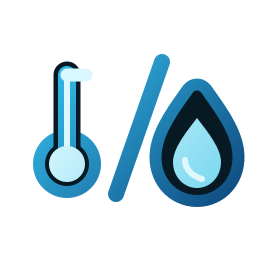

# ioBroker.absolutehumidity

**Tests:** 

## absolutehumidity adapter for ioBroker

build absolute humidity from actual temperature and relative humidity

## Calculation method

The adapter uses empirical Magnus approximation formulas to calculate the
saturation vapor pressure from temperature and relative humidity.

* Absolute humidity is calculated from the saturation vapor pressure using the
  Magnus/Bolton approximation and the ideal gas law. The result is returned in
  g/m³.
* Dew point temperature is calculated using the Magnus formula with Sonntag
  coefficients. The result is returned in °C.

Small deviations from online tables are expected because different tables often
use different Magnus, Tetens, Sonntag, Bolton or Buck coefficient sets.

The instance page is interactive, allowing for the calculation of absolute humidity, dew point temperature, and ventilation recommendations based on data recorded via analog or manual methods. Simply enter the values, and the result will be displayed automatically.

## Create a tab in the tab bar 

Use the pin to create a tab in the tab bar. Use "+ Add device" to add a device.

## Add a Device
To add a device, you must assign a name and select the two states for temperature and relative humidity. 
Optionally, you can specify whether these two values ​​should also be included (again) in the adapter's objects.

## Tile view
The tiles for outdoor use are displayed in green, and those for indoor use in blue.
In the tile view, the tiles are sorted in ascending order, that is, from dry to more humid. 
(If the green tile appears first, ventilating the room might be advisable)

## Object view

## Iobroker Forum Link

[https://forum.iobroker.net/topic/85455/test-adapter-absolut-humidity](https://forum.iobroker.net/topic/85455/test-adapter-absolut-humidity)

## Changelog
<!--
	Placeholder for the next version (at the beginning of the line):
	### **WORK IN PROGRESS**
-->
### 0.1.8 (2026-10-14)
* (BenAhrdt) Ensure that the interactive preview card labels always use the language selected in Admin, even when browser and system languages differ.

### 0.1.7 (2026-10-14)
* (BenAhrdt) Clearly label the editable preview values as demonstration-only and explain that they are not saved.
* (BenAhrdt) Use the selected Admin language for the interactive preview card labels.

### 0.1.6 (2026-09-28)
* Rename the visible Device Manager references to Config Manager in the adapter configuration and translations.
* Add delayed device configuration backups with manual restore and startup recovery when no device configuration exists.

### 0.1.5 (2026-09-27)
* Update the repository-check dependencies and test the adapter on Node.js 26.

### 0.1.4 (2026-09-21)
* Keep long Device Manager measurements readable with a smaller value font and at most two decimal places.

## Collaboration
The adapter was developed in collaboration with Joerg Froehner

## License
MIT License

Copyright (c) 2026 BenAhrdt <github@ben-schmidt.net>

Permission is hereby granted, free of charge, to any person obtaining a copy
of this software and associated documentation files (the "Software"), to deal
in the Software without restriction, including without limitation the rights
to use, copy, modify, merge, publish, distribute, sublicense, and/or sell
copies of the Software, and to permit persons to whom the Software is
furnished to do so, subject to the following conditions:

The above copyright notice and this permission notice shall be included in all
copies or substantial portions of the Software.

THE SOFTWARE IS PROVIDED "AS IS", WITHOUT WARRANTY OF ANY KIND, EXPRESS OR
IMPLIED, INCLUDING BUT NOT LIMITED TO THE WARRANTIES OF MERCHANTABILITY,
FITNESS FOR A PARTICULAR PURPOSE AND NONINFRINGEMENT. IN NO EVENT SHALL THE
AUTHORS OR COPYRIGHT HOLDERS BE LIABLE FOR ANY CLAIM, DAMAGES OR OTHER
LIABILITY, WHETHER IN AN ACTION OF CONTRACT, TORT OR OTHERWISE, ARISING FROM,
OUT OF OR IN CONNECTION WITH THE SOFTWARE OR THE USE OR OTHER DEALINGS IN THE
SOFTWARE.