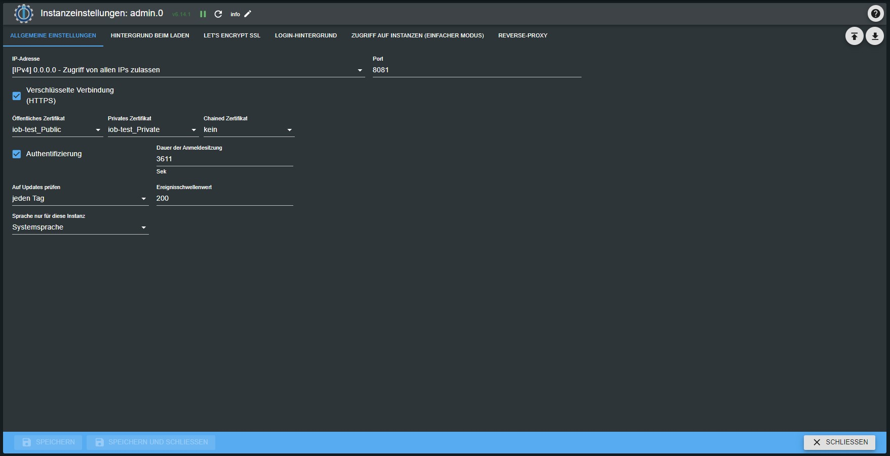
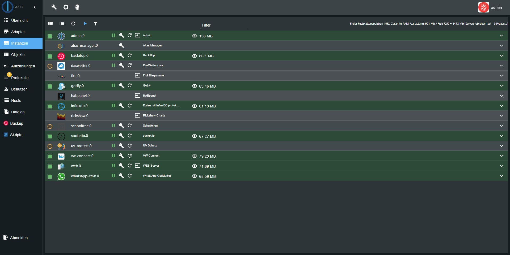
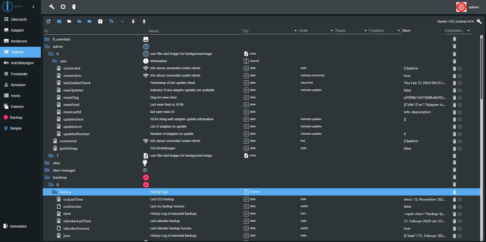
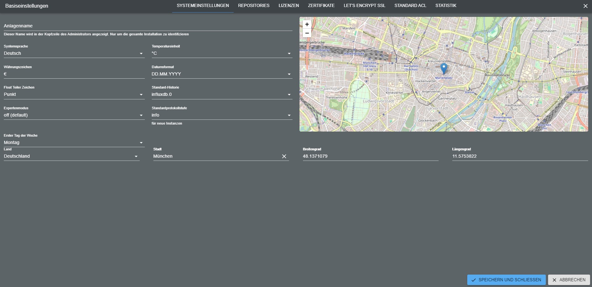

# Admin

The admin adapter is used to configure the whole ioBroker-Installation and all its adapters. 
It provides a web-interface, which can be opened by "http://<IP-Address of the server>:8081" 
in the web browser. This adapter is automatically installed together with ioBroker.

## Configuration
The configuration dialog of the adapter "admin" provides the following settings: 

**IP:** the IP-address of the "admin" web-server can be chosen here. 
Different IPv4 and IPv6 addresses can be selected. The default value is 0.0.0.0. 
If you think, that 0.0.0.0 is invalid setting, please let it stay there, because it 
is absolutely valid. If you change the address, you will be able to reach the web-server 
only through this address. **Port:** You can specify the port of the "admin" web-server. 
If there are more web servers on the PC or device the port must be customized to avoid problems 
of a double port allocation. **Coding:** enable this option if secure https protocol should be used. 

**Authentication:** If you want the authentication with login/password you should enable this check-box. 
Default password for user "admin" is "iobroker" **Buffer:** to speed up the load of the pages enable this option. 
Normally only the developer wants to have this option unchecked.

## Handling
The main page of the admin consist of several tabs. **Adapter:** Here the instances of 
a adapters can be installed or deleted. With the update button 

on the top left we can get if the new versions of adapters are available. 

The available and installed versions of the adapter is shown. For overall view the state of the 
adapter is coloured (red=in planning; orange=alpha; yellow=beta). The updates to a newer version of 
the adapter are made here also. If there is a newer version the lettering of the tab will be green. 
If the question mark icon in the last column is active you can get from there to web site with information of the adapter. 
The available adapter are sorted in alphabetical order. Already installed instance are in the upper part of the list. 

**Instance:** The already installed instance are listed here and can be accordingly configured. If the title of the 
instance are underlined you can click on it and the corresponding web site will be opened. 

**Objects:** the managed objects (for example setup / variables / programs of the connected hardware) 

**States:** the current states (values of the objects)   
If the adapter history is installed, you can log chosen data points. 
The logged data points are selected on the right and appear with a green logo. 

**Scripts:** this tab is only active if the "javascript" adapter is installed.

**Node-red:** this tab is only visible if the "node-red" adapter installed and enabled.

**Hosts:** the computer which ioBroker is installed on. Here the latest version of js-controller can be installed on. 
If there is a new version the letters of the tab are green. To search for a new version you have to click on the update 
icon on the bottom left corner. 

**Enumeration:** here the favourites, trades and spaces from the CCU are listed. 

**Users:** here the users can be added. To do this click on the (+). By default there is an admin. 

**Groups:** if you click on the (+) on the bottom left you can create user groups. From the pull-down menu the users get assigned to the groups. 

**Event:** A list of the running updates of the conditions. 

**Hosts:**
Information about the computer on which ioBroker is installed. The current version of the js controller can be updated here. If a new version is available, the label of the tab appears in green.

**Log:** here the log is displayed In the tab instance the the logged log level 
of the single instance can be set. In the selection Menu the the displayed minimum log level is selected. If an error occurs the 
lettering of the log appears in red.

**System settings:**
Settings such as language, time and date format and other system-wide settings are made in the menu that opens here.

The repositories and security settings can also be set here.

## Changelog
<!--
    Placeholder for the next version (at the beginning of the line):
    ### **WORK IN PROGRESS**
-->
### 8.3.4 (2026-10-25)
- (@typhosj) Fixed: the license dialog of a paid adapter stayed empty and could not be accepted, so the adapter could not be installed. The dialog loaded `licenseInformation.link` as the license text, but that link names the page with prices and where to buy, which the browser may not read. The license text comes from the repository of the adapter again, and the link is shown next to it. A license text that cannot be loaded no longer blocks the dialog, and a short Markdown text that needs no scrolling can be accepted (#3311, ioBroker/ioBroker.vis-2#707)
- (@agross) Improved the English wording of the active repository warning.
- (@GermanBluefox) Fixed: "Add Single-Sign On" in the user dialog sent the display name of the user instead of the user ID, so connecting failed for every user whose name differs from the ID

### 8.3.3 (2026-10-23)
- (@GermanBluefox) Fixed: the object browser showed an object twice and copied its row while scrolling, if a sibling ID began with the same text followed by a space (#3693)

### 8.3.2 (2026-10-23)
- (@GermanBluefox) Fixed: the adapter list was empty after an adapter update and switching between the tabs (#3695)
- (@GermanBluefox) Fixed: an adapter updated while the adapter list was loading was still offered for update with the same version

### 8.3.1 (2026-10-22)
- (@GermanBluefox) Added: sort icon and tooltip on the sort button in the adapters tab (#3684)
- (@GermanBluefox) Added: disk and RAM usage of the host are shown as bars with tooltip in the instances tab
- (@GermanBluefox) Added: the repository version of an adapter can be installed with one click, if a newer or a self-installed version (e.g., from GitHub) is installed (#2973)

### 8.3.0 (2026-10-19)
- (@GermanBluefox) Added: adapter tabs with `adminTab.proxy` (e.g. xterm) run through the port of admin under `/proxy/<instance>/`, for administrators only
- (@GermanBluefox) The used resources added (Only js-controller 8)
- (@GermanBluefox) Fixed: the instances list and the dialog "Update all adapters" fit into the page without a second scrollbar
- (@GermanBluefox) Fixed: the language selected in the wizard is kept after the wizard is closed
- (@GermanBluefox) The admin and the admin pages of the adapters load from the browser cache
- (@GermanBluefox) The tabs "Instances" and "Adapters" load and update faster
- (@GermanBluefox) Fixed: a restart of admin shows "Connection to admin lost" instead of errors like "Cannot read instances!"

## License

The MIT License (MIT)

Copyright (c) 2014-2026 bluefox <dogafox@gmail.com>

[Full license text](LICENSE)