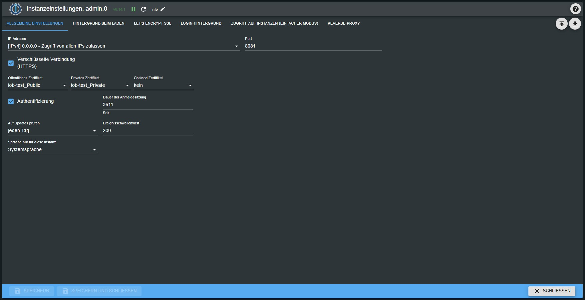
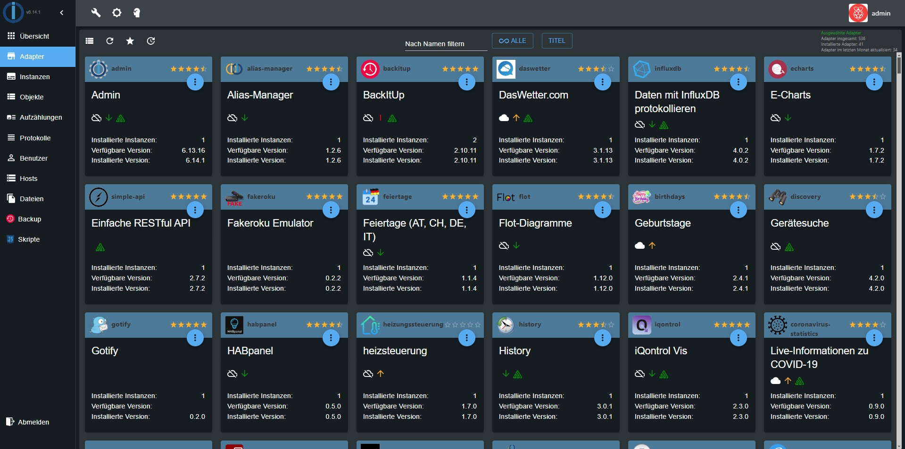
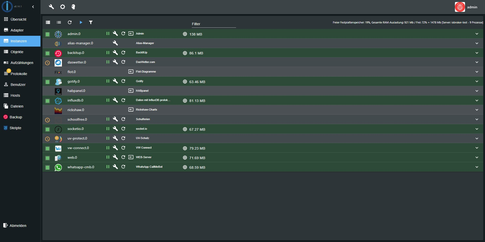
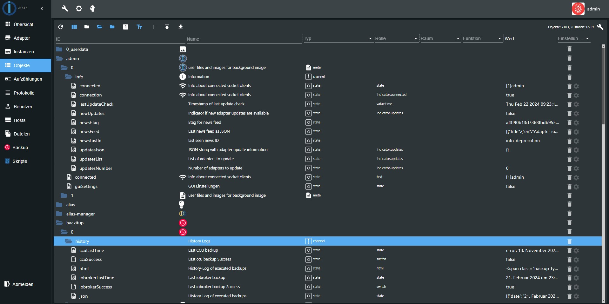
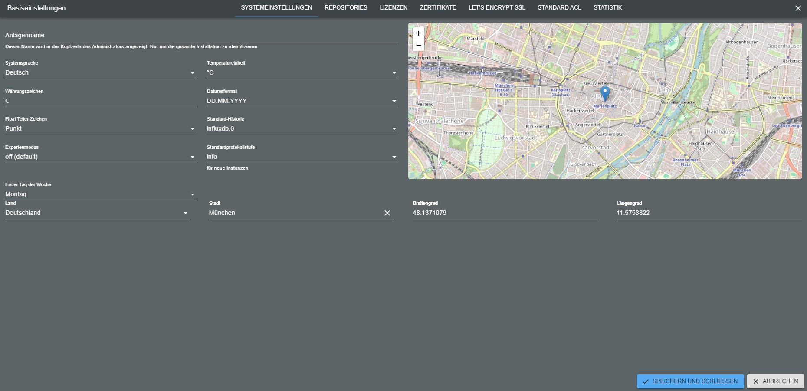

# Admin

The admin adapter is used to configure the whole ioBroker-Installation and all its adapters. 
It provides a web-interface, which can be opened by "http://<IP-Address of the server>:8081" 
in the web browser. This adapter is automatically installed together with ioBroker.

## Configuration
The configuration dialog of the adapter "admin" provides the following settings: 

**IP:** the IP-address of the "admin" web-server can be chosen here. 
Different IPv4 and IPv6 addresses can be selected. The default value is 0.0.0.0. 
If you think, that 0.0.0.0 is invalid setting, please let it stay there, because it 
is absolutely valid. If you change the address, you will be able to reach the web-server 
only through this address. **Port:** You can specify the port of the "admin" web-server. 
If there are more web servers on the PC or device the port must be customized to avoid problems 
of a double port allocation. **Coding:** enable this option if secure https protocol should be used. 

**Authentication:** If you want the authentication with login/password you should enable this check-box. 
Default password for user "admin" is "iobroker" **Buffer:** to speed up the load of the pages enable this option. 
Normally only the developer wants to have this option unchecked.

## Handling
The main page of the admin consist of several tabs. **Adapter:** Here the instances of 
a adapters can be installed or deleted. With the update button 

on the top left we can get if the new versions of adapters are available. 

The available and installed versions of the adapter is shown. For overall view the state of the 
adapter is coloured (red=in planning; orange=alpha; yellow=beta). The updates to a newer version of 
the adapter are made here also. If there is a newer version the lettering of the tab will be green. 
If the question mark icon in the last column is active you can get from there to web site with information of the adapter. 
The available adapter are sorted in alphabetical order. Already installed instance are in the upper part of the list. 

**Instance:** The already installed instance are listed here and can be accordingly configured. If the title of the 
instance are underlined you can click on it and the corresponding web site will be opened. 

**Objects:** the managed objects (for example setup / variables / programs of the connected hardware) 

**States:** the current states (values of the objects)   
If the adapter history is installed, you can log chosen data points. 
The logged data points are selected on the right and appear with a green logo. 

**Scripts:** this tab is only active if the "javascript" adapter is installed.

**Node-red:** this tab is only visible if the "node-red" adapter installed and enabled.

**Hosts:** the computer which ioBroker is installed on. Here the latest version of js-controller can be installed on. 
If there is a new version the letters of the tab are green. To search for a new version you have to click on the update 
icon on the bottom left corner. 

**Enumeration:** here the favourites, trades and spaces from the CCU are listed. 

**Users:** here the users can be added. To do this click on the (+). By default there is an admin. 

**Groups:** if you click on the (+) on the bottom left you can create user groups. From the pull-down menu the users get assigned to the groups. 

**Event:** A list of the running updates of the conditions. 

**Hosts:**
Information about the computer on which ioBroker is installed. The current version of the js controller can be updated here. If a new version is available, the label of the tab appears in green.

**Log:** here the log is displayed In the tab instance the the logged log level 
of the single instance can be set. In the selection Menu the the displayed minimum log level is selected. If an error occurs the 
lettering of the log appears in red.

**System settings:**
Settings such as language, time and date format and other system-wide settings are made in the menu that opens here.

The repositories and security settings can also be set here.

## Changelog
<!--
    Placeholder for the next version (at the beginning of the line):
    ### **WORK IN PROGRESS**
-->
### **WORK IN PROGRESS**
- (@GermanBluefox) Fixed: after "Check adapters for updates" or `iobroker update`, the adapter list shows when the repository was read and not when it was generated (#3729)
- (@GermanBluefox) Updated @iobroker/json-config to 10.1.20: `cron` in the JSON config does not offer the wizard of schedules anymore, which wrote `{}` into the field
- (@GermanBluefox) Updated @iobroker/gui-components to 10.4.6: the CRON dialog has the new mode "Hourly" for a fixed minute of every hour, does not overwrite a schedule that the simple mode cannot show and does not accept invalid values
- (@GermanBluefox) Fixed: the adapter list does not scroll to the top when an adapter is installed
- (@GermanBluefox) Overview shows a hint when a js-controller update is available (#3722, #1914)
- (@GermanBluefox) Fixed: the repository time stamp is updated on the first click of "Check adapters for updates" (#3724)
- (@GermanBluefox) Updated @iobroker/gui-components to 10.4.5: in the JSON config, `customFilter` of `objectId` with `common.role` as a string shows the matching objects and not all others
- (@GermanBluefox) Updated @iobroker/json-config to 10.1.21: `translate` for `text`, also in tables (#3721)
- (@GermanBluefox) Fixed: about 70 texts were not translated, e.g. "Invalid version of ... Required ... Current"; missing spaces in the Windows update commands of js-controller

### 8.3.11 (2026-11-07)
- (@GermanBluefox) Fixed: in the file rights dialog, a "different" permission could not be set for all files
- (@GermanBluefox) Updated @iobroker/json-config to 10.1.19: added the control `diskSelector` to select a file or a folder on the disk of the host where the instance runs (needs js-controller with `CONTROLLER_READ_DISK_DIR`)
- (@krobipd) Fixed: saving the instance settings writes only the settings changed in the dialog, so a setting the adapter wrote into its native while the dialog was open (e.g. its device list) is no longer set back (json-config 10.1.19)
- (@GermanBluefox) Updated @iobroker/socket-classes to 2.10.3: the host commands `readDiskDir` and `deleteDiskFile` need the permission for `cmdExec`

### 8.3.10 (2026-11-06)
- (@GermanBluefox) Fixed: "REAUTHENTICATE!" log flood (#3110)
- (@GermanBluefox) Fixed: the "connection lost" overlay appears only after 2 seconds; loading a tab shows a spinner instead of it
- (@GermanBluefox) Updated `@iobroker/gui-components` to 10.4.3: the loader uses the background of the theme
- (@GermanBluefox) Updated `@iobroker/json-config` to 10.1.17: `coordinates` shows the position on an OpenStreetMap with `map: true`, a click on the map or dragging the marker sets it, `mapStyle` chooses the colors and `readOnly` only shows it; `custom` shows web components of `@iobroker/web-components` (`webComponent`); the text patterns know `_instance`. Admin provides the map, loaded only when a configuration shows one

### 8.3.9 (2026-11-05)
- (@GermanBluefox) Changed: the dialog "Update all adapters" shows the overall progress and the result of each adapter
- (@GermanBluefox) Added: tabs without permission show a lock instead of errors
- (@GermanBluefox) Added: without write rights, instances, enums, users, files, objects and system settings are read-only
- (@GermanBluefox) Updated `@iobroker/json-config` to 10.1.13: the configuration dialogs use the animated icons: upload with progress and result, trash cans, copy with a check mark instead of the alert "Copied", `sendTo` and `setState` confirm the result in the button, rows of tables light up and slide out; fixes for `fileSelector`, `image` with `base64` and the CSV import into an empty table
- (@GermanBluefox) Updated `@iobroker/gui-components` to 10.4.1: animated trash cans, upload, copy and reload symbols in the file and object browser, placeholder rows while the objects are loading, `UploadImage` shows the upload
- (@GermanBluefox) Added: the rights of each object itself (owner, group, everybody) are checked as well

### 8.3.8 (2026-11-04)
- (@GermanBluefox) Added: menu badges jump when their number grows; a ring turns around the adapter icon while it is installed or updated
- (@GermanBluefox) Changed: instance rows fade into the color of the new status; all elements of a row are centered vertically
- (@GermanBluefox) Updated `@iobroker/gui-components` to 10.3.16: arrow up/down at changed numbers in the object browser, check mark after saving
- (@GermanBluefox) Added: admin serves React 19 and 18 as ES modules under `lib/esm/` for web components (`@iobroker/web-components`)
- (@GermanBluefox) Updated packages (`node-forge` 1.4.3, `@module-federation/vite` 1.23.9)

### 8.3.7 (2026-11-03)
- (@GermanBluefox) The `checkDocker` control showed the Docker of the admin host for an instance on that host, also if the instance uses another Docker - e.g. one on a NAS that the adapter names in `iobDockerApi` of its plugin config, or that is chosen in the instance settings. Now admin asks the js-controller of its host as well, if it can check Docker (`CONTROLLER_CHECK_DOCKER`): it checks the Docker connection of the instance, with the `@iobroker/plugin-docker` of the adapter. If it cannot - an older js-controller, an adapter without the plugin - admin checks the Docker of its host itself, as before
- (@GermanBluefox) Updated `@iobroker/json-config` to 10.1.11: `validatorErrorText` is shown below the element instead of the help text, also in the cells of a table (#1911)
- (@GermanBluefox) History data: live values are marked and replaced with the stored ones every 10 seconds; added a reload button (ioBroker.sql#600)
- (@GermanBluefox) An update can be ignored also if its dependencies are not met (#3713)
- (@GermanBluefox) Added: animated icons for start/stop, status, notifications, menu, reload, delete, connection and the result of a command
- (@GermanBluefox) Added: the start/stop button of an instance shows a ring until the instance really runs or stopped
- (@GermanBluefox) Changed: new expert mode symbol (mortarboard)
- (@GermanBluefox) Added: animated folders in the object browser; the restart button of an instance turns until the instance is alive again
- (@GermanBluefox) Changed: the pause button of the log shows the number of new lines as a badge
- (@GermanBluefox) Fixed: the access control dialog crashed with "Error in GUI" and the owner or group could not be changed, if the children had different owners or groups (#3711)

## License

The MIT License (MIT)

Copyright (c) 2014-2026 bluefox <dogafox@gmail.com>

[Full license text](LICENSE)