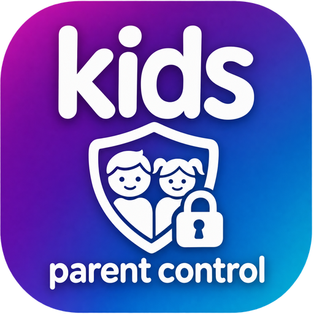

# ioBroker.amazon-kids

Unofficial parental controls for Amazon Kids profiles (Fire tablets, Fire Kids tablets) in ioBroker.

## ⚠️ Important: Unofficial, may stop working

I use the web endpoints of the [Amazon Kids Parent Dashboard](https://parents.amazon.com) for this. Amazon does not offer a public API, so the adapter can stop working whenever Amazon changes the dashboard. The endpoints come from the Python project [amazon_parent_dashboard](https://github.com/GrantGMiller/amazon_parent_dashboard) and from the dashboard itself.

This adapter is not affiliated with or endorsed by Amazon.

---

## Features

- Child profiles, time windows, screen time limit, used and remaining time, usage by app
- Pause and resume the devices of one child or of all children, add or remove bonus time
- Change the time windows, the limit, learn-first and the learning goals of today
- Weekly template that is written back every night, so one-off changes do not stay
- Smart home access, explicit language filter, blocked and allowed websites per child
- Maximum volume, Prime Video, music and the explicit lyrics filter per Kids device (experimental)

## Installation

Install via ioBroker Admin UI.

## Configuration

1. Select the Parent Dashboard address of your country in the instance settings (Germany: `https://eltern.amazon.de`) and start the instance.
2. Read the login address from the log or from the state `info.loginUrl`. It looks like `http://192.168.1.10:3457`.
3. Open that address on a phone or computer in your home network and sign in to Amazon.
4. Wait for the page that tells you the login was successful. The adapter starts reading the dashboard then.

The login works the same way as in the Alexa2 adapter: I use the library [alexa-cookie2](https://github.com/Apollon77/alexa-cookie), which registers the adapter as an app device in the Amazon account and renews the session cookies with the refresh token of that login. The login data is stored encrypted in the instance data directory.

The login page is only available while a login is pending. It is plain HTTP, so only open it inside your own network. Write `true` to `info.login` to sign in again at any time.

### Alternative: paste session cookies

Use this if the login page does not work for your account.

1. Open the Parent Dashboard in a desktop browser and log in.
2. Open the developer tools (F12) and switch to the "Network" tab.
3. Reload the page and click the first request in the list.
4. Copy the complete value of the request header `cookie`.
5. Paste the value into "Session cookies" in the instance settings.

Pasted cookies are not renewed. When Amazon ends the session, the adapter logs an error and you have to paste fresh cookies.

## Datapoints

| State                                                                         | Description                                                                                               |
| ----------------------------------------------------------------------------- | --------------------------------------------------------------------------------------------------------- |
| `info.connection`                                                             | Last request to the dashboard was successful                                                              |
| `info.loginUrl`                                                               | Address of the login page while a login is pending                                                        |
| `info.login`                                                                  | Button: start a new Amazon login                                                                          |
| `info.discover`                                                               | Button: scan the dashboard page for its web endpoints and read a few of them (diagnosis, changes nothing) |
| `info.endpoints`                                                              | Result of that scan as JSON                                                                               |
| `children.<name>.limits.enabledToday`                                         | A total screen time limit is active today                                                                 |
| `children.<name>.limits.minutesToday`                                         | Total screen time limit of today in minutes                                                               |
| `children.<name>.limits.raw`                                                  | Complete time limit configuration as JSON                                                                 |
| `children.<name>.today.allowedWindows`                                        | Time windows in which the devices may be used today, e.g. `06:00-07:30, 10:00-17:00`                      |
| `children.<name>.today.allowedNow`                                            | The current time is inside one of these windows (updated every minute)                                    |
| `children.<name>.today.nextChange`                                            | Next start or end of a time window today                                                                  |
| `children.<name>.today.learnFirst`                                            | Learning goals have to be reached before entertainment                                                    |
| `children.<name>.today.usedMinutes`                                           | Screen time used today                                                                                    |
| `children.<name>.today.remainingMinutes`                                      | Screen time left today: limit plus bonus minus used time                                                  |
| `children.<name>.today.usage`                                                 | What was used today, as JSON list with title, category and minutes                                        |
| `children.<name>.today.goals.*`                                               | Daily learning goals in minutes per category                                                              |
| `children.<name>.limits.bonusMinutes`                                         | Bonus time currently granted                                                                              |
| `children.<name>.schedule.windowsToday`                                       | Write new time windows for this weekday, e.g. `06:00-07:30, 10:00-18:00`                                  |
| `children.<name>.schedule.limitToday`                                         | Write a new total screen time limit for this weekday                                                      |
| `children.<name>.schedule.learnFirstToday`                                    | Switch: learning goals have to be reached before entertainment on this weekday                            |
| `children.<name>.schedule.limitEnabledToday`                                  | Switch: total screen time limit active on this weekday                                                    |
| `children.<name>.schedule.goalAppToday`, `goalVideoToday`, `goalAudibleToday` | Write a new daily learning goal in minutes for this weekday                                               |
| `children.<name>.schedule.saveTemplate`                                       | Button: save the current weekly rules as template                                                         |
| `children.<name>.schedule.restoreTemplate`                                    | Button: write the template back to Amazon                                                                 |
| `children.<name>.schedule.restoreDaily`                                       | Switch: restore the template every night shortly after midnight                                           |
| `children.<name>.schedule.template`                                           | The saved template as JSON                                                                                |
| `children.<name>.schedule.backup`                                             | Weekly rules before the last change by the adapter                                                        |
| `children.<name>.control.pause`                                               | Write minutes to pause all devices of the child, 0 resumes. Returns to 0 after sending                    |
| `children.<name>.control.paused`                                              | Devices are paused by a pause set through ioBroker                                                        |
| `children.<name>.control.pausedUntil`                                         | End of that pause as timestamp, 0 if not paused                                                           |
| `children.<name>.control.resume`                                              | Button: resume the devices                                                                                |
| `children.<name>.control.bonusTime`                                           | Write minutes to add bonus time. Returns to 0 after sending                                               |
| `children.<name>.control.clearBonus`                                          | Button: remove the granted bonus time                                                                     |
| `children.<name>.access.smartHome`                                            | Switch: the child may control Alexa smart home devices                                                    |
| `children.<name>.access.explicitFilter`                                       | Switch: explicit language filter of the child (Amazon cannot be read back, shows the last value sent)     |
| `children.<name>.access.blockedWebsites`, `allowedWebsites`                   | Blocked and allowed websites as JSON list                                                                 |
| `children.<name>.access.blockWebsite`, `unblockWebsite`                       | Write a website address to block or unblock it. Returns to empty after sending                            |
| `children.<name>.access.allowWebsite`, `disallowWebsite`                      | Write a website address to add it to or remove it from the allowed list. Returns to empty after sending   |
| `devices.<name>.volume`                                                       | Maximum volume of the Kids device, 10 to 100                                                              |
| `devices.<name>.videoEnabled`, `musicEnabled`, `musicFilter`                  | Switches: Prime Video, music and explicit lyrics filter on the Kids device                                |
| `household.pause`                                                             | Write minutes to pause the devices of all children, 0 resumes. Returns to 0 after sending                 |
| `household.resume`                                                            | Button: resume the devices of all children                                                                |

## Keeping the weekly rules

I change the times quite often for a single day and want the usual rules back the next day. This is how to set that up:

1. Set the rules in the Parent Dashboard the way they should normally be.
2. Press `schedule.saveTemplate` for the child.
3. Switch `schedule.restoreDaily` on.

Every night the adapter compares the rules at Amazon with the template and writes the template back if they differ.

## Limitations

- The login registers an app device named "ioBroker Amazon Kids" in the Amazon account.
- Amazon stores the rules per weekday. A change through `schedule.windowsToday`, `schedule.limitToday` or `schedule.learnFirstToday` therefore also applies to the same weekday in the following weeks, until the template is restored.
- The nightly restore runs up to five minutes after midnight and only while the adapter is running.
- `today.allowedNow` only reflects the time windows. It does not know the used screen time, bonus time or a pause.
- The used time comes from the activity report of the dashboard. The tablet uploads it with a delay, so `today.usedMinutes` and `today.remainingMinutes` can lag behind.
- Amazon offers no way to read whether devices are paused. `control.paused` and `control.pausedUntil` only know pauses set through ioBroker.
- The settings of the Kids devices (`devices.<name>.*`) are experimental. Amazon's answer for the volume and the switches is not verified yet.

## Changelog

### **WORK IN PROGRESS**

### 0.1.3 (2026-11-27)

- (backfisch88) Fix: commands rejected with HTTP 403 renew the session and are sent again
- (backfisch88) Changed: a failed scheduled session refresh is logged as warning

### 0.1.2 (2026-11-17)

- (backfisch88) Fix: device states are only created for devices that support the setting
- (backfisch88) Fix: existing states also get updated units, ranges and defaults
- (backfisch88) Changed: Amazon answers are shortened in the debug log
- (backfisch88) Fix: profile and device IDs are unique when the case is ignored
- (backfisch88) Changed: one contact email in package.json and io-package.json

### 0.1.1 (2026-11-15)

- (backfisch88) Maintenance: dependencies, translation format

Older changes can be found in CHANGELOG_OLD.md.

## License

MIT License

Copyright (c) 2026 Henrik Schönhofen (backfisch88) <henrik.schoenhofen@icloud.com>

See [LICENSE](https://github.com/backfisch88/ioBroker.amazon-kids/blob/main/LICENSE) for the full license text.