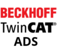
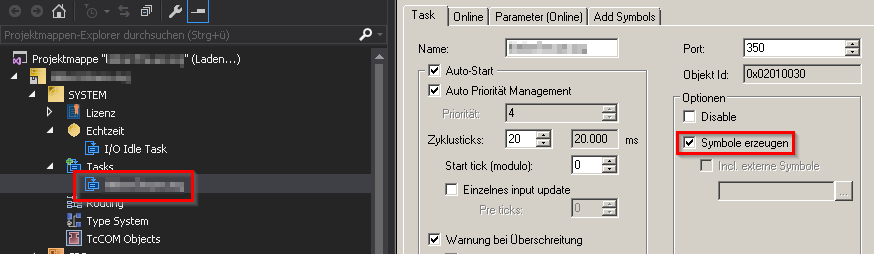

     

# ioBroker.beckhoff

This adapter for ioBroker can Communicate with a Beckhoff Automation System (Twincat 2 or 3) over the ADS Protocol.
The ADS Protocol is implemented in every System of Beckhoff and can be used without any License on ioBroker or Automation System.

This Project is not affilate to Beckhoff in any way

## Description

### Requirements

- Beckhoff PLC that has an ethernet connection and is connected to your LAN
  - Make your you give the PLC a fixed IP address
  - Make sure you can ping the PLC from ioBroker
  - TwinCat 2 **excluding BC Runtimes** or TwinCat 3

### PLC Configuration

1. Enable ADS on your PLC project. To do this click on your task and then enable the checkbox before `Create symbols`. Download the new configuration and make sure you reboot your PLC. The reboot is only needed when you are using TwinCat 2.

   

2. Now add a static route to our Beckhoff PLC. The route should point to your server that will run the proxy application.

   Here an example to add a Static Route directly on PLC u can add this Route also from your EngineeringPC to the PLC.

   

   Important is that the AmsNetId and the AdressInfo (IP-Adress) matches with the Adapter Settings. For further Information about TwinCat Router and Security read Documentation on Synchronisierung [Beckhoff Information System](https://infosys.beckhoff.com/ 'Beckhoff Information System')

3. On TwinCat 2 Create a Struct and fill in your needed Symbols. Then add this Struct to a GlobalVariableTable.

   ##### Currently Supported Types: BOOL, BYTE, WORD, DWORD, SINT, USINT, INT, UINT, DINT, UDINT, REAL, LREAL, TIME, TIME_OF_DAY, TOD, DATE, DATE_AND_TIME, DT, STRING

   OPTIONAL: You can create a Variable in root of Struct with the exact name -> ioBrokerResync (Not Casesensitiv and not matter which Type) -> Every time this Variable changes his value the Table get resynced in ioBroker.

4. On TwinCat 3 Create a GlobalVariableTable and fill in your needed Symbols.

   ##### Currently Supported Types: BOOL, BYTE, WORD, DWORD, SINT, USINT, INT, UINT, DINT, UDINT, REAL, LREAL, TIME, TIME_OF_DAY, TOD, DATE, DATE_AND_TIME, DT, STRING

   OPTIONAL: You can create a Variable in root of Variable Table with the exact name -> ioBrokerResync (Not Casesensitiv and not matter which Type) -> Every time this Variable changes his value the Table get resynced in ioBroker.

### Adapter Configuration

#### Twincat 3 and Twincat 2

1. Choose your Runtime Version
2. Fill in Target IP-Adress and AMS-Net-ID.
3. On TwinCat 2 fill in the Instance Name of Struct.
4. On TwinCat 3 fill in the correct Tablename of the before created GlobalVariableTable.
5. All other Points u mostly not need to Change.

#### Twincat 2 <= v2.11.2240

Upload your \*.tpy File from your PLC Project -> Every Time you change something on the Struct u communicate with the ioBroker, you need to Upload it again.

### Dataexchange

- When some Value is changed in PLC then it will be automatic transferred to ioBroker
- When a Value is changed in ioBroker (Important: ACK need to be FALSE!!) then the Value will be automatic transferred to PLC. After that the Adapter set ACK to TRUE.

### Attention

1. TwinCAT AMS Router doesn't allow multiple TCP connections from the same host. So when you use two instances on the same host to connect to the same TwinCAT router, you will see that TwinCAT will close the first TCP connection and only respond to the newest.
2. The Adapter Sync the complete GlobalVariableTable. U have different options to trigger a resync:
   - Create a resync Variable in PLC (See [here](#PLC-Configuration))
   - When the PLC are not in Run longer your Resync Intervall -> Then the Sync will triggered after the start of PLC.
   - Every Time you Download the Project to your PLC except "OnlineChange"
   - Restart the Adapter
3. Sync never meant the Dataexchange of the Symbols. Sync is the create or delete the States in ioBroker dependent on the GlobalVariableTable in the PLC.

## Connection recovery

The target address accepts IPv4 or a hostname. `adsTimeout` configures each ADS request (default 500 ms); `reconnectInterval` configures the reconnect/status-check interval (default 15 seconds).

`cacheSymbolTable` reuses in-memory symbol metadata after short outages (enabled by default). `symbolCacheMaxAge` limits the outage duration to 300 seconds by default. Reconnects always recreate ADS handles and notifications and read current values. Symbol-version changes, observed STOP/RUN transitions, failed cached subscriptions/reads and `ioBrokerResync` changes force a full synchronization. Missing write acknowledgements refresh values without downloading metadata or replaying writes.

The symbol version is an 8-bit counter. A restart or counter wrap during an unobserved outage may reuse the same number. Disable caching or update a PLC `ioBrokerResync` counter on startup/program changes if this can occur. The outage limit is not a unique program-identity check.

## TPY upload

For TwinCAT 2 <= v2.11.2240, upload and select a `.tpy` file. The adapter reads it from `beckhoff.<instance>.tpy` on startup. A selected file takes precedence over `xmlTpyData`; clear the selection to use the existing XML contents. Update the file whenever PLC symbol definitions change.

## Changelog
<!--
    Placeholder for the next version (at the beginning of the line):
    ### **WORK IN PROGRESS**
-->
### 2.0.0 (2026-10-19)
- (copilot) Adapter requires node.js >= 22 now
- (copilot) Adapter requires admin >= 7.7.22 now
- (zonfacter) Reuse validated symbol metadata after short reconnects, renew ADS handles and refresh values; fully synchronize on metadata changes, observed PLC stops or expired caches
- (zonfacter) Add a configurable ADS request timeout and hostname support; preserve variable-table prefix matching and existing object mappings
- (zonfacter) Migrate to responsive jsonConfig with native TPY upload, persistent filename feedback and packaged translations; retain legacy XML and TPY paths
- (zonfacter) Prepare a named TPY file directory without removing originals or overwriting differing files; support configuration requests through supportedMessages.custom
- (zonfacter) Isolate compact-mode sessions, reject stale callbacks and avoid a metadata reload when only a write acknowledgement is missing
- (zonfacter) Fix synchronization when a metadata notification arrives during the final connection-state write
- (mcm1957) Dependencies have been updated

### 1.7.0 (2026-02-12)
- (mcm1957) Adapter requires node.js >= 20 now
- (copilot) Adapter requires js-controller >= 6.0.11 now
- (copilot) Adapter requires admin >= 7.6.17 now
- (copilot) Migrated to ESLint 9 and @iobroker/eslint-config standard configuration
- (mcm1957) Dependencies have been updated

### 1.6.0 (2024-04-02)

* (mcm1957) Adapter requires node.js 18 and js-controller >= 5 now
* (mcm1957) Dependencies have been updated

### 1.5.3 (2023-10-29)

- (mcm1957) Dependencies have been updated

### 1.5.3-alpha.0 (2023-10-29)

- (mcm1957) Standard test environment has been updated

## License

The MIT License (MIT)

Copyright (c) 2024-2026 iobroker-community-adapters <iobroker-community-adapters@gmx.de>  
Copyright (c) 2018-2023 dkleber89 <dkleber89@gmail.com>

Permission is hereby granted, free of charge, to any person obtaining a copy
of this software and associated documentation files (the "Software"), to deal
in the Software without restriction, including without limitation the rights
to use, copy, modify, merge, publish, distribute, sublicense, and/or sell
copies of the Software, and to permit persons to whom the Software is
furnished to do so, subject to the following conditions:

The above copyright notice and this permission notice shall be included in
all copies or substantial portions of the Software.

THE SOFTWARE IS PROVIDED "AS IS", WITHOUT WARRANTY OF ANY KIND, EXPRESS OR
IMPLIED, INCLUDING BUT NOT LIMITED TO THE WARRANTIES OF MERCHANTABILITY,
FITNESS FOR A PARTICULAR PURPOSE AND NONINFRINGEMENT. IN NO EVENT SHALL THE
AUTHORS OR COPYRIGHT HOLDERS BE LIABLE FOR ANY CLAIM, DAMAGES OR OTHER
LIABILITY, WHETHER IN AN ACTION OF CONTRACT, TORT OR OTHERWISE, ARISING FROM,
OUT OF OR IN CONNECTION WITH THE SOFTWARE OR THE USE OR OTHER DEALINGS IN
THE SOFTWARE.