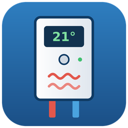
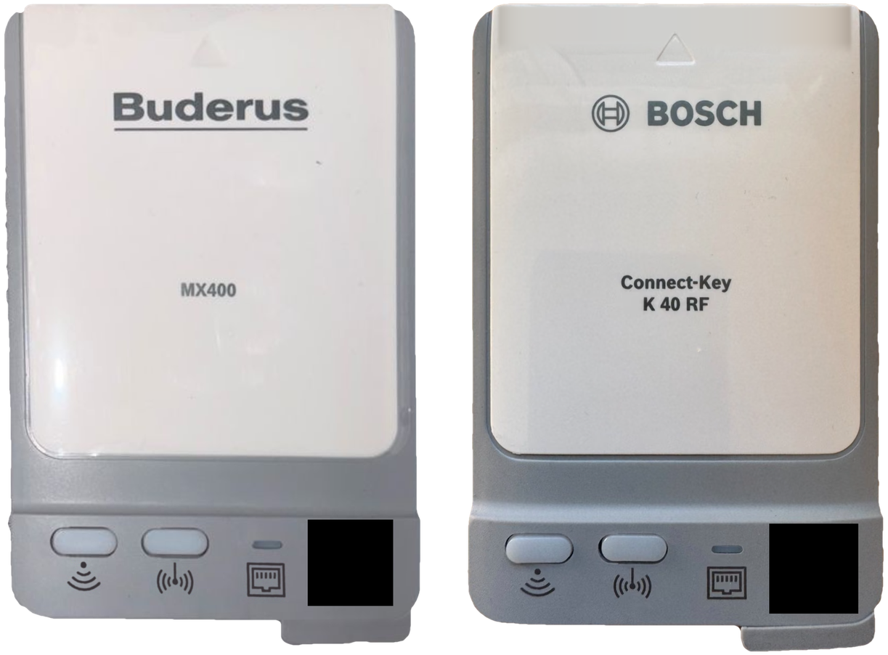
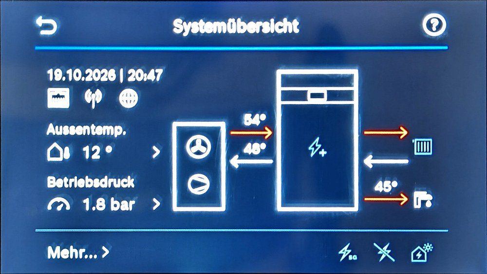

# ioBroker.bosch-buderus-wp


[](LICENSE)
[](https://www.paypal.com/donate/?hosted_button_id=BW2WL8QCH2AMU)

[](https://www.npmjs.com/package/iobroker.bosch-buderus-wp)
[](https://www.npmjs.com/package/iobroker.bosch-buderus-wp)


[](https://nodei.co/npm/iobroker.bosch-buderus-wp/)

**[🇩🇪 Deutsche Anleitung](https://github.com/septa-cr/ioBroker.bosch-buderus-wp/blob/main/docs/de/README.md)**

## Buderus MX400 / Bosch K 40 RF adapter for ioBroker

This adapter reads the data of a **heat pump** (Buderus and others) via the official **local API** of the **LAN and radio module Buderus MX400 / Bosch K 40 RF**. The connection runs directly in your home network. No cloud account is needed.



*The Buderus LAN and radio module MX400 (left) and the Bosch Connect-Key K 40 RF (right). The adapter communicates with this module and was tested with the MX400.*

The MX400 is the internet gateway and radio module of the heating system. It sits in a slot of the heat pump and connects it to the home network via LAN or Wi-Fi. According to the manufacturer, the same local API is also offered by the Bosch Connect-Key K 40 RF and the K 40 RF of IVT, Vulcano and Worcester. The adapter was developed and tested with a Buderus MX400.

Manufacturer: [Buderus](https://www.buderus.de) · [Product information on the MX400 (Buderus, PDF)](https://www.buderus.de/resource/blob/84532/5f174d97fdbaf3201210da560b2364a7/18_Buderus_ISH-2025_LAN-%20und-Funkmodul-MX400.pdf)

> **Note:** The manufacturer's API is currently **read-only**. The adapter can display all values, but it cannot change settings of the heat pump.

## Features

- **Reads all available values automatically.** At startup, the adapter checks every resource described in the manufacturer's API specification and creates data points only for those your system actually provides. In addition, all signals reported by the device itself are read.
- **Names in 11 languages** for all data points (English, German, Russian, Portuguese, Dutch, French, Italian, Spanish, Polish, Ukrainian, Chinese), with the correct units (°C, kWh, %, l/h …) and matching roles
- **Energy counters** (e.g. total consumption, heating, hot water) as separate data points for heat produced, compressor and electric heater
- **History data** for consumption, starts, working time and temperatures: daily values of the last 31 days, monthly values of the last 12 months, plus *today* and *this month*. Temperatures are shown as averages, energy values as totals.
- **Complex responses** such as error messages or system information are split into individual data points, and the complete response is also available as JSON.
- **Sensor special values** (short circuit, open circuit, flow too low …) are not shown as measured values, the data point stays empty instead.
- **Connection indicator** (`info.connection`) in the instance list
- **Gentle on the device:** values that rarely change (history data, Wi-Fi list) are only read once per hour. Resources that did not answer during startup are retried hourly. The list of resources found on your MX400 is stored, so the adapter is ready immediately after a restart. It is refreshed once a day or when you click a button in the settings.
- **Only real changes are written:** a value is only written to its data point when it has changed, which keeps the load low for logging adapters such as History or InfluxDB.



*The system overview on the display of the heat pump. Values such as outdoor temperature, flow and return temperature, hot water temperature and operating pressure are also available in ioBroker.*

## Requirements

- Buderus heat pump with the **LAN and radio module MX400** (or another supported K 40 RF gateway) with **gateway firmware 15.00.01 or newer**
- The MX400 and ioBroker must be in the same local network.
- An **API token** for the MX400 (see below)
- ioBroker with js-controller 6.0.11 or newer and Admin 7.6.20 or newer
- Node.js 22 or newer

## Creating the API token

The token is created **once** with the `Login` and `Pass` values from the sticker or information sheet of the MX400. The token does not expire, so store it safely and treat it like a password.

### Option 1: directly in the adapter settings (recommended)

1. Enter the **IP address** of the MX400 in the settings.
2. Enter **Login** and **Pass** (hyphens are removed automatically). These two values are not stored.
3. Press the **WLAN** and **Wireless** buttons on the MX400 at the same time for one second. The LEDs briefly flash blue.
4. **Within 5 minutes**, click **Request API token** in the settings. The token appears in the field *API token*. To keep a backup of the token outside ioBroker (for example in a password manager), tick **Show API token** below the field. The token is then displayed and can be copied with the button next to it.
5. Click **Save**.

Request the token only once and keep it: every request creates a new token on the MX400, and its memory for tokens is limited (error `507 Token database full`, according to the manufacturer a token can only be revoked with the token itself, see the manufacturer's guide).

### Option 2: manually with curl

Short summary of the manufacturer's guide:

1. Find the IP address of the MX400 in your router.
2. Remove all hyphens from the `Pass` value.
3. Press the **WLAN** and **Wireless** buttons on the MX400 at the same time for one second. The LEDs briefly flash blue.
4. **Within 5 minutes**, request the token (port 9442):

    ```bash
    curl --insecure --request POST "https://IP-ADDRESS:9442/auth/token" \
      --header "Content-Type: application/x-www-form-urlencoded" \
      --data-urlencode "grant_type=password" \
      --data-urlencode "username=LOGIN" \
      --data-urlencode "password=PASS-WITHOUT-HYPHENS" \
      --data-urlencode "client_name=iobroker"
    ```

    On Windows (PowerShell), write `curl.exe` instead of `curl` and put the command on a single line without the `\`.

5. Copy the value of `access_token` from the response and enter it in the field *API token*.

The complete guide with troubleshooting: [K 40 RF API documentation (Bosch Home Comfort)](https://github.com/bosch-home-comfort/api-docs/blob/main/docs/k-40-rf.md)

## Installation

Install the adapter via the adapter list of the ioBroker Admin: open **Adapters**, search for *Buderus MX400* and install it. Then create an instance of the adapter.

## Configuration

| Setting | Description |
| --- | --- |
| IP address of the MX400 | IP address of the MX400 in your network, e.g. `192.168.178.xxx` |
| API token | The token created as described above. It is stored encrypted. |
| Login / Pass | Only needed once to request the token. They are not stored. |
| Polling interval (seconds) | How often the values are read. Default 60, minimum 10 |

At the first start, the adapter checks all resources of the API. This takes about one to two minutes. The log then shows how many resources your system provides, for example: *"Search finished: 1286 paths checked, 118 present …"*.

## Data points

| Folder | Content |
| --- | --- |
| `info.connection` | Connection to the MX400 (true/false) |
| `info.discoveredPaths` | Internal list of the resources found on your MX400 (JSON) |
| `info.diagnosis` | Diagnosis report for forum posts (JSON, only if switched on, see below) |
| `signals.*` | All signals reported by the device, e.g. outdoor temperature, flow temperature, compressor speed |
| `heatSources.*` | Heat pump: temperatures, compressor power, system pressure, energy counters |
| `heatingCircuits.hc1.*` | Heating circuit 1: room temperature, setpoints, pump and status |
| `dhwCircuits.dhw1.*` | Hot water: temperature, setpoint, status |
| `devices.device1.*` | Paired radio devices, e.g. room controllers |
| `recordings.*` | History data (`daily`, `monthly`, `today`, `thisMonth`) |
| `system.*`, `gateway.*`, `notifications.*` | System information, gateway, error messages |

Which folders and values appear depends on your system.

### Recognising the operating state

- `heatSources.hs1.refrigerant.status` shows what the refrigerant circuit is doing: `heating`, `cooling`, `defrost`, `dhw` (hot water charging), `idle` and others. The possible values depend on the device and can differ a little from the manufacturer's description. The adapter uses the list that your device reports itself. On a Buderus WLW186i the values `heating`, `defrost` and `dhw` were observed during the matching operation.
- `heatSources.flameStatus` ("Heat source in operation") only says whether the heat source is running (on/off). It stays `on` while heating, charging the hot water and defrosting, because the compressor keeps running in all three cases.
- The signals `signals.SRC.IntDHW.HeatUpActive`, `DHURunning` and `ExtraActive` did **not** show the hot water charging in our tests (they stayed off while `refrigerant.status` was `dhw`). Please use `refrigerant.status` for this.

### Diagnosis report

If something is missing or looks wrong on your system, the adapter can create a short report that you can paste into a forum post. Switch it on in the adapter settings, tab **Diagnosis** (it is off by default), and save. Then the data point `info.diagnosis` appears. If you switch it off again, the data point is deleted.

The report contains the adapter version, a few device properties (brand, firmware, system type, heat pump type), the paths that have no readable name yet and the fixed values that have no text yet. It contains **no measured values, no IP address, no serial numbers and no other personal data**. Please still look through it before you post it.

To copy it, open the object `bosch-buderus-wp.0.info.diagnosis` in the admin UI (tab Objects), click the value and copy the text. State your heat pump model in your post as well. Please post the report in a code block (button `</>` in the forum editor), so that the thread stays tidy.

## Security notes

- The MX400 uses a self-signed certificate. As recommended by the manufacturer, the adapter therefore does not verify the certificate for this connection only. The data is still transmitted encrypted. Use the adapter only in a trusted local network.
- The token is stored encrypted in ioBroker and is only made available to the adapter itself.

## Support the development

Do you like this adapter? You can support its development with a coffee donation:

[](https://www.paypal.com/donate/?hosted_button_id=BW2WL8QCH2AMU)

## Note on AI involvement

This adapter was developed with the help of an AI assistant (Claude by Anthropic). It was tested with a real Buderus MX400 on a Raspberry Pi 5. The translations of the data point names into Russian, Portuguese, Dutch, French, Italian, Spanish, Polish, Ukrainian and Chinese were also created with AI assistance and have not been checked by native speakers. Corrections are welcome.

## Disclaimer

This adapter is a private project and is not affiliated with Bosch Thermotechnik GmbH or Buderus. All product and company names are trademarks of their respective owners. Use at your own risk.

## Changelog

<!--
    Placeholder for the next version (at the beginning of the line):
    ### **WORK IN PROGRESS**
-->
### 0.0.13 (2026-11-26)

- (septa-cr) The data point "Burner in operation" is now called "Heat source in operation", which fits a heat pump better
- (septa-cr) The data points for the pumps PC0 and PC1 now say which pump it is: primary circuit pump and heating circuit pump (meaning taken from the glossary of a community knowledge base)
- (septa-cr) The status of the refrigerant circuit now also has texts for the values off, dhw (hot water), pool and pool_heat, which Buderus devices report; the README now explains how to recognise the operating state

### 0.0.12 (2026-11-25)

- (septa-cr) Units are now written the usual way: "min" instead of "mins" and "dB" instead of "db"; the parts of the installation date (day, month, year) no longer show a unit
- (septa-cr) The fields of the update, system information and device lists (e.g. gateway ID, timestamp, module serial number) and their folders now have readable names in all languages
- (septa-cr) Status values with fixed values (e.g. refrigerant circuit status, heating circuit status) now show a readable text next to the value in the object list (English, taken from the manufacturer's API description)
- (septa-cr) New diagnosis report for forum posts: in the new tab "Diagnosis" of the settings you can switch on the data point `info.diagnosis` (off by default). It contains the adapter version, device type, paths without a name and fixed values without a text, but no measured values and no personal data
- (septa-cr) Status texts now also match values that the gateway writes differently (upper/lower case, underscores) and use the value list reported by the gateway, so more values show a readable text
- (septa-cr) Data points with a list of states (e.g. EEBUS status, holiday mode) no longer stay empty: the value is kept and the object list shows the text next to it

### 0.0.11 (2026-11-24)

- (septa-cr) The sensor designation T0 (confirmed with the manufacturer's app) is now part of the name of the system flow temperature
- (septa-cr) The system pressure is now called "Systemdruck" in German, as in the manufacturer's app
- (septa-cr) The second return temperature (TC0, from the signal list) is now named "Heat pump return temperature" so that the two data points can be told apart
- (septa-cr) The names of the data points for dehumidification and the groundwater pump and of their folders are now translated in all languages

### 0.0.10 (2026-11-24)

- (septa-cr) Fixed: a data point with custom settings (e.g. logging) is no longer deleted when an old data point has to be replaced; a warning is written to the log instead
- (septa-cr) The error text for a full token memory (HTTP 507) was corrected: according to the manufacturer a token can only be revoked with the token itself
- (septa-cr) The warning about a timer when the adapter is stopped no longer appears
- (septa-cr) Update of `@iobroker/testing` to 6.3.2, badges added to the README

### 0.0.9 (2026-11-14)

- (septa-cr) Fixed: no data point is created below another data point any more (error messages); an old data point of this kind is removed automatically
- (septa-cr) The energy counters (kWh) now use the role `value.energy` instead of the outdated `value.power.consumption`, the system pressure (bar) uses the role `value`
- (septa-cr) Log messages and error texts are now in English
- (septa-cr) The polling interval is now also limited to 10 to 3600 seconds in the code
- (septa-cr) The sensor designations TC0, TC1, TW1 and TR4 are now part of the names of the matching temperature data points

### 0.0.8 (2026-11-03)

- (septa-cr) New: the API token can be displayed in the settings (checkbox "Show API token" with a copy button), so that a backup of it can be kept outside ioBroker
- (septa-cr) The sensor designations PH1, PL1, TR1, TR3, TR5, TR6, TC3 and TA4 are now part of the names of the matching temperature data points

### 0.0.7 (2026-11-02)

- (septa-cr) The adapter was renamed from buderus-mx400 to bosch-buderus-wp, as it supports several brands (instance and data point IDs change, please create a new instance)
- (septa-cr) Title, description and keywords now also name the Bosch K 40 RF (and IVT, Vulcano, Worcester)
- (septa-cr) README: new photo of the modules, note on AI involvement

### 0.0.6 (2026-10-23)

- (septa-cr) Data point names are now available in all recommended languages (Russian, Portuguese, Dutch, French, Italian, Spanish, Polish, Ukrainian, Chinese) in addition to German and English
- (septa-cr) The file with the names is more compact: numbered names (heating circuit 1 to 4 etc.) are generated from templates
- (septa-cr) The field `_pass` is now declared as protected and encrypted in `io-package.json`

### 0.0.5 (2026-10-23)

- (septa-cr) New: the API token can be requested directly in the adapter settings (Login and Pass of the MX400, button "Request API token"), curl is no longer needed
- (septa-cr) New: the list of resources found on the MX400 is stored and reused at the next start, it is refreshed once a day or via a button in the settings
- (septa-cr) Values are only written when they change (`setStateChanged`)
- (septa-cr) Documentation: required Admin version corrected (7.6.20)

### 0.0.4 (2026-10-22)

- (septa-cr) Adjusted to the requirements of the ioBroker repository: minimum Node.js 22, tests with Node.js 22, 24 and 26, automated releases via trusted publishing, updated contact address and installation notes

Older changelog entries can be found in CHANGELOG_OLD.md.

## License

MIT License

Copyright (c) 2026 septa-cr <septamobile@gmail.com>

Permission is hereby granted, free of charge, to any person obtaining a copy
of this software and associated documentation files (the "Software"), to deal
in the Software without restriction, including without limitation the rights
to use, copy, modify, merge, publish, distribute, sublicense, and/or sell
copies of the Software, and to permit persons to whom the Software is
furnished to do so, subject to the following conditions:

The above copyright notice and this permission notice shall be included in all
copies or substantial portions of the Software.

THE SOFTWARE IS PROVIDED "AS IS", WITHOUT WARRANTY OF ANY KIND, EXPRESS OR
IMPLIED, INCLUDING BUT NOT LIMITED TO THE WARRANTIES OF MERCHANTABILITY,
FITNESS FOR A PARTICULAR PURPOSE AND NONINFRINGEMENT. IN NO EVENT SHALL THE
AUTHORS OR COPYRIGHT HOLDERS BE LIABLE FOR ANY CLAIM, DAMAGES OR OTHER
LIABILITY, WHETHER IN AN ACTION OF CONTRACT, TORT OR OTHERWISE, ARISING FROM,
OUT OF OR IN CONNECTION WITH THE SOFTWARE OR THE USE OR OTHER DEALINGS IN THE
SOFTWARE.