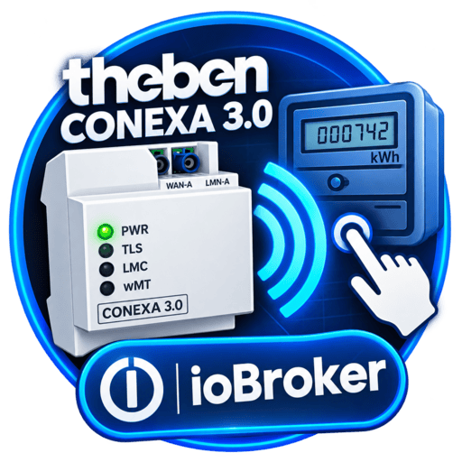

# ioBroker.conexa

**Tests:** 

## Support the project ❤️

If you enjoy this adapter, I would be grateful for a small contribution!

_Fee transparency: PayPal.me charges approximately 2.49% + €0.35 per donation. Ko-fi charges no platform fee (only standard payment processing fees apply)._

## conexa adapter for ioBroker

Reads meter readings and tariff profiles (TAF) locally via the M2M HAN interface.

## Overview & Supported Hardware

This adapter reads meter readings and tariff profiles (TAF) from the [Theben CONEXA 3.0 Smart Meter Gateway](https://www.theben.de/de/conexa-3-0-9070900).

It communicates locally with the gateway through the M2M HAN interface using HTTPS and XML. No cloud service is required.

## Prerequisites

- The M2M HAN interface must be activated on the CONEXA 3.0 gateway.
- The ioBroker host must be able to reach the gateway on the network, typically through HTTPS port 443.
- M2M user credentials must be provided by the metering point operator (Messstellenbetreiber).

## Configuration

Create or open the adapter instance in ioBroker and configure:

- **IP address / hostname:** Network address of the CONEXA 3.0 gateway.
- **Port:** HTTPS port used to connect to the gateway (normally 443).
- **Username:** M2M user name.
- **Password:** M2M password.
- **Polling interval:** Interval in minutes between gateway requests.

## Object Structure & States

The adapter creates states below `conexa.0`:

- `info.*`: Connection indicator and other adapter information.
- `gateway.*`: Gateway status, the structured system log table in `logTableJson`, the next poll timestamp, and grid operator transmission tracking.
- `gateway.marketTransmissions.*`: Event 16001 transmission totals, today's count, last transmission timestamp, and JSON history.
- `usagePoints.*`: Dynamically discovered tariff profiles such as TAF-1, TAF-2, and TAF-7.
- TAF states: Raw values, calculated Wh and kWh readings, consumption for the last interval in `deltaWh`, average power in `averagePowerW`, and capture timestamps.

## Changelog

<!--
	Placeholder for the next version (at the beginning of the line):
	### **WORK IN PROGRESS**

-->
### **WORK IN PROGRESS**

### 0.1.12 (2026-11-19)

- (ChristianPeymann) Removed old news entries from io-package.json

### 0.1.11 (2026-11-19)

- (ChristianPeymann) Prevented case-insensitive collisions between dynamic usage point IDs
- (ChristianPeymann) Updated existing dynamic object names with 11-language translations
- (ChristianPeymann) Added configurable polling interval and translated its label
- (ChristianPeymann) Translated remaining error messages and removed unused template configuration

### 0.1.10 (2026-11-18)

- (ChristianPeymann) Translated all log messages to English
- (ChristianPeymann) Added full 11-language i18n support for dynamic objects
- (ChristianPeymann) Improved documentation and separated developer manual into DEVELOPMENT.md
- (ChristianPeymann) Updated package description to English

### 0.1.9 (2026-10-26)

- (ChristianPeymann) Adjusted minimum Node.js version to 22

### 0.1.8 (2026-10-26)

- (ChristianPeymann) Fixed state roles and added missing translations for object definitions

## License

MIT License

Copyright (c) 2026 Christian Peymann <christian.peymann@ewe.net>

Permission is hereby granted, free of charge, to any person obtaining a copy
of this software and associated documentation files (the "Software"), to deal
in the Software without restriction, including without limitation the rights
to use, copy, modify, merge, publish, distribute, sublicense, and/or sell
copies of the Software, and to permit persons to whom the Software is
furnished to do so, subject to the following conditions:

The above copyright notice and this permission notice shall be included in all
copies or substantial portions of the Software.

THE SOFTWARE IS PROVIDED "AS IS", WITHOUT WARRANTY OF ANY KIND, EXPRESS OR
IMPLIED, INCLUDING BUT NOT LIMITED TO THE WARRANTIES OF MERCHANTABILITY,
FITNESS FOR A PARTICULAR PURPOSE AND NONINFRINGEMENT. IN NO EVENT SHALL THE
AUTHORS OR COPYRIGHT HOLDERS BE LIABLE FOR ANY CLAIM, DAMAGES OR OTHER
LIABILITY, WHETHER IN AN ACTION OF CONTRACT, TORT OR OTHERWISE, ARISING FROM,
OUT OF OR IN CONNECTION WITH THE SOFTWARE OR THE USE OR OTHER DEALINGS IN THE
SOFTWARE.