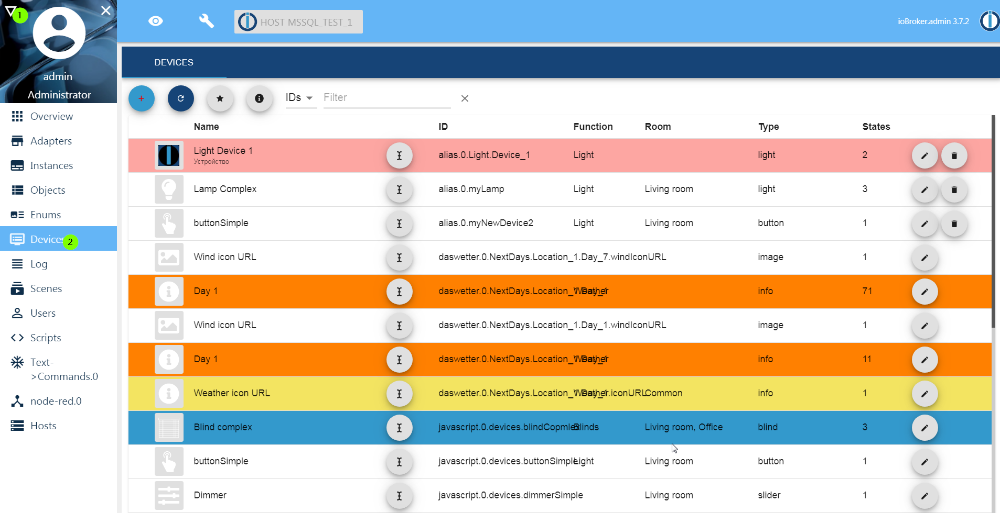

# ioBroker.devices

## Device adapter for ioBroker

Manage and create devices for using it in other adapters like material, iot, matter...

**Important: enable tab in admin, like log and scripts**

**This adapter uses Sentry libraries to automatically report exceptions and code errors to the developers.** For more details and for information on how to disable the error reporting, see [Sentry-Plugin Documentation](https://github.com/ioBroker/plugin-sentry#plugin-sentry)! Sentry reporting is used starting with js-controller 3.0.

## ioBroker.devices Adapter User Manual

### Overview

The `ioBroker.devices` adapter is a component of the ioBroker smart home platform designed to simplify device management by creating and managing virtual devices.

These virtual devices provide a standardized interface for physical devices, making it easier to integrate, script, visualize, and control devices across different manufacturers and protocols.

The adapter ensures consistency in data point naming and structure, reducing the need to modify scripts or visualizations when hardware changes.

It wraps any collection of states in ioBroker (physical **or** virtual) into well‑formed **devices** with rich information:
* `type`, `role`, `smartName`, `color`, `room`, `function`, `icon`, `unit` and more

The result is consumed by dashboards (Material UI, VIS‑2), voice assistants (Alexa/Google), matter adapter, the **iot/cloud** adapter and scripts, giving you a clean, future‑proof object tree.

**Note:** The adapter does **not** poll hardware. It runs as a tab‑only “web” instance → zero CPU/RAM footprint.

### Purpose

The `ioBroker.devices` adapter serves the following purposes:
- Standardization: Creates virtual devices with consistent data point structures, regardless of the underlying hardware or protocol from different data points.
- Simplified Maintenance: Allows users to swap physical devices without updating scripts or visualizations by remapping data points in the adapter. 
- Enhanced Compatibility: Integrates seamlessly with visualization adapters (e.g., Material UI, VIS), IoT adapters (e.g., Alexa, Google Home).
- User-Friendly: Simplifies device management for beginners while offering flexibility for advanced users.

#### Standardization
Many adapters like mqtt, knx or similarly deliver data points with different names and structures. This adapter creates a virtual device with a consistent structure, making it easier to manage and visualize devices.
It adds automatic roles, units and names to the states.

#### Simplified Maintenance
The `ioBroker.devices` adapter allows users to create virtual devices that can be easily remapped to different physical devices.
This means that if you change a physical device, you don't need to update your scripts, visualizations or history settings; you just need to remap the data points in the adapter.

#### Enhanced Compatibility
The adapter knows what the devices should look like and how to use them. It creates a virtual device with the same structure as the physical device, making it easier to integrate with other adapters.

#### User-Friendly
The `ioBroker.devices` adapter is designed to be user-friendly, making it accessible for beginners while still offering advanced features for experienced users. The intuitive interface allows users to create and manage virtual devices without needing extensive technical knowledge.

## Configuration

Once installed, configure the adapter via the Devices tab in the ioBroker admin interface.

### Creating a Virtual Device

Open Devices Tab in admin.

#### Add Device

- Click the "+" button to create a new virtual device.
- Enter a Name for the device (e.g., "LivingRoomLight").
- Select a Device Type (e.g., Light, Switch, Thermostat) from the predefined list.
- Optionally, assign a Category (e.g., Lighting, Heating) for the organization.

Map Data Points:

For each function (e.g., on/off, brightness), map the virtual device’s data point to the corresponding state of the physical device (e.g., `hm-rpc.0.12345.1.STATE` for a Homematic switch).

Use the interface to browse and select states from other adapters.

Save: Click "Save" to create the virtual device. It will appear under alias.0.<DeviceName> in the Objects tab.

#### Types of Devices

The `ioBroker.devices` adapter supports three main approaches to device creation:

1. Automatically Detected Devices

Some adapters (e.g., ioBroker.zigbee, ioBroker.hm-rpc) already provide a valid structure for the devices, and they will be detected automatically **if some category (function or room) is assigned**.
Without the assigned category, the automatically detected device will not be processed.

2. Linked Devices

Linked devices are virtual devices manually created to mirror a specific physical device’s data points with `ioBroker.linkeddevices`.

It is suggested to use `ioBroker.devices` and `alias.0` branch instead of `linkeddevices`.

3. Aliases

Aliases are lightweight virtual devices that act as shortcuts or simplified references to existing states without creating a full device structure.

You can create a new virtual device in a `alias.0` branch. By selecting the device type, you should fill all required states (marked with *). Optionally, you can add not required states (e.g., humidity by temperature sensor).
For every required state and filled optional state, the adapter creates a structure of aliases.
If you created e.g. a temperature device named `Temperature` and provided both states (temperature and humidity) you will find the following states and channel in `alias.0` branch:
- `alias.0.Temperature` - channel
- `alias.0.Temperature.temperature` - state with unit '°C'. It should have a virtual link to some real state with temperature. If you remove the alias in `ioBroker.devices` adapter, this state will stay without a link.
- `alias.0.Temperature.humidity` - state with unit '%'. This will have a virtual link to real state (e.g., to `hm-rpc.0.JHAGHGJJJ.1.HUMIDITY`). If you remove alias in `ioBroker.devices` adapter, this state will be deleted.

Almost every device type could have additional states (indicators) for battery, connectivity, error and some more else. They are optional, but some adapters (e.g., `material` or `matter`) could interpret it.

For every state, you can provide all settings that aliases support:
- Different states for read and write
- Convert formula for read and write

#### Managing Devices
Edit Device: In the Devices tab, click the pencil icon next to a device to modify its name, type, category, color, name, icon or data point mappings.

Delete Device: Click the trash can icon to remove a virtual device. This does not affect the physical device or its adapter.

Organize Devices: Use categories to group devices (e.g., "Lighting", "Heating") for easier management in visualizations.

### Web components of other adapters
Adapters can bring web components (`common.webComponents`, see [`@iobroker/web-components`](https://github.com/ioBroker/web-components)). In the edit mode, "Add widget" lists them with the widgets of their adapter, and a component becomes a tile like any other widget.

The settings dialog of such a tile shows the size and the color of the tile and then the settings of the component, rendered by JSON-Config. A setting of type `selectSendTo` or `autocompleteSendTo` gets its options from the adapter via `sendTo`, as in JSON-Config. Without `instance` in the setting, devices asks the first instance of the adapter that brings the component (`<adapter>.0`), not `devices.0`. The same applies to the forms a component opens as a dialog.

## Type of devices
This adapter is built with the help of `type-detector`. All possible devices could be found [here](https://github.com/ioBroker/ioBroker.type-detector/blob/master/DEVICES.md) 

## Video

## Changelog
<!--
	Placeholder for the next version (at the beginning of the line):
	### **WORK IN PROGRESS**
-->
### 4.4.0 (2026-11-13)
* (@GermanBluefox) Web components: the settings types `selectSendTo` and `autocompleteSendTo` (`@iobroker/web-components` 0.8.0) ask the adapter that brings the component (`<adapter>.0`) when the setting names no `instance`, and not devices itself; also in the forms a component opens as a dialog
* (@GermanBluefox) Fixed: a setting of type `selectSendTo` no longer spins forever when the instance does not answer - it shows a text field, so the value stays editable (`@iobroker/json-config` 10.1.22)

### 4.3.2 (2026-11-10)
* (@GermanBluefox) Nested folders under alias.0 keep their place, name and color in the GUI; only folders on the top level are merged with a room of the same name (issue #739)
* (@GermanBluefox) New widget "Note (Markdown)" for free text like comments or instructions
* (@GermanBluefox) Updated packages
* (@GermanBluefox) Animated icons of `@iobroker/gui-components`: the folder buttons "expand/collapse all" show on hover what they will do, the button "clear filter" has the funnel with the cross, the rows of an opened folder slide out, the widget groups open and close animated, and the notices "not active", "no permission" and "could not be loaded" have their own symbol
* (@GermanBluefox) The switch to hide the config button in the runtime is back in the settings of the root category; users without the edit right still do not see the button
* (@GermanBluefox) If the devices cannot be loaded, for example because the user may not call `sendTo`, the page says so instead of loading forever
* (@GermanBluefox) The list of devices only holds what the logged-in user may read according to the ACLs of the objects (js-controller 7.2.5 or newer). A changed ACL counts at once

### 4.3.1 (2026-11-07)
* (@GermanBluefox) Color light 2×2: the saved colors are shown on the tile and applied with a tap
* (@GermanBluefox) Saving a device no longer resets the names of its states; only the states that were changed are written (issue #725)

### 4.3.0 (2026-11-05)
* (@GermanBluefox) Web components of other adapters (`common.webComponents`, see `@iobroker/web-components`) can be added as tiles: the palette lists them, the settings dialog shows their settings next to the size of the tile, and their dialogs open as dialogs of devices. The list and the settings come from the manifests of the components; the module of a component is loaded when its first tile is shown
* (@GermanBluefox) Plugins may bring background services (`common.deviceWidgets.services`): the app renders them once next to the category, with the widgets of the adapter in all categories the user may control, whichever category is shown - e.g. so that a phone stays registered and rings in every category
* (@GermanBluefox) The dimmer widget is easier to operate in every size: the 1×1 tile fills up like a glass, a tap switches and dragging up or down dims; the wide tiles and the new 2×2 size have a large slider with quick selection, or a bar to tap or drag with ± buttons instead of the small round knob. Only the power button switches these tiles, and a drag sends only the value it is released at
* (@GermanBluefox) Color lights with a dimmer are operated like the dimmer: the 1×1 tile fills with the light color, a tap switches, dragging up or down dims and a long press opens the color dialog; the larger tiles (now also 2×2) have the slider or the bar and a button for the color dialog. Their quick selection can show the saved states instead of brightness values, with "+" to save the current state
* (@GermanBluefox) Dimmer 2×0.5: the slider knob and the status icons no longer touch the power button
* (@GermanBluefox) A plugin or web component tile that cannot be loaded can be deleted directly in the edit mode
* (@GermanBluefox) Delete, reload, folder and play/pause buttons use the animated icons of `@iobroker/gui-components`
* (@GermanBluefox) The "Add widget" dialog is much larger and shows the widgets in sets - the built-in ones by theme, everything an adapter brings (plugin widgets and web components) together - with a search and a filter by set
* (@GermanBluefox) If an adapter brings a plugin and a web component of the same name, like the "Flow diagram" of flow, "Add widget" offers only the plugin; tiles of the web component keep working
* (@GermanBluefox) Web components get the colors, the font and the corners of the theme of devices (`@iobroker/web-components` 0.5.0), not only light or dark

### 4.2.7 (2026-10-25)
* (@GermanBluefox) Added widget for the device type `tv` with a remote control dialog

## License
MIT License

Copyright (c) 2019-2026 bluefox <dogafox@gmail.com>

Permission is hereby granted, free of charge, to any person obtaining a copy
of this software and associated documentation files (the "Software"), to deal
in the Software without restriction, including without limitation the rights
to use, copy, modify, merge, publish, distribute, sublicense, and/or sell
copies of the Software, and to permit persons to whom the Software is
furnished to do so, subject to the following conditions:

The above copyright notice and this permission notice shall be included in all
copies or substantial portions of the Software.

THE SOFTWARE IS PROVIDED "AS IS", WITHOUT WARRANTY OF ANY KIND, EXPRESS OR
IMPLIED, INCLUDING BUT NOT LIMITED TO THE WARRANTIES OF MERCHANTABILITY,
FITNESS FOR A PARTICULAR PURPOSE AND NONINFRINGEMENT. IN NO EVENT SHALL THE
AUTHORS OR COPYRIGHT HOLDERS BE LIABLE FOR ANY CLAIM, DAMAGES OR OTHER
LIABILITY, WHETHER IN AN ACTION OF CONTRACT, TORT OR OTHERWISE, ARISING FROM,
OUT OF OR IN CONNECTION WITH THE SOFTWARE OR THE USE OR OTHER DEALINGS IN THE
SOFTWARE.