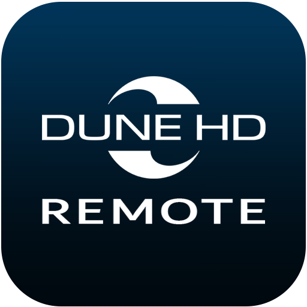

# ioBroker.dune-hd-remote

Control [Dune HD](https://dune-hd.com/) media players via IP network from ioBroker.

[Dune HD](https://dune-hd.com/) produces high-quality network media players supporting 4K HDR playback, Blu-ray, and a wide range of media formats. All Linux-based Dune HD players support IP control via HTTP API, which this adapter uses to provide full remote control from ioBroker.

## Features

- Full playback control (play, pause, stop, seek, prev/next, fast-forward/rewind)
- Navigation (D-pad, enter, return, menus)
- Volume and mute control
- Status polling (player state, position, duration, volume, bitrate, audio language, video resolution)
- Built-in PWA web remote — use your phone as a remote control
- Smart offline polling — reduces poll frequency when player is unreachable
- PWA text input — send text directly to the player's on-screen keyboard
- PWA Play URL — start media playback from any URL directly from the remote

## Supported Models

All Dune HD media players with IP control support (Linux-based firmware).  
Tested on: **Dune HD Pro 4K** (firmware with XML response format).

| Model type | Default port |
|---|---|
| Linux-based (Pro 4K, Solo 4K, etc.) | 80 |
| Android/ATV-based | 11080 |

### Notes for Android models

- **Android apps:** While an Android app is in the foreground, the transport buttons (play, pause, stop, previous, next, rewind, fast-forward) are sent as remote control keys instead of API commands, because the API commands only reach the Dune player itself. Inside the Dune player nothing changes. The "slow" button has no Android key and does nothing in Android apps.
- **Power / standby on Google-certified ATV boxes (known limitation):** On third-party Google-certified ATV boxes that run the Dune Media Center app (for example Android 14 boxes, port 11080) the Power button (`control.power` and the PWA) cannot switch the box to standby. The box accepts the command and the adapter reports no error, but Android refuses to put the box to sleep, because the Dune app does not have the system permission `android.permission.DEVICE_POWER`. Only system apps can get this permission, so there is no setting, adapter option or workaround for it. Switch such a box off with its own remote. All other buttons work normally. On Dune HD players with the Linux-based firmware the Power button works.

## Configuration

### Player
| Field | Description |
|---|---|
| Player Name | Display name (for reference only) |
| Player IP Address | IP address of the Dune HD player |
| Player Port | HTTP port (default: 80) |
| Connection Timeout | Request timeout in ms (default: 5000) |

### Status Polling
| Field | Description |
|---|---|
| Enable Status Polling | Enable periodic status updates |
| Polling Interval | Interval in seconds when player is online (default: 5) |
| Offline Polling Interval | Interval in seconds when player is unreachable (default: 30) |

### PWA Remote Control
Enable the built-in web remote to control the player from any browser or mobile device.

| Field | Description |
|---|---|
| Enable PWA Remote Control | Start the built-in web server |
| Bind IP Address | Network interface to bind to (0.0.0.0 = all interfaces) |
| PWA Server Port | Port for the web remote (default: 8765) |

After enabling, open `http://<iobroker-host>:8765/` in your browser.  
The URL is also stored in the `info.pwaUrl` state.
The admin also shows a link to the remote next to the instance in the **Instances** tab. The admin always shows this link, so it only works while the PWA remote is enabled.

**PWA features:**
- Main tab: D-pad, playback controls, volume, seek
- Main tab: text input field — sends text to the active player keyboard (`set_text` API)
- Main tab: Play URL field — starts media playback from any URL (`launch_media_url` API)
- Digits tab: number keys, color buttons (A/B/C/D), subtitle, zoom, eject, REC
- Settings tab: dark/light theme, connection settings
- Works as installable PWA on iOS and Android (Add to Home Screen)

### Dune Notify Plugin

Show notifications from ioBroker **on top of the video** during playback.  
Requires the **dune-notify** PHP plugin installed on the player (see `dune-notify/` folder).

| Field | Description |
|---|---|
| Enable Notifications | Enable the dune-notify integration |
| Notify Request Timeout | HTTP request timeout in ms (default: 3000) |

## States

| State | Type | Description |
|---|---|---|
| `info.connection` | boolean | Player reachable |
| `info.pwaUrl` | string | PWA remote URL |
| `info.playerModel` | string | Player model name |
| `info.firmwareVersion` | string | Firmware version |
| `status.playerStatus` | string | playing / stopped / paused |
| `status.position` | number | Playback position (seconds) |
| `status.duration` | number | Total duration (seconds) |
| `status.volume` | number | Volume level |
| `status.mute` | boolean | Mute state |
| `status.caption` | string | Current media title |
| `status.audioLang` | string | Audio language |
| `status.videoWidth/Height` | number | Video resolution |
| `status.bitrate` | number | Current bitrate (bit/s) |
| `control.play/pause/stop` | boolean | Trigger playback actions |
| `control.power` | boolean | Power / standby (not supported on Google-certified ATV boxes, see Notes for Android models) |
| `control.volume` | number | Set volume |
| `navigation.up/down/left/right/ok/back` | boolean | Navigation buttons |
| `media.playUrl` | string | Play media from URL |
| `media.seek` | number | Seek to position (seconds) |
| `notify.send` | string | Send notification (text or JSON) |
| `notify.hide` | boolean | Hide current notification |
| `notify.lastResult` | string | Result of last notification request |

## Changelog

### 1.2.13
- README: notes for Android models; the Power button cannot switch Google-certified ATV boxes to standby (Android restriction), `control.power` added to the states table

### 1.2.12
- Fix Play, Pause, Stop, Previous, Next, Rewind and Fast-forward in Android apps: the PWA remote and the control states send the remote's transport keys (IR codes, delivered to Android as media keys) while an Android app is in the foreground; inside the Dune player the API commands are still used

### 1.2.11
- Fix a crash of the adapter when the player did not answer a PWA request in time (the timeout answered the request twice)
- Replace the deprecated `url.parse()` in the PWA server by the WHATWG `URL` API
- Create the object tree also when no player IP is configured yet
- README: badge block, changelog trimmed to the last five versions
- Update transitive dependencies in the lock file (`npm audit fix`)

### 1.2.10
- Fix the "Test Connection" button: enable messagebox, use the current form values (useNative) and the same status request as the polling

### 1.2.9
- Fix the "Test Connection" button: use the values currently entered in the admin form and show a proper success/error message

For older changelog entries see CHANGELOG_OLD.md.

## License

MIT License

Copyright (c) 2026 sadam6752-tech <sadam6752@gmail.com>

Permission is hereby granted, free of charge, to any person obtaining a copy
of this software and associated documentation files (the "Software"), to deal
in the Software without restriction, including without limitation the rights
to use, copy, modify, merge, publish, distribute, sublicense, and/or sell
copies of the Software, and to permit persons to whom the Software is
furnished to do so, subject to the following conditions:

The above copyright notice and this permission notice shall be included in all
copies or substantial portions of the Software.

THE SOFTWARE IS PROVIDED "AS IS", WITHOUT WARRANTY OF ANY KIND, EXPRESS OR
IMPLIED, INCLUDING BUT NOT LIMITED TO THE WARRANTIES OF MERCHANTABILITY,
FITNESS FOR A PARTICULAR PURPOSE AND NONINFRINGEMENT. IN NO EVENT SHALL THE
AUTHORS OR COPYRIGHT HOLDERS BE LIABLE FOR ANY CLAIM, DAMAGES OR OTHER
LIABILITY, WHETHER IN AN ACTION OF CONTRACT, TORT OR OTHERWISE, ARISING FROM,
OUT OF OR IN CONNECTION WITH THE SOFTWARE OR THE USE OR OTHER DEALINGS IN THE
SOFTWARE.