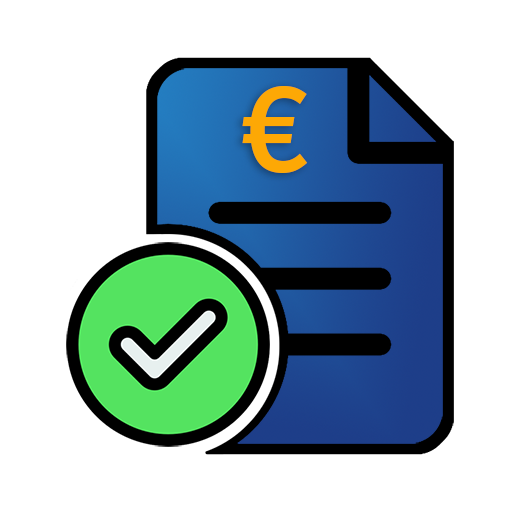

# ioBroker.e-invoices

**Tests:** 

## E-invoices adapter for ioBroker

Create ZUGFeRD e-invoices as PWA with PDF, Excel export and backup

The adapter runs a small web app (PWA) where you create German B2B e-invoices
(ZUGFeRD hybrid: human-readable PDF with embedded EN 16931 XML — the XML is
the leading tax document), store every issued invoice in a local database and
back everything up as versioned ZIP files.

Features:

- Draft → issue flow with atomic invoice numbers per year and employee
  (`YYYY-EE-NNN`, default format `{YYYY}-{EMPLOYEE}-{SEQ}`, e.g. `2026-01-012`)
- Offers ("Angebote") as a second document type with an own number circle,
  validity and life cycle — a plain sight PDF, never an e-invoice, and one
  conversion into an invoice draft
- ZUGFeRD profiles BASIC and EN 16931, offline XSD validation
- Hybrid PDF plus standalone XML for every issued invoice
- Attachments per invoice (delivery note, proof of work) — uploaded in the PWA,
  embedded into the PDF/A-3 file and, for EN 16931, into the XML as BG-24
- Excel copies (single invoice and filtered lists, marked as non-tax copies)
- Layout templates with company logo, colors and footer (mandatory content
  is protected by a validator and cannot be hidden)
- Backup and restore (database plus all files, SHA-256 manifest), optionally copied to an external server over SFTP
- Controllable via states (`control.*`) and a JSON API for the PWA

## Install

Install it in the admin: **Adapters** → filter for `e-invoices` → install.

After the installation, open the instance settings and check the API port
(default 8093). The PWA is then available on that port of your ioBroker host.
Optionally set an API token there; without a token the API trusts the local
network.

## First steps

1. **Token (recommended).** Set `authToken` in the instance settings (a long random value).
   Without a token the API trusts everyone who can reach the port — see *Security notes*.
2. **Open the web app** at `http://<iobroker-host>:8093/` (reach it by IP address if you did not
   set a token). With a token, the login page asks for it once and keeps it in the browser.
3. **Company data.** Under *Firma* create your company profile: name, address, VAT ID or tax
   number, bank account (IBAN), contact. The first one is the default and prefills every new
   document. Several companies are possible (see *Several companies*).
4. **Print template.** Under *Druckvorlagen* upload a logo, pick colors, set the footer and use
   the test print (full invoice, small business, credit note) to check the layout. Mandatory
   content cannot be switched off.
5. **First invoice.** *Rechnungen* → *+ Neu*: seller, buyer, positions, review. A draft can be
   changed freely; **issuing** assigns the number, creates the XML and the hybrid PDF and
   freezes the record.
6. **Backup.** Create one adapter backup on the *Backup* page and note where the instance
   backup (e.g. BackItUp) puts the files — see *Files and backup*.

## Usage

### PWA

Open `http://<iobroker-host>:8093/` for the invoice dashboard, the offers tab
("Angebote"), the multi-step wizard (seller → buyer → lines → review), invoice
details with validation, attachments and downloads, layout templates with PDF
preview and the **System** page. The header bar carries the tabs only — the
"+ Neu" buttons sit where their lists are.

The **System** page holds what is rarely needed, behind a row of tabs inside the page, one
topic at a time: **Status** (app name, version, schema, counters, and the appearance — light,
dark or follow the device), **Backup** (backup and restore), **Firma** (the company data,
filled in once) and **Druckvorlagen** (print templates). It replaces the former header tabs
"Backup", "Firma", "Druckvorlagen" and "Status"; their old addresses `#/backup`, `#/company`,
`#/templates` and `#/status` are the tabs of the page, so old bookmarks keep working.

### Print templates: fine-tuning the header

Besides logo, colors and blocks, a print template has two header distances, both
in mm from the **top edge of the sheet**:

- **Logo distance from top** — where the logo starts (empty = 12.7 mm, where it
  always sat),
- **Text distance from top** — where the header text starts: the small sender line,
  the recipient address and the invoice data (empty = directly below the logo).

With both empty the layout is exactly the one the template always had. Set only the
logo distance and the text follows the logo; set the text distance and it stays
where you put it, whatever the logo does — so a letterhead with a pre-printed logo or
a window envelope can be matched by eye with the PDF preview. The values apply to
invoices and offers alike, and the logo of the following pages (when it is drawn on
every page) uses the same distance. Allowed are 0 to 150 mm; an empty field takes a
value back.

### Language of the web app

The web app speaks the eleven languages of ioBroker: German, English, Russian,
Portuguese, Dutch, French, Italian, Spanish, Polish, Ukrainian and Chinese
(simplified; a Chinese browser of any region gets it). The language is chosen in the
instance settings (`Web app language`, tab *Server*: `auto` or one of the
languages) and the app starts in it. The first match wins:

1. `?lang=xx` in the address bar, e.g. `?lang=fr` (remembered on that device),
2. the choice remembered on that device,
3. the instance setting — `auto` means "ask the browser",
4. the language of the browser, when it is one of the eleven,
5. English.

Only the dictionary of the language in use is loaded, the others are separate files
that are never fetched. A sentence that a dictionary lacks shows in English.

The login page already speaks the language of the instance: `GET /api/health`
(the one open route) carries the setting as `pwaLanguage`. What is **document
content** stays German whatever the screen language is (German tax law, German
invoice recipients): the invoice and offer
PDFs, the XML, the document titles (`Rechnung`, `Angebot`, …), the payment-term
presets and the text of the customer mail. Only their labels in the dropdowns
follow the language of the page (in the web app and in the instance settings).

The **exports** (CSV and Excel: invoice list, open items, revenue, dunning suggestions) are written in the
language of the web app: it sends its language with every request (header `x-e-invoices-language`; `?lang=xx`
works for a direct call). Without one, the instance setting *Web app language* counts, then the language of
the ioBroker system, then English. The figures keep their format (semicolon list, decimal comma), only titles,
notice and column headers change. Two things stay German on purpose: the Excel copy of a single invoice (a copy of
a German tax document) and the DATEV file (its headers are prescribed by DATEV).

The **dunning letters** take the language of the ioBroker system (*System settings → Language*), English when it is
none of the eleven: the built-in texts of the three levels, the date and amount format, the cash discount sentence
and the PDF of the letters. A text you changed on the page "Mahnwesen" is kept as you typed it. The dunning
letters go to customers, so they do not follow the language of the screen.

### HTTPS and installing the web app on a phone

A phone installs the web app only from a **secure origin** — iOS (iPhone, iPad) needs HTTPS for it; over plain
HTTP it stays a bookmark. The adapter answers over HTTPS itself, with a certificate of the certificate collection
of ioBroker, the same one the web adapter uses — no reverse proxy is needed.

1. In the instance settings switch **Use HTTPS** on and choose the **public certificate**, the **private key** and,
   if you have one, the **certificate chain**. The entries come from **Admin > Settings > Certificates**
   (`defaultPublic` / `defaultPrivate` are the self-signed pair ioBroker creates itself; a Let's Encrypt
   certificate is chosen the same way).
2. Save — the instance restarts and the web app answers at `https://<host>:<port>/`. The link of the instance in
   the admin switches to `https` on its own.
3. On the iPhone or iPad open that address in Safari, then **Share > Add to Home Screen**.

If the certificate is missing or cannot be read, the web app and the API do **not** fall back to plain HTTP: they
stay unavailable and the log names the reason (an API token over an unencrypted line is what HTTPS was switched on
to avoid). A self-signed certificate makes the browser warn, and the phone installs the app only when it **trusts**
the certificate: install the certificate on the phone (iOS: also enable it under Settings > General > About >
Certificate Trust Settings) or use a certificate of a real authority. The certificate must name the address you
type (host name or IP). The adapter sends no HSTS header, so switching HTTPS off again keeps working.

When the browser forgets its exception for a self-signed certificate, or the certificate is renewed, the web app
(served from its cache) can no longer reach the API: the browser blocks the requests silently. The web app then
shows *The server cannot be reached* with a *Reload* button; reloading the page lets the browser show its warning
again, and accepting it restores the connection. The adapter loads the certificate when it starts, so restart the
instance after a renewal.

### Light and dark appearance

The web app has a light and a dark appearance. On the **status page**, *Darstellung* offers three choices:
**System** (follow the setting of the device — the default), **Hell** (light) and **Dunkel** (dark). The
choice belongs to the device (it is kept in the browser, like the language) and is applied before the page is
painted, so a dark choice does not flash light first. With *System* the app also follows the device while it is
open, for example when a phone switches to dark in the evening. Only the user interface changes: the PDFs, the
test prints and the Excel files stay as they are, because they are documents and must not depend on a device.

### Attachments (Anlagen)

A draft can carry up to 10 files (PDF, PNG or JPEG, 5 MB each) — delivery
notes, proofs of work, order confirmations. Upload them in the detail view or
in the last wizard step ("Entwurf speichern" first: a file needs a stored
record to belong to). The type is taken from the file's magic bytes, never
from the name or the declared MIME type.

On issue, the attachments become part of the e-invoice:

- **PDF/A-3:** every file rides along as an associated file
  (`Names → EmbeddedFiles` and the catalogue's `/AF`, `AFRelationship /Data`),
  and the sight component lists them under "Anlagen" with type and size.
- **EN 16931 XML:** each file is written as BG-24 "Additional supporting
  documents" (`BT-122` reference, `BT-123` description, `BT-125` base64
  payload) — embedded, not linked, and XSD-validated like the rest.
  Factur-X's **BASIC** XSD has no `AdditionalReferencedDocument`, so a BASIC
  invoice keeps its files in the PDF container alone (still embedded).
- Issued invoices are frozen (GoBD): the Anlagen can be listed and downloaded,
  but no longer added or deleted. An attachment makes the artifacts and the
  backup noticeably bigger (a 5 MB file counts once in the PDF, once as base64
  in the XML and once as its own entry in the backup ZIP).

### Offers (Angebote)

An offer is a second document type beside the invoice: it shares the record,
the lines, the attachments, the render history and the backup with it, but it is
no e-invoice. Create one with `POST /api/invoices` (`docType: "quote"`) and list
only offers with `GET /api/invoices?docType=quote`.

- **Own number circle:** offers number as `A-YYYY-EE-NNN`. The pattern is the
  instance setting "Quotation number format" (`quoteNumberFormat`, default
  `A-{YYYY}-{EMPLOYEE}-{SEQ}`). Offers never consume an invoice number — the
  invoice sequence stays continuous (§ 14 Abs. 4 Nr. 4 UStG).
- **Own validity:** `validUntil` ("Valid until") defaults to the issue date plus
  30 days and is printed on the offer. Offers carry no retention date (§ 147 AO
  concerns invoices) and no Leitweg-ID.
- **Plain sight PDF, never an e-invoice:** no CII XML, no PDF/A-3 container, no
  BG-24 and no `pdfaid` claim. On issue only the PDF is stored; the attachments
  are listed under "Anlagen" with the note that they travel separately instead
  of being embedded. `POST /api/invoices/:id/validate` reports business findings
  only — there is no EN 16931 document to check, so it never reports XSD
  findings.
- **Life cycle:** draft → open → accepted or rejected, or expired once the
  validity date has passed (computed from the date, no timer). The decision is
  recorded with its timestamp by `POST /api/invoices/:id/quote-accept` or
  `…/quote-reject` with a free-text reason; the first decision counts and a
  second one is refused. The sight PDF prints it ("Angenommen am …",
  "Abgelehnt am …: …", "Das Angebot ist am … verfallen.").
- **Conversion:** `POST /api/invoices/:id/convert` creates an invoice *draft*
  (the number is assigned on issue as usual) that copies header and lines,
  translates the dates and keeps the link back (`sourceDocumentId`, printed as
  "Zugrunde liegendes Angebot" / "Daraus hervorgegangene Rechnung(en)"). By
  default the offer must have been accepted — `{ "requireAccepted": false }`
  overrides that — and a second open converted draft is refused. The offer
  itself is never touched.
- **Not revenue:** offers are never dunned and stay out of the accounting
  exports. CSV and XLSX only export invoices unless the caller asks
  otherwise: without a `docType` parameter they are pinned to invoices, the
  explicit counter-word is `?docType=all` (and `?docType=quote` exports the
  offers alone). DATEV never contains an offer.

In the PWA, offers have their own tab (**Angebote**): the list shows the state
(open, accepted, rejected, expired), records the customer's answer and turns an
accepted offer into an invoice draft in one click ("In Rechnung umwandeln").
"+ Neues Angebot" opens the wizard with the document type preselected — the same
wizard as for invoices, without the invoice-only fields: no "Due date", no
Skonto, no payment terms, but a "Valid until" date that follows the issue date
(30 days) while it stays untouched. An invoice draft made from an offer links
back ("Zugrunde liegendes Angebot"), and the offer lists the invoices it became.
The wording of every screen comes from one table per document type
(`src-www/src/labels.ts`), which mirrors the server's `documentLabels()` — no
offer screen says "Rechnung". The booking list and the three accounting exports
stay pinned to `docType=invoice`, so the two document types never mix.

### DATEV export

The **DATEV** button of the invoice list writes a *Buchungsstapel* in the DATEV format (EXTF, format 700,
category 21) that a tax advisor imports into DATEV Rechnungswesen. Every user has an advisor of their own,
so the numbers that tie the file to the advisor's books come from the instance settings, tab **DATEV**:

| Setting | Meaning |
| --- | --- |
| Advisor number / client number | *Beraternummer* and *Mandantennummer* from your tax advisor — **required** |
| Chart of accounts | SKR03 (default) or SKR04 |
| Account length | length of the general ledger accounts, 4 by default |
| First month of the fiscal year | 1 = January |
| Debtor account | collective debtor, empty = `10000` (with account length 4) |
| Revenue accounts 19 % / 7 % / 0 % | empty = SKR03 `8400` / `8300` / `8100`, SKR04 `4400` / `4300` / `4100` |

- Without advisor and client number there is **no DATEV file** — the export says what is missing. The CSV
  and Excel lists work without them.
- One line per invoice and VAT rate: the gross amount, debit the debtor account, credit the revenue account
  of the rate (an *Automatikkonto* that takes the VAT out by itself, so no BU key is written). A credit note
  is booked the other way round (*Haben*). A cancelled invoice and its Storno are both in the file and
  cancel each other out. Offers and drafts are never booked.
- One file holds **one fiscal year**: narrow the period when the invoices span more than one.
- The file is `EXTF_outgoing-invoices….csv`, Windows-1252, with the invoice number in *Belegfeld 1*
  (characters DATEV does not take become `-`).
- The revenue accounts are standard accounts. Reverse charge, intra-community supplies or exports need other
  accounts — ask your advisor and set the 0 % account accordingly. One instance has one DATEV client; for
  several companies with different clients filter the export by company and adjust the settings.
- **Not verified against a real DATEV import** (no DATEV access here): the layout follows the published
  format description. Let your advisor check the first import.

### Date range for lists and exports

The invoice list has a **period** filter: quick choices (this month, last month, this quarter, last
quarter, this year, last year) or two free days *Von* / *Bis*. It filters by the **invoice date**, and
**both days belong to the range** — 1 August to 31 August contains the invoices of both days. One side
may stay empty (open end).

- Excel, CSV and DATEV take exactly the filter of the list, so what you see is what is exported. The
  file name names the range: `invoices_2026-08-01_2026-08-31.csv` (`…_from-…` or `…_to-…` for an open
  end), and the Excel title shows it as well.
- Exports contain **all** matching invoices (no page limit) in date order and **never a draft** — a draft
  has no number to book. A draft only comes into an export when the status "draft" is asked for.
- API: `from` and `to` (ISO date, `2026-08-01`) on `GET /api/invoices` and on the three export routes;
  a malformed date or a range that ends before it starts answers `400`. They combine with `status`,
  `companyId`, `q` and `docType`.

### Several companies

Every document is bound to the company profile it was written for (the company choice in
the wizard; a new document starts with the default company). The
binding is stored with the document, so it survives later changes of the profile. A Storno
credit note and an invoice made from a quotation take over the company of the original.

- The invoice list gets a company filter as soon as there are two or more companies (also
  `?companyId=` on the list and export routes; `none` = documents without a company).
- **Revenue** (`#/revenue`, `GET /api/reports/revenue-by-company`, also `.csv` and `.xlsx`)
  adds the issued invoices up per company, for one year or for all of them, minus the credit
  notes of their own (e.g. for a short delivery). Offers, drafts and Storno documents do not
  count; a cancelled invoice drops out, together with its Storno.
- Documents from before the binding have no company and form their own row
  "without company", so the total always equals the sum of the single documents.
- The **invoice number stays one circle for all companies** — nothing about the numbering
  changed, no existing number moved.

### XRechnung (public-sector customers)

Public authorities in Germany want an **XRechnung**: the XML file alone (standard XRechnung 3.0,
CII syntax), no PDF container. The adapter creates it as the second format of an invoice, next to
the ZUGFeRD default.

- **Choose the format** per document in the wizard ("Rechnungsformat", first step), or set the
  default for new invoices in the instance settings ("Default invoice format"). A draft can be
  switched until it is issued; an issued document keeps its format.
- **Leitweg-ID:** the buyer needs the routing ID of the authority (BT-10, rule BR-DE-15). The wizard
  and the customer list have a field for it; an XRechnung without it is refused when issuing, and
  no number is used up. Only the **syntax** is checked (letters, digits and hyphens, at most 46
  characters) — the checksum exists for some federal states only, so a stricter test would reject
  valid IDs.
- **Mandatory data:** seller contact person, phone and e-mail (BT-41/42/43), seller IBAN, buyer e-mail
  (BT-49). The missing ones are named with their rule before anything is created.
- **What you get:** the XML with the XRechnung identifier and the Peppol business process (BT-23/24),
  and a plain PDF as a view — it contains **no XML** and claims no PDF/A-3. The XML is the invoice:
  send that to the authority (e.g. through its portal). The detail page labels the buttons
  accordingly and has no "mail the PDF" button for an XRechnung. Attachments travel inside the XML
  (BG-24); a credit note (Storno) keeps the format of its invoice.
- **Checked:** the sample cases of `npm run validate` include two XRechnungen; the KoSIT validator
  (scenario "EN16931 XRechnung (CII)", XRechnung configuration 2026-08-31) accepts them.
- Offers never have a format: they are plain sight PDFs.

### Dunning (Mahnwesen)

The page "Mahnwesen" shows, for every overdue unpaid invoice, the **next step** with the
text already filled in: payment reminder, 1st dunning letter, 2nd dunning letter. A step is
suggested from a day after the due date (defaults: 5, 19 and 33 days) and sets a payment
deadline (7, 7 and 5 days). The three texts, the days and the deadlines can be edited on the
same page (placeholders `{number}`, `{customer}`, `{issueDate}`, `{dueDate}`, `{amount}`,
`{days}`, `{deadline}`, `{seller}`) and taken back to the built-in text.

- **The adapter sends nothing.** Copy the text, open it in your mail program (`mailto:` link when the
  customer has an e-mail address) or print the letters of all invoices as one PDF (one page per
  invoice); a CSV list is available as well. Then press **"Mark as reminded"** — only that
  moves the invoice to the next level; the invoice shows level and date.
- A letter is no e-invoice: **no XML is created**, the PDF makes no PDF/A claim.
- Fees and default interest are **not** preset — that is a legal decision of the sender.
- Paid invoices, offers, Storno credit notes and cancelled originals are never chased; nothing is
  suggested twice on the same day and after the 2nd dunning letter there is no template left.
- For dashboards and scripts the state `info.reminderSuggestions` holds the suggestions as JSON;
  the API offers `GET /api/dunning/suggestions` (also `.csv`, `.pdf`) and `/api/dunning/texts`.

### Open items (Offene Posten)

The tab *Offene Posten* lists the unpaid, issued invoices with their age and adds
them up: per age bucket (not due · 1–30 · 31–60 · 61–90 · over 90 days overdue),
per customer and in total, with a switch for the overdue part and a reference day
(*Stichtag*). The dashboard carries a one-line tile with the same sums. The list
is also available as CSV and Excel (`GET /api/open-items`, `.csv`, `.xlsx`, filters
`asOf=YYYY-MM-DD` and `onlyOverdue=1`); all three come from one calculation, so
their sums are identical.

What counts: issued **invoices** that are **not marked as paid**. Offers, drafts,
cancelled originals, Storno credit notes and documents titled *Gutschrift* do not
count — the record has no allocation of a credit note to the invoice it settles, so
they are left out instead of guessed. The record has no part payments either, so
the open amount of an invoice is its gross total. An invoice without a due date is
listed as *not due*. The reminder list (`info.overdue*`) is the narrower one: it
starts five days after the due date and stays quiet for a day after a reminder.

### States

- `info.connection`, `info.invoiceCount`, `info.draftCount`,
  `info.issuedCount`, `info.lastNumber`, `info.lastIssuedAt`,
  `info.dbVersion`, `info.lastBackup`, `info.backupWarning` (empty = backup is current),
  `info.lastRemoteBackup` and `info.remoteBackupError` (copy to the external server, empty = fine)
- `control.createDraft` (button: creates an empty draft, id lands in
  `control.lastDraftId`), `control.issueId` + `control.issue` (button:
  issues a draft), `control.refresh`, `control.backup`,
  `control.restoreId` + `control.restore` (buttons for backup/restore)

### Files and backup

Issued artifacts (PDF/XML/XLSX), logos and backup ZIPs live below the
`e-invoices.0.storage` file mount. The database file `invoices.db` lives in
the instance data directory.

#### BackItUp (ioBroker backup) versus the adapter backup

| | ioBroker backup (e.g. BackItUp) | Adapter backup (ZIP) |
| --- | --- | --- |
| Contains the PDFs, XML, Excel files and logos | yes (`files/e-invoices.0.storage`) | yes |
| Contains the **invoice database** | **no** — `invoices.db` lives in the instance data directory, which is not part of an ioBroker backup | yes, as `dump.json` |
| Verified on restore | no | SHA-256 manifest, restore preview, safety copy |
| Restore | restore ioBroker, then the files | PWA *Backup* page or `control.restore` |

**The database reaches an ioBroker backup only through the adapter ZIP.** The ZIPs are written to
`e-invoices.0.storage/backups/`, which is part of the files an ioBroker backup takes. Without a ZIP, a
restore of an ioBroker backup brings back the documents but not the invoice numbers, the number
counters, the status and the reminders. Therefore:

- The **automatic backup is on by default** (every 1440 minutes = daily, setting *Backup interval in
  minutes*, 0 = off). The interval counts from the last automatic backup, so restarting the adapter
  neither skips nor repeats one; if one is overdue, it runs a minute after the start.
- The newest **7 automatic backups are kept** (setting *Automatic backups to keep*, 0 = keep all). Only
  files named `e-invoices-auto-….zip` are ever deleted. Backups you made by hand
  (`e-invoices-backup-….zip`) and the safety copies before a restore (`…-prerestore-…`) are never
  deleted.
- The *Backup* page and the state `info.backupWarning` warn when there is no backup at all or the
  newest one is older than twice the interval (at least two days; one week when the automatic backup is
  off). The state is empty when everything is fine, so it can drive a notification.
- Instances that were installed before 0.9.2 keep their saved interval (the old default was 0 = off):
  set it in the instance settings.

For disaster recovery use **both**: an ioBroker backup of the whole system and the adapter ZIPs (they
travel inside it). To move to another system, restore an adapter backup ZIP there via the PWA or
`control.restoreId` + `control.restore`. The restore verifies checksums first and replaces the database
in one transaction.

When using the BackItUp adapter, include this adapter instance and its files in the backup job — and
check once in the archive that `files/e-invoices.0.storage/backups/` holds a ZIP.

#### Copy to an external server (SFTP)

A backup that lies on the same machine as the database does not survive the loss of that machine. The tab
*External backup* in the instance settings copies **every backup** (automatic and by hand) to another computer,
for example a NAS, over **SFTP**. The adapter opens the SSH connection itself: no mount, no `sudo`, no shell command.

1. On the server, create a user that may only write into the target directory (not an administrator) and switch
   SFTP on (on a Synology: *Control Panel → File Services → FTP → Enable SFTP service*).
2. In the instance settings, tab *External backup*, switch the copy on and enter host, user, password and the
   directory (it is created when it is missing). The password is stored encrypted and never written to the log.
3. Press *Test connection*: the adapter logs in, creates the directory, writes and deletes a small test file, and
   shows the **fingerprint** of the server. Enter that fingerprint in the settings to trust only this server — a
   different server is then refused before the password is sent. Without a fingerprint the copy works too, but
   the server is not verified (the log warns at every copy, with the fingerprint).

How it behaves:

- The local backup is made first. If the copy fails, the backup stays, the error is logged and shown in
  `info.remoteBackupError`, and the backup page tells it. A failed copy is **not retried**: the next backup is
  copied again, as it contains everything.
- A copy appears under its final name only when it is complete (it is uploaded as `.part`, its size is checked and
  it is renamed). The whole copy is limited to ten minutes. A half file of a failed upload is removed at once
  when the connection still works; otherwise the next good copy removes it (only `e-invoices-auto-….zip.part` and
  `e-invoices-backup-….zip.part`, nothing else).
- *Copies to keep on the server* deletes the oldest **automatic** copies beyond that number (0 = keep all). Backups
  made by hand and every other file in the directory are never deleted.
- Only password login is supported. The ZIP is **not encrypted** (see *Security notes*): the transfer is, the file
  on the server is not — keep it on a volume only you can read.

### API

Same-origin JSON API under `/api` (health, invoices CRUD, issue, validate with
a stored report, XML/PDF/XLSX downloads, attachments of a draft — list, upload
as base64 JSON, download, delete —, offers (list by document type, accept,
reject, convert into an invoice draft), templates with logo upload and PDF
preview, backups, restore, open items as JSON, CSV and Excel). With an API token configured, every route except
`/api/health` requires an `Authorization: Bearer <token>` header.

## E-invoices in a nutshell

Since 2025 German businesses have to be able to **receive** e-invoices, and from 2027/2028 the
duty to **issue** them for B2B grows in stages. An e-invoice is a structured XML document
(standard EN 16931); a PDF alone is not one.

- **ZUGFeRD / Factur-X** (what this adapter creates): a PDF/A-3 file that carries the XML inside.
  People read the PDF, software reads the XML. **The XML is the leading document** — if the two
  ever differ, the XML counts. The adapter creates the EN 16931 profile.
- **XRechnung** is a pure XML format used mainly towards public authorities (B2G). The adapter
  creates it too, as a second format next to ZUGFeRD — see "XRechnung (public-sector customers)".
- Every issued invoice is checked against the XSD schema on issue; the PDF/A-3 structure and
  the XML were additionally validated with the KoSIT validator and veraPDF (see
  `docs/en/validation.md`). Run your own acceptance check before productive use.

## Retention and GoBD

- An **issued invoice is immutable**. A mistake is corrected with a **Storno** (credit note) and a
  new invoice — never by editing. The number circle stays gap-free per year and employee code.
- Every issued invoice records its **earliest deletion date** (`retain_until`): the end of the **tenth** year after
  the issue year. That is a deliberately cautious choice, not the statutory minimum: for invoices the retention
  period is **eight years** since 2025 (§ 147 AO and § 14b UStG as amended by the Fourth Bureaucracy Relief Act,
  BEG IV), while other records (for example business letters or the annual accounts) can need more. Ask your tax
  advisor which period applies to you — the adapter never deletes anything of its own accord. Only drafts can be
  deleted, never an issued invoice. The invoice view in the web app shows this date with the same note.
- **Issuing is checked before the number is taken.** The documents are made once with a placeholder number first; a
  defect of the layout, the attachments or the XML stops there, with the draft untouched and no number used. Should a
  document still end up numbered **without its files** (the disk was full or not writable), the dashboard shows it
  under "Issued but without file" and *Rebuild files* makes exactly the missing ones from the stored data — the XML
  from the record, the PDF with the layout frozen at issue, the Excel copy. A file that exists is never touched, and
  the invoice itself does not change.
- Re-rendering a PDF (for example after a layout change) **never overwrites** the delivered file:
  the original is archived as `<number>.orig-<n>.pdf`, the reason is logged, and the XML stays
  unchanged. The layout an invoice was issued with is frozen with it and can be re-used.
- The adapter helps with these rules, but **you** keep responsibility for them — see *Disclaimer*.

## What this adapter is not

- **No bookkeeping.** There is no ledger, no chart of accounts, no VAT return (UStVA), no income
  statement for the tax return and no tax filing. The CSV, Excel and DATEV exports are lists for your tax
  advisor or your bookkeeping software.
- **No e-mail delivery.** The adapter never sends an invoice or a reminder. You send them yourself
  (the web app offers copy, `mailto:` links and PDF/CSV lists) and mark them as sent.
- **No payment processing.** "Paid" is a flag you set; there is no bank connection and no part
  payments.
- **No substitute for tax or legal advice** and no guarantee that an invoice is correct for your
  case.

## Security notes

- **Token:** set `authToken` in the instance configuration. Every API route except
  `/api/health` then requires `Authorization: Bearer <token>`; without a token the
  API trusts every client that can reach the port. In that case it only answers
  requests whose host name is an IP address or `localhost` (so a web page cannot
  steer your browser to the adapter by DNS rebinding) and refuses writes that carry a
  foreign `Origin`; reach the PWA by IP address, or set a token to use a host name.
  Use a long random token (the adapter warns below 16 characters).
- **Bind address:** `bind` defaults to `127.0.0.1`, so only the host running the
  adapter can reach the API. An unauthenticated bind to another interface is
  logged as a warning on startup — use a token in that case.
- **Rate limits:** 600 requests per minute and client on `/api`, but only 10 on
  `/api/restore*`, which replaces the whole database. Exceeding a budget answers
  `429 Too many requests` and logs method plus path (never the token). **Failed
  sign-ins have a budget of their own:** twenty wrong tokens per minute and client (asking without any token does not count),
  then `429` — even for the right token until the minute is over — so guessing the token
  is slow and a stranger cannot use up your general budget by asking without a token.
- **What the open health route says:** `/api/health` (no token) names only status, version,
  schema version and the web app language. The number of documents per status sits behind
  the token (`/api/status`).
- **Browser hardening:** API and PWA answer with a self-only Content Security
  Policy (`default-src 'self'`, `frame-ancestors 'none'`), `X-Content-Type-Options:
  nosniff`, `Referrer-Policy: no-referrer` and without `X-Powered-By`.
  `X-Forwarded-*` headers are not trusted (`trust proxy` disabled) — the adapter
  is meant to be reached directly — with "Use HTTPS" the adapter itself speaks TLS
  (see "HTTPS and installing the web app on a phone"); put it behind a reverse proxy
  only with HTTPS and a token.
- **Restore safety:** before a restore replaces the database, the current state is
  written to `backups/e-invoices-prerestore-<time>.zip`; if that fails, nothing is
  restored. Number counters are never lowered, and every restore is appended to
  `backups/restore-log.jsonl`.
- **Restore limits:** a backup ZIP may be at most 512 MB and expand to at most
  1 GB (`dump.json` at most 256 MB); a crafted archive is rejected before it is
  unpacked. Entry paths, per-file checksums and the manifest are verified.
  The same limits apply when a backup is **created**: a backup that the restore would refuse is not written, the
  error names the limit that is exceeded (the attachments are own entries of the ZIP, next to the files) — better no backup than one that only looks like protection.
- **Where the PWA keeps the token:** in the browser profile's `localStorage`, so a
  reload does not ask again. It is only ever sent as an `Authorization` header to
  the adapter (never in a URL), but a script running on the same origin could read
  it — use a dedicated browser profile, and note that changing the token in the
  instance config takes effect after the adapter restart.
- **Attachments:** a draft may carry at most 10 files of 5 MB each, and only PDF,
  PNG or JPEG. The type is decided by the file's magic bytes, not by its name or
  the declared MIME type, and the filename is cleaned before it can reach a
  `Content-Disposition` header. An issued invoice is frozen: its attachments can
  be listed and downloaded, but no longer added or deleted (GoBD) — they are
  part of the stored PDF/XML by then.
- **Backup files are not encrypted:** the ZIP contains the database, attachments
  and XML/PDF artifacts in plain text. Keep it on an encrypted volume or share.
  The attachments are own entries of the ZIP (`attachments/<id>`), so a backup with Anlagen is about as large as
  the raw files.

## Why compact mode is off (W5049)

This adapter sets `common.compact` to `false` on purpose: it keeps its own
SQLite database file and serves the PWA plus JSON API on its own TCP port,
so it cannot share the compact process.

## Limitations

- The sight PDFs embed Liberation Sans (SIL OFL 1.1) and carry an sRGB
  output intent, so they are built as PDF/A-3b; the structure was verified
  against a real invoice (`/OutputIntents` with `GTS_PDFA1`, font subsets
  with `/FontFile` and `/ToUnicode`). An independent validator run (KoSIT
  online validator or veraPDF) is still the recommended acceptance step
  before productive use. The embedded XML is unaffected and stays the
  leading part.
- The offline XSD validation runs on every issue; the KoSIT online
  validator is a recommended manual acceptance step before productive use.
- Only EUR, domestic B2B invoices and the EN 16931 profile (as ZUGFeRD or
  XRechnung) are supported in this version. XRechnung is checked by the KoSIT validator, but how an
  individual authority takes it in (portal, Peppol access point, its own extra rules) is up to
  you to find out before the first invoice.

## Disclaimer

**Disclaimer.** This software is provided free of charge and "as is", without warranty of any kind and without any assurance of fitness for a particular purpose. It is not tax or legal advice. To the extent permitted by law, liability is excluded; liability for intent and gross negligence, for injury to life, body or health, and under mandatory law remains unaffected. You are responsible for:

- the correctness of your invoices and offers and for checking the results (e.g. with a validator or your tax advisor),
- compliance with the rules that apply to you (e.g. VAT law, GoBD, retention periods, GDPR),
- regular backups – also outside the adapter – and testing that they can be restored.

This disclaimer is also in [docs/en/disclaimer.md](/#/docs/adapterref/iobroker.e-invoices/docs/en/disclaimer.md); the German original is in [docs/de/disclaimer.md](https://github.com/sadam6752-tech/ioBroker.e-invoices/blob/main/docs/de/disclaimer.md).

## Standards and references

This adapter is built around an invoice *format*, not a device, so the
reference "manufacturer" documentation is the specification it implements:

- [Factur-X / ZUGFeRD](https://fnfe-mpe.org/factur-x/) — the Franco-German
  hybrid invoice standard (readable PDF with the leading CII XML inside) and
  the profiles used here (BASIC, EN 16931).
- [KoSIT Validator](https://github.com/itplr-kosit/validator) — the open
  validation engine for EN 16931 documents; its configuration for
  XRechnung/EN 16931 is what the manual acceptance check described under
  "Limitations" runs.
- [@stackforge-eu/factur-x](https://www.npmjs.com/package/@stackforge-eu/factur-x) —
  the library that generates the CII XML and embeds the hybrid PDF.

The German rules behind the numbering and retention logic come from § 14 UStG
and § 147 AO; the adapter implements them, it is not a substitute for tax
advice.

## Provenance

All adapter sources in `src/` and the PWA in `src-www/` are written for
this project. Third-party libraries (plain npm dependencies, no copied
code): `@stackforge-eu/factur-x` (EUPL-1.2) for CII generation, XSD
validation and hybrid embedding, `pdfkit`, `exceljs`, `jszip`,
`better-sqlite3` and `express` (all MIT).

## Changelog
<!--
	Placeholder for the next version (at the beginning of the line):
	### **WORK IN PROGRESS**
-->
### 1.3.0 (2026-11-06)

* (alex) Review of the ioBroker repository (PR #6894): the download file names are English (`invoices….csv`, `EXTF_outgoing-invoices….csv`, `revenue-by-company…`, `open-items…`, `dunning-suggestions.csv`, `dunning-letters.pdf`, `…_from-…`/`…_to-…` for an open range).
* (alex) The exports (CSV and Excel lists of invoices, open items, revenue and dunning suggestions) are written in the eleven ioBroker languages: titles, notice and column headers follow the language of the web app, else the instance setting, else the system language, else English. The invoice copy and the DATEV file stay German.
* (alex) The built-in dunning texts (three levels), the dunning letter PDF and `info.reminderSuggestions` come in the eleven ioBroker languages, chosen by the language of the ioBroker system (English for any other). Texts you changed stay as they are.
* (alex) Instance settings: the payment terms presets show translated labels in all eleven languages; the stored text stays the German sentence printed on the German invoice.
* (alex) The validation evidence moved from `docs/validierung/` to `docs/validation/` with English names (`sample-cases/`, `sample-cases.mjs`, `credit-note`, …), the German documentation files to `docs/de/validation.md` and `docs/de/disclaimer.md`. The script prints English messages.

### 1.2.2 (2026-10-19)

* (alex) When the server gives no answer, the web app shows a banner instead of the browser's "NetworkError": the server cannot be reached; with HTTPS and a self-signed certificate reload the page (or open the address) and accept the security warning again, otherwise check the instance. A *Reload* button is in the banner, which goes away with the next answer of the server. All eleven languages.

### 1.2.1 (2026-10-12)

* (alex) A half uploaded file (`….zip.part`) of a failed copy is removed on the server: at once when the connection still works, otherwise by the next good copy. Only half files of this adapter are touched.
* (alex) fix: *Test connection* uses the saved password only for the saved server and user, so no script can have the password sent to a server of its own.
* (alex) fix: when the time limit runs out while the connection is still being made, the late connection is closed at once instead of uploading after the failure was reported.
* (alex) fix: a failed state update can no longer turn a successful backup into an error of the API; an old copy error is cleared when the copy is switched off.
* (alex) fix: a restored attachment takes its size from its content, not from `dump.json`.
* (alex) The admin labels "Host" and "Password" of the external backup are worded so every language has its own text.
* (alex) fix: the time limit of the copy to the external server uses the timers of the adapter (`this.setTimeout`) instead of the plain `setTimeout` of Node.js (repository checker E5005).

### 1.2.0 (2026-10-12)

* (alex) **Copy of the backups to an external server over SFTP:** the new tab *External backup* in the instance settings copies every backup (automatic and by hand) to another computer, for example a Synology NAS. Pure SFTP without mount, `sudo` or shell command; password stored encrypted; optional host key fingerprint; *Test connection* button; a failed copy never touches the local backup and is shown in the log, in `info.remoteBackupError` and on the backup page. Optionally the oldest automatic copies on the server are deleted (only files of this adapter).
* (alex) The web app asks "Really sign out?" before it signs out (menu link and login page).
* (alex) The unused translation key `e-invoices adapter settings` was removed from `admin/i18n`.

### 1.1.5 (2026-10-12)

* (alex) The invoice view of an issued invoice shows the earliest deletion date ("Keep until") with a note: the adapter cautiously counts ten years, the law needs at least eight for invoices and ten for some records; in doubt ask the tax advisor. The note is available in all eleven languages.
* (alex) The backup keeps the attachments as own ZIP entries (`attachments/<id>`, each with its SHA-256 in the manifest) instead of base64 inside `dump.json`: about a third smaller, less memory while it is made, and the restore checks every attachment on its own. Backup format 2; backups of older versions (format 1) can still be restored.

Older changes: see CHANGELOG_OLD.md.

## License
MIT License

Copyright (c) 2026 alex <sadam6752@gmail.com>

Permission is hereby granted, free of charge, to any person obtaining a copy
of this software and associated documentation files (the "Software"), to deal
in the Software without restriction, including without limitation the rights
to use, copy, modify, merge, publish, distribute, sublicense, and/or sell
copies of the Software, and to permit persons to whom the Software is
furnished to do so, subject to the following conditions:

The above copyright notice and this permission notice shall be included in all
copies or substantial portions of the Software.

THE SOFTWARE IS PROVIDED "AS IS", WITHOUT WARRANTY OF ANY KIND, EXPRESS OR
IMPLIED, INCLUDING BUT NOT LIMITED TO THE WARRANTIES OF MERCHANTABILITY,
FITNESS FOR A PARTICULAR PURPOSE AND NONINFRINGEMENT. IN NO EVENT SHALL THE
AUTHORS OR COPYRIGHT HOLDERS BE LIABLE FOR ANY CLAIM, DAMAGES OR OTHER
LIABILITY, WHETHER IN AN ACTION OF CONTRACT, TORT OR OTHERWISE, ARISING FROM,
OUT OF OR IN CONNECTION WITH THE SOFTWARE OR THE USE OR OTHER DEALINGS IN THE
SOFTWARE.