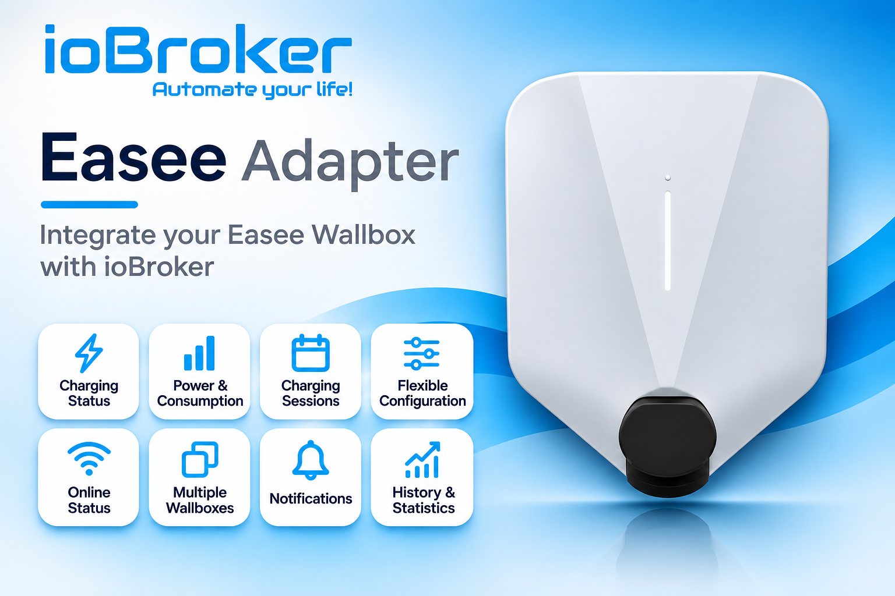

# ioBroker.easee

<!--  -->

## easee adapter for ioBroker

Adapter to connect [Easee Wallboxes](https://easee.com/).

## Requirements

- Node.js 22.19.0 or newer
- ioBroker js-controller 7.2.2 or newer
- ioBroker Admin 7.7.22 or newer

## Help

### Connection mode

Cloud is the default connection mode. Choose **Easee Cloud** or
**Bluetooth (local)** in the adapter settings. Cloud mode uses your Easee
account. Bluetooth mode connects directly to chargers configured in the
Device Manager on the Connection tab. Use it to add, edit, and remove local
chargers; Bluetooth mode does not log in to Cloud or switch to Cloud
automatically. Enter each charger's serial number and Bluetooth PIN (not
your Easee account password), then save the settings and restart the adapter.
An optional name is only an ioBroker label. The PIN is stored encrypted in the
adapter configuration.

The charger must be in Bluetooth range and available for a local connection.
The **Advanced Bluetooth functions** tab shows Bluetooth status and
connection method and offers an optional manual search. Search results do not configure chargers or
replace the required serial number and PIN. Bluetooth mode does not provide
Cloud-only information such as site prices, session history, or authorization
token details. Only datapoints supported by the selected connection mode are
exposed; unsupported adapter-created datapoints are removed after switching
modes. For setup, compatibility, and troubleshooting, see the
[Bluetooth guide](/#/docs/adapterref/iobroker.easee/docs/bluetooth.md).

### Charger status and controls

`<chargerId>.status.chargerOpMode` shows the current charging state:

| Value | State |
| ---: | --- |
| 0 | Offline |
| 1 | Disconnected |
| 2 | Waiting to start |
| 3 | Charging |
| 4 | Paused or completed |
| 5 | Error |
| 6 | Ready to charge |
| 7 | Waiting for authentication |
| 8 | Ending authentication |

In Cloud mode, Easee may provide an authorization token after a charging
session in `status.authToken`. When the token matches a key in your Easee account,
`status.authTokenName` shows the key owner's name; otherwise it shows
`unknown`. Both states remain empty until a token is available.

In Cloud mode, write a new name to `<chargerId>.name` to rename a charger. Your
Easee account must have permission to change chargers on the site.

`config.dynamicCircuitCurrentP1`–`P3` set the current limit for each phase. In
Cloud mode, update all phase values together. Bluetooth mode reads the other
phase values before applying a change and rejects it if they are unavailable.

Cloud session polling is automatic by default. You can set a separate interval
per charger in Admin; very short intervals are adjusted to avoid excessive
requests.

## Credits

This adapter would not have been possible without the great work of @Newan (https://github.com/Newan), who developed former releases of this adapter.

## Changelog
<!--
  Placeholder for the next version (at the beginning of the line):
  ### **WORK IN PROGRESS**
-->
### **WORK IN PROGRESS**
- (Voodoo2man) Limited the displayed charging power to two decimal places in the Device Manager card.

### 4.0.0 (2026-11-10)
- (Voodoo2man) Added optional local Bluetooth connectivity alongside Cloud, with charger discovery and setup through the Device Manager.
- (Voodoo2man) Improved Cloud status and session updates, charger controls, and Bluetooth charger configuration saving.

### 3.2.0 (2026-11-07)
- (Voodoo2man) Added the ability to change the charger name through the writable `<chargerId>.name` state.
- (Voodoo2man) Replaced the adapter icon.
- (Voodoo2man) Added an authorization token datapoint that is cleared when charging starts and set after the session, with a separate owner-name datapoint.

### 3.1.0 (2026-11-01)
- (Voodoo2man) Corrected cable-lock status reporting and improved the reliability of charger status updates.
- (Voodoo2man) Added a readable and adjustable permanent cable-lock setting, kept separate from the actual cable-lock status.
- (Voodoo2man) Improved recovery of live charger updates after connection interruptions while retaining regular status updates when live updates are disabled.

### 3.0.0 (2026-10-23)
- (Voodoo2man) Raised the minimum Node.js version to 22.19.0.

### 2.0.0 (2026-10-18)
- (Voodoo2man) Improved charger status updates and recovery after connection interruptions, with contributions from @Michaelnorge, @Codibris, and @m1chel87 and earlier compatibility work by @NCIceWolf.
- (Voodoo2man) Improved circuit-current controls and added configurable session updates across chargers.
- (Voodoo2man) Added configurable charging costs, including VAT.

## Donation

## License
MIT License

Copyright (c) 2026 iobroker-community-adapters <iobroker-community-adapters@gmx.de>  
Copyright (c) 2025 Newan <info@newan.de>

Permission is hereby granted, free of charge, to any person obtaining a copy
of this software and associated documentation files (the "Software"), to deal
in the Software without restriction, including without limitation the rights
to use, copy, modify, merge, publish, distribute, sublicense, and/or sell
copies of the Software, and to permit persons to whom the Software is
furnished to do so, subject to the following conditions:

The above copyright notice and this permission notice shall be included in all
copies or substantial portions of the Software.

THE SOFTWARE IS PROVIDED "AS IS", WITHOUT WARRANTY OF ANY KIND, EXPRESS OR
IMPLIED, INCLUDING BUT NOT LIMITED TO THE WARRANTIES OF MERCHANTABILITY,
FITNESS FOR A PARTICULAR PURPOSE AND NONINFRINGEMENT. IN NO EVENT SHALL THE
AUTHORS OR COPYRIGHT HOLDERS BE LIABLE FOR ANY CLAIM, DAMAGES OR OTHER
LIABILITY, WHETHER IN AN ACTION OF CONTRACT, TORT OR OTHERWISE, ARISING FROM,
OUT OF OR IN CONNECTION WITH THE SOFTWARE OR THE USE OR OTHER DEALINGS IN THE
SOFTWARE.