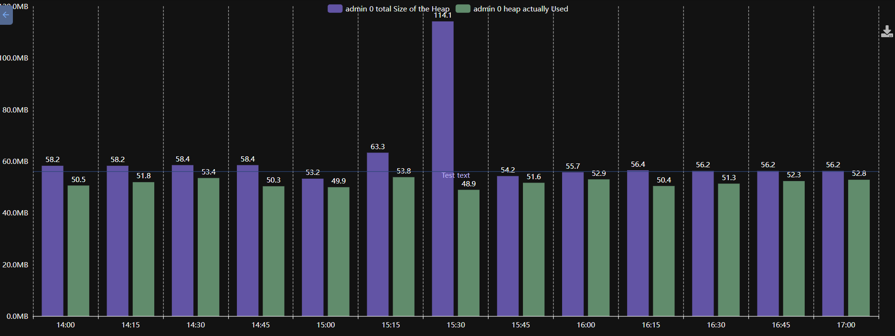
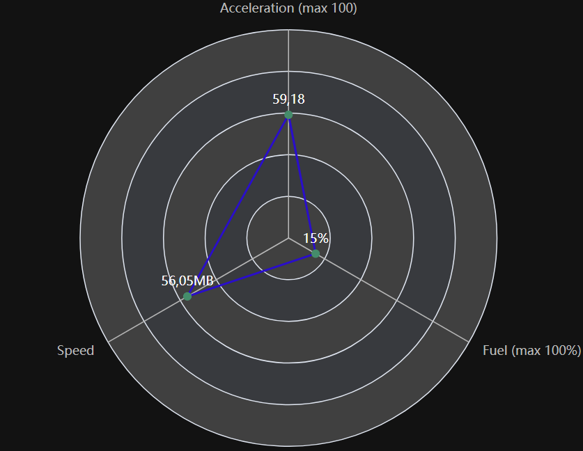
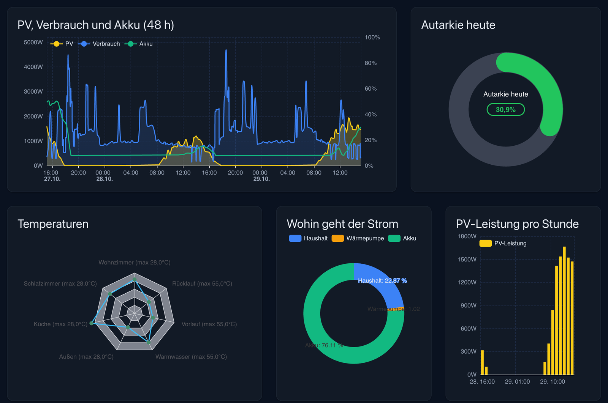

# ioBroker.echarts


[](https://www.npmjs.com/package/iobroker.echarts)


[](https://www.npmjs.com/package/iobroker.echarts)

**This adapter uses Sentry libraries to automatically report exceptions and code errors to the developers.** For more details and for information how to disable the error reporting see [Sentry-Plugin Documentation](https://github.com/ioBroker/plugin-sentry#plugin-sentry)!

## echarts adapter for ioBroker

Build useful charts in ioBroker:





Use "Actual value" aggregation for predicted result.

### One bar per data point

Normally the X-axis of a bar chart is the time and every bar is one interval. With **Bar settings → One
bar per line** the X-axis becomes the list of the lines instead: every line gets exactly one bar, which
shows the last value of that line. Together with the aggregation "Actual value" that is the current
value of every state, e.g. the consumption of every device.

**Horizontal bars** turns the chart by 90°, so the names stand on the Y-axis. That is the better choice
for long names or for many lines.

## Usage

Add after the restart the tab in the admin:


The created preset can be accessed in web adapter too. URL: `http://IP:8082/echarts/index.html?preset=echarts.0.PRESETID`.

For `vis` there is a special widget with easy selection of presets.

### Time range widget

Beside the chart widget there is the widget "E-Charts time range". It shows the same three fields as
the "Time" tab of the preset editor - type (relative or static), end and range - and hands the choice
of the user to the chart widgets of the same view. Every one of the three fields can be switched off
in the settings of the widget; a field that is switched off keeps the value that stands in its
attribute. As long as no chart is picked under "Charts", every E-Charts widget of the view follows it.

The same works without the widget: a chart that is opened with a preset takes the range out of the
URL hash, e.g. `http://IP:8082/echarts/index.html?preset=echarts.0.PRESETID#range=60&relativeEnd=now`.
`range`, `relativeEnd`, `timeType`, `start`, `start_time`, `end` and `end_time` are read there, and
they override what the preset brings without changing the preset itself.

### Chart modes

The "Options" tab of the preset editor opens with a "Chart mode", which says what the whole chart is:

- **Mixed** - the chart as it always was: a time axis, and every line brings its own type.
- **Donut** - one ring, one slice per line with the current value of its state. The size of the hole,
  the labels on the slices, the text in the hole and the order of the slices are set beside it. The
  values come in through a subscription, so the ring follows the states without a refresh.
- **Bar (current value)** - one bar per line instead of one bar per time interval. This is what the
  checkbox "One bar per line" did; an old preset is read as this mode and keeps working.
- **Radar** - the polar chart. It used to be a type a single line could take, which then forced every
  other line to it; an old preset is read as this mode.
- **Gauge** - in the shape "Circles" the scale is bent into a full circle and a ring is stacked per
  line, with the names and the values in the middle; in the shape "Gauge" the open scale stays and
  every line gets a pointer, with the names and the values in a row underneath.

Donut and "Bar (current value)" read the states and never the history, so they need no time range and
no aggregation.

The chart modes in a vis-2 view, every chart is one preset shown with the widget "Echarts Chart":
mixed (lines with a second Y-axis), gauge, radar, donut and bars per hour.



### Chart without an iframe (experimental)

The vis-2 chart widget draws the chart in an iframe: every chart on a view brings its own React app,
its own echarts and above all its own socket connection. The attribute "Without iframe" draws it into
the widget instead - the model then uses the connection the vis runtime already holds, and the chart
lives in the theme of vis-2.

The widget for ioBroker.devices carries the same setting. Both embed `ChartEmbed` of `src-chart`,
which is the only place that ties the chart model to the chart view.

The chart code is loaded on demand (about 1.5 MB, 480 kB gzipped) the first time a widget with this
setting is shown, because neither vis-2 nor the devices host shares echarts. A page without such a
widget loads nothing extra. The iframe stays the default and remains the only way for the stand-alone
URL and for the preview in the editor.

### Web components

The adapter brings the web component `<iob-echarts-chart>` (`common.webComponents`). Aura and every other
host of ioBroker web components shows it like a widget of its own; vis-2 and devices keep offering their
E-Charts widget, which carries the same name.

It draws a preset (`echarts.0.<name>`), or - without a preset - the history of a single state as the vis-2
widget does: chart type, aggregation, live update, ticks, range and end are set in the component. The
history instance is the one that records the state, the default history first. The chart is drawn
directly with the connection of the host - no iframe, no socket of its own - in the light or dark theme
and the font of the host.

The buttons of the preset work as on the chart page: save as image, export the data as CSV, select the
lines; the mouse and the fingers pan and zoom. The setting "Time range selector" adds the button for the
time range also if the preset has none. It offers a relative range with its end, or a fixed range - what
the vis-2 widget "E-Charts time range" does for the charts of a view. That widget has no component of its
own: it steers other widgets of the same view, and a host of web components has no such link.

The module bundles echarts (only the charts, components and renderers a preset can use), moment and the
chart code of `src-chart`: about 925 kB, 300 kB gzipped, loaded only when a host shows the component.
It is built by `npm run build:wc` from `src-webcomponents/` into `admin/webcomponents/`.

### Tooltip

Lower case `i` indicates that the value was interpolated from the 2-neighbour values, and it does not exist at this time stamp.


### Data from JSON

You can define the data source from JSON. In this case you can create some custom state of type `json` and store the value like this:

```json
[
    { "ts": 1675887847000, "val": 45 },
    { "ts": 1675887848000, "val": 77 },
    { "ts": 1675887849000, "val": 180 }
]
```

Alternative following attribute names are supported for `val`: `value`, `v`, `data`, `y`.
And following for `ts`: `time`, `t`, `date`.

You cannot define start and start in echarts settings. The start and end will be calculated automatically from the data.
Aggregation is not possible either. All manipulations must be done by writing of the JSON data.
The chart will be automatically updated every time the value changes.

### Server side rendering

You can render the presets on the server and get it as base64 URL or save it on disk on in ioBroker DB:

```js
sendTo(
    'echarts.0',
    {
        preset: 'echarts.0.myPreset', // the only mandatory attribute

        renderer: 'svg', // svg | png | jpg | pdf, default: svg

        width: 1024, // default 1024
        height: 300, // default 300
        background: '#000000', // Background color
        theme: 'light', // Theme type: 'light', 'dark'

        title: 'ioBroker Chart', // Title of PDF document
        quality: 0.8, // quality of JPG
        compressionLevel: 3, // Compression level of PNG
        filters: 8, // Filters of PNG (Bit combination https://github.com/Automattic/node-canvas/blob/master/types/index.d.ts#L10)

        fileOnDisk: '', // Path on disk to save the file.
        fileName: '', // Path in ioBroker DB to save the files on 'echarts.0'. E.g. if your set "chart.svg", so you can access your picture via http(s)://ip:8082/echarts.0/chart.png

        cache: 600, // Cache time for this preset in seconds, default: 0 - no cache
    },
    result => {
        if (result.error) {
            console.error(result.error);
        } else {
            console.log(result.data); // data:image/svg+xml;base64,...
        }
    },
);
```

Besides `data` (a data URL), the answer carries `contentType` (e.g. `image/png`) and, with `fileName`, `file` (e.g. `echarts.0/agent/outside.png`, to send as `iobfile://echarts.0/agent/outside.png`): the fields for pictures of the shared catalog of ioBroker.assistant. A picture kept by `cache` has no `file`.

The preset may also be a chart of its own, without a preset object, e.g. the outside temperature of the last 24 hours:

```js
sendTo('echarts.0', 'send', {
    preset: {
        l: [{ id: 'alias.0.Outside.Temperature' }], // the lines: id, and optional name, unit, color, instance (history adapter)
        range: 1440, // minutes back from now
        title: 'Outside',
    },
    renderer: 'png',
    background: '#ffffff',
    fileName: 'agent/outside.png', // then e.g. telegram: sendTo('telegram.0', 'send', { text: 'iobfile://echarts.0/agent/outside.png' })
});
```

`sendTo('echarts.0', 'help', {})` answers with a description of the messages for AI agents (e.g. pi-agent) and script authors; the answer lists all commands with `write` (whether a command changes something).

**Attention: You cannot enable/disable lines in legend on touch devices with enabled zoom**

## Developer manual

**For non-developers, this link does not work!**

You can debug view charts locally with:

- cd iobroker.echarts/src-chart
- npm run start
- Browser: http://localhost:8081/adapter/echarts/tab.html?dev=true

## Todo

- widget for vis (button)
- show enum icons on folders or near it
  <!--
  	Placeholder for the next version (at the beginning of the line):
  	### **WORK IN PROGRESS**
  -->

## Changelog
### **WORK IN PROGRESS**
* (@GermanBluefox) Live update does not start a new read while the previous one is still running (#1325)

### 6.6.0 (2026-11-23)
* (@GermanBluefox) The answer of `send` also carries `contentType` and, with `fileName`, `file` (the fields for pictures of the shared catalog of ioBroker.assistant); `data` stays a data URL
* (GermanBluefox) The preset editor has a switch "Auto preview" and a button "Update preview": with the switch off, the preview is updated only by the button; with the switch on, the preview waits briefly after a change so fast changes cause only one reload (#1323)

### 6.5.1 (2026-11-20)
- (@GermanBluefox) The help for AI agents describes charts without a preset (states and time range in the message), e.g. "the outside temperature of today", and how to send a chart with a messenger
- (@GermanBluefox) Fixed: the message "send" with renderer "pdf" now answers with the PDF instead of never answering; a failure while rendering or writing `fileOnDisk` is answered as an error as well
- (@GermanBluefox) Fixed: the message "send" now answers errors with their text instead of an empty object
- (@GermanBluefox) Fixed: the message "send" with an unknown preset now answers with an error instead of no answer at all

### 6.5.0 (2026-11-19)
- (@GermanBluefox) Added the message "help": a description of all messages for AI agents (e.g. pi-agent), and common.supportedMessages.help

### 6.4.1 (2026-11-17)
- (@GermanBluefox) Fixed the build with echarts-for-react 3.1.0: version 6.4.0 failed to build and was not published, this version contains its changes

### 6.4.0 (2026-11-17)
- (@GermanBluefox) A chart can show an arrow at each side that moves the time range by its own length: a week back for "7 days", the month before for "this month". After a click into the chart the arrow keys ← and → do the same. The option "Show arrows for the previous and next period" is in the time settings of the preset; it works for lines and for bars, which stay on their raster of days, weeks or months. Stepping forward back to the present brings the live update back
- (@GermanBluefox) Added the short form of the web component manifests (tag, name, icon, size) to `common.webComponents`, so that hosts like Aura can list the components before the adapter is installed; the build writes it with `iob-web-components sync-io-package`
- (@GermanBluefox) Updated packages
- (@GermanBluefox) The editor lists the states of a running history instance from its answer to `getEnabledDPs` and no longer only from `common.custom`, so the states that the recorder selects by itself appear as well

## License

ioBroker.echarts is available under the Apache License V2.

Copyright (c) 2019-2026 @GermanBluefox <dogafox@gmail.com>

Apache ECharts
Copyright (c) 2017-2026 The Apache Software Foundation

This product includes software developed at
The Apache Software Foundation (https://www.apache.org/).