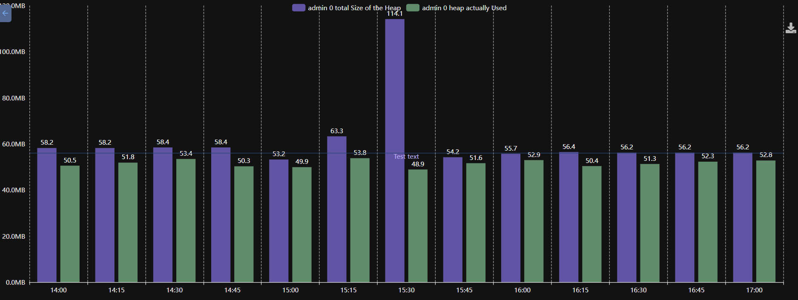
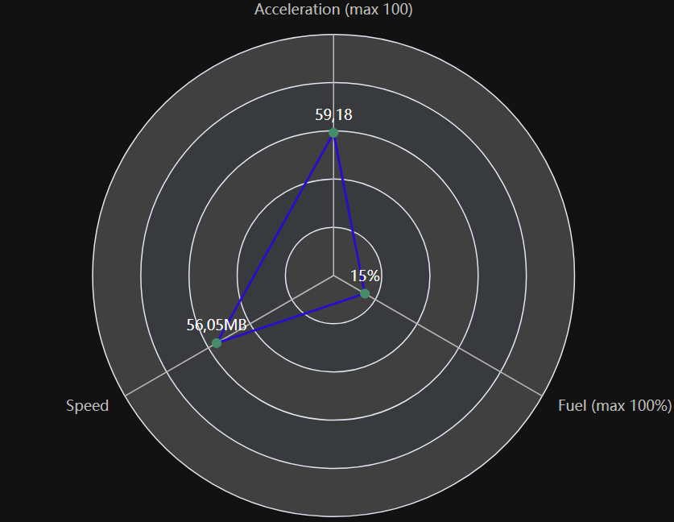
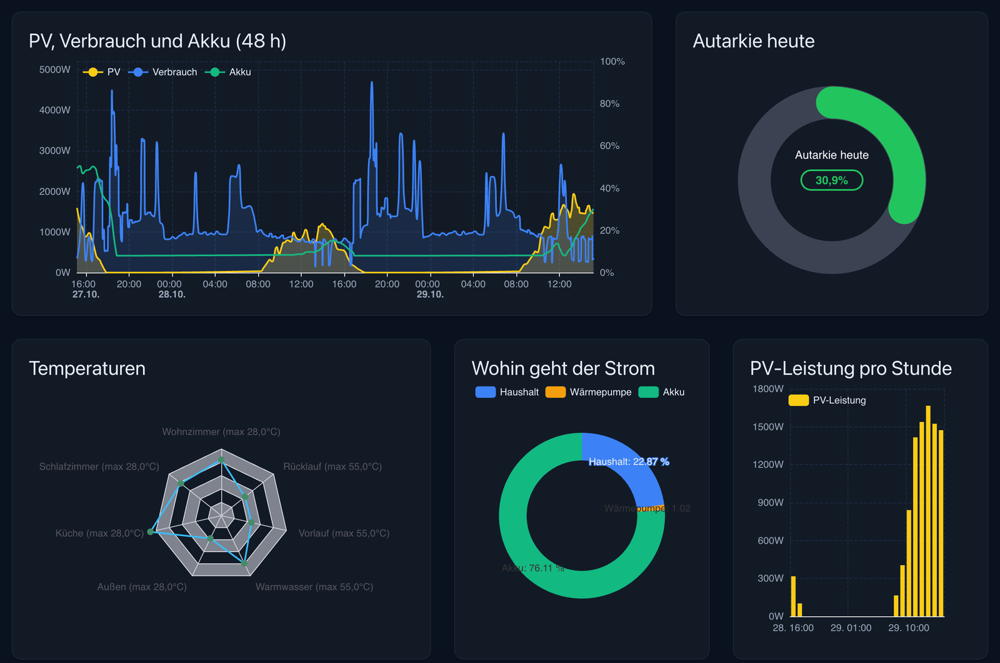

# ioBroker.echarts


[](https://www.npmjs.com/package/iobroker.echarts)


[](https://www.npmjs.com/package/iobroker.echarts)

**This adapter uses Sentry libraries to automatically report exceptions and code errors to the developers.** For more details and for information how to disable the error reporting see [Sentry-Plugin Documentation](https://github.com/ioBroker/plugin-sentry#plugin-sentry)!

## echarts adapter for ioBroker

Build useful charts in ioBroker:





Use "Actual value" aggregation for predicted result.

### One bar per data point

Normally the X-axis of a bar chart is the time and every bar is one interval. With **Bar settings → One
bar per line** the X-axis becomes the list of the lines instead: every line gets exactly one bar, which
shows the last value of that line. Together with the aggregation "Actual value" that is the current
value of every state, e.g. the consumption of every device.

**Horizontal bars** turns the chart by 90°, so the names stand on the Y-axis. That is the better choice
for long names or for many lines.

## Usage

Add after the restart the tab in the admin:


The created preset can be accessed in web adapter too. URL: `http://IP:8082/echarts/index.html?preset=echarts.0.PRESETID`.

For `vis` there is a special widget with easy selection of presets.

### Time range widget

Beside the chart widget there is the widget "E-Charts time range". It shows the same three fields as
the "Time" tab of the preset editor - type (relative or static), end and range - and hands the choice
of the user to the chart widgets of the same view. Every one of the three fields can be switched off
in the settings of the widget; a field that is switched off keeps the value that stands in its
attribute. As long as no chart is picked under "Charts", every E-Charts widget of the view follows it.

The same works without the widget: a chart that is opened with a preset takes the range out of the
URL hash, e.g. `http://IP:8082/echarts/index.html?preset=echarts.0.PRESETID#range=60&relativeEnd=now`.
`range`, `relativeEnd`, `timeType`, `start`, `start_time`, `end` and `end_time` are read there, and
they override what the preset brings without changing the preset itself.

### Chart modes

The "Options" tab of the preset editor opens with a "Chart mode", which says what the whole chart is:

- **Mixed** - the chart as it always was: a time axis, and every line brings its own type.
- **Donut** - one ring, one slice per line with the current value of its state. The size of the hole,
  the labels on the slices, the text in the hole and the order of the slices are set beside it. The
  values come in through a subscription, so the ring follows the states without a refresh.
- **Bar (current value)** - one bar per line instead of one bar per time interval. This is what the
  checkbox "One bar per line" did; an old preset is read as this mode and keeps working.
- **Radar** - the polar chart. It used to be a type a single line could take, which then forced every
  other line to it; an old preset is read as this mode.
- **Gauge** - in the shape "Circles" the scale is bent into a full circle and a ring is stacked per
  line, with the names and the values in the middle; in the shape "Gauge" the open scale stays and
  every line gets a pointer, with the names and the values in a row underneath.

Donut and "Bar (current value)" read the states and never the history, so they need no time range and
no aggregation.

The chart modes in a vis-2 view, every chart is one preset shown with the widget "Echarts Chart":
mixed (lines with a second Y-axis), gauge, radar, donut and bars per hour.



### Chart without an iframe (experimental)

The vis-2 chart widget draws the chart in an iframe: every chart on a view brings its own React app,
its own echarts and above all its own socket connection. The attribute "Without iframe" draws it into
the widget instead - the model then uses the connection the vis runtime already holds, and the chart
lives in the theme of vis-2.

The widget for ioBroker.devices carries the same setting. Both embed `ChartEmbed` of `src-chart`,
which is the only place that ties the chart model to the chart view.

The chart code is loaded on demand (about 1.5 MB, 480 kB gzipped) the first time a widget with this
setting is shown, because neither vis-2 nor the devices host shares echarts. A page without such a
widget loads nothing extra. The iframe stays the default and remains the only way for the stand-alone
URL and for the preview in the editor.

### Web components

The adapter brings the web component `<iob-echarts-chart>` (`common.webComponents`). Aura and every other
host of ioBroker web components shows it like a widget of its own; vis-2 and devices keep offering their
E-Charts widget, which carries the same name.

It draws a preset (`echarts.0.<name>`), or - without a preset - the history of a single state as the vis-2
widget does: chart type, aggregation, live update, ticks, range and end are set in the component. The
history instance is the one that records the state, the default history first. The chart is drawn
directly with the connection of the host - no iframe, no socket of its own - in the light or dark theme
and the font of the host.

The buttons of the preset work as on the chart page: save as image, export the data as CSV, select the
lines; the mouse and the fingers pan and zoom. The setting "Time range selector" adds the button for the
time range also if the preset has none. It offers a relative range with its end, or a fixed range - what
the vis-2 widget "E-Charts time range" does for the charts of a view. That widget has no component of its
own: it steers other widgets of the same view, and a host of web components has no such link.

The module bundles echarts (only the charts, components and renderers a preset can use), moment and the
chart code of `src-chart`: about 925 kB, 300 kB gzipped, loaded only when a host shows the component.
It is built by `npm run build:wc` from `src-webcomponents/` into `admin/webcomponents/`.

### Tooltip

Lower case `i` indicates that the value was interpolated from the 2-neighbour values, and it does not exist at this time stamp.


### Data from JSON

You can define the data source from JSON. In this case you can create some custom state of type `json` and store the value like this:

```json
[
    { "ts": 1675887847000, "val": 45 },
    { "ts": 1675887848000, "val": 77 },
    { "ts": 1675887849000, "val": 180 }
]
```

Alternative following attribute names are supported for `val`: `value`, `v`, `data`, `y`.
And following for `ts`: `time`, `t`, `date`.

You cannot define start and start in echarts settings. The start and end will be calculated automatically from the data.
Aggregation is not possible either. All manipulations must be done by writing of the JSON data.
The chart will be automatically updated every time the value changes.

### Server side rendering

You can render the presets on the server and get it as base64 URL or save it on disk on in ioBroker DB:

```js
sendTo(
    'echarts.0',
    {
        preset: 'echarts.0.myPreset', // the only mandatory attribute

        renderer: 'svg', // svg | png | jpg | pdf, default: svg

        width: 1024, // default 1024
        height: 300, // default 300
        background: '#000000', // Background color
        theme: 'light', // Theme type: 'light', 'dark'

        title: 'ioBroker Chart', // Title of PDF document
        quality: 0.8, // quality of JPG
        compressionLevel: 3, // Compression level of PNG
        filters: 8, // Filters of PNG (Bit combination https://github.com/Automattic/node-canvas/blob/master/types/index.d.ts#L10)

        fileOnDisk: '', // Path on disk to save the file.
        fileName: '', // Path in ioBroker DB to save the files on 'echarts.0'. E.g. if your set "chart.svg", so you can access your picture via http(s)://ip:8082/echarts.0/chart.png

        cache: 600, // Cache time for this preset in seconds, default: 0 - no cache
    },
    result => {
        if (result.error) {
            console.error(result.error);
        } else {
            console.log(result.data);
        }
    },
);
```

**Attention: You cannot enable/disable lines in legend on touch devices with enabled zoom**

## Developer manual

**For non-developers, this link does not work!**

You can debug view charts locally with:

- cd iobroker.echarts/src-chart
- npm run start
- Browser: http://localhost:8081/adapter/echarts/tab.html?dev=true

## Todo

- widget for vis (button)
- show enum icons on folders or near it
  <!--
  	Placeholder for the next version (at the beginning of the line):
  	### **WORK IN PROGRESS**
  -->

## Changelog

### **WORK IN PROGRESS**
- (@GermanBluefox) Added the short form of the web component manifests (tag, name, icon, size) to `common.webComponents`, so that hosts like Aura can list the components before the adapter is installed; the build writes it with `iob-web-components sync-io-package`

### 6.3.0 (2026-11-09)
- (@GermanBluefox) Added web component `<iob-echarts-chart>` for Aura and other hosts (`common.webComponents`)
- (@GermanBluefox) Fixed: a chart drawn without iframe kept the first fixed time range and ignored every later one

### 6.2.0 (2026-11-09)
* (GermanBluefox) Bars and lines can be combined in one chart: changing the type of one line no longer changes all the others, and the lines are drawn on their own time axis over the bars (#1319)
* (GermanBluefox) Bars can be drawn stacked, side by side or overlapping: overlapping bars all start at zero, so a color with transparency shows the bars behind them (#1318)
* (GermanBluefox) The chart no longer fails with "Show sum over the stack" if the automatic grid padding is off, and the sum disappears when the option is switched off
* (GermanBluefox) The tooltip can show only the line nearest to the mouse instead of all lines, for charts with many lines (#1280)

### 6.1.0 (2026-10-30)
* (GermanBluefox) Ask before unsaved preset changes are lost by reloading or leaving the editor (#1290)
* (GermanBluefox) Bars per day, week or month show the right values after a switch of the daylight saving time. The history adapter split the range into equally long intervals, so after the 25-hour day every value written at 23:59:59 was shown one day later and the day of the switch stayed empty. The chart now sends the borders of its bars along; this needs ioBroker.sql, ioBroker.history or ioBroker.influxdb with `@iobroker/aggregate` 1.1 (#1311)
* (GermanBluefox) Copying a preset of an older version does not break the editor anymore: the copy was stored without any lines, and the "Diagrams" tab stayed empty every time it was opened. A preset without lines opens as an empty one now (#1285)
* (GermanBluefox) A line with a thickness stored as text, e.g. "3", is clipped at the border of the grid again instead of being drawn over the X-axis (#1284)
* (GermanBluefox) The CSV export keeps its line breaks in Firefox: the file was a `data:` URL, from which Firefox removes them, and a `#` in an ID cut the file off (#1282)
* (GermanBluefox) "Digits after comma" of a line can be emptied again to use the setting of the chart, and 0 is shown as 0 instead of an empty field. The empty field shows which value is used instead (#1288)
* (GermanBluefox) The chart and the preview opened through the web adapter under the admin address (`/adapter/echarts/...`) move to the address of the web adapter on any port, not only on 8082. The preview offers the link over the own host first, so it also works behind a reverse proxy, and a copied link is absolute (#1273, #1230)
* (GermanBluefox) Every color of the chart (background, title, labels, ticks, grid, legend, bar labels, border and buttons) can get an own value for the dark theme. With the theme "auto", a chart in vis-2 can thus be adjusted to the light and the dark mode; empty, the color stays the same in both (#1312)

### 6.0.0 (2026-10-14)
- (@GermanBluefox) Added chart mode "Gauge" (rings or pointers)
- (@GermanBluefox) Added chart mode "Donut"
- (@GermanBluefox) Added "Chart mode" setting (Mixed, Donut, Bar, Radar, Gauge); "One bar per line" and "polar" lines are migrated
- (@GermanBluefox) Added vis-2 widget "E-Charts time range"
- (@GermanBluefox) vis-2 and devices widgets can draw the chart without an iframe (experimental)
- (@GermanBluefox) The time range can be passed in the URL hash and changed without reload
- (@GermanBluefox) Fixed: dark chart in vis-2 was shown on a white background
- (@GermanBluefox) Fixed: chart in vis-2 did not follow theme changes
- (@GermanBluefox) Fixed: "undefined" after values without unit
- (@GermanBluefox) Fixed: overlapping labels in the gauge
- (@GermanBluefox) Fixed: radar axes were labelled "undefined"
- (@GermanBluefox) Gauge uses Min/Max of the lines; empty scale ends follow the values
- (@GermanBluefox) Fixed: gauge showed zero for lines with aggregation other than "current"
- (@GermanBluefox) Settings that have no effect in the current chart mode are hidden
- (@GermanBluefox) Only "standard" and "JSON" sources are offered where no history is read; any state can be selected there
- (@GermanBluefox) JSON source works for current-value charts
- (@GermanBluefox) Fixed: chart without iframe kept growing or crashed on early time range
- (@GermanBluefox) Fixed: switching the chart mode left parts of the old chart
- (@GermanBluefox) Fixed: line ID field lost focus while typing
- (@GermanBluefox) Fixed: chart setting "After comma" was ignored
- (@GermanBluefox) Fixed: dropdown tooltip covered the open list
- (@GermanBluefox) Fixed missing translations of slider labels
- (@GermanBluefox) Source "standard" can be selected in the opened line too; history sources show the adapter icon
- (@GermanBluefox) "Expand all" / "Collapse all" are shown for a single entry too
- (@GermanBluefox) Added widget description to the vis-2 palette tooltip
- (@GermanBluefox) Build scripts migrated to TypeScript

### 5.1.1 (2026-08-31)
- (@GermanBluefox) Many GUI fixes

## License

ioBroker.echarts is available under the Apache License V2.

Copyright (c) 2019-2026 @GermanBluefox <dogafox@gmail.com>

Apache ECharts
Copyright (c) 2017-2026 The Apache Software Foundation

This product includes software developed at
The Apache Software Foundation (https://www.apache.org/).