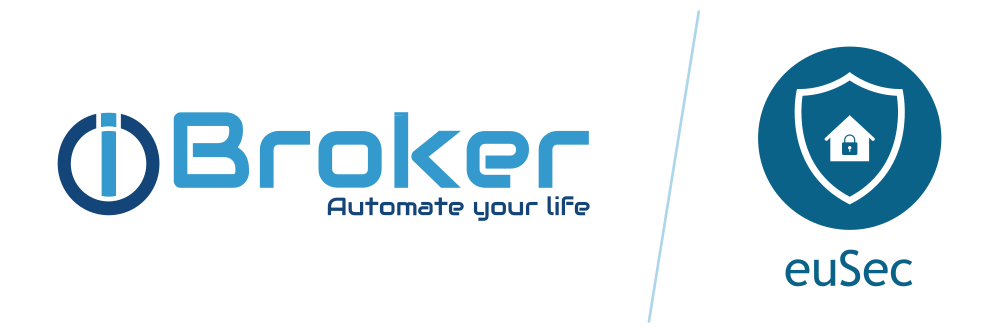

# ioBroker.euSec

[](https://www.npmjs.com/package/iobroker.eusec)
[](https://www.npmjs.com/package/iobroker.eusec)
[](https://www.npmjs.com/package/iobroker.eusec)


[](https://libraries.io/npm/iobroker.eusec)

**Tests:** 

[](https://nodei.co/npm/iobroker.eusec/)

> [!IMPORTANT]
> This adapter cannot be installed from github

This is an [ioBroker](https://www.iobroker.net) adapter that uses the [eufy-security-client](https://github.com/bropat/eufy-security-client) library to communicate with Eufy devices.

**This project is not affiliated with Anker and Eufy (Eufy Security). It is a personal project that is maintained in spare time.**

## Description

This adapter allows you to control [Eufy security devices](https://us.eufylife.com/collections/security) by connecting to the Eufy cloud servers and local/remote stations.

You need to provide your Cloud login credentials. The adapter connects to your cloud account and polls for all device data via HTTPS. Now a local or remote P2P connection to the Eufy stations/devices is also supported. However, a connection to the Eufy Cloud is always a prerequisite.

One Adapter instance will show all devices from one Eufy Cloud account and allows you to control them.

> [!TIP]
> Widgets for vis-2 (live camera, event popup, snapshot) are available as a separate adapter:
> [vis-2-widgets-eusec](https://github.com/typhosj/ioBroker.vis-2-widgets-eusec).

## Documentation

Check out the documentation [here](https://github.com/iobroker-community-adapters/ioBroker.eusec/tree/master/docs).

## Known working devices

Information about supported devices can be found [here](/#/docs/adapterref/iobroker.eusec/docs/devices.md).

## Credits

This adapter would not have been possible without the great work of Patrick Broetto (brobat) <https://github.com/bropat>, who created previous releases of this adapter.

## Upgrading from adapter 2.x or older

Adapter 2.x and older added `--security-revert=CVE-2023-46809` to the node process parameters of every instance running on node.js 18 or 20. node.js 22 and newer refuse to start an instance with that flag, and this adapter requires node.js 24.

Updating this adapter clears the node process parameters of all eusec instances, which removes the flag. Other parameters (e.g. `--max-old-space-size`) are cleared as well and have to be entered again after each update. If an instance still does not start and its log shows `--security-revert=CVE-2023-46809`, remove the parameters by hand and restart the instance:

```
iobroker object set system.adapter.eusec.0 common.nodeProcessParams=[]
```

A detailed description (in German) is available at our forum (https://forum.iobroker.net/topic/82651/test-adapter-eusec-v2-0-x).

## Changelog

<!--
	Placeholder for the next version (at the beginning of the line):
	### **WORK IN PROGRESS**
-->
### **WORK IN PROGRESS**
- (typhosj) Switching quickly between on-demand cameras of the same station now also works between cameras with different video codecs, e.g. from a SoloCam S340 (H.265) to an Indoor Cam (H.264). The new camera was started right after the old one was stopped, and its livestream began with the last data of the old camera and kept its codec - nothing could be played, and the station stayed blocked for up to five minutes. The next livestream of a station now starts two seconds after a stop at the earliest (reported in the forum)
- (typhosj) The start no longer logs the error "Check push token - Response code not ok" for an account that has been migrated to the new eufy backend. That rejection is expected and push works over the new backend, so it is now logged once as info. A warning is logged instead when push could not be established on either backend

### 3.6.2 (2026-10-26)
- (typhosj) Switching quickly between on-demand cameras of the same station works now. A camera opened within ten seconds after another camera of the station was closed did not start, and the station stayed blocked for up to five minutes. The livestream of the closed camera, or one started through start_stream that nobody watches, is now stopped right away before the next livestream of the station starts, also one for start_stream or a talkback (reported in the forum)
- (typhosj) A talkback now keeps the other cameras of its station from starting, like a watched livestream does. Opening another camera of the station ended the talkback before.

### 3.6.1 (2026-10-26)
- (typhosj) On-demand streams no longer hang for five minutes when a player opens the stream again shortly after the last one left. A request that came while the idle livestream was being stopped waited for a livestream nobody started; a compatibility stream then failed in VLC with "404 Not Found" or "[exec] timeout" (reported in the forum)
- (typhosj) Compatibility streams of on-demand cameras now also start when the camera takes more than 5 seconds to deliver the first picture. ffmpeg gave up after 5 seconds, so the first attempt failed for most battery cameras and only a second one shortly after worked. go2rtc still gives up after 30 seconds, so a camera that needs more than about 20 seconds to start fails the first attempt as before (reported in the forum)

### 3.6.0 (2026-10-25)
- (typhosj) eufyCam C37 (T814X): the states `dualCamWatchViewMode` and `enabled` are no longer created and are removed from existing installations. The C37 has one lens and does not report whether it is enabled, so `enabled` always showed `true` (#198)
- (typhosj) Compatibility streams no longer stop answering for good after a viewer left. The bundled go2rtc 1.9.4 could lock up a transcoded stream when it ended it, and only a restart of the adapter helped. The adapter now downloads go2rtc 1.9.14 from its GitHub release once, checks it against the published checksum and keeps it in the data directory of the instance. Without access to GitHub it falls back to go2rtc 1.9.4 and logs a warning
- (typhosj) The setting "Livestream quality" now also applies to cameras that name their qualities by resolution, such as the SoloCam S340 or the Indoor Cam S350. Low, medium and high stand for the lowest, the second and the third resolution, for example 720P, 1080P and 3K. Until now these cameras stayed at "Auto", where they change the resolution while the livestream runs and the player shows a green or black picture. The SoloCam S340 raises its resolution at the start of every livestream even at a fixed quality; for it, a compatibility stream keeps the resolution steady (reported in the forum)
- (typhosj) New setting "Excluded devices": the instance ignores the devices and stations listed there. It creates no states for them, receives none of their events and pictures and does not connect to them; excluding a HomeBase excludes every device connected to it. Useful when two ioBroker installations share one Eufy account, for example one at home and one in a motorhome on mobile data (requested in the forum)
- (typhosj) Compatibility streams play sound in VLC again. The transcoded picture started 2 to 4 seconds ahead of the sound, so VLC dropped the sound, while browsers still played it. The video now keeps the timestamps the camera sent (reported in the forum)

### 3.5.0 (2026-10-11)
- (hdering) The eufyCam C37 (T814X) is no longer an unknown device without states: the adapter handles it like the eufyCam S4. Livestream, motion, person and vehicle detection, light, pan and tilt and the battery states should work, but are not confirmed on a real camera yet - please report in #198

### 3.4.2 (2026-10-05)
- (typhosj) On-demand livestreams no longer show only a picture every few seconds and then go black. Since 3.4.0 every keyframe of 16 KB or more was taken for a go2rtc that does not keep up, and the video up to the next keyframe was dropped. Data is now only dropped once more than 4 MB wait for go2rtc (reported in the forum)

## License

MIT License

Copyright (c) 2025-2026 iobroker-community-adapters <iobroker-community-adapters@gmx.de>  
Copyright (c) 2020-2024 bropat <patrick.broetto@gmail.com>

The web pages in `www/` that go2rtc serves are taken from [go2rtc](https://github.com/AlexxIT/go2rtc),
MIT licensed by Alexey Khit (2022). Their license text is in `www/LICENSE.go2rtc`, the list
of files and what was changed is in `www/VENDOR.md`.

Permission is hereby granted, free of charge, to any person obtaining a copy
of this software and associated documentation files (the "Software"), to deal
in the Software without restriction, including without limitation the rights
to use, copy, modify, merge, publish, distribute, sublicense, and/or sell
copies of the Software, and to permit persons to whom the Software is
furnished to do so, subject to the following conditions:

The above copyright notice and this permission notice shall be included in all
copies or substantial portions of the Software.

THE SOFTWARE IS PROVIDED "AS IS", WITHOUT WARRANTY OF ANY KIND, EXPRESS OR
IMPLIED, INCLUDING BUT NOT LIMITED TO THE WARRANTIES OF MERCHANTABILITY,
FITNESS FOR A PARTICULAR PURPOSE AND NONINFRINGEMENT. IN NO EVENT SHALL THE
AUTHORS OR COPYRIGHT HOLDERS BE LIABLE FOR ANY CLAIM, DAMAGES OR OTHER
LIABILITY, WHETHER IN AN ACTION OF CONTRACT, TORT OR OTHERWISE, ARISING FROM,
OUT OF OR IN CONNECTION WITH THE SOFTWARE OR THE USE OR OTHER DEALINGS IN THE
SOFTWARE.