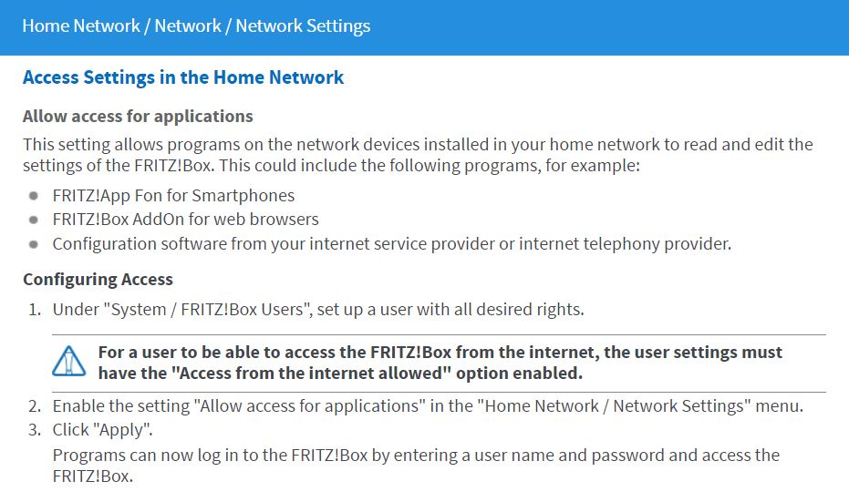
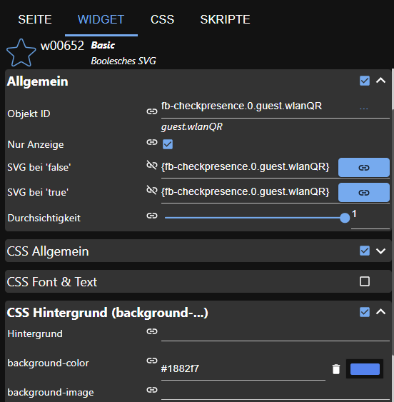

# ioBroker.fb-checkpresence

[](https://www.npmjs.com/package/iobroker.fb-checkpresence)


[](https://snyk.io/test/github/afuerhoff/ioBroker.fb-checkpresence)

[](https://nodei.co/npm/iobroker.fb-checkpresence/)


[](https://www.npmjs.com/package/iobroker.fb-checkpresence)

**Tests:** 

## fb-checkpresence adapter for ioBroker

The adapter checks whether family members are present based on the devices reported by the FRITZ!Box. For each enabled family member, you must provide a member name, MAC address, IP address, and hostname. Choose whether the device should be identified by its MAC address, IP address, or hostname. A group and comment are optional. The adapter creates presence data points based on the member name.

### Used open source code
#### npm dateformat v4.5.3
(c)  2007-2009 Steven Levithan <stevenlevithan.com>
npm: https://www.npmjs.com/package/dateformat
github: https://github.com/felixge/node-dateformat
license: MIT

### Adapter pre conditions
A History adapter is optional. Select a supported History, SQL, or InfluxDB adapter to store and evaluate historical family member data. Presence detection works without a History adapter, but history-based information will not be available.

You can choose one of the following adapters:
* History
* SQL
* InfluxDB

## FRITZ!Box

This adapter uses an AVM FRITZ!Box and communicates with it via the TR-064 protocol. For more information about FRITZ!Box products, see [AVM's website](https://fritz.com/collections/fritz-box).

### TR-064 requirements

The used TR-064 interface from the fritzbox is described here: https://avm.de/service/schnittstellen/.

The adapter uses the following TR-064 services and actions:

* Hosts:1 — X_AVM-DE_GetHostListPath (supported since 2017-01-09)
* Hosts:1 — X_AVM-DE_GetMeshListPath
* Hosts:1 — GetSpecificHostEntry
* Hosts:1 — X_AVM-DE_GetSpecificHostEntryByIP (supported since 2016-05-18)
* DeviceInfo:1 — GetSecurityPort
* DeviceInfo:1 — GetInfo
* WANPPPConnection:1 — GetInfo
* WANIPConnection:1 — GetInfo
* WLANConfiguration3 — SetEnable
* WLANConfiguration3 — GetInfo
* WLANConfiguration3 — GetSecurityKeys
* X_AVM-DE_HostFilter — DisallowWANAccessByIP
* X_AVM-DE_HostFilter — GetWANAccessByIP
* DeviceConfig:1 — Reboot
* LANConfigSecurity1 — X_AVM-DE_GetCurrentUser

TR-064 access is disabled by default on the FRITZ!Box. To enable it, log in to the FRITZ!Box web interface and switch to the advanced view. Open **Home Network » Network » Network Settings** and enable **Allow access for applications**. Restart the FRITZ!Box after changing this setting.

> **Note:** The menu names may differ slightly depending on your FRITZ!OS version.



## Configuration

### General

The configuration form validates required values and prevents saving while a validation error is present.

### FRITZ!Box address, username, and password

Enter the IP address or hostname of your FRITZ!Box, together with the username and password of a FRITZ!Box user. Recent FRITZ!OS versions (7.25 and later) require a user account for this type of access. Create the user in the FRITZ!Box settings and grant it the required FRITZ!Box access rights.

The password is stored encrypted by ioBroker and is not saved as plain text. FRITZ!Box usernames and passwords can be up to 32 characters long. See the [AVM recommendations for logging in to a FRITZ!Box](https://avm.de/fileadmin/user_upload/Global/Service/Schnittstellen/Empfehlungen%20zur%20Benutzerfu%CC%88hrung%20bei%20der%20Anmeldung%20an%20einer%20FRITZ%21Box_v1.1.pdf) and AVM's [information about permitted characters](https://service.avm.de/help/de/FRITZ-Box-Fon-WLAN-7490/014/hilfe_zeichen_fuer_kennwoerter).

If the adapter reports connection timeouts, check the username, password, and access rights. The FRITZ!Box may temporarily block a user after repeated unsuccessful login attempts. In that case, check the FRITZ!Box and its logs; a restart may be required to clear the block.

### SSL

Enable **SSL** to connect to the FRITZ!Box via HTTPS. If **Verify certificate** is enabled, the adapter checks whether the FRITZ!Box certificate is valid and trusted. This option is disabled by default for compatibility with FRITZ!Box installations that use self-signed or otherwise untrusted certificates.

If your FRITZ!Box uses a valid certificate from a trusted CA, enable **Verify certificate** for stricter security. If the adapter cannot establish an HTTPS connection, first check the certificate and the FRITZ!Box configuration. If necessary, disable **Verify certificate** or turn off **SSL** completely to fall back to an unencrypted HTTP connection.

### Polling intervals
The adapter has separate polling intervals for family members and FRITZ!Box devices. Both can be set between 10 and 3600 seconds. Each polling cycle starts after the previous cycle has finished.

### Filter time
When a family member's status changes to absent, the adapter waits for the configured filter delay and checks the status again. The absent status is set only if the member is still absent. A change to present is applied immediately.

### History adapter

A History adapter is optional. Select a supported History, SQL, or InfluxDB adapter to store and evaluate historical family member data. Presence detection works without a History adapter, but history-based information and statistics will not be available.

### Date format

The date format is used in the adapter's formatted HTML and JSON output. For available format masks, see the [dateformat documentation](https://www.npmjs.com/package/dateformat#mask-options).

### FRITZ!Box device data points

Enable **Create data points for FRITZ!Box devices** to create individual data points for devices found in the FRITZ!Box network.

To limit which devices receive individual data points, enable **Use selected devices only** and select the desired devices from the list. Devices are matched by their MAC address. If this option is disabled, individual data points are created for all devices.

The device lists and device counters continue to show the complete device information reported by the FRITZ!Box, regardless of the selection. The selection only controls the creation and updating of individual `fb-devices.<device>.*` data points.

Changing the selection does not delete data points that were created previously. If you no longer need data points for devices that are no longer selected, delete them manually in the ioBroker Objects view.

> **Note:** The device selection is available only when **Create data points for FRITZ!Box devices** is enabled.

### Synchronizing FRITZ!Box device data points
You can synchronize FRITZ!Box device data points once or configure periodic synchronization. Periodic synchronization runs at the specified interval and removes data points for devices that are no longer reported by the FRITZ!Box. The interval controls how often synchronization runs; it is not the amount of time a device must be inactive before removal.

The selected-device setting does not delete existing data points for devices that are no longer selected. Delete those data points manually if they are no longer needed.

### Mesh information

When mesh information is enabled, the adapter creates additional data points for devices and interfaces in the FRITZ!Box mesh network. This option requires **Create data points for FRITZ!Box devices** to be enabled.

### Guest network information

Enable guest network information to retrieve details about devices connected to the guest network and update the related guest states.

### Guest Wi-Fi QR code

Enable QR code generation to create a QR code for the guest Wi-Fi network. The code is stored in the `guest.wlanQR` state and can be displayed in VIS using the **Basic Boolesches SVG** widget. Use the following example settings:



### Family member compatibility

The compatibility option controls the object structure used for family member states:

* **Compatibility enabled, group empty:** Uses the legacy object structure.
* **Compatibility enabled, group set:** Uses the new structure, with states under the `familyMembers` folder.
* **Compatibility disabled:** Uses the new structure, with states under the `familyMembers` folder.

The legacy structure may be removed in a future version. When changing from the legacy structure, follow any instructions in the adapter log. You may need to update scripts or VIS widgets that refer to the old state IDs.

### Family member presence and filtering

The adapter creates a presence state for each enabled family member and checks whether the configured device is present or absent. The presence state changes when the detected status changes.

You can enable filtering for an individual family member. When the device is detected as present, the presence state changes to `true` immediately. When it is detected as absent, the adapter waits for the configured filter delay and checks again. The state changes to `false` only if the device is still absent after the delay.

Some device information, such as connection speed, is read from the individual FRITZ!Box device data points. Enable **Create data points for FRITZ!Box devices** to make this information available.

### Manually trigger presence detection

You can manually trigger a presence check by sending the `triggerPresence` message to the adapter. Further trigger requests are rejected during the 10-second cooldown. The callback returns `false` if the request is blocked and `true` if the adapter accepts it.

```javascript
sendTo('fb-checkpresence.0', 'triggerPresence', {}, result => {
    log(result, 'info');
});
```

### Whitelist settings

Select the FRITZ!Box devices that should be considered known. Devices not included in the whitelist are treated as unknown and may appear in the blacklist.

You can also add a device to the whitelist from JavaScript. The adapter checks the supplied hostname and MAC address against the FRITZ!Box device list. If the device is found and is not already in the whitelist, it is added to the whitelist configuration.

```javascript
sendTo(
    'fb-checkpresence.0',
    'addDeviceToWhitelist',
    {
        hostname: 'devicename',
        mac: '00:00:00:00:00:00',
    },
    result => {
        log(result, 'info');
    },
);
```

## Features

### FRITZ!Box capability check

The adapter checks which FRITZ!Box services and features are available and reports the results in the log. It also checks whether the configured FRITZ!Box user has the required access rights. If a service is unavailable or the user lacks the required permission, the corresponding feature is disabled. If a feature does not work, check the adapter log and the FRITZ!Box user's permissions.

### Switch guest Wi-Fi on or off

Set the `guest.wlan` state to `true` or `false` to switch the FRITZ!Box guest Wi-Fi on or off.

### Guest Wi-Fi QR code

When QR code generation is enabled, the guest Wi-Fi QR code is stored in `guest.wlanQR`. It can be displayed in VIS using the **Basic Boolesches SVG** widget.

### Block or allow a device's internet access

For supported FRITZ!Box devices, set the `disabled` state under `fb-devices` to `true` to block that device's internet access, or to `false` to allow access again.

### Guest devices and blacklist

The adapter reports devices connected to the guest network. It also compares detected devices with the whitelist; devices that are not whitelisted may be listed in the blacklist.

### Family member presence and history

For each configured family member, the adapter tracks presence. When a History adapter is selected and available, it can also calculate and store arrival and departure times and other history-based information.

### Device counts

The adapter reports the total number of devices and the number of active devices as reported by the FRITZ!Box. These counts reflect the FRITZ!Box device list, not just the devices selected for individual `fb-devices` data points.

## Objects

### `presenceAll`

`true` when all configured family members are present.

### `presence`

`true` when at least one configured family member is present.

### `devices`

The total number of devices reported by the FRITZ!Box.

### `activeDevices`

The number of active devices reported by the FRITZ!Box.

### HTML and JSON tables

The HTML and JSON output includes family member arrival and departure information.

### `info`

Contains adapter information, including the last update and connection status.

### `guest`

Contains guest network information, including the number of active guests and tables with guest device details.

### `blacklist`

Contains the number of unknown devices and tables with information about those devices.

### `member.present`

Contains information about the member's presence on the current day, including how long the member has been present since the last status change.

### `member.absent`

Contains information about the member's absence on the current day, including how long the member has been absent since the last status change.

### `member.comming` and `member.going`

Contain the member's arrival and departure information. The state ID `comming` is retained for compatibility.

### `member.history` and `member.historyHtml`

Contain the member's history for the current day.

## Changelog
### 1.5.0 (2026-10-26)
* (afuerhoff) Adapter requires node.js >= 22 now
* (afuerhoff) configuration changed to jsonConfig
* (afuerhoff) dependencies updated
* (afuerhoff) dependabot.yml fixed [#358](https://github.com/afuerhoff/ioBroker.fb-checkpresence/issues/358)
* (afuerhoff) new fb-devices cyclic sync option integrated
* (afuerhoff) SSL certificate validation added; certificate checks can be enabled explicitly, while self-signed certificates remain compatible when disabled
* (afuerhoff) readme updated
* (softwarecrash) PR398 fixes a crash in newfilter mode
* (afuerhoff) issues [#413]

### 1.4.2 (2025-10-30)
* (afuerhoff) dependencies updated
* (afuerhoff) package.json issues fixed [#350](https://github.com/afuerhoff/ioBroker.fb-checkpresence/issues/350)
* (afuerhoff) npm security changes
* (afuerhoff) filter time extended to 300s
* (afuerhoff) guest wlan bug fixed [#353](https://github.com/afuerhoff/ioBroker.fb-checkpresence/issues/353)
* (afuerhoff) deprecated functions changed

### 1.4.1 (2025-09-19)
* (afuerhoff) dependencies updated
* (afuerhoff) repository checker & code scanning issues fixed

### 1.4.0 (2025-05-28)
* (afuerhoff) dependencies updated
* (afuerhoff) error handling optimized
* (afuerhoff) enhancement  [#336](https://github.com/afuerhoff/ioBroker.fb-checkpresence/issues/336)
* (afuerhoff) issue [#337](https://github.com/afuerhoff/ioBroker.fb-checkpresence/issues/337)
* (afuerhoff) issue [#335](https://github.com/afuerhoff/ioBroker.fb-checkpresence/issues/335)

### 1.3.1 (2025-03-02)
* (afuerhoff) dependencies updated
* (afuerhoff) bug fixed [#333](https://github.com/afuerhoff/ioBroker.fb-checkpresence/issues/333)
* (afuerhoff) bug fixed [#305](https://github.com/afuerhoff/ioBroker.fb-checkpresence/issues/305)

## License
MIT License

Copyright (c) 2019-2026 Achim Fürhoff <achim.fuerhoff@outlook.de>

Permission is hereby granted, free of charge, to any person obtaining a copy
of this software and associated documentation files (the "Software"), to deal
in the Software without restriction, including without limitation the rights
to use, copy, modify, merge, publish, distribute, sublicense, and/or sell
copies of the Software, and to permit persons to whom the Software is
furnished to do so, subject to the following conditions:

The above copyright notice and this permission notice shall be included in all
copies or substantial portions of the Software.

THE SOFTWARE IS PROVIDED "AS IS", WITHOUT WARRANTY OF ANY KIND, EXPRESS OR
IMPLIED, INCLUDING BUT NOT LIMITED TO THE WARRANTIES OF MERCHANTABILITY,
FITNESS FOR A PARTICULAR PURPOSE AND NONINFRINGEMENT. IN NO EVENT SHALL THE
AUTHORS OR COPYRIGHT HOLDERS BE LIABLE FOR ANY CLAIM, DAMAGES OR OTHER
LIABILITY, WHETHER IN AN ACTION OF CONTRACT, TORT OR OTHERWISE, ARISING FROM,
OUT OF OR IN CONNECTION WITH THE SOFTWARE OR THE USE OR OTHER DEALINGS IN THE
SOFTWARE.