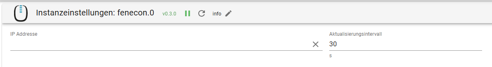

# ioBroker.fenecon

**Tests:** 

## Fenecon

[Fenecon](https://fenecon.de) is a German manufacturer of PV inverters, battery storage systems and energy management systems for homes and businesses. Most systems run the **FEMS** (Fenecon Energy Management System), which is based on the open source energy management platform [OpenEMS](https://github.com/OpenEMS/openems). Fenecon is one of the main contributors to OpenEMS.

Because FEMS exposes its data through the OpenEMS **REST/JSON API**, this adapter works with every FEMS system that provides this interface, independent of the concrete device model (Home, Commercial, ...).

## Adapter

This adapter connects to the FEMS central unit over the local network and reads all available channel values through the OpenEMS REST/JSON interface (`http://<ip>/rest/channel/...`). It mirrors the returned values into ioBroker states, assigns meaningful roles and units and can optionally write compatible values back to FEMS.

The adapter is a polling adapter (`dataSource: poll`), runs as a daemon and supports compact mode.

Features:

- reads all channels of the FEMS box or only a configurable subset
- creates the ioBroker object tree (channels and states) automatically on the first start
- assigns every known FEMS channel a specific ioBroker role and keeps the FEMS unit
- converts temperatures delivered in deci degrees Celsius (`dC`) to degrees Celsius
- calculates the **Autarchy** and **SelfConsumption** rates from the summary values
- low load on FEMS and ioBroker: unchanged values are not rewritten (only a periodic heartbeat), and updates are written in parallel batches
- optional write-back: writable (`RW`/`WO`) channels can be set from the Admin UI, scripts or Blockly
- robust against broken responses and firmware changes: invalid entries are dropped and new/unknown channels are reported in the log

## How it works

1. On start the adapter validates the configuration (IPv4 address and refresh interval).
2. It fetches the channel list from the FEMS box. Without custom endpoints it requests the catch-all endpoint `.*/.*`, which returns every available channel. With custom endpoints only the configured components/channels are requested.
3. For every valid channel `component/channel` an ioBroker **channel** object and a **state** object are created. Forbidden characters are replaced so that the FEMS address can be used as object id. Objects are only extended/updated when the managed definition (name, desc, role, type, unit, read, write) changed.
4. Values are written with `ack: true`. A value is only written when it actually changed; unchanged values are still refreshed at least every 10 minutes (heartbeat) so that timestamps do not become stale.
5. The next run is scheduled using the configured refresh interval.

## Configuration

To establish a connection, the IP address of the FEMS central unit is required. The refresh interval can also be adjusted.

| Setting                        | Description                                                                                                                                               |
| ------------------------------ | --------------------------------------------------------------------------------------------------------------------------------------------------------- |
| **IP address**                 | IPv4 address of the FEMS central unit in the local network (e.g. `192.168.1.50`). The field is validated as IPv4 and saving is blocked on a wrong format. |
| **Refresh interval**           | Polling interval in seconds. Allowed range: `5` - `3600` s (default `30` s).                                                                              |
| **Use user defined endpoints** | If disabled (default) all channels are read through the catch-all request. If enabled only the endpoints in the table are requested.                      |
| **Endpoints**                  | Table of `Component ID` / `Channel ID` pairs, used when custom endpoints are enabled.                                                                     |

### Custom endpoints

You can use custom endpoints so that not all data is retrieved. To do so, activate the checkbox and configure the rows in the table. Each row results in one request to `<Component ID>/<Channel ID>` and reduces the load when only a few values are needed.

The `Channel ID` may contain a single channel, several channels separated by `;`, or a regular expression / wildcard:

- Component `_sum`, Channel `.*` -> all channels of the summary
- Component `ess0`, Channel `.*` -> all channels of the battery storage
- Component `_sum`, Channel `GridActivePower;EssSoc` -> only these two channels

## States

States are generated automatically when the adapter starts. If a channel or state was deleted by accident, warnings appear in the log file: restart the adapter and the missing objects are recreated.

The object tree mirrors the FEMS component structure as `<component>.<channel>`, for example `fenecon.0._sum.GridActivePower` (the instance number may differ).

Common components:

| Component                              | Meaning                                                                        |
| -------------------------------------- | ------------------------------------------------------------------------------ |
| `_sum`                                 | Aggregated values of the whole system (grid, production, consumption, battery) |
| `ess0`                                 | Energy storage system (battery inverter / charger)                             |
| `battery0`                             | Battery pack (cells, temperatures, BMS data)                                   |
| `batteryInverter0`                     | Battery inverter (e.g. GoodWe)                                                 |
| `meter0`                               | Grid / energy meter                                                            |
| `charger10`, `charger11`               | EV charging stations (EVCS)                                                    |
| `ctrl*`                                | OpenEMS controllers (charge optimization, balancing, ...)                      |
| `io0`, `io1`                           | Digital / analog I/O                                                           |
| `modbus0`, `modbus1`, `modbus2`        | Modbus interfaces                                                              |
| `_host`, `_power`, `_energy`, `_cycle` | OpenEMS system information and power/energy solver                             |
| `scheduler0`, `predictor0`, `rrd4j0`   | OpenEMS scheduler, forecast and historian                                      |

The most important summary values are located below `_sum`:

- `_sum.GridActivePower` - grid power in W (positive = buying from grid, negative = feeding into grid)
- `_sum.ProductionActivePower` - PV production power in W
- `_sum.ConsumptionActivePower` - house consumption power in W
- `_sum.EssActivePower` - battery power in W (sign depends on charge / discharge)
- `_sum.EssSoc` - battery state of charge in %
- `_sum.GridBuyActiveEnergy` / `_sum.GridSellActiveEnergy` - bought / sold energy in Wh
- `_sum.ProductionActiveEnergy` / `_sum.ConsumptionActiveEnergy` - produced / consumed energy in Wh

Every state has a description (`desc`) taken from the FEMS channel text and a role matching its meaning. Known channels get a specific role (e.g. `value.power`, `value.energy`, `value.voltage`, `value.current`, `value.temperature`, `value.frequency`, `indicator`, `text`). Channels that are not in the mapping table yet fall back to a role derived from the unit, and are reported once in the log so they can be added.

### Calculated values

Besides the raw FEMS values the adapter calculates two additional states:

- `_sum.Autarchy` - autarchy rate in % (share of the consumption covered by own production)
- `_sum.SelfConsumption` - self-consumption rate in % (share of the production consumed instead of fed into the grid)

### Write-back (commands)

Channels that FEMS marks as writable (access mode `RW` or `WO`) are created with `write: true` and the adapter subscribes them. When a value is written without `ack` (e.g. from the Admin UI, a script or Blockly), the adapter sends it back to FEMS with a `POST` request and sets the state to `ack: true` after a successful write. Read-only (`RO`) channels reject writes and log a warning.

Values delivered in deci degrees Celsius are converted back to the FEMS scale before writing.

## Troubleshooting

- **No data / errors in the log**: check the IP address (valid IPv4 and reachable from the ioBroker host) and that the FEMS box answers on `http://<ip>/rest/channel/`.
- **Configuration rejected**: the IP address must be a valid IPv4 address and the refresh interval must be between 5 and 3600 seconds.
- **Missing or empty states**: the adapter drops invalid FEMS entries and reports unknown channels in the log. Restart the adapter so the object tree is rebuilt; unknown channels can be added to the state mapping table (see developer notes).
- **States were deleted**: restart the adapter to recreate them. Manually changed objects are only overwritten when their managed definition differs.

## Developer notes

The adapter is written in TypeScript. The sources live in `src/` and the compiled output is generated into `build/`, which is the directory shipped with the npm package.

Source layout:

- `src/main.ts` - adapter lifecycle, polling loop and state updates
- `src/fems-client.ts` - REST client for the OpenEMS/FEMS channel API
- `src/state-factory.ts` - object/role/unit helpers and value conversion
- `src/calculations.ts` - autarchy and self-consumption calculation
- `src/states.ts` - generated mapping table of all known FEMS channels to ioBroker roles
- `src/types.ts` - shared types and runtime validation helpers

Useful npm scripts:

- `npm run build` compiles the sources
- `npm run watch` recompiles on every change
- `npm run check` runs the strict type check (`tsc --noEmit`)
- `npm run lint` runs ESLint
- `npm run test` runs the unit tests (`test:ts`) and the ioBroker package tests (`test:package`)
- `npm run test:integration` runs the integration tests
- `npm run generate:states` regenerates the role mapping in `src/states.ts` (run `node tools/generate-states.js src/states.ts --check` to verify it is up to date)
- `npm run benchmark` runs the state update benchmark (`tools/benchmark.js`)

For live validation use the [@iobroker/dev-server](https://github.com/ioBroker/dev-server) instead of a productive instance: run `setup` once, then `watch` or `debug` to verify runtime behavior, reconnects, object updates and the Admin UI.

## Changelog

<!--
	Placeholder for the next version (at the beginning of the line):
-->
### 1.0.1 (2026-11-07)

- (SG-App) update mapping table after FEMS update to 2026.10.2

### 1.0.0 (2026-11-07)

- (SG-App) migrate the adapter sources to TypeScript, compiled output is generated into `build/`
- (SG-App) validate the configured IP address strictly as IPv4
- (SG-App) use the sanitized channel and state names consistently for the object ids
- (SG-App) validate the FEMS response and drop invalid entries instead of creating nonsense states
- (SG-App) only write states when the value changed, with a heartbeat to refresh the timestamps
- (SG-App) write state updates in parallel batches to lower the CPU load
- (SG-App) cache the existing objects at startup and only extend objects when the definition changed
- (SG-App) assign a specific role to every known state and log unknown channels for later additions
- (SG-App) add the channels reported as unknown to the state mapping table
- (SG-App) support writing values back to FEMS through onStateChange for writable channels
- (SG-App) convert the temperature values delivered in deci degrees Celsius (dC) to degrees Celsius
- (SG-App) extend the README with a detailed adapter description, configuration, state overview and troubleshooting

### 0.7.0 (2025-09-28)

- (SG-App) dependency updates
- (SG-App) allow multi channel configuration
- (SG-App) optimize Rest request and log channel not exists

### 0.6.2 (2025-02-11)

- (SG-App) fix loading single channel

### 0.6.1 (2025-02-10)

- (SG-App) fix missing size attributes

## License

MIT License

Copyright (c) 2025-2026 Georg Schreiner <info@sg-app.de>

Permission is hereby granted, free of charge, to any person obtaining a copy
of this software and associated documentation files (the "Software"), to deal
in the Software without restriction, including without limitation the rights
to use, copy, modify, merge, publish, distribute, sublicense, and/or sell
copies of the Software, and to permit persons to whom the Software is
furnished to do so, subject to the following conditions:

The above copyright notice and this permission notice shall be included in all
copies or substantial portions of the Software.

THE SOFTWARE IS PROVIDED "AS IS", WITHOUT WARRANTY OF ANY KIND, EXPRESS OR
IMPLIED, INCLUDING BUT NOT LIMITED TO THE WARRANTIES OF MERCHANTABILITY,
FITNESS FOR A PARTICULAR PURPOSE AND NONINFRINGEMENT. IN NO EVENT SHALL THE
AUTHORS OR COPYRIGHT HOLDERS BE LIABLE FOR ANY CLAIM, DAMAGES OR OTHER
LIABILITY, WHETHER IN AN ACTION OF CONTRACT, TORT OR OTHERWISE, ARISING FROM,
OUT OF OR IN CONNECTION WITH THE SOFTWARE OR THE USE OR OTHER DEALINGS IN THE
SOFTWARE.