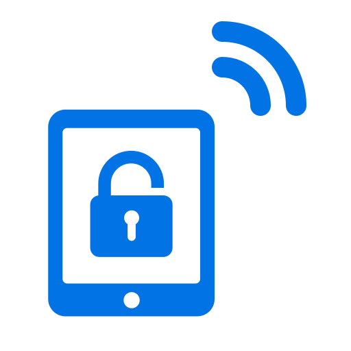

# ioBroker.freekiosk

**Tests:** 

## FreeKiosk adapter for ioBroker

[FreeKiosk](https://freekiosk.app) ([RushB-fr/freekiosk](https://github.com/RushB-fr/freekiosk)) is an open-source kiosk app for Android tablets, an alternative to Fully Kiosk Browser. This adapter reads the status of your FreeKiosk tablets into ioBroker states and lets scripts, Blockly and vis control them: screen, brightness, volume, URL, screensaver, text-to-speech, screenshots, camera photos, motion detection, remote keys and display mode.

Each tablet talks to the adapter over either REST (the adapter polls the tablet) or MQTT (the tablet pushes to a broker built into the adapter).

## Requirements

* FreeKiosk 2.0.0 or newer (tested with 2.0.0 and 2.1.0-beta.1)
* Node.js 22.12 or newer

## Setup over REST

1. In FreeKiosk open Settings > Advanced > REST API, enable it, and note the port (default 8080). Optionally set an API key.
1. Turn on "Allow remote control" in FreeKiosk, otherwise the tablet refuses all commands.
1. In the adapter settings add a row to the device table (see below): transport `REST`, the tablet's host and port. If you set an API key, enter it on the REST tab.
1. The REST tab also holds the poll interval in seconds (default 30, allowed 5 to 3600; values outside that range are clamped). A new poll starts only after the previous one has finished.

## Setup over MQTT

1. In the adapter settings open the MQTT tab and set the port (default 1886), a user and a password. The base topic (default `freekiosk`) must be the same as the base topic in FreeKiosk's MQTT settings.
1. In FreeKiosk open Settings > Advanced > MQTT and enter the ioBroker host as broker, the port, the same user and password, the same base topic, and a device name.
1. Turn on "Allow remote control" in FreeKiosk.
1. Add a row to the device table (see below) with transport `MQTT` and FreeKiosk's device name as topic ID. The broker starts only once the table holds an MQTT tablet; until then FreeKiosk reports "connection refused". A tablet that connects under a topic ID not in the table is logged with the topic ID to enter.

Only over MQTT: motion detection, always-on motion detection, periodic screenshots and camera photos, and their intervals. Screenshots and camera photos work over both transports: over REST the adapter downloads them directly when you press the button (screenshot as PNG, camera photo as JPEG); over MQTT the tablet publishes them (JPEG) to the broker, but only for the image streams turned on in FreeKiosk's MQTT settings. `images.screenshotEnabled` and `images.cameraEnabled` show which are on; a capture of a stream that is off is refused with a warning.

## Device table

One row per tablet, up to 50 rows. A row that fails validation is logged and skipped; the other tablets keep running.

When you delete a row, the adapter deletes that tablet's objects and stored images at its next start (saving the settings restarts it). If one of its states has custom settings such as history, the adapter keeps all of that tablet's objects and images, logs a warning naming those states, and deletes them at the first start after you removed the custom settings. The same applies to the MQTT-only states of a tablet switched to REST. A disabled row or a row that fails validation keeps its objects. Changing a row's object ID counts as deleting the old tablet and adding a new one.

* **Object ID**: ASCII letters, digits, `_` and `-`, at most 32 characters, unique regardless of case, and not `info`.
* **Transport**: `REST` or `MQTT`.
* **Host and port** (REST only): a hostname or IP address without `http://`, path or IPv6 zone (`%wlan0`); the port defaults to 8080. MQTT rows need neither.
* **Topic ID** (MQTT only): FreeKiosk's device name from its MQTT settings, at most 64 characters; empty uses the object ID. FreeKiosk sends the name unchanged (for example the model name `KFTRPWI`); the adapter compares it in lowercase with every character other than `a-z`, `0-9`, `_` and `-` as `_`, so `KFTRPWI` and `kftrpwi`, or `Wall Display` and `wall_display`, are the same tablet. Topic IDs must be unique in that form.

## Security

The built-in broker and FreeKiosk's REST API are not encrypted. Keep both inside your LAN, never forward their ports to the internet, and use a broker password that you use nowhere else.

## States

Each tablet is a device object named after its ID in the device table.

| Channel | Content |
|---|---|
| `info` | online flag, last update, transport, FreeKiosk version, model, manufacturer, Android version, IP, device owner and kiosk mode |
| `battery` | level, charging, temperature |
| `screen` | screen on/off, brightness, screensaver (active, and a switch that shows the last acknowledged command because FreeKiosk does not report the setting), auto-brightness (read only) |
| `webview` | current URL (writable to navigate), loading, can go back, URL rotation |
| `wifi` | SSID, signal strength (dBm and %) |
| `sensors` | light, proximity; over MQTT also motion and motion always on |
| `audio` | volume |
| `system` | memory used, free storage |
| `images` | paths of the latest screenshot and camera photos with their time; over MQTT also auto-capture switches and intervals |
| `commands` | reload, wake, reboot, clear cache, lock, restart UI, audio stop and beep, screenshot, camera photos, URL rotation start and stop, text-to-speech, toast, launch app, execute JavaScript, audio play, mode |
| `remote` | D-pad and navigation buttons, key, key combo and text input |

* Buttons: write `true`.
* `webview.url` takes an http(s) URL.
* `commands.audioPlay` takes a URL or JSON such as `{"url":"http://...","loop":false,"volume":50}`.
* `commands.mode` takes `{"mode":"webview","url":"http://..."}`, `{"mode":"external_app","package":"com.example.app"}` or `{"mode":"media_player"}`. A `url` must be http(s).
* Images are stored in the instance file storage. To show one in vis, use the path from `images.*`; the web adapter serves it as `/freekiosk.0/<id>/<file>`.
* If nothing happens when you send a command, check "Allow remote control" in FreeKiosk first. With it off, REST refuses commands and an MQTT tablet does not subscribe to them; in both cases the adapter logs a warning and does not acknowledge the command.
* A command is acknowledged only after it was delivered: over REST when the tablet answered with success, over MQTT when the broker handed it to the tablet's command subscription. If the tablet is offline, the command is dropped with a warning and not queued.

## Known limits

* Auto-brightness can be read but not switched yet.
* FreeKiosk up to 2.1.0-beta.1 stops sending its status over MQTT after a reconnect to the broker ([RushB-fr/freekiosk#328](https://github.com/RushB-fr/freekiosk/issues/328)): the tablet stays online in ioBroker and still takes commands, but its states can stop updating. The fix is merged in FreeKiosk and ships with its next release. REST tablets are not affected.
* The adapter restores the names, roles and units of its objects on every start, so a name changed in the object browser does not last. Custom settings such as history stay.
* One API key and one broker login are shared by all tablets.
* No TLS for the broker.

## Logo

The adapter icon is derived from the FreeKiosk logo of [RushB-fr/freekiosk](https://github.com/RushB-fr/freekiosk) (redrawn, with added signal waves), used under the MIT License of that project. The licence notice ships with the adapter in [THIRD-PARTY-NOTICES.md](/#/docs/adapterref/iobroker.freekiosk/THIRD-PARTY-NOTICES.md).

## Changelog
<!--
    Placeholder for the next version (at the beginning of the line):
    ### **WORK IN PROGRESS**
-->
### **WORK IN PROGRESS**
* (typhosj) Objects with custom settings such as history are no longer deleted: a tablet removed from the device table keeps its objects, and a tablet switched to REST keeps its MQTT-only states, until the custom settings are removed

### 0.1.0 (2026-11-05)
* (typhosj) MQTT: an empty image from the tablet no longer replaces the last stored image
* (typhosj) MQTT: commands are refused with a warning while "Allow remote control" is off in FreeKiosk, instead of being acknowledged
* (typhosj) MQTT: new states `images.screenshotEnabled` and `images.cameraEnabled`; a screenshot or camera capture of a stream that is off in FreeKiosk is refused with a warning instead of being acknowledged
* (typhosj) MQTT: the broker closes a client that publishes to a `$SYS/` topic
* (typhosj) MQTT: topic IDs match regardless of case and of characters other than a-z, 0-9, _ and -, because FreeKiosk sends its device name unchanged (such as `KFTRPWI`); commands go out in the spelling the tablet uses
* (typhosj) MQTT: the log says when the broker does not start because no MQTT tablet is configured, and names the topic ID to enter for a tablet that is not in the device table
* (typhosj) Screenshots and camera photos are stored one at a time per tablet and kind, so an older image can no longer overwrite a newer one; over REST, presses during a download lead to one more download
* (typhosj) The adapter now stops at once even while a connection to the broker is still being set up
* (typhosj) Names, roles and units of the adapter's objects are restored on every start
* (typhosj) The time states `info.lastUpdate` and `images.*Time` have the unit ms
* (typhosj) The web view URL and the display mode URL must start with http:// or https://; spaces around the web view URL are removed before it is sent
* (typhosj) The settings check object IDs, hosts, topic IDs, the base topic and the MQTT login before saving; object IDs and topic IDs must be unique
* (typhosj) REST: a host with an IPv6 zone (such as `%wlan0`) is rejected, because no URL can be built from it
* (typhosj) The objects and images of a tablet whose row was deleted from the device table are deleted at the next start
* (typhosj) REST: a tablet that answers 401 while no API key is set is logged as "requires an API key"; error messages keep the HTTP status even when the tablet's error answer is too large

Older changes: CHANGELOG_OLD.md

## License
MIT License

Copyright (c) 2026 typhosj <typhosj@gmx.de>

Permission is hereby granted, free of charge, to any person obtaining a copy
of this software and associated documentation files (the "Software"), to deal
in the Software without restriction, including without limitation the rights
to use, copy, modify, merge, publish, distribute, sublicense, and/or sell
copies of the Software, and to permit persons to whom the Software is
furnished to do so, subject to the following conditions:

The above copyright notice and this permission notice shall be included in all
copies or substantial portions of the Software.

THE SOFTWARE IS PROVIDED "AS IS", WITHOUT WARRANTY OF ANY KIND, EXPRESS OR
IMPLIED, INCLUDING BUT NOT LIMITED TO THE WARRANTIES OF MERCHANTABILITY,
FITNESS FOR A PARTICULAR PURPOSE AND NONINFRINGEMENT. IN NO EVENT SHALL THE
AUTHORS OR COPYRIGHT HOLDERS BE LIABLE FOR ANY CLAIM, DAMAGES OR OTHER
LIABILITY, WHETHER IN AN ACTION OF CONTRACT, TORT OR OTHERWISE, ARISING FROM,
OUT OF OR IN CONNECTION WITH THE SOFTWARE OR THE USE OR OTHER DEALINGS IN THE
SOFTWARE.