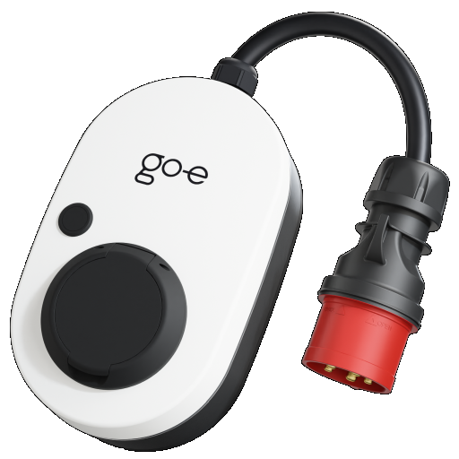

# ioBroker.go-eCharger

[](https://www.npmjs.com/package/iobroker.go-e-charger)
[](https://www.npmjs.com/package/iobroker.go-e-charger)


[](https://github.com/hombach/ioBroker.go-e-charger/actions/workflows/codeql-analysis.yml)
[](https://ci.appveyor.com/project/hombach/iobroker-go-e-charger)
[](https://snyk.io/test/github/hombach/ioBroker.go-e-charger)

## Versions


[](https://nodei.co/npm/iobroker.go-e-charger/)

## ioBroker adapter for go-e Charger EV wallboxes

This adapter integrates one or more go-e Charger wallboxes into your ioBroker home automation. It cyclically polls each wallbox via its local HTTP API, provides all relevant data as ioBroker states, and lets you control charging directly from your smart home.

For more information about the go-e Charger hardware, visit the manufacturer's website: [go-e GmbH](https://go-e.com).

### Features

- supports multiple go-e Chargers within a single adapter instance
- monitoring of car state, charging power, charging current, grid phases, and energy statistics
- **ChargeNOW** – start charging immediately at a configurable current
- **ChargeManager** – automatic PV surplus charging: the charging current is continuously adjusted to the available solar power, taking house consumption and the state of charge of your home battery into account. Charging of your EV can be delayed until the home battery has reached a configurable minimum state of charge.

    > **Note:** When ChargeManager is enabled on several chargers at the same time, the available surplus is split between them in the order of the wallbox list – see [Several wallboxes on one PV surplus](#several-wallboxes-on-one-pv-surplus).

- switching between 1-phase and 3-phase charging (hardware generation 3 and newer)
- energy statistics per RFID card (card name, ID, and charged energy)
- read-only mode per wallbox – monitor a charger purely, without sending **any** control commands to it (no charge release, no charging current, no phase switching), e.g. when charging is controlled elsewhere or access is managed via RFID tags

Tested with firmware V033, V040.0, V041.0, V054.7, V054.11, V055.5, V055.7, V055.8, V56.1, V56.2, V56.8, V56.9, V56.11, V57.0, V57.1, V59.4, V60.0, V60.1, V60.2, V60.5, V60.6 and with up to 3 chargers operated in parallel.

### Requirements

- For hardware generation 3 and 4 you have to enable "HTTP API v1" in your go-e app.
- For phase switching you additionally have to enable "HTTP API v2" in your go-e app (hardware generation 3 and newer).

## Configuration

Add one entry per go-e Charger to the wallbox list and enter its IP address. Optionally assign a name to each charger.

Enable **read-only mode** for a charger if the adapter should only read its data and never write to it. In read-only mode the adapter sends no control commands at all – neither the charge release, nor the charging current, nor phase switching. The ChargeNOW and ChargeManager states can still be toggled, but they have no effect on a read-only charger. Use this mode when the charging of that wallbox is controlled by another system or managed locally via RFID tags.

The poll cycle time defines how often the adapter reads data from the chargers and adjusts the charging current (minimum 3 seconds, default 10 seconds).

#### Per-wallbox current limits

Each wallbox can optionally be given its own **minimum** and **maximum charging current** [A]. These apply to **both** ChargeManager (PV surplus) and ChargeNOW, for example to throttle a single charger or to balance the load between several boxes on a shared supply.

- A value of `0` means "not set": the minimum falls back to the technical minimum of 6 A, and the maximum falls back to the installation-wide maximum charging current from the standard settings.
- A per-box maximum can only lower a charger below the installation limit, never raise it above.
- If the configured minimum ends up higher than the maximum, the minimum is clamped down to the maximum and a warning is logged.

The adapter also reads the current caps reported by each charger – the absolute maximum current, the cable current limit and (via API v2) the minimum charging current – and folds them into the effective limits, so a charger is never driven beyond what its hardware or the plugged cable allows. The detected caps are published as `Wallbox_X.info.hardwareMaxChargeCurrent` and `Wallbox_X.info.hardwareMinChargeCurrent` to help you choose sensible per-box values.

### PV surplus charging with ChargeManager

ChargeManager calculates the charging current from numeric ioBroker states supplied by an energy-management, inverter, meter, or user-created data source. It does not depend on a particular vendor, but the selected states must represent the quantities described below.

Configure the object IDs of the following states:

- currently available solar power [W]
- current home power consumption [W]
- current state of charge of your home battery [%] (only required in the battery-aware modes, see _Home battery mode_ below)

#### Input requirements

| Input                        | Expected value                 | Unit | Sign                 |
| ---------------------------- | ------------------------------ | ---- | -------------------- |
| Solar power                  | Total current PV generation    | W    | Positive generation  |
| Home power consumption       | Total current household demand | W    | Positive consumption |
| Home battery state of charge | Current battery charge level   | %    | 0 to 100             |

All configured states must contain numeric values. Power values in kW must be converted to W before they are selected. A grid import/export state cannot be used directly because ChargeManager currently expects separate generation and consumption values.

If no home battery is installed, set the **Home battery mode** to _Disabled_ (see below). No battery state of charge has to be configured, and ChargeManager charges purely from the available PV surplus. The former helper-state workaround (a constant state set to `Settings.Setpoint_HomeBatSoC`) is no longer needed.

#### Wallbox consumption in the home-consumption value

Enable **Charger consumption is included in the home power consumption value** when the selected home-consumption state rises by approximately the charging power after charging starts. ChargeManager then adds the measured wallbox power back before calculating the available surplus. This prevents the controller from treating its own charging load as additional household demand.

Leave the option disabled when the selected state already excludes wallbox consumption.

#### Calculation

ChargeManager uses the following calculation once per poll cycle:

```text
available power =
    solar power
  - home power consumption
  + wallbox power, if it is included in home power consumption
  - grid reserve
  + battery bonus (Battery priority mode only)

target current = floor(available power / 230 V / active phases)
```

Six settings on the ChargeManager configuration page tune this calculation:

- **Home battery mode** (default _Battery priority_) – how the home battery is taken into account:
    - _Disabled_ – no home battery is used. No SoC state has to be configured, and no battery power is ever assigned to the car.
    - _Minimum SOC_ – EV charging is blocked below `Settings.Setpoint_HomeBatSoC`, but the battery never contributes power to the car.
    - _Battery priority_ – as above, plus the battery bonus described below.
- **Battery SoC hysteresis** [%] (default 0) – how far the SoC may fall below the minimum before a _running_ controller stops. It keeps a battery hovering around its minimum from toggling the charge release every cycle; starting still requires the full minimum SoC.
- **Maximum battery SoC age** [s] (default 0 = off) – surplus control stops when the SoC state has not been updated within this time, so a dead helper state cannot silently keep the car charging.
- **Grid reserve power** [W] (default 100) – power kept free on the grid connection instead of being assigned to the car. Increase it to keep more safety headroom; set it to `0` to hand the full surplus to the car.
- **Maximum battery bonus** [W] (default 2000) – how much extra power, on top of the pure solar surplus, may be drawn while the home battery is above its minimum state of charge. The bonus is `0` when the battery is exactly at the minimum SoC and grows linearly to this maximum as the battery approaches 100 %, so a fuller battery lets the car charge faster. Set it to `0` to charge purely from the measured solar surplus without ever discharging the home battery into the car.
- **Minimum ChargeManager current** [A] (default 6) – the surplus charging current below which the charger is switched off after a short delay. This applies to PV surplus charging only.

The **maximum charging current** [A] (default 16, up to 32) is configured on the **standard settings page**, not here: it is an installation-wide limit of the shared power supply (main breaker / circuit protection) rather than a ChargeManager tuning value. It caps the current the adapter will ever assign to **any** wallbox, in **both** ChargeManager (PV surplus) **and** ChargeNOW.

> **⚠️ Do not set the maximum charging current higher than your go-e Charger hardware and your electrical installation support.** go-e Charger models are rated for different maximum currents (e.g. 16 A or 32 A), and the actual limit also depends on your cable, plug and wiring. Setting a value above the hardware/installation rating can trip protection devices or damage equipment. When in doubt, keep the default of 16 A.

In the battery-aware modes, EV charging is disabled below `Settings.Setpoint_HomeBatSoC` so that the home battery has priority. Charging starts once the internal target reaches 10 A (or the minimum current if it is set higher); a running charge then follows the target down to the minimum current. The calculated current is limited to the configured maximum, and the internal current target changes by at most 1 A per poll cycle to reduce sudden changes.

#### Several wallboxes on one PV surplus

The surplus is a single shared resource, so it is split between the wallboxes rather than offered to each of them in full. The wallboxes are served in the **order of the wallbox list**, which is therefore also their priority: the first entry takes as much surplus as it can use, and the following entries only see what is left. Reorder the list to change which car is charged first.

A wallbox only reserves surplus while a vehicle is connected to it. An empty wallbox is skipped, so it cannot hold back surplus that another wallbox could use right now.

The per-wallbox current limits described above still apply to each box individually, which lets you cap a single charger even when it is first in the list.

#### Enabling ChargeManager

After the adapter has started, use the writable states below. Replace instance `0` and wallbox number `0` where necessary.

| State                                             | Purpose                                                         |
| ------------------------------------------------- | --------------------------------------------------------------- |
| `go-e-charger.0.Settings.Setpoint_HomeBatSoC`     | Minimum home-battery SoC before surplus charging is allowed     |
| `go-e-charger.0.Wallbox_0.Settings.ChargeManager` | Enables or disables PV surplus control                          |
| `go-e-charger.0.Wallbox_0.Settings.ChargeNOW`     | Forces charging; switches ChargeManager off                     |
| `go-e-charger.0.Wallbox_0.Settings.ChargeCurrent` | Current used by ChargeNOW                                       |
| `go-e-charger.0.Wallbox_0.Settings.Charge3Phase`  | Selects one-phase or three-phase charging on supported hardware |
| `go-e-charger.0.Wallbox_0.Settings.PhaseMode`     | `1` / `3` fixes the phase count, `0` switches automatically     |

For surplus charging, set `ChargeManager` to `true`. ChargeNOW charges at the configured `ChargeCurrent` without considering the available surplus. The two modes are exclusive: switching one on switches the other off.

ChargeNOW ends by itself and switches off when the vehicle is unplugged, or, with **withdraw release when the vehicle stops charging** enabled for the wallbox, when the vehicle draws no power for 5 minutes. Switching ChargeNOW on before plugging in is fine: it waits for the vehicle without waking the charger.

#### One-phase and three-phase charging

On hardware generation 3 and newer, `Charge3Phase` selects the phase mode:

- `false`: one-phase charging
- `true`: three-phase charging

Because the current implementation starts charging when its internal target exceeds 9 A, the effective starting point is 10 A. This requires approximately 2.3 kW in one-phase mode or 6.9 kW in three-phase mode after the reserve and battery adjustments. One-phase mode therefore provides a wider operating range for smaller PV systems or variable weather.

##### Automatic phase switching

Enable **automatic 1-/3-phase switching** per wallbox (gen 3+ only, off by default) to let ChargeManager pick the phase mode from the available surplus:

- It switches **up to three phases** once one-phase charging is saturated (the surplus exceeds the one-phase maximum), giving access to the higher three-phase ceiling.
- It switches **down to one phase** once the surplus can no longer sustain the three-phase minimum (~4.1 kW at 6 A), so a shrinking surplus keeps charging one-phase instead of stopping.
- The gap between those thresholds plus a dwell time prevents rapid back-and-forth switching, which would interrupt charging each time.

The option makes automatic switching available; `Settings.PhaseMode` selects it at runtime without restarting the adapter:

- `0`: automatic switching (only accepted while the option is enabled and on gen 3+ hardware; the default then), starts from the phase count the charger is using
- `1`: fixed one-phase charging, sets `Charge3Phase` to `false`
- `3`: fixed three-phase charging, sets `Charge3Phase` to `true`

In automatic mode the ChargeManager picks the phase count without changing `Charge3Phase`, which keeps applying to ChargeNOW. Writing `Charge3Phase` directly does not end automatic mode. Because a switch briefly interrupts charging and not every vehicle handles it gracefully, the option is off by default.

#### Operating modes

| ChargeNOW | ChargeManager | Result                                     |
| --------- | ------------- | ------------------------------------------ |
| `false`   | `false`       | The adapter does not charge                |
| `false`   | `true`        | Charging follows the calculated PV surplus |
| `true`    | `false`       | Forced charging at `ChargeCurrent`         |

With both modes off, the adapter withdraws only a charge release it gave itself. A charge started from the go-e app, the button on the charger or the charger's own default is left alone.

In read-only mode, these states can still be changed but no resulting control command is sent to the charger.

#### Verification and troubleshooting

Before relying on automatic charging, verify the selected input states in the ioBroker object view:

1. Solar power is close to zero at night and follows current generation during the day.
2. Home power consumption remains positive and reacts plausibly when household loads are switched on.
3. Battery state of charge remains between 0 and 100.
4. All power values are expressed in W rather than kW.
5. The wallbox-consumption option matches whether charging power is included in the selected home-consumption value.
6. `Wallbox_0.info.connection` is `true`.
7. `Wallbox_0.Power.Charge`, `Wallbox_0.Power.GridPhases`, and, on supported hardware, `Wallbox_0.Power.EnabledPhases` contain plausible values.

Charging may take several poll cycles to start because the internal target increases by only 1 A per cycle. With the default 10-second cycle and an initial target of 0 A, reaching the default 10 A starting point can take approximately 100 seconds.

When ChargeManager runs several wallboxes at once, the PV surplus is shared between them in wallbox-list order, so the first entry has priority and later ones only receive the remaining surplus (see [PV surplus charging with ChargeManager](#pv-surplus-charging-with-chargemanager) above).

#### Total current budget (fuse protection)

To protect a shared fuse or supply line feeding several wallboxes, set the **maximum total charging current** [A] on the standard settings page. It is an installation-wide budget: the summed charging current of **all** wallboxes never exceeds it, in **both** ChargeManager and ChargeNOW. Unlike the PV surplus (which is measured in watts), the fuse is protected in **amperes**, because a feed rated for e.g. 20 A carries 20 A regardless of whether a wallbox charges one- or three-phase.

The budget is allocated in priority order: ChargeNOW wallboxes first, then ChargeManager wallboxes in wallbox-list order. A wallbox that no longer fits is throttled to the remaining current, or switched off when even its minimum would not fit. While the budget is active, a wallbox without a connected vehicle is kept off and reserves nothing, so several idle wallboxes plugged in at the same time can never exceed the fuse before the next cycle re-plans, and an idle wallbox never starves one that is already charging.

A value of `0` (default) disables the budget; the adapter then does not enforce a combined limit, so make sure the sum of the per-wallbox maximum currents stays within your installation's capacity.

While the budget is active, the adapter also **follows the actually measured charging current**: if a wallbox draws noticeably less than it is allowed (e.g. a vehicle with a lower onboard-charger limit, a car tapering near full, or temperature derating), its unused current is reclaimed after a few cycles and handed to the next wallbox in priority order. The wallbox keeps a small headroom above its real draw and is offered one ampere more each cycle as long as it uses what it gets, so it can grow back to its limit. To stay safe, a wallbox is only ever throttled _down_ to reclaim capacity — its command is never left high while the freed amperes are given away — so the summed current can never exceed the fuse even if a vehicle suddenly ramps back up.

> This is a conservative per-phase-agnostic model: every ampere counts against one budget regardless of which phase it lands on. It never exceeds the fuse rating, but with loads spread across phases it may leave some capacity unused.

## Migrating from the go-e adapter

Coming from the adapter [ioBroker.go-e](https://github.com/MK-2001/ioBroker.go-e)? The migration guide maps datapoints and settings, answers common questions (go-e app mode, HTTP API v1/v2, sign of the input values, running both adapters in parallel with read-only mode) and lists what is not supported yet:

- [Migration guide (English)](/#/docs/adapterref/iobroker.go-e-charger/docu/migration-from-go-e.md)
- [Umstiegsanleitung (Deutsch)](/#/docs/adapterref/iobroker.go-e-charger/docu/migration-from-go-e_de.md)

## Sentry

This adapter employs Sentry libraries to automatically report exceptions and code errors to the developers. For more details and information on how to disable error reporting, please consult the [Sentry-Plugin Documentation](https://github.com/ioBroker/plugin-sentry#plugin-sentry)!

## Donate

<a href="https://www.paypal.com/donate/?hosted_button_id=76GBRV9BX5US8"></a>
If you enjoyed this project – or are just feeling generous – consider buying me a beer. Cheers! :beers:

## Changelog

<!--
  Placeholder for the next version (at the beginning of the line):
  ### **WORK IN PROGRESS**
-->
### 1.10.2 (2026-11-01)

- (HombachC) added a migration guide from the go-e adapter (ioBroker.go-e) in English and German
- (HombachC) fixed the RFID card energy (statistics.RFID<n>.chargedEnergy) on gen 3+ chargers freezing at the value read at adapter start: it is now read from the API V2 card keys in Wh precision, with an API V1 fallback refreshed every cycle (#889)

### 1.10.1 (2026-10-31)

- (HombachC) an unreachable charger (e.g. without power) is now shown offline: its info.connection turns false, live readings are cleared and it is left out of ChargeManager and current budget until it answers again; the error is logged once instead of every cycle
- (HombachC) added read-only state info.ipAddress with the configured IP address of each charger
- (HombachC) log messages now name a charger by its configured name (e.g. charger "WEST - Tesla" (192.168.11.181)) instead of its number; the number is only used when no name is configured
- (typhosj) ChargeManager: new state `Settings.PhaseMode` switches between fixed one-phase, fixed three-phase and automatic phase switching at runtime; the instance option now only makes the automatic mode available

### 1.10.0 (2026-10-29)

- (HombachC) improved log message for invalid wallbox responses (no longer suggests checking the IP)
- (HombachC) fixed maxAmpTotal config: default 16 A, max 64 A consistent between admin and code
- (HombachC) fixed outdated native defaults in io-package.json (e.g. subtractSelfConsumption undefined on new installs)
- (typhosj) with ChargeNOW and ChargeManager both off, the adapter no longer aborts a charge it did not start - a charge started from the go-e app, the button or after a charger restart used to be cut off in the next cycle, until the vehicle gave up
- (typhosj) ChargeNOW now switches itself off when the vehicle is unplugged, and with the option above when the vehicle stops drawing power; it used to hold the charge release until switched off by hand, so the next vehicle plugged in started charging at the full ChargeNOW current. While ChargeNOW waits for a vehicle, nothing is sent to the charger
- (typhosj) ChargeNOW and ChargeManager are now exclusive: switching one on switches the other off, instead of ChargeNOW silently taking precedence
- (typhosj) a ChargeManager that takes over a charger - at adapter start or after ChargeNOW - continues a running charge at its current, with a fresh shutdown delay; it used to start from its previous state and could withdraw the release in its first cycle
- (typhosj) ChargeManager: a charger in force state neutral, where it decides by itself and charges any vehicle, is now held off unless the adapter released it - firmware 60.6 comes back from every restart in that state, the go-e app sets it when a setting is saved, and firmware 59.4 and 60.6 set it when a vehicle is unplugged; the next vehicle used to charge at full power from the grid until the shutdown delay ran out. The release the charger reports in that state is no longer taken for one the adapter gave
- (HombachC) fixed TypeError in log when a state change arrives for an unconfigured wallbox number

### 1.9.0 (2026-10-28)

- (solar0x) new states `Wallbox_X.Power.VoltageL1`, `VoltageL2` and `VoltageL3` show the voltage the charger measures on each grid phase, in V; all hardware generations. As in the go-e app, a single-phase supply with L and N swapped shows its N voltage as L1
- (typhosj) new state `Wallbox_X.Power.GridFrequency` shows the grid frequency the charger measures, in Hz; hardware gen 3 and newer with HTTP API v2 enabled only, and it stays empty while the charger reports the frequency as unknown [#898]
- (typhosj) new state `Wallbox_X.info.chargeState` explains why the charger is charging or not - waiting for a vehicle, charging the home battery first, not enough PV surplus, ramping up to the start current, charging, current budget exhausted, both modes off; every change of the reason is also logged once. A charger that never started used to leave no trace in the log, because most of these reasons were only logged together with a write to the charger
- (typhosj) ChargeManager: new per-wallbox option to withdraw the charge release when the vehicle draws no power for 5 minutes - vehicles such as the Renault Zoe otherwise stay in charging mode, e.g. in the evening when the battery bonus keeps the release active (reported by a user)
- (hombach) phase voltages and grid frequency are rounded to 2 decimal places
- (hombach) updated dependencies

### 1.8.1 (2026-10-11)

- (typhosj) after an automatic switch from one to three phases the ChargeManager now continues at the power the car was charging with instead of the one-phase current; 16 A on one phase used to become 16 A on three phases (about 11 kW) and came down only one ampere per cycle, drawing the difference from the battery or the grid
- (typhosj) after an automatic switch from three to one phase the ChargeManager now also continues at the power reached so far, capped at what the surplus carries on one phase; it used to keep the three-phase current, so a car plugged in while the charger still held three phases from the last charge took about a minute longer to start

## License

MIT License

Copyright (c) 2020-2026 C.Hombach <go-e-charger@homba.ch>

Permission is hereby granted, free of charge, to any person obtaining a copy
of this software and associated documentation files (the "Software"), to deal
in the Software without restriction, including without limitation the rights
to use, copy, modify, merge, publish, distribute, sublicense, and/or sell
copies of the Software, and to permit persons to whom the Software is
furnished to do so, subject to the following conditions:

The above copyright notice and this permission notice shall be included in all
copies or substantial portions of the Software.

THE SOFTWARE IS PROVIDED "AS IS", WITHOUT WARRANTY OF ANY KIND, EXPRESS OR
IMPLIED, INCLUDING BUT NOT LIMITED TO THE WARRANTIES OF MERCHANTABILITY,
FITNESS FOR A PARTICULAR PURPOSE AND NONINFRINGEMENT. IN NO EVENT SHALL THE
AUTHORS OR COPYRIGHT HOLDERS BE LIABLE FOR ANY CLAIM, DAMAGES OR OTHER
LIABILITY, WHETHER IN AN ACTION OF CONTRACT, TORT OR OTHERWISE, ARISING FROM,
OUT OF OR IN CONNECTION WITH THE SOFTWARE OR THE USE OR OTHER DEALINGS IN THE
SOFTWARE.