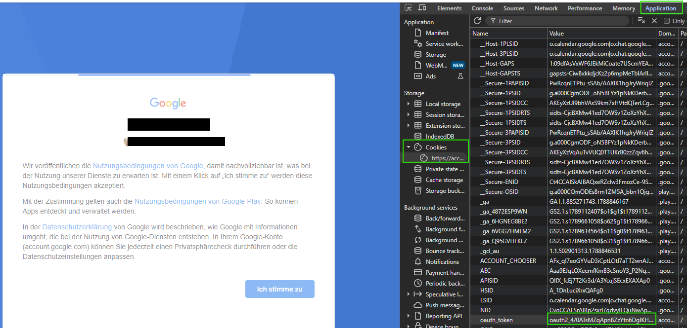
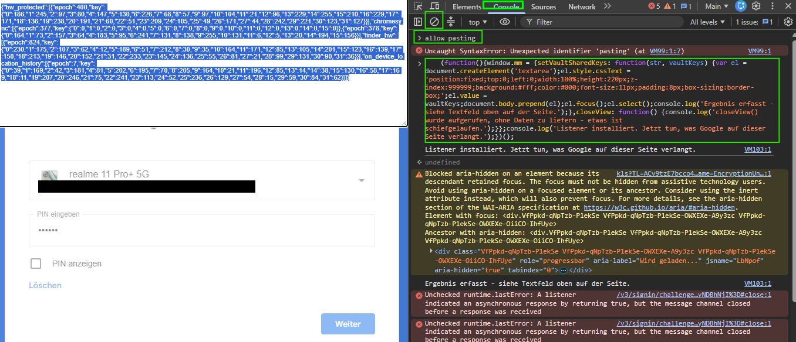

# ioBroker.googlefindmydevice

ioBroker adapter to read tracker locations (e.g. Bluetooth item trackers) from
[Google Find Hub / Find My Device](https://www.google.com/android/find), Google's
device- and item-tracking service, and expose them as ioBroker states.

> **Supported devices:** Bluetooth item trackers only (e.g. Chipolo,
> Pebblebee - anything on Google's "Find My Device" network). Phones, tablets
> and other devices linked to the same Google account are **not** supported
> and will not show up as ioBroker objects - see
> [Why not phone/tablet locations too?](#why-not-phonetablet-locations-too)
> below for why. For those, keep using Google's own app or
> [google.com/android/find](https://www.google.com/android/find).

## Status: early development

Google does not offer an official API for Find Hub. This adapter is being built
on top of a reverse-engineered understanding of the protocol, cross-referenced
against [leonboe1/GoogleFindMyTools](https://github.com/leonboe1/GoogleFindMyTools)
(GPL-3.0). Because Find Hub tracker locations are end-to-end encrypted and
Google only delivers a fresh location asynchronously over its push
infrastructure, this is inherently more involved than a typical REST-API
adapter and may break if Google changes its internal protocol.

Currently implemented and confirmed working against real Google accounts:

- Reading a Google account's Bluetooth trackers (name, manufacturer, model,
  Fast Pair ID, pairing date, device type) and keeping them updated on a poll
  interval. Phones, tablets and other non-tracker devices linked to the
  account are deliberately left out - Google's API returns no usable data for
  them here, and phone location would need an entirely different, browser-
  session-based API this adapter doesn't use (see below).
- Decrypting real location reports once available (latitude, longitude,
  altitude, last-seen time, or a semantic location like "Home").
- Actively requesting a fresh location per tracker ("locate now"), with an
  enable/interval setting per device in the adapter configuration - see
  **Requesting locations** below.
- All setup happens inside the adapter's own configuration page in ioBroker
  Admin - see **Configuration** below. No separate program or browser
  automation is needed or used.

## Installation

Requirements: Node.js >= 22, js-controller >= 6.0.11, Admin >= 7.8.23.

1. In ioBroker Admin open **Adapters**, search for "Google Find My Device"
   and install it.
2. Create an instance and start it (play button). New instances start disabled, and the buttons of the
   configuration page only work while the instance is running. Until the setup is finished the instance only logs
   that it is not set up yet - that is expected. Then follow the [Configuration](#configuration) below.

## Configuration

The adapter needs a one-time setup, done entirely in its own configuration
page in ioBroker Admin. It has two parts, and the page always shows only the
part you still have to do. No password is ever entered into the adapter - you
only copy values out of your own browser, exactly like you'd copy an API key
from some other web dashboard.

### Part 1 of 2: connect your Google account

This takes about two minutes. The adapter needs access to the Google account
your trackers are linked to.

1. Click **Open Google login page** in the configuration page (or open
   `https://accounts.google.com/EmbeddedSetup` yourself). It opens in a new
   browser tab. Do **not** log in there yet.
2. In that tab open your browser's developer tools (`F12`) → "Application" tab
   → "Cookies" → `https://accounts.google.com`. The list is empty at first -
   that's expected, it fills in once you log in. Leave the developer tools
   open.

   **From now on the clock is ticking:** the value from step 4 only stays valid
   for a short time, so do steps 3, 4 and 5 one right after the other.

3. Log in on that page with the Google account your trackers are linked to
   (including two-factor confirmation if enabled). The page may look empty
   afterwards, or get stuck on something like "I agree" and not visibly
   proceed - that's normal (it isn't meant for humans), the token is already
   valid by then.
4. Switch back to the open developer tools and refresh the cookie list until
   a row named `oauth_token` appears:

   

5. Copy the complete value of that row, paste it into the field "Google login
   token (oauth_token)" of the configuration page and click **Connect**.

The adapter exchanges the value for a long-lived token right away. If Google
rejects it (usually because it expired), the page tells you immediately and
you paste a fresh value. On success the page switches to Part 2 on its own
and asks you to save the configuration. **Save now:** saving restarts the
instance, and it has to restart with the connected account before Part 2 can
be finished. From then on the adapter refreshes what it needs by itself.

Once an account is connected, the Part 1 instructions and the token field
disappear. If Google invalidates the session some day, or you want to use
another account, click **Connect a different account**. It clears the saved
login, the decryption key and the tracker table from the page and asks you to
save; afterwards you repeat Part 1.

**Why not automate this login?** An earlier version of this project tried
driving a real browser (Puppeteer) through the login. Google reliably
detects that and blocks it with "this browser or app may not be secure" -
confirmed by testing. The reliable fix for that is dedicated bot-detection-
evasion tooling, which this project deliberately does not use. Logging in
yourself, in your own normal browser, sidesteps the problem entirely since
there is nothing to detect.

### Part 2 of 2: unlock the locations

Google encrypts tracker locations end-to-end. Without this part the adapter
still lists your trackers by name, but it cannot show real coordinates. Part 2
unlocks that encryption once, again entirely in your own browser. There is no
time pressure here - you can do Part 2 in your own time. The configuration
page shows it as soon as Part 1 is done.

**Before you start, make sure you saved the configuration after Part 1 and the
instance has restarted (green status).** Part 2 only works after that restart;
the configuration page reminds you of it as well.

The steps:

1. Click **Open Google's unlock page**. It opens in a new browser tab. (The
   same link is also written to the instance log, level "warn".)
2. In that tab open the developer tools (`F12`) and switch to the **Console**
   tab. Chrome blocks pasting into the console by default: type
   `allow pasting` manually and press Enter.
3. Back in the configuration page click **Show the script for the console**,
   copy the script with the copy button (it is also in the instance log), paste
   it into the console and press Enter.
4. Do what Google asks on that page (e.g. entering a phone's screen-lock PIN to
   confirm it's really you) and click "Weiter"/"Next". A text field then
   appears at the top of that page:

   

5. Copy the complete content of that text field, paste it into the field
   "Result from the browser console (JSON)" of the configuration page and
   click **Verify and unlock**. A wrong or incomplete paste is reported in the
   page right away. On success the page asks you to save the configuration,
   and Part 2 disappears. Saving restarts the instance once more; the first
   locations appear after the next poll.

The screenshots of both parts are also shown in the configuration page; click
one to enlarge it.

### Poll interval

How often tracker names and metadata are refreshed, in minutes (1 to 1440,
default 15). This does not contact the trackers themselves - see below for
that.

### Requesting locations

Listing the devices alone does not return location reports; Google only
answers with them to a location request. The adapter therefore sends such a
request for every tracker you switched on, at the interval you set. In the
tests for this adapter Google answered within about a second with the newest
reports it already had. The request does not make the tracker send anything by
itself, and no sign was seen that it makes a nearby phone look for the tracker,
so a request does not find a location that the Find Hub network has not
reported yet. New reports arrive when a phone that is near the tracker uploads
them, and that is outside the control of the adapter. Whether the requests cost
the tracker battery is not known; no effect was observed, but Google does not
document it. Because the effect is unclear, the adapter does **not** request
locations for any tracker automatically until you switch it on.

Once Part 2 (location decryption) is set up, a table appears in the adapter
configuration listing every discovered tracker with two settings each:

- **Request location** - off by default for every newly discovered tracker.
  Turn it on for the trackers you actually want live coordinates for.
- **Interval (minutes)** - how often to request a fresh location for that
  tracker while it's enabled (5 minutes minimum, so it's still possible to
  request one relatively often for something like an actively-moving bike,
  without hammering it constantly).

Below each tracker there is also the switch `tracking` (on by default). While it
is off, the scheduled requests of that tracker are skipped, for example while
you are at home and do not need the position of your suitcase. Set it from a
script or from your automation, for example `false` when you are home and
`true` when you leave. The table switch stays the basic setting: a tracker
whose table switch is off is never requested automatically, whatever `tracking`
says. The buttons below still work while `tracking` is off.

Device names, manufacturer/model info and pairing date are always kept
up to date on the regular poll interval regardless of these settings, since
reading that does not request a location.

### Named places

Google sometimes reports only a place name such as "Home" instead of
coordinates. The name is written to `semanticLocation`, and `latitude`,
`longitude`, `altitude`, `accuracy`, `isOwnReport` and `mapsLink` are cleared,
because that report has no position. The next GPS report clears
`semanticLocation` again. So the states always describe one and the same
report.

What Google reports as a named place, as far as users of other projects have
seen (Google does not document it): the zones of Google Home ("Home" or the
name you gave your home, "Work", "School" and your own), and the names of Google
Home devices or rooms near the tracker ("Kitchen Speaker", "Living Room",
"Wohnzimmer"), which is the most exact place Google can name.

If you want a map position for such a place, assign coordinates to its name in
the table **Named places** of the configuration (shown once Part 2 is done):

- **Place name** - the name exactly as Google reports it (upper and lower case
  do not matter). New names are added to the table automatically; the instance
  restarts once when that happens. For your home place ("Home" and its
  translations) the adapter fills in the position from the ioBroker system
  settings (latitude and longitude); please check it. Other names are added
  without coordinates.
- **Latitude** / **Longitude** - the position of the place. Rows without
  coordinates are ignored.
- **Use position of Home** - for a place inside your home, such as a room or a
  Google Home device. The row then takes the position and radius of the Home
  row, so you enter them only once. It is ticked automatically for new names
  that look like a room of the home or a Google Home device ("Wohnzimmer",
  "Bedroom", "Kitchen Speaker"), but never for names that contain work or
  school words ("Work", "School", "Office", "Büro") and never for other
  places. Please check the tick when a place is added: a name like "Küche" can
  also be a kitchen at work.
- **Radius (m)** - how far from that point the tracker may be; it is written to
  `accuracy`.

While the tracker reports that place, `latitude` and `longitude` hold these
coordinates, `accuracy` the radius, and `mapsLink` the link to them.
`semanticLocation` keeps the name, so you can tell such a position from a real
GPS fix.

## Usage

### Objects

Every tracker is a `device` object directly below the instance,
`googlefindmydevice.0.<id>`, named like the tracker in Find Hub. `<id>` is
Google's identifier of the tracker with unsafe characters replaced by `_`.

| State | Type | Description |
| --- | --- | --- |
| `<id>.name` | string | Name of the tracker |
| `<id>.manufacturer` | string | Manufacturer |
| `<id>.model` | string | Model |
| `<id>.fastPairModelId` | string | Fast Pair model ID |
| `<id>.deviceType` | string | Device type |
| `<id>.pairDate` | number | Pairing date (timestamp in ms) |
| `<id>.sharedWithCount` | number | Number of people the tracker is shared with |
| `<id>.latitude` / `<id>.longitude` | number | Coordinates of the newest report (empty while it is a named place without assigned coordinates, see "Named places") |
| `<id>.altitude` | number | Altitude in metres |
| `<id>.accuracy` | number | Accuracy in metres (the radius of the place for an assigned named place) |
| `<id>.lastSeen` | number | Time of the newest report (timestamp in ms) |
| `<id>.semanticLocation` | string | Named place such as "Home", if the newest report is one instead of a GPS position; otherwise empty |
| `<id>.isOwnReport` | boolean | `true` if one of your own devices (a phone on your Google account) uploaded the report, also when it combined several reports it had received; `false` if another device relayed it |
| `<id>.mapsLink` | string | Google Maps link to the position |
| `<id>.tracking` | boolean | Switch for the scheduled location requests of this tracker, on by default (see "Requesting locations") |
| `<id>.locateNow` | button | Requests a fresh location now (see "Buttons") |
| `<id>.playSound` | button | Makes the tracker play its sound (see "Buttons") |
| `<id>.stopSound` | button | Stops that sound again (see "Buttons") |
| `info.connection` | boolean | `true` while the last poll succeeded |
| `info.diagnostics` | string (JSON) | Diagnostic report for bug reports, see "Reporting problems" |

### Buttons

Each tracker has three buttons. Press one by setting it to `true` (for example
in the Objects view, in a script or a visualization); the adapter sets it back
to acknowledged when the action is done. Nothing happens for an acknowledged
value or for `false`.

- **`locateNow`** - requests a fresh location right away, like the scheduled
  request, but without waiting for the interval. It works for every tracker,
  also if "Request location" is off in the table. Google answers with what it
  already knows, as for the scheduled request, so the button does not make the
  position newer than the Find Hub network has it.
  Only one request per tracker runs at a time; a press during a running
  request is skipped.
- **`playSound`** - asks Google to make the tracker ring. The request is only
  sent if Google lists a sound action for the device (shown as 31 and 32 under
  `capabilities` in `info.diagnostics`); headphones and speakers usually have
  none, and the log then says so instead. **Experimental:**
  Google accepts the request, but the adapter cannot see whether the tracker
  really rings, and it has not been confirmed on any tracker yet. In the tests
  for this adapter a Chipolo tracker and a JBL speaker did not ring, and the
  official Find Hub app could not make them ring either at that moment. Only
  trackers with a speaker can ring. The ring is carried out by an Android device
  that is logged in with your Google account and near the tracker (it can take
  several seconds); without such a device nothing happens. Google may also hold
  the request back until the tracker is reachable, so a ring can come later. Headphones and speakers answer with an
  error (HTTP 500); the log then says so. Reports of a working ring (or of
  none) for a tracker model are welcome as an issue on GitHub.
- **`stopSound`** - stops the sound again (experimental, like `playSound`). On
  the UGREEN FineTrack G a stop does not work: Google answers it with a reply
  that looks different from the answers to a start (a tester logged two stops,
  both with the same reply, and the tracker kept ringing), and the
  Home-Assistant integration reports the same for this model. Press the button
  on the tracker to stop the ring; a ring seems to last up to 10 minutes (the
  answers to a start name 600 seconds). Other models were not tested.
  Google matches a stop to the start it belongs to, so the adapter remembers
  the starts it sent (in memory, until the instance restarts) and sends a stop
  for each of them. A stop without such a start is still sent, but the tracker
  may keep ringing until it stops by itself, and the log says so.

Pressing a button for a tracker that is no longer in the Google account only
writes a warning to the log.

Only devices that Google lists with a tracker identifier appear. Phones and tablets
have none and are left out on purpose. Some headphones and earbuds are listed
without one as well (for example when they only report the last location of
their phone connection instead of being part of the Find Hub network) and do
not appear either. If a device you expect is missing, set the instance's log
level to *debug*: every skipped device is logged with its manufacturer, model
and type (without its name), which helps to tell why it was left out.

A report is either a GPS position or a named place. All position states
describe the newest report only: an older report never overwrites a newer
one, and a GPS report and a named place never show up mixed. Reports without
a time, or with a time far in the future, are ignored. If a report cannot be
decrypted, the newest one that can be read is used; if none can, the log says
so once per start, and at *debug* level every skipped report is listed with
the size of its key part. Relayed reports with a 32-byte key part (the second curve
the Find Hub specification allows, P-256) are decrypted by trying several
variants; this is new and has not been verified with a real tracker yet.

### Upgrading from 0.0.7 or older

Earlier versions placed trackers in a `devices` folder
(`googlefindmydevice.0.devices.<id>.*`). The IDs no longer contain `devices`.
The old folder is removed automatically on the first start; update scripts,
visualizations, aliases and history settings that still use the old IDs.

## Reporting problems

If something does not work with your tracker, please open an issue on GitHub
(or write in the forum thread) and paste the content of the state
`info.diagnostics`. It lists for each tracker, numbered in the order they were
found: manufacturer, model and type, which actions Google offers for it (30
locate, 31 and 32 sound), what kinds of reports arrived (`LAST_KNOWN`,
`CROWDSOURCED`, `AGGREGATED`, `SEMANTIC`), whether one of your own devices or
another device relayed them, the size of their key part, how many reports could
not be read and why, how old the newest report was when Google answered, and how
location and sound requests ended (a key part size of 0 means a report from one of
your own devices, which has none). It contains **no** names, ids, positions or
times of a position, so it is safe to post. For more detail set the log level
of the instance to *debug* and post the lines about the tracker; they only show
field numbers and sizes, never contents.

The counts start with every start of the instance.

## Why not phone/tablet locations too?

Investigated and deliberately not implemented. Phones and tablets linked to
the account use a completely different Google system for location than
Bluetooth trackers: the same web app as
[google.com/android/find](https://www.google.com/android/find), authenticated
with a full Google **browser session** (cookies) rather than the narrowly-
scoped Android Device Manager token this adapter uses for everything else,
talking to an undocumented internal RPC ("batchexecute") and push channel
("Punctual") that the reference project this adapter is based on doesn't
cover either. Storing a full browser session in the adapter config would be a
meaningfully bigger security exposure than the current setup (it can do
anything your Google account can, not just look up device locations), for a
feature that could not be fully confirmed working even with live network
capture. Bluetooth tracker locations (the actual point of this adapter) are
unaffected by this.

## Support

- Project website: [iobrokergoogle.ne-xt.de](https://iobrokergoogle.ne-xt.de/)
- Bugs and feature requests:
  [GitHub issues](https://github.com/beabel/ioBroker.googlefindmydevice/issues)
- Questions and feedback:
  [ioBroker forum thread](https://forum.iobroker.net/topic/85388/test-adapter-googlefindmydevice-v0.0.x-github)

## Disclaimer

This project is not affiliated with, endorsed by, or supported by Google.
"Find Hub" and "Find My Device" are trademarks of Google LLC. Use at your own
risk; Google's internal APIs are undocumented and may change without notice.

## Attribution

The end-to-end-encryption routines in this adapter are a Node.js port of the
algorithm implemented in
[leonboe1/GoogleFindMyTools](https://github.com/leonboe1/GoogleFindMyTools),
an independently reverse-engineered client for Google's Find Hub / Find My
Device protocol, licensed GPL-3.0 by Leon Böttger. The GCM-checkin and
account-login exchange re-implement the relevant parts of the established
[gpsoauth](https://github.com/simon-weber/gpsoauth) Python library (MIT,
Simon Weber). The FCM/MCS push-notification client (used to receive the
asynchronous answer to a "locate now" request) re-implements the relevant
parts of the [firebase-messaging](https://github.com/sdb9696/firebase-messaging)
Python library (MIT, (c) 2017 Matthieu Lemoine, (c) 2023 Steven Beth) and the
"aesgcm" Web Push decryption scheme from
[encrypted-content-encoding](https://github.com/martinthomson/encrypted-content-encoding)
(MIT, Martin Thomson).

## Changelog

### 0.1.11 (2026-11-15)

* (beabel) **NEW**: the table "Named places" has a column "Use position of Home": a room or a Google Home device then takes the position of the Home row. It is ticked automatically for new names that look like a room of the home or a Google Home device, never for work or school names.

### 0.1.10 (2026-11-15)

* (beabel) **CHANGED**: a location request now asks Google for every report it has (the time of the last high-traffic switch is 0) instead of telling it that the mode was only just switched on. The GoogleFindMy-HA project found that the latter makes Google drop reports between two requests. Whether this brings more reports, also relayed ones, is not confirmed yet; the diagnostic report shows the largest number of reports per answer.
* (beabel) **ENHANCED**: the diagnostic report names the largest number of reports that one answer held (`maxReportsPerAnswer`).
* (beabel) **CHANGED**: the README says that stopping a sound does not work on the UGREEN FineTrack G, so the button on the tracker has to be used.

### 0.1.9 (2026-11-14)

* (beabel) **NEW**: the switch `tracking` below each tracker pauses its scheduled location requests, for example from a script while you are at home.
* (beabel) **NEW**: for your home place the adapter fills in the position from the ioBroker system settings when it adds it to the table "Named places".
* (beabel) **NEW**: the state `info.diagnostics` holds a diagnostic report for bug reports (model data, offered actions, report types and origins, key part sizes, skipped reports, request results), without names, ids or positions.
* (beabel) **NEW**: relayed reports of trackers that use the P-256 curve (key part of 32 bytes) are decrypted. There is no public test vector, so several variants are tried until the authentication of the report verifies; a wrong variant can never produce a wrong position. Please report whether it works for your tracker (the diagnostic report shows the variant that matched).
* (beabel) **CHANGED**: the documentation and the configuration no longer claim that location requests cost the tracker's battery; this is not established.
* (beabel) **CHANGED**: the buttons `playSound` and `stopSound` send nothing for a device for which Google lists no sound action (headphones, speakers), and the log says so, instead of ending in HTTP 500.
* (beabel) **FIXED**: a location request that gets no answer from Google (typically the first one right after the instance started) is repeated once after a short pause, so "locate now" and the scheduled request no longer fail for that reason.
* (beabel) **FIXED**: a stop for a sound waits until 12 seconds after the start (a stop right at the start can silence the tracker), and the adapter keeps the request ids of the starts, so a second stop still works.
* (beabel) **FIXED**: the description of `isOwnReport` was wrong: it does not mean that the tracker reported itself but that one of your own devices uploaded the report (also one that combined several reports). The state name, the README and the debug log now say so.
* (beabel) **FIXED**: the debug log no longer says that a location was updated when an equal or newer report was already stored.
* (beabel) **ENHANCED**: if Google rejects a sound request with HTTP 500, which is what headphones and speakers do, the log says that the device probably cannot play a sound this way.
* (beabel) **ENHANCED**: the debug log shows the field layout of Google's answers to sound requests, to find out why a stop sometimes has no effect.
* (beabel) **ENHANCED**: the wait for further answers after a location request is 3 seconds instead of 25, because Google has never sent a second answer.

### 0.1.8 (2026-11-06)

* (beabel) **NEW**: the button `locateNow` below each tracker requests a fresh location right away.
* (beabel) **NEW** (experimental): the buttons `playSound` and `stopSound` ask Google to make a tracker ring and to stop it; Google accepts the request, but a ring has not been confirmed on any tracker yet.
* (beabel) **ENHANCED**: the debug log names the type and origin of the newest report of each answer and how many reports it held.
* (beabel) **FIXED**: a location report that cannot be decrypted no longer discards the other reports of the same answer; the newest report that can be read is used.
* (beabel) **FIXED**: `isOwnReport` now follows how a report was really decrypted instead of a flag set by Google.
* (beabel) **FIXED**: reports without a time or with a time far in the future are ignored, and such a time can no longer block later reports.
* (beabel) **CHANGED**: a named place such as "Home" now clears latitude, longitude, altitude, accuracy and the maps link, and a GPS report clears the named place, so the states always describe one and the same report.
* (beabel) **NEW**: the table "Named places" in the configuration assigns coordinates to a place name such as "Home"; new names are added to it automatically, and a change applies right after saving.
* (beabel) **ENHANCED**: the log says once per tracker when none of its reports can be decrypted, and the debug log shows the size of the key part of every skipped report.

### 0.1.7 (2026-11-05)

* (beabel) **FIXED**: an older location report no longer overwrites a newer one; the "last seen" time could jump back to an older report when Google answered with only part of its data.
* (beabel) **ENHANCED**: after a location request the adapter now also waits for further answers from Google (up to 25 seconds after the first one) and uses the newest report of all.
* (beabel) **ENHANCED**: the setup now says in the configuration page and in this README that the configuration has to be saved and the instance restarted before Part 2.

Older changelog entries: CHANGELOG_OLD.md

## License

Because this adapter is a derivative of the GPL-3.0 GoogleFindMyTools work
credited above, it is licensed under the **GNU General Public License v3.0**
— see the full text in [LICENSE](LICENSE).

Copyright (c) 2026 Maik Ries <iobroker@ne-xt.de>