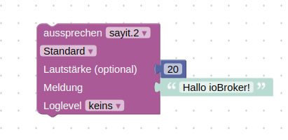
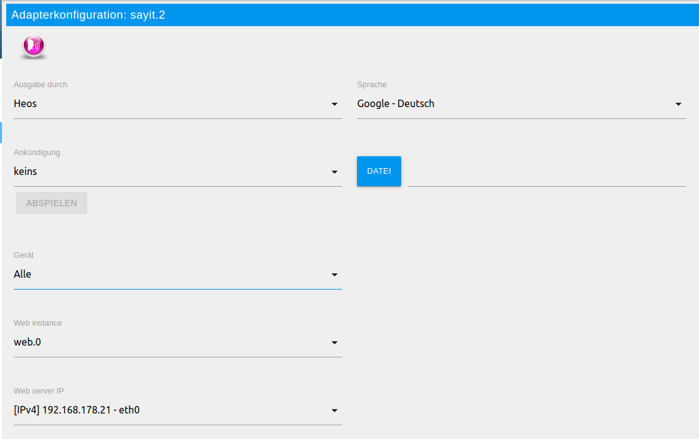
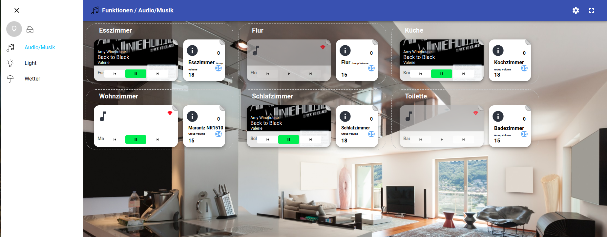
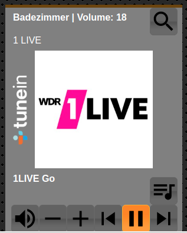
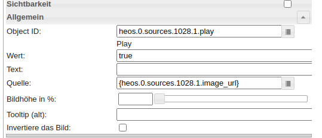
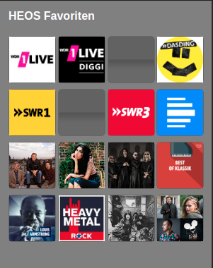
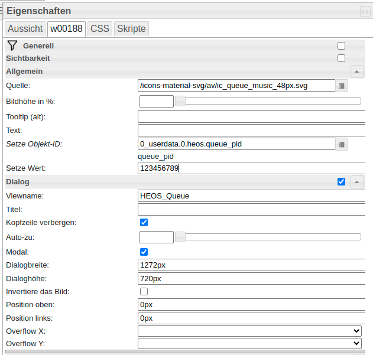
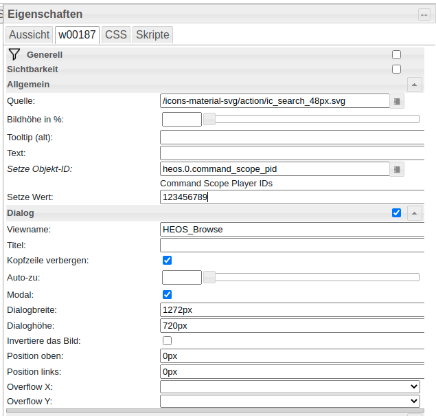
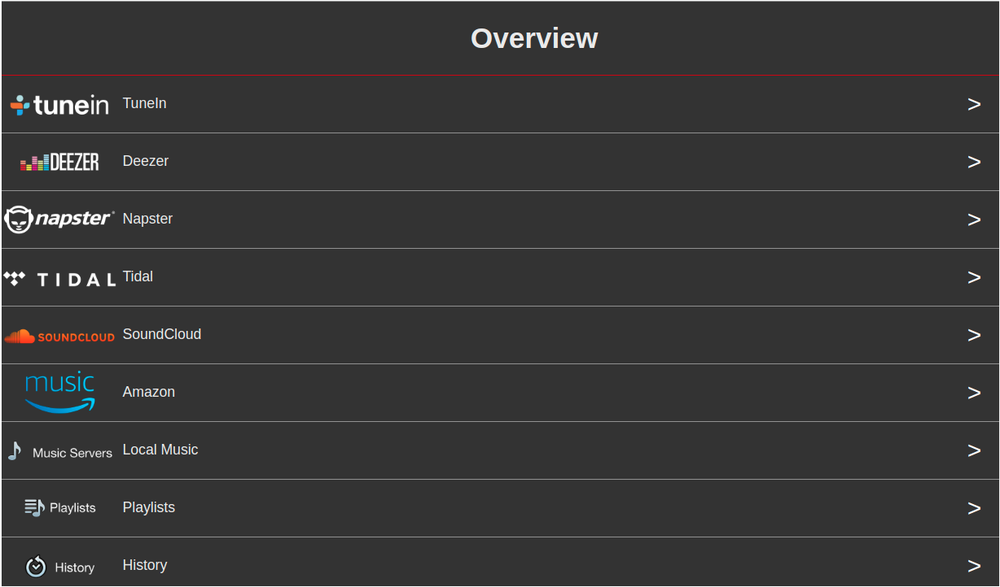
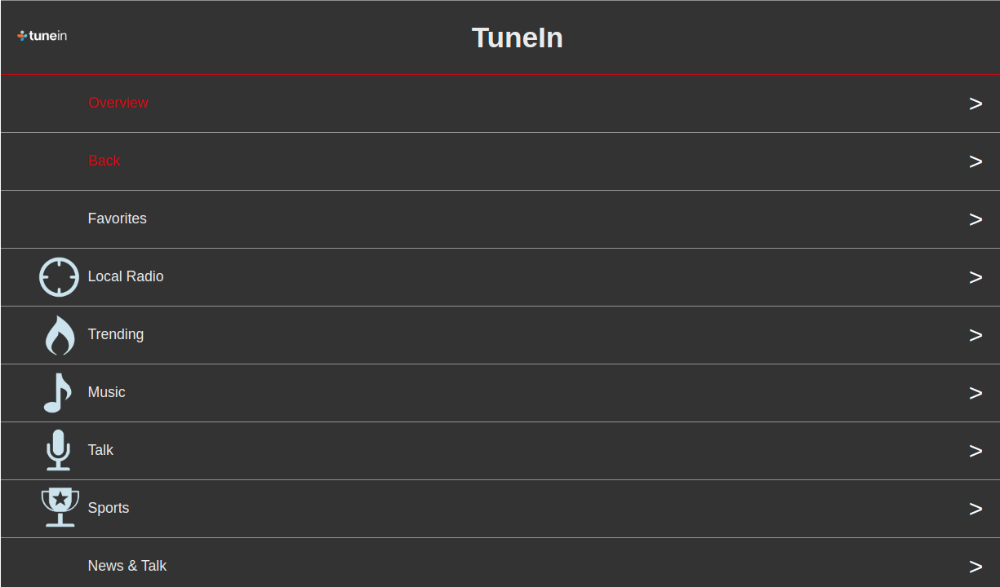

# ioBroker.heos

[](https://www.npmjs.com/package/iobroker.heos)
[](https://www.npmjs.com/package/iobroker.heos)


[](https://snyk.io/test/github/withstu/ioBroker.heos)

[](https://nodei.co/npm/iobroker.heos/)

Control your HEOS speakers and receivers (Denon, Marantz) from ioBroker: play, pause, volume, mute, groups, favorites, playlists and what is currently playing.

## Quick start

1. **Install** the adapter in the ioBroker Admin (Adapters → search for "heos") and create an instance.
2. **Optional: enter your HEOS account** (tab "Account settings"). It is only needed for your favorites (presets) and playlists. Everything else works without it.
3. **Save and start.** The adapter finds your HEOS devices in the network by itself. After a few seconds each device appears under `heos.0.players.<player id>`.
4. **Use it.** The most important states of every player:

| State | What it does |
|---|---|
| `play`, `pause`, `stop`, `next`, `prev` | Buttons for playback |
| `volume` | Volume 0–100 |
| `muted` | Mute on/off |
| `current_title`, `current_artist`, `current_image_url` | What is playing right now |
| `power` | Device on/standby (only on supported devices) |

**Quick Select** (only on some models, e.g. Denon Home, Denon Home Sound Bar 550, HEOS Bar, AV receivers): `quick_select_supported` shows if a player supports it. If yes, the folder `quick_selects` contains one entry per Quick Select with its name from the HEOS app, a `play` button to recall it and a `save` button to store the current state there. What is stored depends on the device (e.g. input, sound mode, volume).

**Group presets** (HEOS 3.34 or newer): groups you saved in the HEOS app appear in the folder `group_presets`, each with its name, the players, the current state (Active, Inactive, Disabled) and an `apply` button that groups the players. `group_presets_supported` shows if your HEOS system supports it.

**AV receivers (Denon, Marantz):** this adapter controls everything that runs over HEOS (streaming, groups, favorites, what is playing). For the receiver itself – inputs, zones, sound modes, channel levels – use the [Denon/Marantz adapter](https://github.com/iobroker-community-adapters/ioBroker.denon) as well. Both adapters can run at the same time.

To play your favorites, press `heos.0.sources.1028.browse` once. The adapter then creates a `play` button for every favorite under `heos.0.sources.1028`. For playlists use `heos.0.sources.1025.browse`.

### No players found?

- ioBroker and the HEOS devices must be in the **same network**. Searching uses multicast (SSDP), which is often blocked between VLANs/subnets or by a Docker bridge network.
- **ioBroker in Docker**: use network mode `host` or `macvlan`, or enter the IP address of one HEOS device in "Advanced settings → preferred IP addresses". One device is enough – it reports all others.
- The devices must accept connections on **TCP port 1255** (can be switched off in the HEOS advanced settings, `https://<device-ip>/settings/`).

## Settings explained

**Account settings**
* **Username / Password**: Your HEOS account. Only needed for favorites and playlists.

**General settings**
* **Queue settings**: What happens when you start a playlist – play now, play next, add to the end or replace the queue and play.
* **Command scope**: Which players receive a `scope/[cmd]` command (all players, all group leaders, or the player IDs in `heos.0.command_scope_pid`).
* **Volume step**: How much `volume_up` / `volume_down` change the volume.
* **Automatic playback**: Automatically plays music after a player is connected or unmuted. You can switch it off per player with the state `auto_play`.
* **Mute on regex**: Mutes the player while the song information matches the text pattern, e.g. to mute ads. Example for Spotify: `spotify:ad:|Advertisement`.
* **Reboot on failure**: Reboots a HEOS device if the adapter detects that it no longer responds properly.

**Advanced settings** – normally you do not need to change anything here.
* **Heartbeat**: How often (ms) the connection is checked and how many failed checks are allowed before reconnecting.
* **Search**: How long (ms) and how often (ms) the adapter searches for devices.
* **Reconnect / Request timeout**: Wait time before reconnecting (ms) and for an answer from the device (s).
* **Network**: UDP source port for the device search (0 = automatic), preferred IP addresses (comma separated, used if the automatic search fails) and the option to switch the automatic search off completely. **Encrypted connection**: connects via TLS on port 1265 instead of port 1255 (HEOS 3.67 or newer). Only needed if port 1255 is switched off on your devices.

The player state `ignore_broadcast_cmd` defines whether a player ignores commands sent to all players (e.g. `player/set_mute&state=on` or the `play` buttons of presets/playlists).

## Disclaimer
HEOS, DENON and Marantz are trademarks of D&M Holdings Inc.
The developers of this module are in no way endorsed by or affiliated with D&M Holdings Inc.,
or any associated subsidiaries, logos or trademarks.

## Reference
The used HEOS API (HEOS CLI) is documented here: https://rn.dmglobal.com/usmodel/HEOS_CLI_ProtocolSpecification-Version-1.24.pdf

## Advanced usage

### States and their meanings

### Command State

The HEOS player can be controlled by the different player states. To control the players in a more advanced way you can use the command state. On the one hand there is one global command state (heos.0.command) to control the whole adapter or multiple players with one command. On the other hand there is a command state per player.

#### HEOS Command State (heos.0.command)

* ```system/connect```: Try to Connect to HEOS
* ```system/disconnect```: Disconnect from HEOS
* ```system/reconnect```: Disconnect and Connect
* ```system/load_sources```: Reload sources
* ```system/reboot```: Reboot connected player
* ```system/reboot_all```: Reboot all players
* ```group/set_group?pid=<pid1>,<pid2>,...```: Set group with the list of player ids e.g. ```group/set_group?pid=12345678,12345679```.
* ```group/set_group?pid=<pid1>```: Delete existing group e.g. "group/set_group?pid=12345678"
* ```group/ungroup_all```: Delete all groups
* ```group/group_all```: Group all player in one group
* ```player/[cmd]```: Send the command to all players. e.g. player/set_mute&state=on 
* ```leader/[cmd]```: Send the command to all leading players. e.g. leader/set_mute&state=on
* ```scope/[cmd]```: Send the command to the configured scope all players, leading players or comma separated player pids in scope_pids
* ```...```: All other commands are tried to send to HEOS (Look in the HEOS API PDF for details)

#### Player Command State (heos.0.players.123456789.command)

Note: Multiple commands are possible, if they are separated with the pipe e.g. set_volume&level=20|play_preset&preset=1

* ```set_volume?level=0|1|..|100```: Set the player volume 
* ```set_play_state?state=play|pause|stop```: Set the player state
* ```set_play_mode?repeat=on_all|on_one|off&shuffle=on|off```: Set Repeat and Shuffle mode
* ```set_mute?state=on|off```: Mute player
* ```volume_down?step=1..10```: Lower volume
* ```volume_up?step=1..10```: Raise volume
* ```play_next```: Play next
* ```play_previous```: Play previous
* ```play_preset?preset=1|2|..|n```: Play preset n
* ```play_stream?url=url_path```: Play URL-Stream
* ```add_to_queue?sid=1025&aid=4&cid=[CID]```: Play playlist with [CID] on player (aid: 1 – play now; 2 – play next; 3 – add to end; 4 – replace and play)

### Presets & Playlists
Each source e.g. preset/favorite or playlists are located in the sources state folder (```heos.0.sources```). You can find your presets/favorites in the subfolder with the ID 1028 and the playlists in the subfolder with the ID 1025. Initially the adapter don't create your individual presets and playlists, because you have to trigger an update by setting the following states to true:
- Presets/Favorites: ```heos.0.sources.1028.browse```
- Playlists: ```heos.0.sources.1025.browse```
After that the adapter creates the states for the presets or playlists so that you easily can play the preset on all players.

### Image color extraction
With version 1.7.6 the prominent colors of the song cover are extracted and saved to three new player states:
* **current_image_color_palette**: Prominent colors selected by node-vibrant.
* **current_image_color_background**: Color with the biggest population in the image. Can be used as background color for player controls in VIS.
* **current_image_color_foreground**: Color with the second biggest population in the image and a good read contrast to the background color. Can be used as text color for player controls in VIS.

## Seek
The seek functionality is not working on all sources. Spotify and Amazon Music are supporting seeking.

## SayIt
[SayIt Adapter](https://github.com/ioBroker/ioBroker.sayit) is supported.




## Material UI
[Material UI Adapter](https://github.com/ioBroker/ioBroker.material) is supported.



## VIS

### Installation
* Create following string states:
    * 0_userdata.0.heos.queue_pid
    * 0_userdata.0.heos.queue_html
    * 0_userdata.0.heos.browse_result_html

### Player View
* Open the file: [player_view.json](https://github.com/withstu/ioBroker.heos/blob/main/docs/vis/views/player_view.json)
* Replace 123456789 with the player pid
* Import view into VIS



### Presets
* Click button ```heos.0.sources.1028.browse``` to load presets
* Open the file: [presets_view.json](https://github.com/withstu/ioBroker.heos/blob/main/docs/vis/views/presets_view.json)
* Import view into VIS




### Queue
* Queue Widget: [queue_player_widget.json](https://github.com/withstu/ioBroker.heos/blob/main/docs/vis/views/queue_player_widget.json)
* Queue View: [queue_view.json](https://github.com/withstu/ioBroker.heos/blob/main/docs/vis/views/queue_view.json)
* Queue HTML Generation Script: [queue.js](https://github.com/withstu/ioBroker.heos/blob/main/docs/vis/scripts/queue.js)



### Browse Sources
* Browse Widget: [browse_player_widget.json](https://github.com/withstu/ioBroker.heos/blob/main/docs/vis/views/browse_player_widget.json)
* Browse View: [browse_view.json](https://github.com/withstu/ioBroker.heos/blob/main/docs/vis/views/browse_view.json)
* Browse HTML Generation Script: [browse.js](https://github.com/withstu/ioBroker.heos/blob/main/docs/vis/scripts/browse.js)





Alternative you can use the script from Uhula: https://forum.iobroker.net/post/498779

## Changelog
<!--
	Placeholder for the next version (at the beginning of the line):
	### **WORK IN PROGRESS**
-->
### 3.3.0 (2026-11-27)
* (Schimi1983) Player timers use the adapter timer functions, so they are cleaned up reliably when the adapter stops
* (Schimi1983) Fix warnings "State ...quick_selects.<n>.connected has no existing object" on start/stop
* (Schimi1983) Player objects are only written when they are new or changed (less load on start and on player changes, history/smartName settings are kept)
* (withstu) Update dependencies
* (Schimi1983) README: quick start, troubleshooting and plain-language explanation of all settings; removed dead badge, updated API link to spec v1.24
* (Schimi1983) Settings: the heartbeat interval field was labelled "Volume step"
* (Schimi1983) Fix state metadata: buttons are write-only, `volume_lock` uses role `switch`, `connected_ip` uses role `info.ip`, `group_volume` gets range 0-100, valid time units
* (Schimi1983) Remove roles from folder objects, set `dataSource` to `push`, translate the heartbeat header in the settings
* (Schimi1983) New player state `update_available`: shows if a firmware update is available (checked on connect and once a day)
* (Schimi1983) README: hint to the Denon/Marantz adapter for receiver functions (inputs, zones, sound modes)
* (cavernerg) fix: do not share one array between preferred and next connect IPs
* (cavernerg) fix: refill connect list when SSDP discovery is disabled
* (cavernerg) fix: abandon startPlayers when the connection changed meanwhile
* (Schimi1983) Quick Select: new player state `quick_select_supported` and folder `quick_selects` with name, `play` and `save` button per Quick Select (only on supported devices)
* (Schimi1983) Group presets: new folder `group_presets` with name, players, state and `apply` button per preset from the HEOS app, plus indicator `group_presets_supported`
* (Schimi1983) New option "Encrypted connection" (TLS, port 1265) in the advanced settings, for HEOS 3.67 or newer

### 3.2.4 (2026-10-04)
* (withstu) Update dependencies
* (withstu) Fix #549

### 3.2.3 (2026-09-27)
* (withstu) Fix cover colors
* (withstu) Update dependencies

### 3.2.2 (2026-08-19)
* (withstu) Fix repository checker findings

### 3.2.1 (2026-08-19)
* (withstu) Package update
* (withstu) Improve number casting

## License
MIT License

Copyright (c) 2025-2026 withstu <withstu@gmx.de>

derived from https://forum.iobroker.net/topic/10420/vorlage-denon-heos-script by Uwe Uhula
TTS derived from https://github.com/ioBroker/ioBroker.sonos

Permission is hereby granted, free of charge, to any person obtaining a copy
of this software and associated documentation files (the "Software"), to deal
in the Software without restriction, including without limitation the rights
to use, copy, modify, merge, publish, distribute, sublicense, and/or sell
copies of the Software, and to permit persons to whom the Software is
furnished to do so, subject to the following conditions:

The above copyright notice and this permission notice shall be included in all
copies or substantial portions of the Software.

THE SOFTWARE IS PROVIDED "AS IS", WITHOUT WARRANTY OF ANY KIND, EXPRESS OR
IMPLIED, INCLUDING BUT NOT LIMITED TO THE WARRANTIES OF MERCHANTABILITY,
FITNESS FOR A PARTICULAR PURPOSE AND NONINFRINGEMENT. IN NO EVENT SHALL THE
AUTHORS OR COPYRIGHT HOLDERS BE LIABLE FOR ANY CLAIM, DAMAGES OR OTHER
LIABILITY, WHETHER IN AN ACTION OF CONTRACT, TORT OR OTHERWISE, ARISING FROM,
OUT OF OR IN CONNECTION WITH THE SOFTWARE OR THE USE OR OTHER DEALINGS IN THE
SOFTWARE.