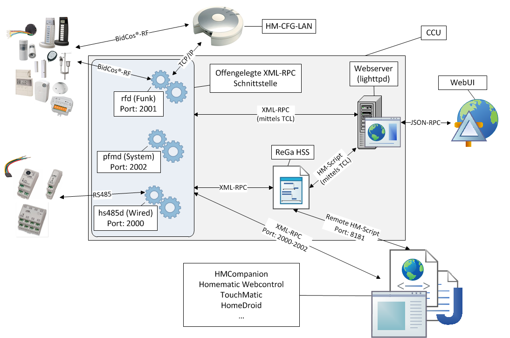
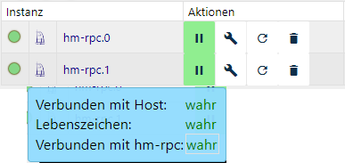

# ioBroker HomeMatic RPC Adapter


[](https://www.npmjs.com/package/iobroker.hm-rpc)
[](https://www.npmjs.com/package/iobroker.hm-rpc)

[](https://nodei.co/npm/iobroker.hm-rpc/)

This adapter connects HomeMatic interface processes (BidCos services, Homegear and CUxD) to ioBroker.
The communication uses XML-RPC or BIN-RPC.

**This adapter uses Sentry libraries to automatically report exceptions and code errors to the developers.** It also reports new device schemas.
For more details and for information how to disable the error reporting see [Sentry-Plugin Documentation](https://github.com/ioBroker/plugin-sentry#plugin-sentry) and the chapter [What is Sentry.io](#what-is-sentryio).

## What is Homematic?

> Homematic is the smart home system of eQ-3. It allows the comprehensive control of many different functions in a house or in a flat. These functions can be combined in simple scenarios and in complex scenarios.

> The product range contains devices for light control, roller shutter control and heating control, hazard detectors, safety sensors and devices for weather measurement. The radio communication makes it easy to add devices to an existing building. In new buildings, wired bus components can be used.

Source: [Homepage of the manufacturer eQ-3](https://www.eq-3.de/produkte/homematic.html)

## Homematic components in ioBroker

Two adapters are required to manage and to control Homematic components with ioBroker:

### 1. Homematic ReGaHss

This adapter connects to the Homematic logic layer "ReGaHSS" (**Re**sidential **Ga**teway).
It synchronizes the device names, the system variables, the rooms, the functions and the programs between Homematic and ioBroker.

### 2. Homematic RPC

RPC means **R**emote **P**rocedure **C**all. It is a technique for the communication between processes.
This adapter connects to the communication modules of a Homematic central unit (CCU, CCU2, CCU3 and newer).
The following modules are supported:

- `rfd` for radio devices,
- `HMIP-rfd` for Homematic IP devices,
- `hs485d` for wired devices,
- `CUxD` for external components, like EnOcean or FS20 (CUxD is an additional software for the CCU),
- `CCU-Jack` for the virtual devices of [CCU-Jack](https://github.com/mdzio/ccu-jack) (an add-on for the CCU),
- `Homegear` as a replacement for a CCU.

This diagram shows the structure and the communication interfaces:



Source: [wikimatic.de](http://www.wikimatic.de/wiki/Datei:Homematic_Aufbau.png)

## How the adapter works

One instance of the adapter is responsible for exactly one communication module (`rfd`, `hs485d` and so on).
If you want to use several modules at the same time, you must create a separate instance for every module.

The adapter communicates with the module either via BIN-RPC or via XML-RPC.
The communication uses an event interface, so the correct addresses are important.
The CCU sends the events to the adapter automatically, and a cyclic polling is not necessary.

Additionally, the adapter checks the connection to the CCU in a fixed interval.

If you teach in new devices on the CCU, you must enable the option "Synchronize objects (once)" and restart the adapter.
Only then the information about the new Homematic devices is transferred to the adapter.

## Configuration

### Main settings

#### HomeMatic Address

The IP address of the CCU, or of the host on which the BidCos service runs.

#### HomeMatic Port

The port depends on the selected communication module.
The adapter enters the port automatically as soon as you select the daemon.
Change the port only if your ports differ from the standard ports.

The following ports are used by default:

| Daemon          | Communication module   | Standard port             | HTTPS port    |
|-----------------|------------------------|---------------------------|---------------|
| HomeMatic IP    | HMIP-rfd               | 2010                      | 42010         |
| rfd             | rfd (radio devices)    | 2001                      | 42001         |
| Virtual Devices | virtual devices        | 9292                      | 49292         |
| hs485d          | hs485d (wired devices) | 2000                      | 42000         |
| CUxD            | CUxD                   | 8701                      | not supported |
| Homegear        | Homegear               | as configured in Homegear | not supported |
| CCU-Jack        | CCU-Jack               | 2121                      | 2122          |
| openccu-lite    | lite-rpc of the system | 80 (see [openccu-lite](#openccu-lite)) | 443 |

The HTTPS ports work only with the XML-RPC protocol.

#### Adapter Address

The IP address of the host on which the adapter runs.
The CCU uses this address to connect to the adapter, so the CCU must be able to reach this address.
The entries "0.0.0.0 Listen on all IPs" and "127.0.0.1" are only for special cases, because the CCU cannot reach ioBroker at these addresses.

#### Adapter Port

The port on which the adapter waits for the connection of the CCU.
Keep the value "0", so that ioBroker selects a free port automatically.
Change this value only in special cases.

#### Daemon

A CCU supports different device types (radio, wired, Homematic IP, CUxD, CCU-Jack).
You must create a separate instance of the adapter for every type.
The daemon `openccu-lite` connects an interface of an openccu-lite system, see [openccu-lite](#openccu-lite).

#### Protocol

Two protocols are available for the communication: XML-RPC and BIN-RPC.
BIN-RPC is faster, but some devices do not support it, or they support it incorrectly.
In this case select the XML-RPC protocol.

**Note:** CUxD works only with BIN-RPC. Homematic IP, Virtual Devices and CCU-Jack work only with XML-RPC.
For these daemons the adapter uses the right protocol automatically.

#### Synchronize objects (once)

At the first start, the instance reads *all* devices from the CCU.
If you change the configuration later (rename devices, add devices or remove devices), enable this option to synchronize the configuration in ioBroker again.

The instance restarts immediately, reads all devices again and disables this option itself.

### Additional settings

#### Adapter Callback Address

Sometimes ioBroker runs behind a router. In this case the inbound address and the outbound address are different.
Enter the IP address of the router here. The router forwards the traffic to ioBroker by the port number.

If ioBroker runs in a Docker container, enter the IP address of the Docker host here.
You must also forward the adapter port (see "Adapter Port") into the container.
You can select any free port for this, for example, 12001 or 12010.

#### Check communication interval (in seconds)

The adapter sends a ping to the CCU in this interval.

#### Reconnect interval (in seconds)

The adapter waits this time before it starts the next connection attempt.

#### Don't delete devices

By default, the adapter removes a device from the object tree if it does not find this device on the CCU at the adapter start,
or if the CCU reports the device as deleted while the adapter is running.
Enable this option to keep such devices, for example if you removed a device from the CCU only temporarily.

This option also avoids a problem on the CCU side:
Homematic IP devices are sometimes not transferred correctly to ioBroker, and the CCU reports them as deleted, e.g. during a firmware update, although they still exist.
Without this option their objects are deleted, and they are created again only after a restart of the adapter.
For this reason the option is enabled automatically as soon as you select Homematic IP as daemon.

With this option enabled, delete the objects of a device that you removed from the CCU manually in the object tree.

#### Suppress interim levels of moving channels

A dimmer or a blind acknowledges a command immediately, before its ramp or movement is finished. The CCU forwards this
acknowledgement as events with the level at that moment together with `WORKING = true` (Homematic) or
`PROCESS = NOT_STABLE` (Homematic IP). The final level follows a few seconds later with the next status message
(for BidCos dimmers after `STATUSINFO_MINDELAY` + `STATUSINFO_RANDOM`, by default 2-3 s). Therefore the state jumps, e.g.
`0 → 100` (command, `ack: false`) `→ 0.5` (acknowledgement) `→ 100` (final value).

If this option is enabled, a `LEVEL` / `LEVEL_2` of a channel which has a `WORKING` or `PROCESS` data point is held back
until the flag of the same status message arrives (the CCU sends it a few milliseconds after the level, at most 300 ms
are waited). The level is dropped if the channel is still moving, otherwise it is written. The state therefore keeps the
commanded value until the final level arrives. `WORKING`, `PROCESS` and `DIRECTION` are always written, so the movement
itself can still be detected. Channels without such a flag are not affected.

#### Use https

If this option is enabled, the adapter uses HTTPS instead of HTTP.
This works only with the XML-RPC protocol.

#### Username and Password

If the option "Use https" is enabled, enter the user name and the password of a CCU user here.
Enter these credentials also if the API of the CCU requires an authentication, the adapter sends them with XML-RPC with and without HTTPS.
BIN-RPC does not support an authentication.

### openccu-lite

[openccu-lite](https://github.com/openccu-lite/openccu-lite) is a CCU firmware without ReGaHSS. Its interface processes
are reached through *lite-rpc*: the requests go over the web port of the system with a token, and the events come as a
stream the adapter opens - no callback server, no callback address, no `init`, so the adapter can run behind a router or
in a Docker container without any port forwarding.

Select the daemon **openccu-lite** and enter the address of the system in "HomeMatic Address" (the port follows the
"Use https" option: 443 or 80). Then:

- **Interface**: the interface of the system this instance connects (`HmIP-RF`, `BidCos-RF`, `BidCos-Wired`,
  `VirtualDevices`). As with a CCU, one instance connects one interface; once the instance is paired, the list shows the
  interfaces the system runs.
- **Pair**: the instance must be running. Press the button: a six-digit code appears below it, together with a link to
  the Status page of the system. Approve the request there (as one of the system's administrators, with a password or a
  passkey) - the code on the Status page must match. The token and the fingerprint of the system's certificate are then
  stored in the instance configuration by themselves; save the configuration and the instance restarts with them. A
  rejected or expired request, a wrong address and a system without pairing are reported in the dialog.
  Each instance pairs for a token of its own (a system allows a few event streams per token).
- **Token** and **Certificate fingerprint** are filled by the pairing. An API token created on the system can be entered
  by hand as well; the fingerprint pins the certificate of the system (leave it empty if the certificate is trusted by
  Node.js, or the system is reached over HTTP).
- **Take names, rooms and functions from the system** (default on): the devices, channels and states are named as on
  the system (`<channel name>.<DATAPOINT>` for the states, as hm-rega names them), and the rooms and functions of the
  system fill `enum.rooms` and `enum.functions` - live, whenever a name or a room changes on the system. The enums get
  the ids hm-rega gives the rooms and functions of a CCU, so scripts and visualizations keep working after a move from a
  CCU with hm-rega: the name as it is, only a dot (and a character an object id cannot hold) becomes `_` (room
  "Living Room" → `enum.rooms.Living Room`). An enum that exists with that id - the one hm-rega made - is carried on:
  its name, icon and the members of other adapters stay. The CCU's own rooms and functions that hm-rega named by their
  key (`enum.rooms.LivingRoom`, `enum.functions.Light`, …) are taken for the rooms openccu-lite named "Wohnzimmer",
  "Licht", … when no enum of that name exists. A room tree is flattened: every node becomes an enum of its own, a
  nested one named by the names along its path (`EG` / `Bad` → `enum.rooms.EG_Bad`), and a channel is a member of its
  innermost room only. A rename on the system gives a new enum, as with hm-rega. The adapter manages only the members
  of its own instance, and only in the enums it manages (the ones of the system's rooms and functions, and the ones it
  created): rooms and functions made in ioBroker keep what was put into them. An enum the adapter created is removed
  when nothing is left in it; when another adapter still has members in it, it stays and the log names it once, so it
  can be deleted by hand. Without this option the objects keep the address as name, as with a CCU.

The devices are synchronized at every start of the instance (the system sends its device list with the stream), so
"Synchronize objects (once)" is not needed on openccu-lite. "Don't delete devices" works as with a CCU. The values the
system holds are written into the states when the instance connects, so the states are current before the first event.
The settings "Adapter Address", "Adapter Port", "Protocol", "Adapter Callback Address", "Check communication interval",
"Reconnect interval", "Username" and "Password" do not apply and are hidden.

### Device manager

The tab "Device manager" shows all devices of this instance.
You can rename a device, you can control a device directly, and you can read the installed firmware version and the available firmware version of a device.

## Instances



The installed instances of the adapter are listed in the area *Instances* of ioBroker.
The colored circle on the left side shows whether the instance is enabled and whether it is connected to the CCU.

If you move the mouse pointer over a symbol, you get detailed information.

## Objects of the adapter

The area *Objects* shows all values and all information that the CCU sends to the adapter. The values are shown in a tree structure.

Which objects and which values are shown depends on the devices (function and channels) and on the structure inside the CCU.

The central unit uses the ID `BidCoS-RF`, and all virtual buttons are listed under this ID.
Devices are created under their serial number, and groups get the name `INT000000x`.

### Channel 0 (all devices)

This channel is created for every device. It contains the following function data:

| Data point                       | Meaning                                                            |
|----------------------------------|--------------------------------------------------------------------|
| AES_Key                          | Encryption enabled or disabled                                     |
| Config (Pending / Pending Alarm) | Pending configuration                                              |
| Dutycycle / Dutycycle Alarm      | Transmission time of the Homematic devices                         |
| RSSI (Device / Peer)             | Signal strength between the device and the central unit            |
| Low Bat / Low Bat Alarm          | Low battery charge                                                 |
| Sticky unreach / unreach alarm   | System message about a communication error (error occurred before) |
| Unreach / unreach alarm          | System message about a communication error (current state)         |

### Channels 1 to 6

These channels contain measured values, control data and status data.
The shown data depends on the function of the device. The following table shows some examples:

| Function                        | Channel | Possible values                                                                  |
|---------------------------------|---------|----------------------------------------------------------------------------------|
| Sensors                         | 1       | Temperature, humidity, fill level, open or closed state and so on                |
| Heating thermostats             | 4       | Operating mode, set temperature, actual temperature, valve position and so on    |
| Actuators                       | 1       | Level (roller shutter, dimmer), direction of movement (roller shutter) and so on |
| Devices with measuring function | 3       | Status                                                                           |
|                                 | 6       | Consumption meter, voltage, power and so on                                      |

## Custom commands

You can send custom commands to the adapter, for example, to read and to control the MASTER area of a device.
The MASTER area allows you to configure the weekly heating programs and more.

Send a message to the adapter for this purpose.
The message contains the method as the first parameter, followed by an object.
This object must contain the `ID` of the target device. Optionally it contains the `paramType`, which selects, for example, the MASTER area.
Send additional parameters in the `params` object.

**Examples:**

Write all values of the MASTER area of a device to the log:

```javascript
sendTo('hm-rpc.0', 'getParamset', {ID: 'OEQ1861203', paramType: 'MASTER'}, res => {
    log(JSON.stringify(res));
});
```

Set an attribute of the MASTER area to a specific value:

```javascript
sendTo('hm-rpc.0', 'putParamset', {ID: 'OEQ1861203', paramType: 'MASTER', params: {'ENDTIME_FRIDAY_1': 700}}, res => {
    log(JSON.stringify(res));
});
```

List all devices:

```javascript
sendTo('hm-rpc.0', 'listDevices', {}, res => {
    log(JSON.stringify(res));
});
```

Set a value, like the adapter does it on `stateChange`:

```javascript
sendTo('hm-rpc.1', 'setValue', {ID: '000453D77B9EDF:1', paramType: 'SET_POINT_TEMPERATURE', params: 15}, res => {
    log(JSON.stringify(res));
});
```

Read the current value of a datapoint from the interface process of the CCU (the same as `.State()` in a HomeMatic script):

```javascript
sendTo('hm-rpc.1', 'getValue', {ID: '000453D77B9EDF:1', paramType: 'ACTUAL_TEMPERATURE'}, res => {
    if (!res.error) {
        log(`Temperature: ${res.result}`);
    } else {
        log(res.error);
    }
});
```

The interface process returns its cached value, it does not request a new value from the device.
The adapter already gets every change of this value as an event, so normally the state in ioBroker has the same value.
How often a device reports a value (e.g. the power of a switch actuator with power metering) is set in the MASTER area of its channel.

Read the `paramsetDescription` of a channel of a device:

```javascript
sendTo('hm-rpc.1', 'getParamsetDescription', {ID: '000453D77B9EDF:1', paramType: 'VALUES'}, res => {
    log(JSON.stringify(res));
});
```

Read the firmware information of a device. In this example the firmware status is written to the log:

```javascript
sendTo('hm-rpc.1', 'getDeviceDescription', {ID: '0000S8179E3DBE', paramType: 'FIRMWARE'}, res => {
    if (!res.error) {
        log(`FW status: ${res.result.FIRMWARE_UPDATE_STATE}`)
    } else {
        log(res.error)
    }
});
```

## Additional information

### Firmware update state

For devices whose description contains the firmware update state (Homematic IP), the adapter creates the state `<device>.0.FIRMWARE_UPDATE_STATE`.
It is updated whenever the CCU reports a change of the firmware update status, and on every start of the adapter.
Possible values are e.g. `UP_TO_DATE`, `NEW_FIRMWARE_AVAILABLE`, `DELIVER_FIRMWARE_IMAGE` (the firmware is being transferred), `READY_FOR_UPDATE` (the transfer is finished, the update can be started), `DO_UPDATE_PENDING` (the update must be started on the device) and `PERFORMING_UPDATE`.

```javascript
on({id: /^hm-rpc\.1\..*\.0\.FIRMWARE_UPDATE_STATE$/, val: 'READY_FOR_UPDATE'}, obj => {
    log(`Firmware of ${obj.id.split('.')[2]} is transferred`);
});
```

### Dummy program for the button states

If you use HomeMatic switches or HomeMatic remote controls, the CCU confirms the button states only if a "dummy" program runs on the CCU.
This program must use the state of the related switch or of the related remote control.
Without such a program, ioBroker does not get the button states.

You can use one single dummy program for several buttons.
Add all button states to the if-clause and combine them with the operator "or" or with the operator "and".
The then clause of the program can stay empty.
After that, the state in ioBroker is updated on every button press.

## What is Sentry.io?

Sentry.io is a service for developers. It gives an overview about the errors of their applications. Exactly this is implemented in this adapter.

If the adapter crashes, or if another code error happens, the error message is sent to Sentry. The same message also appears in the ioBroker log.
If you allowed the ioBroker GmbH to collect diagnostic data, your installation ID is sent too.
This installation ID is only a unique ID **without** any additional information about you, like your email address or your name.
It allows Sentry to group the errors and to show how many users are affected by an error.
All of this helps the developer to provide adapters that are free of errors and that basically never crash.

## Development

To update all device images, execute the following command:

```bash
npm run update-images
```

## Changelog
### 4.3.2 (2026-11-24)
- (@hobbyquaker) openccu-lite: the rooms and functions of the system get the enum ids hm-rega gives them (`enum.rooms.Living Room` instead of `enum.rooms.living-room`), so the enums of a CCU with hm-rega are carried on after the move; enums the adapter does not manage (rooms made in ioBroker) are no longer emptied. Enums an earlier version created with the old ids are removed when nothing else is in them
- (@hobbyquaker) openccu-lite: an enum the adapter created that is no longer a room or function of the system and stays because another adapter has members in it (also one with the ids of 4.3.0/4.3.1) is named in the log, so it can be deleted by hand
- (@hobbyquaker) openccu-lite: the stale-object cleanup leaves the objects alone while the interface lists no device at all (e.g. right after its process on the system was restarted)
- (@hobbyquaker) openccu-lite: the help text of the interface field is shown in the admin's language
- (@GermanBluefox) `LEVEL` is sent together with `HUE` and `SATURATION`, HmIP-RGBW still rejected the color with `MISSING_NON_OPTIONAL_PARAMETER` (#1557)

### 4.3.1 (2026-11-21)
- (@hobbyquaker) openccu-lite: a device paired later no longer deletes the objects of the other devices of the instance; objects of devices removed on the system are cleaned up when the instance connects, without leaving broken objects behind ("obj.type has to exist")

### 4.3.0 (2026-11-18)
- (copilot) Adapter requires node.js >= 22.19.0 now
- (@hobbyquaker) New daemon `openccu-lite`: connects an interface of an [openccu-lite](https://github.com/openccu-lite/openccu-lite) system through its lite-rpc (requests with a token, events as a stream - no callback server). The pairing runs from the instance settings: press "Pair", approve the six-digit code on the Status page of the system, the token and the certificate fingerprint are stored by themselves. The names of the devices, channels and states, the rooms and functions come from the system's metadata and follow its changes live
- (@gcaruso73) New option "Suppress interim levels of moving channels": the LEVEL of the acknowledgement of a dimmer or blind (`WORKING = true` / `PROCESS = NOT_STABLE`) is not written, so the state no longer jumps to the start value of the ramp before the final value arrives
<!--
	Placeholder for the next version (at the beginning of the line):
	### **WORK IN PROGRESS**
-->

### 4.2.4 (2026-10-22)
* (@GermanBluefox) Do not re-register every 5 minutes if events with an outdated interface id keep arriving (#1542)

### 4.2.3 (2026-10-19)
* (@GermanBluefox) After an unclean stop, the CCU kept sending the events with the old interface ID and they were discarded silently. The adapter now removes an old registration before it registers, and registers again with a warning if events with an old ID of this instance arrive (#1542)

### Older changelog
[here](/#/docs/adapterref/iobroker.hm-rpc/OLD_CHANGELOG.md)

## License

The MIT License (MIT)

Copyright (c) 2014-2026 bluefox <dogafox@gmail.com>  
Copyright (c) 2014 hobbyquaker <hq@ccu.io>

Permission is hereby granted, free of charge, to any person obtaining a copy
of this software and associated documentation files (the "Software"), to deal
in the Software without restriction, including without limitation the rights
to use, copy, modify, merge, publish, distribute, sublicense, and/or sell
copies of the Software, and to permit persons to whom the Software is
furnished to do so, subject to the following conditions:

The above copyright notice and this permission notice shall be included in
all copies or substantial portions of the Software.

THE SOFTWARE IS PROVIDED "AS IS", WITHOUT WARRANTY OF ANY KIND, EXPRESS OR
IMPLIED, INCLUDING BUT NOT LIMITED TO THE WARRANTIES OF MERCHANTABILITY,
FITNESS FOR A PARTICULAR PURPOSE AND NONINFRINGEMENT. IN NO EVENT SHALL THE
AUTHORS OR COPYRIGHT HOLDERS BE LIABLE FOR ANY CLAIM, DAMAGES OR OTHER
LIABILITY, WHETHER IN AN ACTION OF CONTRACT, TORT OR OTHERWISE, ARISING FROM,
OUT OF OR IN CONNECTION WITH THE SOFTWARE OR THE USE OR OTHER DEALINGS IN
THE SOFTWARE.