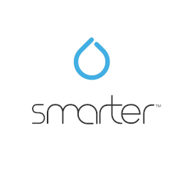

# ioBroker.ikettle2

**Tests:** 

## ikettle2 adapter for ioBroker

Control your Smarter iKettle 2.0 with ioBroker.

## Join the Discord server to discuss everything about ioBroker!

If you like my work, please feel free to provide a personal donation  
(this is an personal Donate link for Jey Cee, no relation to the ioBroker Project !)  

---
## Manual
### Object description
**on** - Turns the kettle on. set_temperature has to be set before.

**on_formula** - Turns the kettle on, heating up and holds the formula_temperature for the warming_time.
formula_temperature and warming_time has to be set before.

**calibrate** - Start base calibration.

**on_plate** - Indicates if the kettle is on the base plate.

**set_temperature** - The target temperature for heating up water.

**formula_temperature** - The target temperature after heating up the water to set_temperature.

**water_temperature** - The actual temperature of the water.

**water_level** - Water amount in the kettle in litres. The weight sensor in the base drifts with heat, so the level
is only measured while the kettle is idle and colder than the temperature set in the instance settings (default 40 °C).
While heating and while the water is hot the last measured value is kept. See *Water level calibration* below.

**water_level_raw** - Raw value of the weight sensor (median of the last values). Used for the water level calibration.

**warming_time** - The time the kettle will hold the water at the formula temperature before turning off. 
Note: 0 = Not used, the minimum time is 5 minutes and the maximum is 30 minutes.

**get_preset** - Read the preset values for manual control (without APP) from the kettle.

**set_preset** - Set the preset values on the kettle for manual control (without APP). 
formula_temperature, temperature and warming_time in preset folder has to be set before. 

---
### Calibrate
Take the kettle from the base, then set the object calibrate to true. 
After the beep from base you can turn the kettle back on base and use it.

### Water level calibration
The adapter converts the raw sensor value into litres with calibration points from the instance settings.
The defaults (2090 = 0 l, 2185 = 1.8 l) are the values of earlier versions and do not fit every kettle.

The sensor is not linear: on a tested kettle the first litre raised the raw value by 64, the next 0.8 l only by 31
(empty 2067, 1 l 2131, 1.8 l 2162). Therefore an optional third point for the empty kettle can be set; the points
are joined by straight lines.

1. Put the empty kettle on the base, wait about a minute and note `kettle.water_level_raw` as *empty kettle*.
2. Fill a known amount of cold water (for example 1 l) and note the value as point 1.
3. Fill up to a second amount (for example 1.8 l up to the max mark) and note the value as point 2.

The raw value moves by a few units, so read it after the kettle stood still for a while.

---
## Changelog
### **WORK IN PROGRESS**
- (sadam6752-tech) Fix: messages are split at the terminator 0x7e, answers to commands are no longer mixed up with status messages
- (sadam6752-tech) Fix: reconnect with a growing delay (5 s to 60 s) instead of reconnecting at once in a loop
- (sadam6752-tech) Fix: `kettle.preset.get_preset` works now (it was not subscribed)
- (sadam6752-tech) Fix: command states are confirmed only after the kettle accepted the command; invalid temperatures are not sent
- (sadam6752-tech) Water level only measured while the kettle is idle and cold, calibration with two or three points (optional empty kettle) in the instance settings, new state `kettle.water_level_raw`
- (copilot) Adapter requires node.js >= 22 now
### 1.0.11 (2026-11-03)
* chore(deps-dev): bump @types/node from 25.9.8 to 25.9.9

### 1.0.10 (2026-10-03)
* chore(deps-dev): bump @types/node from 25.9.5 to 25.9.8

### 1.0.9 (2026-09-03)
* chore(deps-dev): bump @tsconfig/node22 from 22.0.5 to 22.0.6
* chore(deps-dev): bump @alcalzone/release-script-plugin-license

### 1.0.8 (2026-08-03)
* chore(deps-dev): bump @iobroker/testing from 5.2.2 to 5.3.0
* chore(deps-dev): bump @types/node from 25.9.4 to 25.9.5

### 1.0.7 (2026-07-03)
* chore(deps-dev): bump @alcalzone/release-script-plugin-manual-review
* chore(deps-dev): bump @alcalzone/release-script from 5.2.0 to 5.2.1
* chore(deps-dev): bump @types/node from 25.9.1 to 25.9.4

### 1.0.6 (2026-06-03)
* chore(deps-dev): bump @alcalzone/release-script from 5.1.1 to 5.2.0
* chore(deps-dev): bump @alcalzone/release-script-plugin-iobroker
* chore(deps-dev): bump @types/node from 25.6.0 to 25.9.1
* chore(deps-dev): bump @iobroker/eslint-config from 2.2.0 to 2.3.4
* chore(deps-dev): bump @alcalzone/release-script-plugin-license
* Update from template: S6020-addChangelogOld
* Update from template: X0000-dropNode20
* Update from template: W8917-dependabot-addIgnoreTypesNode
* chore(deps-dev): bump typescript from 5.9.3 to 6.0.3

### 1.0.5 (2026-05-03)
* chore(deps-dev): bump @types/node from 25.5.0 to 25.6.0
* Update from template: X0000-updateNodeJsAtTestAndRelease

### 1.0.4 (2026-04-02)
* (jey-cee) fix some issues found by adapter checker

### 1.0.3 (2026-03-31)
* (iobroker-bot) Adapter requires node.js >= 20 now.
* (Jey Cee) Correct size of ip input on xl displays
* (Jey Cee) update dependencies
* (Jey Cee) fix issues found by adapter checker

### 1.0.2
* (Jey Cee) Add watchdog for connection to prevent adapter freeze
* (Jey Cee) Migrate config to JSON Config
* (Jey Cee) Update dependencies 
* (Jey Cee) Fix issues found by adapter checker

### 1.0.1
* (Jey Cee) fixes for Beta release

### 1.0.0
* (Jey Cee) initial release

## License
MIT License

Copyright (c) 2021-2026 Jey Cee <jey-cee@live.com>

Permission is hereby granted, free of charge, to any person obtaining a copy
of this software and associated documentation files (the "Software"), to deal
in the Software without restriction, including without limitation the rights
to use, copy, modify, merge, publish, distribute, sublicense, and/or sell
copies of the Software, and to permit persons to whom the Software is
furnished to do so, subject to the following conditions:

The above copyright notice and this permission notice shall be included in all
copies or substantial portions of the Software.

THE SOFTWARE IS PROVIDED "AS IS", WITHOUT WARRANTY OF ANY KIND, EXPRESS OR
IMPLIED, INCLUDING BUT NOT LIMITED TO THE WARRANTIES OF MERCHANTABILITY,
FITNESS FOR A PARTICULAR PURPOSE AND NONINFRINGEMENT. IN NO EVENT SHALL THE
AUTHORS OR COPYRIGHT HOLDERS BE LIABLE FOR ANY CLAIM, DAMAGES OR OTHER
LIABILITY, WHETHER IN AN ACTION OF CONTRACT, TORT OR OTHERWISE, ARISING FROM,
OUT OF OR IN CONNECTION WITH THE SOFTWARE OR THE USE OR OTHER DEALINGS IN THE
SOFTWARE.