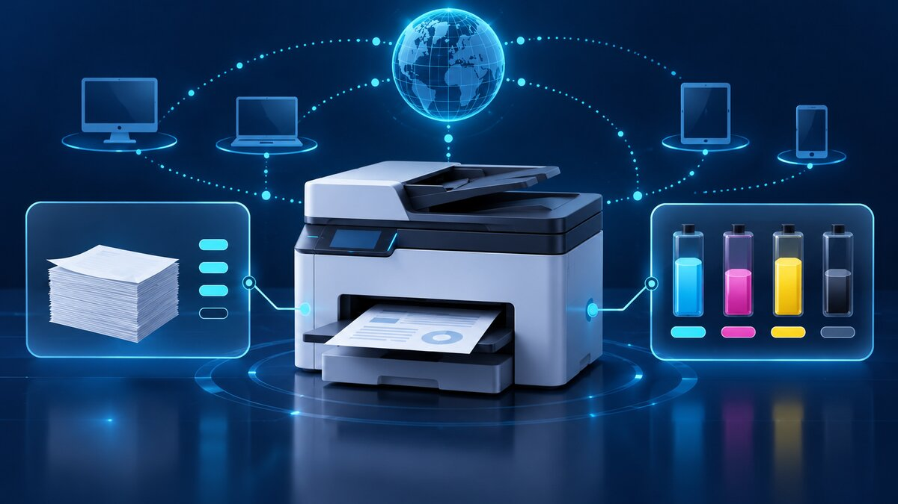

# ioBroker Internet Printing Protocol

## ioBroker Internet Printing Protocol Adapter

The adapter polls configured network printers using the Internet Printing Protocol (IPP) and publishes read-only availability, printer state, toner or ink levels, and supported page counters. It uses `Get-Printer-Attributes` over IPP/2.0; device and firmware support varies, so optional attributes may not be reported by every printer. Compatibility depends on each printer’s IPP implementation; no particular device has been verified against this implementation.

For the protocol model and attribute definitions, see [RFC 8011](https://www.rfc-editor.org/rfc/rfc8011.html).

Node.js 22 or newer, Admin 8.2.0 or newer, and js-controller 7.2.2 or newer are required.

## Configuration

Configure polling interval and request timeout at the top of the adapter configuration page. Add and manage printers below using the Device Manager. Use its **Add printer**, **Discover printers**, **Edit**, and **Remove** actions; printer cards show the configured host, live connection state, and model when reported. During printer removal or legacy cleanup, the adapter preserves an object subtree if any descendant state has `common.custom` settings and logs a warning. A removed printer is no longer polled, so retained values may become stale; after transferring or removing the custom settings, delete the retained objects manually if desired.

Printer configurations use backed-up file storage per instance (for example, `ipp.0/printer-config.json`). Legacy `native.printers` and per-instance files are migrated automatically. The former shared `ipp/printer-config.json` must be restored manually through the appropriate instance's Device Manager. Existing `info` IDs remain usable, but new printers cannot use `info`.

## Automatic printer discovery

Use **Discover printers** in the Device Manager to find `_ipp._tcp` and `_ipps._tcp` services via mDNS on available IPv4 and IPv6 interfaces (up to ten seconds). The scan combines records across responses, requests SRV/TXT details, and does not contact printers or submit print jobs.

Review each result before adding it. The advertised SRV record supplies the host and port; TXT `rp` supplies the resource path. If `rp` is missing or invalid, verify the path before saving. IPPS is preferred when both protocols identify the same printer, and existing configurations are skipped. `ioBroker.discovery` can suggest an adapter instance, but add individual printers here.

Discovery requires mDNS multicast to reach the printer network; firewalls or isolated VLANs may block it. There is no subnet or port scan. Debug logging reports response, service-record, and accepted-result counts.

| Setting | Description |
| --- | --- |
| ID | Stable object-tree identifier; use 1-32 letters, digits, underscores, or hyphens. German umlauts are transliterated (`ä` to `ae`, `ö` to `oe`, `ü` to `ue`, `ß` to `ss`). The ID cannot be changed after creation because it determines the printer's state IDs. |
| Label | Display name for the printer. |
| Host | Printer hostname or IP address without a scheme, port, credentials, path, query, fragment, or embedded whitespace. IPv6 literals must be enclosed in brackets. |
| Port | IPP port; defaults to `631`. |
| IPP resource path | Absolute resource path without `..`, whitespace, query, or fragment; defaults to `/ipp/print`. |
| Use TLS | Use IPPS over TLS. |
| Verify TLS certificate | Validate the printer's TLS certificate; disabled by default for self-signed printer certificates. |

The polling interval defaults to 60 seconds and is limited to 10 seconds through 24 hours. The request timeout defaults to 5000 ms and is limited to 500-30000 ms; it is a hard deadline for the complete request and response, including slow or incomplete responses. The adapter only sends the read-only `Get-Printer-Attributes` operation; it does not submit print jobs or change printer settings. Configure only printers that expose an IPP endpoint at the selected host, port, and resource path.

Empty placeholder rows are ignored during startup and migration. Other invalid printer rows are skipped with a warning that identifies the invalid fields. Debug logging reports configured field names and value types without printing configured values.

When a printer is switched off or temporarily unreachable, the adapter marks it offline without a warning-level log; connection and timeout details are available at debug level. IPP protocol, TLS, and configuration errors remain warnings.

## States

Each printer has `status`, `supplies`, `counters`, and `details` channels.

- **Status:** `online` is always available; model, message, and numeric state are published when supported. An unreachable printer has state `0` (`off`), and its last readings are retained while offline. Model values use the complete `printer-make-and-model`; messages use English IPP reason/state labels.
- **Supplies:** Toner and ink levels use IPP `marker-levels` directly as percentages. Display names use recognized marker type/color labels or fall back to `Supply N`.
- **Counters:** `pages_completed`, `impressions_completed`, and `media_sheets_completed` are created only when reported. Missing counter and detail values are cleared after a successful poll, including after a restart.
- **Details:** Returned scalar numeric, boolean, and string attributes not already represented elsewhere are exposed, except attributes the adapter explicitly excludes (such as capability/default fields and raw marker values); arrays and objects are omitted. IDs derive from attribute names and may change for non-canonical names or collisions.

## Changelog
<!--
    Placeholder for the next version (at the beginning of the line):
    ### **WORK IN PROGRESS**
-->
### 0.4.1 (2026-11-25)

- (Voodoo2man) Improved discovery across IPv4 addresses and scoped IPv6 interfaces, matched DNS-SD names case-insensitively, and combined split mDNS service records with diagnostics.

### 0.4.0 (2026-11-22)

- (Voodoo2man) Added manual IPP/IPPS printer discovery with review-before-save in the Device Manager and shared-instance detection support for `ioBroker.discovery`.

### 0.3.0 (2026-11-19)

- (Voodoo2man) Exposed printer online/offline status in ioBroker Admin.
- (Voodoo2man) Preserved custom states in printer objects during cleanup.
- (Voodoo2man) Prevented empty legacy printer rows from causing startup warnings.

### 0.2.1 (2026-11-11)

- (Voodoo2man) Hardened printer configuration storage with normalized request timeouts, safer migration, per-instance file isolation, and cleanup of owned orphaned legacy roots.
- (Voodoo2man) Treated temporary printer gateway errors as offline states without warning-level logs.
- (Voodoo2man) Improved published printer data with stable detail IDs, English IPP reason labels, complete model names, and scalar text details that may retain printer-localized wording.
- (Voodoo2man) Combined basic settings and printer management on one configuration page.

### 0.2.0 (2026-11-08)

- (Voodoo2man) Hardened IPP response handling, corrected supply percentages and state clearing, preserved legacy printer configurations, normalized printer IDs, refreshed state metadata, localized Device Manager actions, scheduled polls after each completed cycle, and isolated Device Manager storage from Admin saves.
- (Voodoo2man) Aligned saved endpoint validation with polling, made colliding dynamic detail IDs unique, and removed unused UI translation entries.

Older release notes are available in CHANGELOG_OLD.md.

## License
MIT License

Copyright (c) 2026 Voodoo2man <Voodoo2man@outlook.de>

Permission is hereby granted, free of charge, to any person obtaining a copy
of this software and associated documentation files (the "Software"), to deal
in the Software without restriction, including without limitation the rights
to use, copy, modify, merge, publish, distribute, sublicense, and/or sell
copies of the Software, and to permit persons to whom the Software is
furnished to do so, subject to the following conditions:

The above copyright notice and this permission notice shall be included in all
copies or substantial portions of the Software.

THE SOFTWARE IS PROVIDED "AS IS", WITHOUT WARRANTY OF ANY KIND, EXPRESS OR
IMPLIED, INCLUDING BUT NOT LIMITED TO THE WARRANTIES OF MERCHANTABILITY,
FITNESS FOR A PARTICULAR PURPOSE AND NONINFRINGEMENT. IN NO EVENT SHALL THE
AUTHORS OR COPYRIGHT HOLDERS BE LIABLE FOR ANY CLAIM, DAMAGES OR OTHER
LIABILITY, WHETHER IN AN ACTION OF CONTRACT, TORT OR OTHERWISE, ARISING FROM,
OUT OF OR IN CONNECTION WITH THE SOFTWARE OR THE USE OR OTHER DEALINGS IN THE
SOFTWARE.