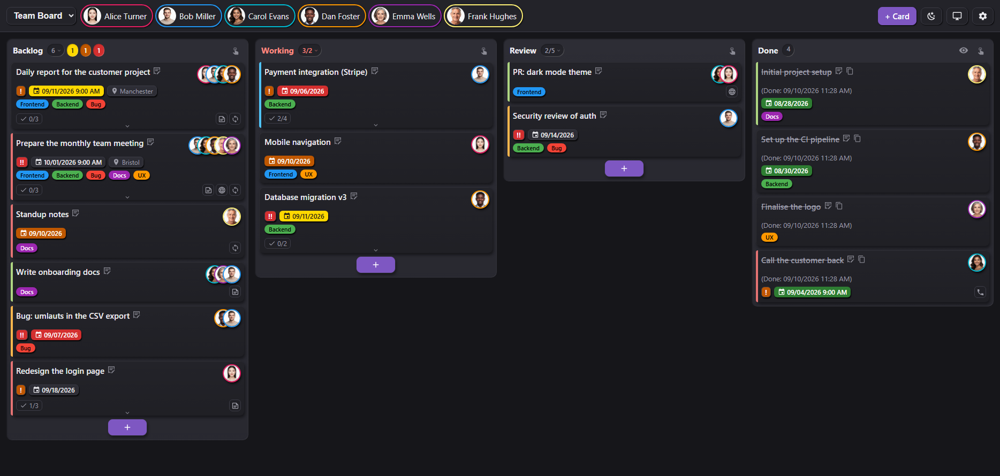

# ioBroker.kanban

[](https://www.npmjs.com/package/iobroker.kanban)
[](https://www.npmjs.com/package/iobroker.kanban)


[](https://github.com/bmueller77/ioBroker.kanban/actions/workflows/test-and-release.yml)
[](LICENSE)

Kanban board adapter for ioBroker with its **own web server**, live sync, webhooks, multi-user support and e-mail notifications (including calendar invites) via the `email` adapter.



**Full documentation:** [English](/#/docs/adapterref/iobroker.kanban/docs/en/README.md) · [Deutsch](https://github.com/bmueller77/ioBroker.kanban/blob/main/docs/de/README.md)

**Questions, ideas, bug reports:** [GitHub issues](https://github.com/bmueller77/ioBroker.kanban/issues), or the ioBroker forum threads [Kanban board (English)](https://forum.iobroker.net/topic/85031/new-adapter-kanban-board) and [KanBan-Board (deutsch)](https://forum.iobroker.net/topic/85030/test-kanban-board).

## Installation

Install the adapter from the ioBroker admin: *Adapters* → filter for `kanban` → install. Then create an instance `kanban.0` and open the web UI at `http://<host>:8095/`.

> The adapter is awaiting inclusion in the official ioBroker repository.

## Features

- **Own web server** (default port 8095), the web UI is served directly by the adapter; no `iobroker upload` needed for UI updates
- **Multiple boards** with freely configurable columns (name, order, display limit, WIP limit, "new"/"done" flags)
- **Cards** with title, Markdown description, assignees, due date (optionally with time), labels, color, priority, checklist, link, location and calendar invite
- **Recurring tasks** (daily/weekly/monthly/yearly, n-th weekday, n-th working day incl. public-holiday calculation)
- **Card templates**: save a card as a template, fill new cards from it, exchange templates as a file between boards and instances
- **Drag & drop** (mouse + touch), live sync across all open views via WebSocket (polling fallback)
- **Multi-user without login**: user registry in the admin config, assignable members per board; the header chips act as a saved per-board person filter
- **E-mail notifications** via `iobroker.email` on assignment, due date and card events (toggleable per event type and per user)
- **Webhooks inbound** (token-secured) and **outbound** (JSON POST on events)
- **Share view**: dialog to build filtered, embeddable links
- **iframe-friendly** (no frame headers) with `?embed=1` mode for Lovelace & co.
- **Multilingual** (de, en, fr, nl, it, es, pl, pt, ru, uk, zh-cn), configurable **date & time format** per instance (moment/Day.js tokens with localised month/weekday names, 12h/24h), theming (light/dark/auto, accent color, custom CSS)

## Web UI / URL parameters

`http://<host>:8095/` with optional parameters (excerpt, full list in the [docs](/#/docs/adapterref/iobroker.kanban/docs/en/README.md#sharing-views--url-parameters)):

| Parameter | Effect |
|---|---|
| `board=<id>` | preselect a board |
| `users=<name,name>` | person filter: show only cards assigned to these users (`user=<name>` = single-user short form) |
| `label=<id,id>` | label **blacklist**: hide cards with these labels |
| `columns=<id,id>` | show only these columns |
| `doneLimit=N` | in done columns show only N cards (`0` = none, omit = all) |
| `theme=light\|dark\|auto` | force a theme |
| `embed=1` | borderless view without the header bar (for iframes) |
| `card=<id>` | open a card dialog directly (deep link from e-mails) |
| `lang=<code>` | force a language (de, en, fr, nl, it, es, pl, pt, ru, uk, zh-cn) |

### Lovelace embedding

```yaml
type: iframe
url: http://<host>:8095/?board=family&embed=1&theme=auto&user=user1
aspect_ratio: 75%
```

## REST API

For integrations on the local network (the same API the web UI uses). **Reading** (`GET`) is open; **writing** (`POST`/`PATCH`/`DELETE`) requires a token from 0.1.1 (`X-Kanban-Token`; the web UI sends it automatically), see [Security](/#/docs/adapterref/iobroker.kanban/docs/en/README.md#security--access-control).

| Method | Route | Purpose |
|---|---|---|
| GET | `/api/boards` | board list |
| POST | `/api/boards` | create a board `{title}` |
| GET | `/api/boards/:id` | board JSON; with `?rev=<n>` → `{unchanged:true}` if current |
| PATCH | `/api/boards/:id` | `{title?, columns?, labels?}` |
| DELETE | `/api/boards/:id` | delete a board |
| POST | `/api/boards/:id/cards` | create a card |
| PATCH | `/api/boards/:id/cards/:cardId` | update a card partially |
| POST | `/api/boards/:id/cards/:cardId/move` | `{columnId, order?}` |
| DELETE | `/api/boards/:id/cards/:cardId` | delete a card |
| PATCH | `/api/users/:name` | set a user colour (applied at runtime, no restart) |

## Webhooks & commands

External systems (scripts, agents) modify boards/cards token-secured via `POST /webhook/<token>/action`. The same command vocabulary applies as for `sendTo` and the `action` state:

```bash
curl -X POST http://<host>:8095/webhook/<token>/action \
  -H 'Content-Type: application/json' \
  -d '{"cmd":"addCard","board":"family","title":"Buy milk","assignees":["user1"],"due":"2026-07-15"}'
```

Commands: `listBoards`, `getBoard`, `addBoard`, `deleteBoard`, `addCard`, `updateCard`, `moveCard`, `doneCard`, `deleteCard`, `reassignUser`. From ioBroker scripts:

```js
sendTo('kanban.0', 'addCard', { board: 'family', title: 'From a script' }, res => log(JSON.stringify(res)));
setState('kanban.0.action', JSON.stringify({ cmd: 'doneCard', board: 'family', cardId: 'c_xyz' }));
```

**Outbound webhooks** send a JSON POST to configured URLs on events (`cardCreated, cardUpdated, cardMoved, cardAssigned, cardDone, cardDeleted, cardDue`). Details in the [docs](/#/docs/adapterref/iobroker.kanban/docs/en/README.md#webhooks-inbound).

## States (for scripts/visualization)

| State | Content |
|---|---|
| `kanban.0.boards.<id>.data` | full board as JSON (read-only) |
| `kanban.0.boards.<id>.rev` / `.cardCount` / `.overdueCount` | revision & counters |
| `kanban.0.users.<id>.assignedCount` / `.overdueCount` / `.overdueList` | per user |
| `kanban.0.lastEvent` | last event as JSON (can trigger scripts) |
| `kanban.0.info.orphanedAssignees` | assignees that no longer exist as users, after a user ID was renamed |
| `kanban.0.action` | command input (write JSON, cleared after processing) |

## Security

From **0.1.1**: token-secured write API, Markdown preview sanitized with DOMPurify (no stored XSS), a Content Security Policy and safe link schemes only. The web UI works without a login, the token blocks third-party websites/CSRF but is **not** a substitute for network isolation. For hard isolation, bind the port to the LAN only or put an authenticating reverse proxy in front.

Also from **0.3.0**: agent tokens keep their board restriction on the REST API as well, tokens are only read from the header or the request body, the write secret lives in the adapter's file storage instead of a readable state, the token-free `action` state can be switched off, and irreversible commands are logged with their source. Note that `sendTo` and the `action` state are local ioBroker interfaces without a token by design: anyone who can run scripts in ioBroker can use them.

Details: [Security & access control](/#/docs/adapterref/iobroker.kanban/docs/en/README.md#security--access-control).

## Requirements

- js-controller >= 6.0.11, Node.js >= 22
- For e-mail notifications: a configured `iobroker.email` instance
- Optional: `iobroker.feiertage` for region-accurate public-holiday calculation of the working-day recurrences

## Changelog

<!-- Der Platzhalter bleibt stehen. release-script trägt hier die
     nächste Version ein und ersetzt die Überschrift. -->
### 0.4.1 (2026-10-31)
* (bmueller77) **Dragging on a touch screen starts reliably, and the drop zones appear.** Holding a card still before moving it was often enough to break the drag. After the hold time the board waits for the first movement, and about half a second later an Android WebView took over the long press for its own drag and drop and cancelled the touch. The drag never started, so there were no drop zones either; clearing the site data only seemed to help. On devices with a touch screen the board now uses its own drag emulation instead of native drag and drop. Mouse-only devices are unchanged
* (bmueller77) **An open page loads new code by itself after an update.** A kiosk tablet keeps the board open for days and kept running the code it had loaded last. The adapter now tells every connected page which version of the web interface it serves, and the page reloads when that differs. An open dialog is waited for, so nothing typed is lost
* (bmueller77) **The start page is English until the translation takes over.** It declared itself German, and every label visible before the web interface loads its language was German as well. Both are English now, so English also remains if a translation does not load. Requested in the review for the ioBroker repository
* (bmueller77) **The header counts menu stays open while ticking.** Every tick redraws the board, and the redraw closed the menu after each click, although it is meant for setting several ticks in a row
* (bmueller77) The hint in the "Templates" tab mentions the pencil for editing a template's content

### 0.4.0 (2026-10-11)
* (bmueller77) **Card templates.** A template is a named set of card fields that belongs to a board. It is created from an existing card through "Manage", it fills the editor when a new card is made, and it can travel to another board or another instance as a file
  * Two things deliberately stay behind: the **due date**, because a fixed date ages and a template saved in January would otherwise create cards dated the day before yesterday in March, and the **checklist ticks**, because a template holds the items rather than their state. The time of day stays, since 17:00 is a property of the task
  * If the template carries a recurrence and no date is given, the next date is worked out and the pattern is anchored to today. A template of "every 30 days" creates a card due today and counts from there, not from a pattern set half a year ago
  * Labels and assignees are checked when the template is used, not when it is saved. A template sits on a board for months while labels are deleted and members leave; whatever no longer exists is dropped, and a label is never recreated from an old template
  * The "Manage" dialog now offers four kinds below one another as radio buttons, each with a line explaining it. Side by side there was no room, and the labels were already being cut off at three
  * The board settings have a "Templates" tab listing them: drag to reorder, rename, open one in the card editor to change its content, export, delete. Changes there take effect with Save
  * Scripts and webhooks can use templates too: `addCard` takes a `template` field, matched by ID first and by name second. Fields given explicitly beat the template. An unknown name is an error rather than a quiet omission, so that a typo does not produce half-filled cards for months
  * Export and import carry labels by name, not by ID, since an ID from another board means nothing on this one. An import appends and never replaces, because there is no telling what hides behind a name in a file; a name that already exists gets a counter
  * Import has its own dialog, like export, and takes two steps: choose a file or paste the text of an export, then tick the templates to take over. Between picking the file in the file dialog and the file reaching the page, the browser can take several seconds, and during that time "Reading file..." stands next to the button. Errors are shown in the dialog. The imported templates join the list in the board settings and are stored with Save
* (bmueller77) **Messages from an open dialog can be seen and closed.** The hint bar belonged to the page, and an open dialog sits above everything on the page, so any message raised from inside a dialog stayed hidden behind it: an error while saving, a failed download and so on. The bar now appears above the topmost open dialog, and its close cross can be clicked there

### 0.3.8 (2026-10-09)
* (bmueller77) **The drop zones are back when dragging on a phone or a tablet.** Reported in [#42](https://github.com/bmueller77/ioBroker.kanban/issues/42) and broken since 0.3.5, where a check for horizontal overflow replaced the width rule instead of adding to it. On a narrow screen the columns stack, there is no horizontal overflow, and the bar with the target columns stayed away, which leaves no way at all to reach a hidden column. The pointer type no longer decides either: a WebView does not always answer `pointer: coarse` correctly, and Fully Kiosk even reverses the platform in its user agent
* (bmueller77) **A switch in the share dialog turns the zones on for good**, below the embed mode. They appear by themselves as soon as a column sits beyond the right edge, which on a desktop with a touch screen is not a reliable test
* (bmueller77) **User names are sanitized before they become part of an object ID.** "Björn Müller" used to produce `users.Björn Müller`, with a space and an umlaut in the path; it is now `users.bjoern-mueller`, by the same rules as the board IDs. The display name stays in the channel name and in the cards. On the first start the old channel is removed and rebuilt under the new ID, and the log says so, so a script or a view that refers to the old one can be updated. Reported in the review for the ioBroker repository
* (bmueller77) The files of the web interface are sent with `no-store` instead of `no-cache`. The latter permits storing the file and only asks for revalidation, which Fully Kiosk ignored for days while the server had long been serving the fix

### 0.3.7 (2026-10-06)
* (bmueller77) **Six more German messages, found by looking for the right thing.** Two come out of renaming a user, two out of a malformed cron expression, two out of reading an image in older browsers. The previous pass filtered for umlauts and German word order, and not one of these six has an umlaut; one even begins with two English words. A word list beats a pattern here, and the same search now runs over the web interface as well
* (bmueller77) Dashes, typographic quotes and ellipses are gone from the eight language files in Latin script, in both `www/i18n` and `admin/i18n`. Russian, Ukrainian and Chinese keep theirs, where they are ordinary typography

### 0.3.6 (2026-10-06)
* (bmueller77) **Eleven more error messages are English now.** Ten of them come out of the REST API, so every script and integration that talks to the adapter was reading German; the eleventh explains a malformed cron expression. The earlier pass searched for one particular shape of error and missed every message built in another, which is why these survived it
* (bmueller77) Dutch: "Urgent" as a priority is "Dringend"
* (bmueller77) `@iobroker/testing` on 6.3.0

### 0.3.5 (2026-09-28)
* (bmueller77) **Dragging a card with a finger works again.** On a tablet a card could not be picked up at all, whatever you grabbed it by. Two causes, both in the drag library's settings:
  * The hold that starts a drag was cancelled by the smallest movement. The tolerance was zero pixels, which a mouse pointer keeps and a finger never does. That is why it worked at a desk and never on a tablet
  * The library listens to pointer events where the browser offers them, and ends a drag when the browser cancels the pointer. A tablet WebView claims the gesture for itself after about a second, so the drag was over before it did anything. It now uses touch events, where it keeps control of the gesture itself
* (bmueller77) **The board scrolls along** when a card is dragged to the edge. Without it, a column beyond the edge was simply out of reach. The strip that triggers the scroll is also wider now: 30 px is something a mouse hits and a finger does not, because the hand stops short of the screen edge and the fingertip covers the spot you are aiming at
* (bmueller77) **The quick-move bar now appears on tablets too.** It used to depend on screen width, but the question is not how wide the screen is, it is whether all columns fit on it. With five columns and three and a half of them visible, every move to the last column meant dragging and scrolling at the same time. The bar appears when the board scrolls sideways and a coarse pointer is in use, so a mouse is left out: there the edge strip is easy to hit and scrolling works
* (bmueller77) Fix: the quick-move bar always offered the trash as a target, even on a device where the trash column is hidden. A target appeared mid-drag that was nowhere on screen, and one slip put the card in it. The trash is offered only while its column is shown

### 0.3.4 (2026-09-27)
* (bmueller77) The copyright line in `LICENSE` and the author entry in `io-package.json` carry an e-mail address now. The repository checker asks for one in both places, and it was only in `package.json`

### 0.3.3 (2026-09-21)
* (bmueller77) **Everything the adapter says is in English now.** Thirty-five error messages were German, from `title fehlt` to `Karte '...' existiert nicht`. They reach users in the log, as REST responses and as the answer to a `sendTo` call, so a German message left half the ioBroker world guessing. Cron messages are included
* (bmueller77) **Five state names were German** and are English now: `Card count`, `Overdue cards`, `Overdue cards (list)` and `Assigned open cards`. Since these objects are created only when they are missing, a new name never reached an existing installation. The adapter now corrects the names of its own objects once at startup, so boards that have been running for months are renamed as well
* (bmueller77) The HTTP status code of the REST API no longer depends on the wording of an error. It used to test the message for the German `existiert nicht` to decide between 404 and 400, which would have broken silently with the translation. An error that stands for something missing now carries its status itself
* (bmueller77) `reminderDaysBefore` is held to the range 0 to 30 in the code as well, not only in the settings dialog. The configuration can be edited by hand, and a value far outside that range moved the reminder threshold somewhere nobody would find

### 0.3.2 (2026-09-10)
* (bmueller77) **The trash has the sort toggle now**, like every other column. The default stays deletion time, oldest first, so whatever is closest to being removed for good sits on top; sorting by due date, priority or age is available all the same. The broom moved to the left of the toggle so that the sorting sits in the same place in every column
* (bmueller77) Fix: the **focus ring** took the accent colour unchanged. That works in the light theme; in the dark one the same dark tone stood against dark surfaces and was barely visible. The ring colour is computed now: lightened or darkened from the accent colour, only as far as it takes to stand out against every surface it lands on, so the instance keeps its colour family
* (bmueller77) Fix: below 600 px the card editor, the board manager and the views dialog did not fill the screen and sat pinned to the top left. Their rules hang on their IDs and beat the element rule in the mobile block
* (bmueller77) Fix: in the same block the tab panel was squashed as a flex child while its content visibly ran out of it. The scroll area did not count the overflowing pixels, and on a short window **Save scrolled out of sight entirely** - anyone who did not think to scroll back lost their input
* (bmueller77) Fix: the text colour on avatars and chips hung on a fixed brightness threshold, and around that threshold the choice came out wrong - on turquoise it picked white where black is the more legible of the two. It now compares both and takes the better one
* (bmueller77) Fix: the **browser's back button** closed the card editor without a word, while Escape and the close cross ask first. The open dialog now adds a history entry; the back button takes it away and raises the same prompt
* (bmueller77) Fix: if someone changed the same card in another window, the open editor did not notice and **overwrote it silently on save**. It now compares the state it opened with against the current one and asks when they differ. Only the fields the editor edits are compared, so a column change or a fresh completion timestamp does not raise the prompt
* (bmueller77) The eye and the broom in the column header, the drag handles in the settings and the "+X more" row were too small to hit reliably, on a touchscreen in particular. All four are bigger now. It weighs more on the broom than elsewhere, since an irreversible action sits behind it
* (bmueller77) Fix: the sort menu carried no roles, the tooltip on a completed card was the only single-line one, a badge without a warning colour was hard to make out against the white card and now carries a hairline, the disabled menu entry kept the pointing hand, the triangle was lost on a coloured badge, the focus landed on `body` after toggling "+X more", and in drag-handle mode the whole card carried the grab cursor while dragging only starts at the handle
* (bmueller77) Fix: the explanatory line in the due-date tooltip told the timeline backwards. It runs from yellow to red now, in eleven languages
* (bmueller77) Fix: the heading above the label switch always read "hide labels", even when it was set to "show only these labels". Fix: the prompt for removing a board member counted the cards correctly but named every future non-member instead of the people actually on those cards
* (bmueller77) Fix: the subject "card deleted" stood for a move to the trash. The checkbox says "to the trash" and so does the confirmation dialog, only the mail did not. Corrected in eleven languages
* (bmueller77) **Yellow means tomorrow, the lead time only drives the mail** (#25). Colour and column count followed the setting **Remind X days before due**: at a lead time of 3 everything up to the day after tomorrow turned yellow while the number above it still read "Tomorrow". Yellow now means the next calendar day, full stop, and the same arithmetic drives the column count. The tooltip needs no number any more, since the scale is the same for every instance
* (bmueller77) **Only IDs that something hangs on are frozen now.** Until now the adapter wrote the marker back for every user on the first start, and every such write restarts the instance - exactly the window in which saving in the admin was lost, reproduced twice, without a message and without a log entry. It hit the setup, the moment when someone sets the port, saves, enters users, saves. A fresh instance with users but no cards no longer writes its configuration back at all
* (bmueller77) Fix: creating a card fired "card created" and "card assigned", and **both attached the `.ics`** although the manual says the invite comes once. The notifier remembers the dispatch itself now
* (bmueller77) **Deleting a card sends a cancellation**: an `.ics` with `METHOD:CANCEL`, the same `UID` and the next sequence number, so the calendar clears the entry instead of leaving the appointment standing. Only where an invite was ever sent
* (bmueller77) The **add button** at the foot of a column is narrower. It used to span a good quarter of the column and caught the clicks on the rows of an expanded checklist below it. A "+" does not need that width
* (bmueller77) **No cards are created in a done column any more.** A card created there carried no `doneAt` and therefore dropped out of three documented features: the "age in column" sort, the display limit for done cards and the automatic cleanup. It stayed there forever without anyone seeing why. The store refuses it and the UI does not offer it: the card editor leaves done columns out when creating and copying, the transfer dialog likewise, and there is no "+" at the foot of such a column. Moving and editing an existing card keeps the column selectable
* (bmueller77) Fix: `doneAt` was cleared when a card moved to the trash, so restoring it lost the completion time. Fix: labels created through the interface were all green and now take their colour in turn from the same palette as the UI. Fix: the mirror states of deleted users stayed behind under `users.*`, so a dashboard reading `assignedCount` kept counting people too many. Fix: the "+" at the foot of a column was not blocked when no user existed - only the header button had been secured, the dead end was still reachable by the other route
* (bmueller77) **Error messages no longer arrive as a browser box.** All eight `alert()` calls go through the in-page hint now: a red border, `role=alert`, and they stay until someone closes them. A modal box halts the page until it is clicked away and is unreadable to any automated check - two testers could only report that the renderer refused scripts and had to leave the wording open
* (bmueller77) Fix: on a board without columns "+ Card" stayed active, the editor opened, the column field was empty, and only saving ran into the error. Fix: the menus in the column header hang off `body`, so a deleted column left its menu standing and operable. Fix: with fifteen users the chip bar grew wider than the window and pushed the whole page out of view; it wraps now. Fix: markdown tables in the description and the reading window had neither borders nor padding
* (bmueller77) The socket around the sticky add button is one pixel wide instead of seven. It only shows when the button floats over a card, and then as a heavy frame
* (bmueller77) Fix: a saved card that the active filter hides straight away **disappeared without a word**. A tester created six cards and thought saving was broken until the network response 201 told him otherwise. After saving, the board is checked for the card and the UI says so when it is not there
* (bmueller77) Fix: from the sixth column on, "+ Add column" sat on the edge of the scroll area, half cut off and without effect, and the input that followed was lost. Fix: the recurrence prefilled day and month with today's date even when the card carried a due date. Fix: the remembered expanded state silently overruled a freshly set display limit, so "Max 3" showed seven cards and looked broken. Fix: the board picker still showed the old name after renaming
* (bmueller77) Fix: the "duration" field took the whole width next to the checkbox, for a value like `01:00`. Fix: the summary of a collapsed section showed raw markdown for the description and only the host for the link, so two cards with different files on the same server looked identical. Fix: the label summary carried no colour dots although the manual describes them. Fix: the interface error texts wrote "zustaendige" without the umlaut
* (bmueller77) Fix: with the WIP limit exceeded and a filter active, the column header read "2/5" in red - the filtered figure before the slash, the colour from the unfiltered one. The column's own figure stands there now, and the tooltip still names how many the filter shows. The rule sat in the middle of the rendering and had been wrong twice for that reason; it lives in `totalLabel()` with five tests beside it
* (bmueller77) Fix: the plural form still read "card(s)", "tarjeta(s)" in the prompt for removing a board member. Written out in all eleven languages now. Fix: "+ New" in the card editor always assigned green - the palette had only reached the board manager
* (bmueller77) **A fresh instance no longer ships with two example users.** Since the adapter freezes user IDs, the presets were permanently called "user1" and "user2" and could only be deleted, not renamed, so the first thing to do on a new instance was to throw away two users whose names must not be touched. "+ Card" explains by itself that a user is missing first
* (bmueller77) Fix: a recurring card left lying for several intervals produced a follow-up card **dated in the past**. Due 28.08., interval 7, completed 07.09. gave 04.09. The calculation now starts from the later of due date and today. Finishing early keeps the calendar as the reference, otherwise the grid would creep forward with every early tick
* (bmueller77) Fix: without a single user the card editor opened and saving failed on a condition nobody could meet there. Fix: the reason on the blocked "+ Card" never appeared, because Chrome delivers no mouse events on disabled buttons. It uses `aria-disabled` now, so the click is caught and says what is missing
* (bmueller77) Fix: the column count and the sort button in the column header were too small to hit reliably and are bigger now. Fix: "+X more" hung on the column while the add button hung in the card list, so the hint sat below the add button, set off from the cards and not lined up with them
* (bmueller77) Fix: `info.orphanedAssignees` was only written on start, so a repair or a restore from the trash left the state stale until the next start. Fix: `info.frozenUserIds` only ever grew, so a user created later with the same ID would have found the field locked from the outset. Fix: `info.apiSecret` was created on fresh instances after all, although the manual has said the opposite since 0.3.0
* (bmueller77) Fix: "setInterval called, but adapter is shutting down" did not come from a normal restart but from saving the settings: the host stops the instance mid-start while the start is still creating timers. Server, scheduler and the delayed write ask first now
* (bmueller77) Fix: "2 Karte(n)" in the prompt for removing a board member. Fix: the tooltip on the due date named only the state; the scale stands below it now. Fix: after "+ Add column" and "+ Add label" the focus stayed on the link. Fix: the links in the rendered markdown preview sat in the tab order although it is display only
* (bmueller77) A card that carries a **time of day** now turns red once that time has passed. Until now the colour only changed at midnight, although 0.3.0 introduced the minute precise `cardDue` event, so the event and the colour contradicted each other. The badges are refreshed in place every minute rather than by re-rendering the board, which leaves the scroll position and a drag in progress untouched
* (bmueller77) Fix: **`boards.<id>.overdueCount` went stale.** The minute tick only refreshed the per-user states; the board counters were written by the persist path, which runs on changes. A card that becomes overdue purely because the date rolled over triggers no change, so on an untouched board the counter kept its old value
* (bmueller77) **A user ID can no longer be renamed once it exists.** Cards, avatar files and the addresses of shared views all hang on that ID, so a rename left every one of them pointing nowhere - and the adapter could not even clean up afterwards, because a rename cannot be told apart from "deleted and newly created". The field is locked as soon as the user has been saved once. The display name stays freely editable, which is what people actually want to change. Cost: the adapter writes a marker into its own instance configuration, which restarts the instance once per newly added user
* (bmueller77) **Cards that point at a user who no longer exists can be repaired in the board settings**, under *Users -> Orphaned assignees*. Each orphaned ID shows how many cards it holds and on which boards; the count expands into the list of cards - title, board, column, due date, done ones struck through - and each card opens in the normal editor, because nobody moves thirteen cards on trust. The gear icon carries a small dot while anything is open. The section is absent when there is nothing to fix, and it never appears in embedded views with `hideSettings=1`
* (bmueller77) The trash is now left out of the repair as well, not just out of the detection. Until now the confirmation named a number that the card list did not contain, and cards on their way to deletion were reassigned to somebody
* (bmueller77) `reassignUser` also moves the **avatar picture** now. The files are named after the user ID, so the picture stayed behind under the old one and the target person was left without. An existing picture of the target is not overwritten. The target also becomes a member of every board it touches - otherwise it would be responsible for cards while missing from that board's person filter
* (bmueller77) **The API validates assignees the way the card editor does.** At least one person is required, and every ID has to exist; unknown ones are answered with `400` and a list of the valid IDs. Until now anything went through, placeholders like `default` included, which produced cards the editor could never have created and which stay invisible behind a `users` filter. An ID already on the card stays allowed when editing, so an orphaned card does not become the one card you cannot touch. **This is a behaviour change:** callers that create cards without an assignee will start failing
* (bmueller77) An unknown **label** coming in through the API is added to the board instead of being rejected, so a script can hand out a new label without creating it first. Without that the card would carry a label the board does not list, which makes it invisible behind an `onlyLabel` filter
* (bmueller77) New commands `reassignUser` and `listOrphanedAssignees`, plus `POST /api/users/<name>/reassign`, `GET /api/users/orphaned` and `GET /api/users/orphaned/<name>` for the card list behind one ID. All of them touch every board, so they stay closed to board-restricted tokens
* (bmueller77) "+X more" below a column is a button now. It looked like one and was plain text, so the cards hidden by the display limit could not be reached without changing the limit itself. Clicking shows them, clicking again hides them, and the choice is remembered per device. Its text also lines up with the left edge of the cards now instead of sitting six pixels further left
* (bmueller77) Fix: with a filter on, an exceeded WIP limit turned the column red while the badge showed only the match count, so two cards against a limit of three looked like a bug. The limit now stays visible in that case, and the tooltip names both figures, the cards the column really holds and the ones the filter shows
* (bmueller77) **New recurrence kind: every X days counted from completion** (#40). "Every X days" keeps a fixed grid from its start date, so a card due every 30 days that is finished ten days late comes back after 20 days, not 30. The new kind counts from the moment the card is ticked off, which is what maintenance intervals mean: the filter lasts 30 days from the change, not from the calendar. Both kinds share the same arithmetic, only the anchor differs, and the follow-up card carries its own copy of the rule. No calendar series can be built for it, so such cards get a single invite like "working day of the month" does
* (bmueller77) The hint below the recurrence field for "every X days" said "new card after the configured number of days", which described the new kind rather than the existing one. That reading is exactly what was reported in #40
* (bmueller77) Fix: the adapter was killed with SIGKILL on every restart. Shutdown closed the web server first and wrote the data afterwards, but `server.close` waits for every connection to go away and an open browser tab holds its keep-alive. The adapter hung, never got to writing, and the host killed it after a second, so the last changes were at stake on every restart. Data is written first now, and open connections are closed instead of waited for
* (bmueller77) Fix: Escape and the close cross discarded card edits without asking. The settings dialog had always asked; the card editor had not. It now compares the form against a snapshot taken when it opened, so no field can be forgotten. "Cancel" still discards without asking
* (bmueller77) Fix: a card belonging to a deleted user showed an empty required field in the editor. Clicking a person then left the old ID in place unnoticed. The ID now appears as its own dashed chip marked "(deleted)"
* (bmueller77) Fix: the dot on the gear was only computed on load, on the assumption that orphaned assignees cannot appear while the board is open. They can: a card restored from the trash brings its ID back. The check now also runs after a restore, and it clears the dot again
* (bmueller77) Fix: an unusable date format was accepted without checking and then printed on every card verbatim. A format without a day, month or year token is discarded with a warning in the log
* (bmueller77) Fix: Enter inside the checklist saved the whole card and closed the dialog. It creates the next item now; Ctrl and Enter saves from there
* (bmueller77) Fix: selection and keyboard focus looked identical on the chips, both a two-pixel ring in the accent colour. The focus ring is dashed now
* (bmueller77) Fix: white on the orange due badge was hard to read, so the orange is darker now. Red as a text colour on a dark surface got a lighter tone through `--danger-fg`
* (bmueller77) Fix: the sticky add-card button sat on top of card titles and labels while scrolling. It has an opaque pad in the column colour now
* (bmueller77) Fix: below 600 px the board row in the settings stretched the board picker and the name field far beyond their content, because the column direction turned a `flex-basis` meant as width into a height
* (bmueller77) The due-date badge has a tooltip naming its state, since a colour on its own does not say whether it is worse than the one beside it. New labels take their colour from a palette in rotation. The pencil and the other card icons are easier to hit. "+ Card" is disabled while no board exists, and the filter button that has been dead since 0.3.0 is gone
* (bmueller77) **With exactly one user, assignment disappears** (#35). No chips in the header, no avatars on the cards, no assignees field in the editor, no user picker in the views dialog: with one person there is nothing to choose and nothing to filter. The API fills the field in instead of answering `400`, so a script does not fail on a question that answers itself. A card carrying an ID that no longer exists keeps it rather than being silently moved. Adding a second user brings all of it back
* (bmueller77) The copy button on a done card is `mdi:content-copy` now, two offset sheets (#33). It used to be a sheet with a circular arrow, which at that size looked like the recurrence icon sitting on the same card, so people read the copy button as a recurrence marker that had moved. The recurrence icon itself never moved. The documentation gained a table listing every icon that can appear on a card
* (bmueller77) Labels keep one order everywhere (#32). A card used to list them in the order they had been clicked in the editor, so two cards carrying the same labels looked different. Card, picker and section summary now all follow the order of the board, and that order can be dragged by a handle in the board settings, the same way the columns already worked
* (bmueller77) Fix: `overdueCount` and `overdueList` ignored the time of day (#31). A card due today at 09:00 turned red in the board at 09:01, while the states kept their old value until midnight, because the counters compared dates only. One function now decides it for the states, the `cardDue` event and the colour alike
* (bmueller77) **The column header can show more than the card count.** Clicking the number opens a menu with four checkmarks: total, tomorrow, today, overdue. Each ticked entry gets its own badge next to the others, in the same colours the due-date badges use on the cards and following the same arithmetic, lead time and time of day included. The choice is stored per column and per device, like the sort mode. Done columns and the trash have no menu, since every card there counts as completed
* (bmueller77) The sort menu and the new counts menu can be operated from the keyboard. Both hang off `body`, so a Tab from the button that opened them used to jump past them into the cards; they now take the focus, move with the arrow keys and hand it back on Escape
* (bmueller77) **The card editor is reorganised.** The two required fields come first, title and assignees - the latter used to sit far down and could fall below the fold on a small screen, so the card could not be saved without scrolling for it. Everything optional now sits in collapsible sections: description, labels and card colour, link, location, recurrence, checklist. Each header shows on its right what is inside, so a collapsed section summarises rather than hides. Which sections are open is remembered per device and applies to the next new card as well
* (bmueller77) Labels and card colour share one section header on wide screens; below 600 px each gets its own and collapses separately
* (bmueller77) **The chip groups can be operated from the keyboard.** Assignees, labels, card colours and the new link type bar are `<span>` elements and were invisible to Tab: focus skipped straight past them, and in the colour picker it landed on the last swatch because only the custom-colour wheel carried a `tabIndex`. Each group is now a single tab stop with arrow keys inside, Home and End for the ends, space or Enter to select. The section headers are tab stops too
* (bmueller77) **The link field has a bar of the nine link types above it.** Clicking one puts a matching example into the field as a placeholder, `tel:+49123456789` instead of `https://...`, without touching what is already typed. The bar also highlights which type matches the current address, using the same detection the board uses for the card
* (bmueller77) The link field accepts exactly what the board renders. It was an `<input type="url">`, which demanded a scheme and therefore rejected `example.com` and relative paths although the adapter accepts both - while letting `javascript:` through, because that is a formally valid URL. The same function now decides in both places
* (bmueller77) All dialogs have a close cross in the top right. Card editor and settings share one width and height so nothing jumps when switching between them; the views dialog stays as tall as its content
* (bmueller77) Fix: **a closed dialog stayed on screen.** The rule giving the dialogs their flex layout was not bound to `[open]` and therefore overrode the browser default `dialog:not([open]) { display: none }`. The dialog kept its space and, no longer being in the top layer, the board painted through it
* (bmueller77) Fix: the first label in the editor stretched over all free vertical space and pushed everything below it down, because `flex: 1` on labels is meant to distribute width in a row, not height in a column
* (bmueller77) Fix: the focus ring of the fields was clipped at the left edge of the scrolling area, and section headers did not line up with the other labels
* (bmueller77) The yellow of the lead-time step is `#ffd800`
* (bmueller77) `/api/config` now also carries `reminderDaysBefore`, which the web UI needs for the colour window
* (bmueller77) New CSS variables `--due-upcoming` and `--due-upcoming-text` for the yellow step, defined for both themes and referenced with a fallback so existing custom themes keep working

### 0.3.1 (2026-08-19)
* (bmueller77) Releases are now built and published by CI when a version tag is pushed, signed with provenance through npm trusted publishing. The 0.3.0 package was published by hand and carries no signature, which is what the repository checker flags as E2008 and E3032
* (bmueller77) The workflow follows the ioBroker standard now: separate `check-and-lint` and `adapter-tests` jobs, a trigger for `v*` tags, a concurrency group per branch, and a `deploy` job that also creates the GitHub release. Adapter tests run on Node 22 and 24 across Linux, Windows and macOS instead of Linux alone
* (bmueller77) Type checking for the adapter sources (`tsconfig.json` on `@tsconfig/node22`), with `lib/adapter-config.d.ts` declaring the 29 fields of the instance configuration, so a typo in `adapter.config.<field>` surfaces instead of silently reading `undefined`
* (bmueller77) `npm run lint` is usable again. Prettier flagged every line of every file on a Windows checkout because the repository stores LF and git checks out CRLF; it now accepts the line ending a file arrives with
* (bmueller77) `common.news` lists only the versions that actually exist on npm, so the changelog shown in the admin matches what can be installed
* (bmueller77) Internal: the day difference of the "every X days" recurrence is computed from `getTime()` on both dates rather than subtracting the Date objects. Same result, without the implicit conversion

### 0.3.0 (2026-08-04)
* (bmueller77) **Trash**: deleting a card no longer removes it immediately, it moves to a per-board **Trash** column and can be restored for **30 days**, after which it is deleted permanently. The trash column is hidden by default and can be shown per device (board settings). It has its own fixed grey styling, is sorted by deletion time and shows the remaining days per card
* (bmueller77) Optional **automatic cleanup** of old done cards per board, by **age** (default 90 days) or by **count** (default 100), moving them into the trash daily and on adapter start
* (bmueller77) **Per-column sorting**: a toggle in the column header opens a menu with five modes, drag & drop, drag handles, due date (incl. time, cards without a date last), priority and age in column (most recently added on top, e.g. the last card you completed). For the automatic modes a **direction toggle** sits next to it and reverses the order with one click. Mode and direction are stored per device; returning to the manual modes restores your own order. Requested by @lyc in the [ioBroker forum](https://forum.iobroker.net/topic/85030/neuer-adapter-kanban-board) (post #5), tracked as [#10](https://github.com/bmueller77/ioBroker.kanban/issues/10)
* (bmueller77) Cards can be **moved or copied to another board**: labels are matched by name, assignees are limited to members of the target board, and if none remain you are asked to pick one. Requested by @lyc in the [ioBroker forum](https://forum.iobroker.net/topic/85030/neuer-adapter-kanban-board) (post #5), tracked as [#11](https://github.com/bmueller77/ioBroker.kanban/issues/11)
* (bmueller77) The same dialog can **clone a card in place**: three buttons at the top (clone / copy / move) decide what happens, and a clone duplicates the card with all its content directly below the original
* (bmueller77) **Recurrence by cron expression**: a new recurrence type takes the usual five fields (`0 8 * * 1-5`) with lists, ranges, steps and the English short names for month and weekday. The expression works as a pattern, not as a schedule: the adapter uses it to find the next due date when a card is ticked off. Minute and hour set the time of the card, and the editor shows the rule in plain words plus the next three dates while you type. Simple patterns also become a proper recurring calendar invitation
* (bmueller77) Recurring cards now produce a **series invite** (`RRULE`) instead of one single event per instance, and the invite is sent **once**: follow-up cards attach nothing, an updated invite (same `UID`, higher `SEQUENCE`) only follows a change of due date, time, duration or recurrence rule
* (bmueller77) Calendar invites get an adjustable **duration** (`calendarDuration`, `HH:MM`, default one hour) next to the calendar checkbox
* (bmueller77) Done cards now show a **strikethrough title**, a **completion timestamp** in the configured date/time format, and a **copy button** that opens the editor with the same content
* (bmueller77) The **"Email" tab is now called "Notifications"** and is sorted so that the mail settings come first: adapter instance, sender, reminder time, lead time, the card-precise due trigger, then the per-event defaults. The pointer to other services (Telegram, Pushover and the rest through the lastEvent state or an outbound webhook) sat in the middle of the mail settings and now closes the tab under its own heading, linking straight to the docs section that walks through it. Native messenger support stays open as [#12](https://github.com/bmueller77/ioBroker.kanban/issues/12), raised by @lyc in the [ioBroker forum](https://forum.iobroker.net/topic/85030/neuer-adapter-kanban-board) (posts #5 and #6)
* (bmueller77) New events **cardRestored** and **cardPurged**; `cardDeleted` now means "moved to trash" (automatic cleanup adds `detail.auto`). Per-user e-mail toggles for all three; automatic cleanup runs are bundled into one summary e-mail per user
* (bmueller77) The **created** notification now reaches all members of the board instead of only the assignees of the card, so you also hear about cards someone else is responsible for
* (bmueller77) Every notification event and every card returned by the **REST API** now carries the computed field **`dueAt`**, the due date including time as an ISO timestamp with local offset (no time = 00:00), so automations no longer need to combine `due` + `dueTime` + time zone themselves
* (bmueller77) New instance option **"fire 'card due' at the card's time of day"** (off by default): cards with a time of day trigger `cardDue` exactly then, flagged `detail.exact: true`, next to the unchanged daily reminder, for minute-precise triggers without polling
* (bmueller77) Reworked **board settings**: one Board tab with a board picker (edit any board without switching), a "show this board" button, create/delete board, member selection and the cleanup section
* (bmueller77) Reworked **card editor layout**: calendar-invite checkbox and location moved up below the due date; assignees and labels sit side by side (stacked on narrow screens)
* (bmueller77) All irreversible actions now use an **in-app confirmation dialog** instead of the browser's `confirm()`
* (bmueller77) The card editor now opens **only via the edit icon** placed right after the end of the title, not by clicking anywhere on the card, so no editor opens by accident while scrolling or tapping. Cards stay draggable everywhere
* (bmueller77) Checklist items in the card editor can be **reordered by drag & drop** via a small grip (shown from two items upwards)
* (bmueller77) The **hit area of the checklist chevron** is noticeably wider and taller (the icon itself keeps its size and position), and whether a checklist is **expanded or collapsed is remembered** per device and board, just like the column sort modes
* (bmueller77) Columns always share the **full window width**; the board only scrolls horizontally once less than 280 px per column would be left
* (bmueller77) The landing zones offered while dragging on narrow screens moved from a column at the right edge, up to a full screen width away from the card, to a row along the top in the same order as the columns; with many columns the row wraps instead of running off screen
* (bmueller77) The address bar now carries the **current board** (`?board=<id>`), updated whenever you switch boards, so the URL can be copied and shared as is
* (bmueller77) New URL parameter **`onlyLabel=`** (label whitelist) next to the existing `label=` blacklist, selectable in the share dialog: show only cards carrying one of the given labels
* (bmueller77) Subtle depth for the board, all lit from the top left: cards, avatars, chips, header controls and buttons cast a
    shadow to the bottom right, while columns, the card counter and chips of hidden users look recessed. Cards and
    columns also carry a faint top-to-bottom gradient. Every effect is a CSS variable and can be overridden or
    switched off in your own CSS
* (bmueller77) The UI now ships in **eleven languages**: German, English, French, Dutch, Italian, Spanish, Polish, Portuguese, Russian, Ukrainian and Chinese (simplified)
* (bmueller77) All **log messages are now in English** (they were partly German before), following the usual ioBroker convention. Texts in the web UI and in the admin config stay translated
* (bmueller77) **Security: the write token was readable by any website.** `Access-Control-Allow-Origin: *` sat on every route, including the one that hands the token to the UI in a `<meta>` tag, so any page open in your browser could scan the network for the adapter, read that page cross-origin, take the token and then change or delete boards. CORS is now limited to `/api` and `/webhook` and to origins listed in the new **"Allowed browser origins"** setting (empty by default = same origin only). Only browser access was affected; scripts, Node-RED and curl are unchanged
* (bmueller77) **Security: a board-restricted token could still escape its boards.** It was only checked for board-specific webhook calls and could change any board via `/api`. On the command route the guard accepted any allowed board named anywhere in the body as proof, even for commands that ignore that field: `addBoard` with `"board":"<allowed>"` created boards elsewhere, and the same trick worked on the user and avatar routes. What counts now is the board the call actually touches: the path board for REST plus a transfer's target, and per command the field that command really evaluates. A writing command that names no board is refused for restricted tokens; reading commands (`listBoards`, `getBoard`) stay open
* (bmueller77) **Security: an empty token row opened the API.** A row added in the token table but left blank matched every request that carried no token at all, because a missing token fell back to the empty string. Blank tokens are now rejected outright. In the same vein, an empty **"allowed boards"** field counted as `*`, so clearing it to take rights away in fact granted them for every board. Empty now means no board; enter `*` explicitly for all
* (bmueller77) Tokens are **no longer accepted as a URL parameter** (`?token=...`), only in the `X-Kanban-Token` header or as `_token` in the body, so they stop showing up in logs, browser history and referrers
* (bmueller77) The **SPA write secret moved into the adapter's file storage**; the state `kanban.0.info.apiSecret` stays but is kept empty. An existing value is migrated on first start. Object access no longer implies write access to the API
* (bmueller77) The **`action` state can be switched off** in the instance settings ("Webhooks (in)"). It executes the full command vocabulary without a token, so installations that do not use it can close that door
* (bmueller77) **Irreversible commands** (`deleteBoard`, `emptyTrash`, `purgeCard`) are logged with their source, no matter which route they came in through
* (bmueller77) **Fix: on a tablet, dragging a card into another column was cancelled by the context menu.** Dragging by touch means pressing and holding, which Android also reads as a long press. With the finger on an icon (priority, due date and location are SVGs) or on a link, the WebView opened its context menu, sent `pointercancel` and the card dropped back where it came from. Measured on a Galaxy Tab S5e: context menu after 251 ms, cancel after 749 ms. Grabbing the same card by its title worked, which is why it looked arbitrary: cards without a due date, priority or location have no icon row at all. The context menu is now suppressed on cards, and `touch-action` is applied to their children as well, since it does not inherit and the finger practically never rests on the card itself
* (bmueller77) **Fix: dragging a card landed it somewhere else while a filter was active.** The board reported the position among the *visible* cards, but the server reads it as a position in the *full* column. With a person or label filter, a display limit or a done limit in place, the card therefore jumped after the next reload. The position is now translated to the full column before it is sent
* (bmueller77) **Fix: the "views" dialog kept offering the users of the board you were looking at.** Switching the board inside the dialog reloaded labels and columns but not the users, so the generated `users=` link could name people who belong to no one on the target board, and then silently filtered nothing at all
* (bmueller77) **Fix: a board refresh could pull you back to the board you just left.** A reply that arrived after you had switched boards overwrote the new one, and two overlapping refreshes could write an older revision over a newer one
* (bmueller77) **Fix: a card spawned by a recurrence lost its time of day, location and calendar-invite flag.** They were silently dropped when the follow-up card was built, so `dueAt` of the new card was always 00:00. All three are inherited from the template now
* (bmueller77) **Fix: a board whose member list no longer matched any existing user became unusable.** After renaming user IDs in the admin, the board offered nobody while an assignee is a required field, so no card could be saved. Such a board now offers **all** users. User rows without an ID are dropped instead of showing up as a member called "null", and removing a member who is the only assignee of cards asks first
* (bmueller77) Fix: ticking a checklist item on a card no longer scrolls the board back to the top; column, board and page scroll positions survive the re-render
* (bmueller77) Fix: a shared `users=` link no longer overwrites the personal chip selection permanently
* (bmueller77) Fix: live sync reconnects reliably after an adapter restart (single reconnect chain, watchdog, refresh on tab focus and a minute-by-minute safety net)
* (bmueller77) Fix: native date and time pickers follow the theme (`color-scheme`), so the calendar icon stays visible in dark mode
* (bmueller77) Fix: the port fallback is logged as a warning instead of an error and says what to do
* (bmueller77) **Stricter validation, please check your automations.** The API no longer repairs invalid input silently: an unknown `columnId`, a malformed `due` and a `priority` outside `0/1/2` now return an error instead of being dropped or remapped, and `getBoard` on an unknown board answers `404` instead of `200` with `null`

### 0.2.1 (2026-07-25)
* (bmueller77) Now runs on **Express 5** (updated dependency)
* (bmueller77) Fixed the **user avatar upload** ("image could not be read"): the Content-Security-Policy blocked the `blob:` URL used to read the file; the image is now loaded without a `blob:` URL, so the CSP stays strict
* (bmueller77) Requires **Node.js 20+** (Node.js 18 reached end-of-life) and **admin 7.8.23+**
* (bmueller77) Updated dependencies (`@iobroker/adapter-core`, `ws`)
* (bmueller77) Adapter metadata (type, connection type, keywords) and repository housekeeping for the ioBroker repository (adapter checker)
* (bmueller77) Every notification event now carries a ready-to-use deep **link** to the card; the docs gained copy-paste **Telegram/Pushover** notification-routing examples

### 0.2.0 (2026-07-22)
* (bmueller77) Mobile: columns stack & collapse (accordion); full-screen dialogs with a fixed action bar (equal-width buttons), no sideways scrolling
* (bmueller77) Assignable **users per board**, managed centrally under *Settings → Boards*; each board needs at least one member
* (bmueller77) Header user chips are now a **saved, per-board filter** (multi-select; tap to show only those users' cards; all active by default). The old "my cards" button was removed
* (bmueller77) **User colours** are edited in the web UI (*Settings → Users*), applied instantly **without an adapter restart** (previously in the instance config)
* (bmueller77) **Colour ring** around avatars (cards always, chips when selected), 50% larger avatars, and **automatic black/white text** on labels & avatars (WCAG luminance) for readability
* (bmueller77) Per-board **notification link target**: board view (highlight card), card editor, or a fixed custom URL
* (bmueller77) **Configurable date format** per instance (moment/Day.js tokens incl. localised month/weekday names) plus a 12h/24h **time format**; empty date format = ioBroker system format
* (bmueller77) **At least one assignee is required** per card in the UI, required fields are marked with a red `*`; the validation message follows the board language
* (bmueller77) **Per-column display limit** ("Max"): show only the first N cards, the rest collapse into a `+X more` hint
* (bmueller77) Column settings gained an aligned header row (Title · Max · WIP · New · Done) with explanatory tooltips
* (bmueller77) Material Design icons throughout (toolbar, card badges, link types), no more emoji glyphs
- **0.1.3**, Fix: the column task count now respects the active person/label filter (previously showed the column total)
- **0.1.2**, "Share view": `doneLimit` distinguishes empty=all / 0=none; label filter is now a blacklist (new labels stay visible)
- **0.1.1**, Security: token-protected write API, sanitized Markdown preview, CSP, safe link schemes
- **0.1.0**, Initial release

## Acknowledgements

Built with the support of Anthropic's **Claude**, in particular for the translations of the web UI and this documentation (English, French, Dutch, Italian), as well as testing and documentation review.

## License

The MIT License (MIT)

Copyright (c) 2026 Björn Müller <bjoern@mueller.family>

Permission is hereby granted, free of charge, to any person obtaining a copy
of this software and associated documentation files (the "Software"), to deal
in the Software without restriction, including without limitation the rights
to use, copy, modify, merge, publish, distribute, sublicense, and/or sell
copies of the Software, and to permit persons to whom the Software is
furnished to do so, subject to the following conditions:

The above copyright notice and this permission notice shall be included in all
copies or substantial portions of the Software.

THE SOFTWARE IS PROVIDED "AS IS", WITHOUT WARRANTY OF ANY KIND, EXPRESS OR
IMPLIED, INCLUDING BUT NOT LIMITED TO THE WARRANTIES OF MERCHANTABILITY,
FITNESS FOR A PARTICULAR PURPOSE AND NONINFRINGEMENT. IN NO EVENT SHALL THE
AUTHORS OR COPYRIGHT HOLDERS BE LIABLE FOR ANY CLAIM, DAMAGES OR OTHER
LIABILITY, WHETHER IN AN ACTION OF CONTRACT, TORT OR OTHERWISE, ARISING FROM,
OUT OF OR IN CONNECTION WITH THE SOFTWARE OR THE USE OR OTHER DEALINGS IN THE
SOFTWARE.