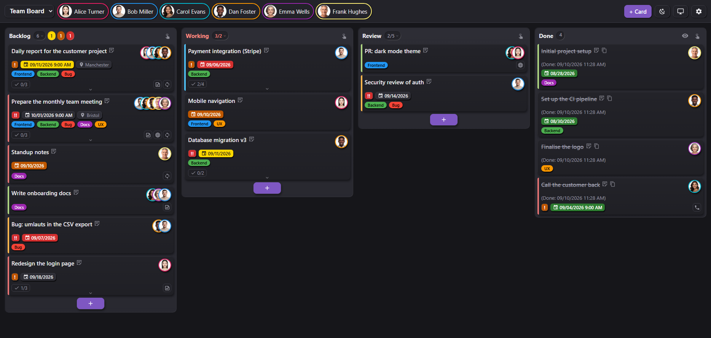

# ioBroker Kanban: documentation (English)

A **Kanban board as a dedicated ioBroker adapter**. It ships its own web server, serves a single-page app with no framework (plain JavaScript) and keeps every open view in sync over a WebSocket. Cards move by drag & drop, boards and columns are freely configurable, tasks can recur, and notifications go out by e-mail, with a calendar invite on request. Everything is reachable from outside over REST, webhooks and `sendTo`.

> **Who is it for?** Households that manage tasks together, whether that is a family, a flat-share or the maintenance plan for a house, and want those tasks where ioBroker already runs. Every event lands in a state that scripts and Node-RED can read, and the board embeds into Lovelace as a webpage card.



---

## Contents

- **[Installation & first steps](#installation--first-steps)**
- **[Part A: Instance settings (ioBroker admin)](#part-a-instance-settings-iobroker-admin)**
  - [Tab "General"](#tab-general)
  - [Tab "Users"](#tab-users)
  - [Tab "Notifications"](#tab-notifications)
  - [Tab "Webhooks (in)"](#tab-webhooks-in)
  - [Tab "Webhooks (out)"](#tab-webhooks-out)
- **[Part B: The board (web UI)](#part-b-the-board-web-ui)**
  - [Header bar](#header-bar)
  - [Boards, columns & labels](#boards-columns--labels)
    - [Counts in the column header](#counts-in-the-column-header)
    - [Trash](#trash)
    - [Move done cards to the trash](#cleanup)
  - [Cards: all fields](#cards-all-fields)
  - [Card templates](#card-templates)
  - [Sorting & order](#sorting--order)
  - [Recurrence](#recurrence)
  - [Public holidays](#public-holidays)
  - [Users in the board](#users-in-the-board)
  - [Mobile view](#mobile-view)
  - [Sharing views / URL parameters](#sharing-views--url-parameters)
- **[Part C: Integration & automation](#part-c-integration--automation)**
  - [REST API](#rest-api)
  - [Webhooks: inbound](#webhooks-inbound)
  - [Webhooks: outbound](#webhooks-outbound)
  - [sendTo & action state](#sendto--action-state)
  - [Live sync & deep links](#live-sync--deep-links)
  - [ioBroker states & objects](#iobroker-states--objects)
- **[Part D: Reference](#part-d-reference)**
  - [Security & access control](#security--access-control)
  - [Language / internationalization](#language--internationalization)
  - [FAQ & pitfalls](#faq--pitfalls)

---

## Installation & first steps

1. **Install the adapter.** In the ioBroker admin under *Adapters*, filter for `kanban` and install it (for a GitHub install see [Installation in the main README](/#/adapters/kanban#installation)).
2. **Create an instance.** Open the **⋮** menu on the adapter tile and pick **"+"**. ioBroker creates the instance (`kanban.0`) and shows a console window that can be closed after `Process exited with code 0`. Repeat for every further instance (`kanban.1`, `kanban.2`, ...).
3. **Set the port.** Under *Instances*, open the gear of the instance, tab **General**: adjust **port** (default `8095`), **IP binding** (default `0.0.0.0`) and **base URL**.
   **With several instances:** each needs its own port. If the configured one is taken, the adapter still starts and falls back to the next free port. The instance list, however, keeps showing the *configured* port, and the link there leads to the wrong instance. The port actually in use is in the log: `Port 8095 is in use - falling back to free port 8096. The instance list still shows the configured port; enter the free port there to keep both in sync.` Then enter that port in the settings.
4. **Add a user.** Tab **Users**: a fresh instance ships with **none**. Enter at least one person, because every card needs an assignee. Take a moment over the ID: it cannot be changed after the first start, while the display name can be changed any time. [Tab "Users"](#tab-users) explains why.
5. **Open the web UI:** **`http://<host>:<port>/`**
6. On first launch there is no board yet. Use the **gear icon**  at the top right to create one. Every new board comes with three default columns:
   - **To do** (`todo`)
   - **In progress** (`doing`)
   - **Done** (`done`, flagged as the "Done" column)
7. Create the first task with **"+ Card"**.

**Multiple instances:** Every instance (`kanban.0`, `kanban.1`, ...) is a fully independent system with its own port, language, users and boards. **No data is shared.** Useful e.g. for separate areas (family vs. club) or a test system next to the production board.

**How this documentation is organised:** [Part A](#part-a-instance-settings-iobroker-admin) covers everything configured in the **ioBroker admin** under *Instances → `kanban.0` → gear* (port, language, user list, e-mail, webhook tokens). [Part B](#part-b-the-board-web-ui) describes the **web UI** of the board itself (boards, columns, cards, views). [Part C](#part-c-integration--automation) is aimed at scripts and third-party systems, [Part D](#part-d-reference) holds security, languages and the FAQ.

---

## Part A: Instance settings (ioBroker admin)

These settings live in the **ioBroker admin** under *Instances → `kanban.0` → gear*. They apply to the **entire instance** and only take effect on **Save**, the adapter restarts in the process. The sections below match the five tabs of the configuration page.

> Throughout this document `kanban.0` stands for **the local** instance. With a second instance all paths and states read `kanban.1`, `kanban.2`, ... accordingly.

### Tab "General"


| Setting | Meaning |
|---|---|
| **Port** | Web server port (default `8095`). If it is taken, the adapter falls back to a free one, but the instance list keeps showing the configured port. How to spot and straighten that out is in [Installation, step 3](#installation--first-steps). |
| **IP address** | Bind address (default `0.0.0.0` = all interfaces). |
| **Base URL** | Publicly reachable URL used in e-mail links (e.g. behind a reverse proxy). Empty = auto-detect local IP. |
| **Default theme** | `auto` (system), `light` or `dark`. |
| **Accent color** | Color of the controls (default `#7E57C2`). |
| **Language** | UI language. Eleven languages are available, listed under [Language / internationalization](#language--internationalization). Empty/automatic = ioBroker system language. Can be overridden per URL with `?lang=xx`. |
| **Date format** | Display format of the due date. The field is **empty by default** and then uses the **ioBroker system format**. Tokens see the table below; `DD.MM.` is one possible pattern among them. On start the adapter checks whether the format carries a day, month or year at all. Bad input is discarded (with the reason in the log) and the display falls back to the system format. |
| **Time format** | `24 hours (14:00)` or `12 hours (2:00 PM)`. Applies to the optional time of day on cards. |
| **Custom CSS** | Served as `/api/custom.css`, for individual tweaks. |

#### Date format tokens

The common moment/Day.js notation applies (case-sensitive):

| Token | Meaning | Example (20 July 2026) |
|---|---|---|
| `D` / `DD` | day without / with leading zero | `5` / `05` |
| `M` / `MM` | month as a number without / with leading zero | `7` / `07` |
| `MMM` / `MMMM` | month name short / full | `Jul` / `July` |
| `YY` / `YYYY` | year two / four digits | `26` / `2026` |
| `ddd` / `dddd` | weekday short / full | `Mon` / `Monday` |

Month and weekday names are rendered in the board language. Examples: `DD.MM.` → `20.07.` · `DD MMMM YYYY` → `20 July 2026` · `dddd, DD MMM` → `Monday, 20 Jul` · `MM/DD/YYYY` → `07/20/2026`.

> Note: ioBroker itself uses `OO`/`O` for month names. Those are **not** supported here, a string copied from the system format that contains `OO` has to be rewritten to `MMMM`.

### Tab "Users"

This is where the users are created. The list applies to the entire instance. In the board they appear as chips in the header bar and can be assigned to cards.


| Field | Meaning |
|---|---|
| **ID** (`name`) | Internal ID, lowercase, no special characters (e.g. `bjoern`). Used in URL parameters and assignments. |
| **Display name** (`displayName`) | Display name of the user (e.g. `Björn`). |
| **E-mail** (`email`) | Optional. Target address for e-mail notifications. |
| **notify...** | Nine per-user checkboxes controlling notifications, see [Tab "Notifications"](#tab-notifications). |

Add a row with the **"+"** in the table header; the bin icon at the end of a row removes it again (without asking). The two arrows next to it move a row up or down; the order of the table is the order the people appear in within the board. Rows without an ID are dropped when saving. A fresh instance ships with **no** users; until the first one is added, the "+ Card" button in the board is blocked and says so.

> **The ID cannot be changed once created.** Boards and cards find their people through it, and the avatar pictures and the addresses of shared views hang on it as well. Changing it later would leave all of that pointing nowhere, and the adapter could not even clean up afterwards: a rename cannot be told apart from "deleted and newly created". The adapter therefore fixes the ID as soon as the user has been saved once. To do so it writes a marker into the instance configuration on the next start and restarts once while doing so - once per new user, never again after that.
>
> **When the field locks:** only once something hangs on the ID, meaning a card is assigned to it or it carries an avatar image. Until then it can be changed freely; an ID nothing points at is safe to rename. A freshly set up instance with users but no cards therefore never writes its configuration back and never restarts itself.
>
> **If the field stays typeable:** saving the instance settings at exactly the moment the adapter writes the marker back overwrites it again with what the form still held. The adapter retries up to three times, after that it logs "Could not freeze the user ID(s)" and leaves the fields typeable. That state only shows **after a full reload of the admin page**, though: inside the open page the field stays typeable even when the adapter locked it long ago. The log is the more reliable source; it says either "User ID(s) ... are now fixed" or the warning. In a real failure, restart the instance once and check that the fields are locked **before** creating any cards.
>
> The **display name** stays freely editable. "Tom Reich" becomes "Tommy Reich" without a single card noticing.
>
> *Recommendation:* give the ID a moment's thought at the outset. Lower case, no umlauts, and readable enough to survive in a shared address (`?users=bjoern`).
>
> <a id="renaming-a-user"></a>
> **If cards do point nowhere**, the adapter reports it on start in the log and in the state `info.orphanedAssignees`, and the gear icon  in the board header gets a small dot. That happens when someone was deleted and created again, or when a card came in through the API with a foreign ID.
>
> The repair lives under **Settings → Users → Orphaned assignees**. That section only exists while there is something to repair - with everything in order the tab shows nothing but the user avatars. Each orphaned ID gets a row with its extent and the boards involved; the card count expands into the list of cards, so nothing gets moved unseen. Next to it a dropdown with the existing people and a button that asks first. The trash stays out of it: what is on its way to deletion does not need to belong to anyone.
>
> The same thing works through the interface:
>
> ```bash
> curl -X POST "http://<host>:8095/webhook/<TOKEN>/action" -H 'Content-Type: application/json' -d '{"cmd":"reassignUser","from":"bjoern_old","to":"bjoern"}'
> ```
>
> This carries over the assignees of every card, the member lists of the boards **and** the avatar picture. The picture only if the target person has none yet. If the new ID was already on a card, no duplicate entry appears. The target ID has to exist in the instance settings, otherwise the call fails with `400`.

### Tab "Notifications"

Notifications are triggered on card events and delivered via **e-mail** (through the ioBroker `email` adapter) and/or **outbound webhooks**. In addition, every event is written to the state `kanban.0.lastEvent` (as a script trigger).


| Setting | Meaning |
|---|---|
| **Email adapter instance** | Which `email.x` instance is used for sending. |
| **Sender** | Optional sender address (empty = email adapter default). |
| **Reminder time** | `HH:MM`, when due cards are checked (default `08:00`). |
| **Remind X days before due** | Lead time for `cardDue` reminders (`0` to `30`, default `1`). |
| **Fire "card due" at the card's time of day** | **Off** by default. In addition to the daily reminder, cards with a **time of day** fire `cardDue` exactly at that time (`detail.exact = true`), so automations can trigger to the minute without polling the API. **Note:** the event goes through the normal notification path, so a second "due" e-mail is also sent to everyone who has that notification enabled. To drive scripts and webhooks only, the "due" e-mail notification should be turned off for that user. |
| **Default** | Global fallback switches per event. They apply when a user has no notification settings of their own in the Users tab (see below). |

At the very bottom of the tab sits the block **"Other services (Telegram, Pushover, ...)"**. It holds no setting, only the note that e-mail is the one notification path built in, plus a link to examples for connecting other adapters, Telegram for instance: [Notifications to any service](#other-services).

#### Who gets notified, and when?

In the **"Users"** tab every user has nine checkboxes. They decide which events trigger an e-mail for that person:

| Checkbox | When exactly it fires | Recipients |
|---|---|---|
| **assigned** (`notifyAssigned`) | As soon as someone is set as an assignee, on card creation for every initial entry, and when added later. Fires **once per person**. | **Only the person concerned** |
| **due** (`notifyDue`) | Daily at the reminder time (default `08:00`) for cards due today or within the lead days. A run missed due to an adapter restart is caught up. | All assignees of the card |
| **changed** (`notifyUpdated`) | On every edit of a card (title, date, labels, checklist ...). | All assignees of the card |
| **moved** (`notifyMoved`) | When moved to a different column. | All assignees of the card |
| **done** (`notifyDone`) | **In addition** to "moved", if the target column is flagged as *done*. | All assignees of the card |
| **created** (`notifyCreated`) | **Once** when a card is created; likewise when it is copied from another board and when a recurrence spawns the next card. | **All members of the board**, regardless of who it is assigned to |
| **trash** (`notifyDeleted`) | When a card moves to the **trash**, whether deleted by hand or by the automatic cleanup. Default: off. | All assignees of the card |
| **restored** (`notifyRestored`) | When a card is **restored** from the trash. Default: off. | All assignees of the card |
| **deleted** (`notifyPurged`) | When a card is removed **permanently**, either after 30 days in the trash or by hand. Default: off. | All assignees of the card |

The core difference between **assigned** and **created**: "assigned" is the **personal** message to the assignee and goes to that one person only. "created" is the **status message** to the whole team, every member of the board, even when the card belongs to someone else.

**Careful, events overlap.** Some actions trigger several events at once. Anyone with both checkboxes set will receive **several e-mails**, there is no bundling:

| Action | Events fired |
|---|---|
| Create a card **with** assignees | **created** + **assigned** |
| Edit a card and add someone | **changed** + **assigned** |
| Drag a card into the done column | **moved** + **done** |
| Switch the column in the card editor to a done column | **changed** + **moved** + **done** |
| Switch the column in the card editor to an open column | **changed** + **moved** |

For most setups **"assigned"** alone is therefore enough. **"created"** pays off where cards that *others* create matter too, with a shared assignment.

**Fallback:** if a user has nothing set for an event, the **global default** applies (tab "Notifications", section "Default"). This way existing users keep receiving notifications without having to configure everything individually.

**No self-spam:** whoever triggers a change is not notified about that very change.

**Prerequisite:** only users **with an e-mail address on file** receive mails; everyone else is skipped.

> **The route counts too.** Moving a card by dragging produces the events of a move. Switching the same column in the **card editor** counts as a change to the card as well, so **changed** comes on top. With every checkbox set, one gesture produces three messages.

> **Trash events:** "moved to trash", "restored" and "permanently deleted" have their own checkboxes, all **off** by default. An **automatic cleanup run** does not send one mail per card but **one summary mail per user** listing every affected card. Deleting a single card by hand still sends a normal individual mail. The button with the **broom icon**  empties the whole trash at once and therefore also sends a summary mail rather than one message per card.

#### Calendar invite (.ics)

If **"Calendar invite"** is enabled on a card and a date is set, the adapter attaches a `termin.ics` to the notification e-mail:

- **Without time** → all-day event on the due date.
- **With time** → timed event with the **duration** set on the card (`calendarDuration`, default one hour).
- **With a recurrence** → a **series** instead of a single event: the invite carries an `RRULE`, so the calendar creates the whole series. Daily, every X days, weekly (with weekdays), monthly (day of month), monthly (nth/last weekday) and yearly are mapped. **Exception:** "workday of the month" depends on public holidays, which the calendar standard does not know, so those cards stay single events.
- **The invite is sent only once.** It is attached when the card is **created** or **newly assigned** to someone. Follow-up cards of a recurrence send **no** further invite (the series is already in the calendar), and reminder or move mails attach nothing either. An **updated** invite only goes out when **due date, time, duration or recurrence rule** change. That invite carries the same `UID` and a higher `SEQUENCE`, so the calendar replaces the existing entry instead of adding a second one. Other changes (the title, for instance) deliberately do not trigger a new invite.
- **Deleting sends a cancellation.** When a card with an invite moves to the trash or is removed for good, an `.ics` with `METHOD:CANCEL`, the same `UID` and the next `SEQUENCE` goes out. The calendar clears the entry instead of leaving it behind.
- Title (`SUMMARY`), description, **location** (`LOCATION`) and link (`URL`) are carried over.
- **Time zone:** timed events are emitted unambiguously in UTC; the underlying time zone is determined from the system (or `system.config`), including daylight saving. All-day events are deliberately time-zone-free.

The attachment is included with **every** notification for the card, so an invite enabled only later arrives with the next "Card changed" mail.

### Tab "Webhooks (in)"

Other systems (or ioBroker itself) can modify cards and boards via HTTP. Those requests are secured with **tokens**, which are managed here. The matching endpoints and commands are documented in [Part C](#webhooks-inbound).

| Field | Meaning |
|---|---|
| **name** | Label (shown as the source in logs). |
| **token** | Secret token, part of the URL. |
| **allowedBoards** | `*` = all boards, or a list of allowed board IDs (separated by space, comma, or semicolon). **Empty = no board**: such a token cannot write anything. Enter `*` explicitly to mean all boards. |
| **enabled** | Token active/inactive. |

The **"Generate new token"** button (above the table) automatically adds a new row with a secure random token (32 hex chars) and the name `agent`/`agent1`/.... Then adjust the name, optionally restrict `allowedBoards`, and **Save**. Alternatively fill the token field manually (e.g. `openssl rand -hex 16`). **Recommendation:** use a separate token for each integration (each agent, each script), that way each one can be revoked or replaced individually via the `enabled` checkbox.

Invalid token → HTTP `401`. Board not allowed → HTTP `403`.

**Quick test:** a single call shows whether a freshly created token works. For the standard case there is no need to jump to [Part C](#webhooks-inbound):

```bash
curl -X POST "http://<host>:8095/webhook/<YOUR_TOKEN>/action" \
  -H 'Content-Type: application/json' -d '{"cmd":"listBoards"}'
```

If a **board list** comes back, the token is valid. All further commands and the complete list of responses and error codes are in [Part C](#webhooks-inbound).

Below the table sit two more switches: **"Accept commands via the action state"** (see [sendTo & action state](#sendto--action-state)) and **"Allowed browser origins (CORS)"**. The latter normally stays empty and is only needed when a website on another address calls the API from the browser. Details are under [Security & access control](#security--access-control).

### Tab "Webhooks (out)"

The adapter can send an **HTTP POST** to arbitrary URLs on every event, e.g. to Node-RED, IFTTT, a chat service or a script written for the purpose.

| Field | Meaning |
|---|---|
| **name** | Label. |
| **url** | Target URL (receives `POST` with a JSON body). |
| **events** | `*` = all events, or a list of event types (separated by comma/semicolon/space). |
| **enabled** | Active/inactive. |

**Event types:** `cardCreated`, `cardUpdated`, `cardMoved`, `cardAssigned`, `cardDone`, `cardDeleted`, `cardRestored`, `cardPurged`, `cardDue`.

The structure of the JSON payload and the delivery details are in [Part C](#webhooks-outbound).

---

## Part B: The board (web UI)

The web UI at **`http://<host>:8095/`** is the actual workspace. Everything in this part is configured directly in the browser and takes effect immediately, no adapter restart. Thanks to live sync, changes show up on all open devices right away.

### Header bar

The **header bar** contains, left to right: the **board selector**, the **user chips** (doubling as a person filter, see [Users in the board](#users-in-the-board)), the **"+ Card"** button, the **theme toggle** (sun/moon ), the **"Views"** dialog (monitor icon , see [Sharing views](#sharing-views--url-parameters)) and the **settings** (gear ).

*Note: in embed mode (`embed=1`) the header bar is hidden entirely.*


### Boards, columns & labels

The button with the **gear icon**  opens the board manager. It has three tabs: **Board**, **Templates** (see [Card templates](#card-templates)) and **Users** (colours and avatars, see [Users in the board](#users-in-the-board)). Changes are only applied on **Save**.

At the very top of the Board tab sits a row with three elements. The fourth entry of the table, "Delete board", sits at the bottom of the tab:

| Element | Effect |
|---|---|
| **Board picker** | Selects which board is being edited. The board displayed in the background does not change. With unsaved changes the dialog asks first (save, discard, cancel). |
| **Arrow button** | Switches the displayed board to the one being edited, while the dialog stays open. It is greyed out when the active board is already selected. |
| **Name field + "Create"** | Creates a new board. It immediately becomes the board being edited and starts with all known users as members plus its own trash column. |
| **"Delete board"** (at the bottom) | Deletes the board being edited after a confirmation. The last remaining board cannot be deleted in the web UI. Via API and webhook (`deleteBoard`) that lock does **not** apply: the last board can be removed there as well, after which the instance shows "No board yet" again. |

Below that follow the board title, the member selection (see [Users in the board](#users-in-the-board)), columns, labels, the notification link target and the [Move done cards to the trash](#cleanup) section.

#### Columns

Columns can be created, reordered by drag & drop, renamed and deleted. **Deleting a column does not lose any cards**, they are moved to the first column of the board automatically. The [trash](#trash) is a system column and does not appear in this list.

> Every action that cannot be undone (deleting a card or board, emptying the trash, permanent deletion) asks for confirmation in a dialog **inside the UI**, styled like the rest of the board and in the configured language.


Above the column list sits a header row with the field names (**Title · Max · WIP · New · Done**).

- **Column ID:** besides its visible title every column carries an **immutable ID**. The three default columns are called `todo`, `doing` and `done`, newly created columns get a generated, unique ID. **Renaming keeps the ID**, so shared `columns=` links and `moveCard` calls keep working unchanged. The IDs can be looked up via `GET /api/boards/<id>` (see [REST API](#rest-api)).
- **Column width:** columns always share the **full width of the window**, so two columns each take up half. Only once less than 280 px would be left per column does the board become horizontally scrollable.
- **Display limit (Max):** a number > 0 shows only the first N cards in that column; `+X more` appears directly under the last one, with the add button below that. `0` = show all. The counter in the column header still counts **all** cards of the column. `+X more` is a **button**: one click shows the remaining cards, the line then reads `- hide X again`, and a second click collapses them. The limit on the board stays untouched; only the local browser remembers the deviation, like the sort mode and the eye icon .
- **WIP limit** (work in progress): a number > 0 caps the recommended card count. If exceeded, the column warns visually (counter & header are highlighted). `0` = no limit. The limit is a **warning**, not a hard block. It always refers to the **total** number of cards in the column, even while a person/label filter is showing fewer. Once it is exceeded, the **column** count sits before the slash even with a filter on, so "7/5" - exactly the number the warning colour comes from. The tooltip names both: how many cards the column really holds and how many the filter shows. While the limit is kept, an active filter simply shows the matches without a slash; a ratio of filtered cards to the limit would mix two different sets.
- **"New"** (`allowAdd`): controls which columns accept new cards. Such a column carries the add button at its foot - a "+" on a coloured pad.
- **"Done" column** (`isDone`): cards moved here count as completed (`doneAt` is set, recurrences are triggered). Their title is shown with a **strikethrough**, and below it the completion time appears in brackets, for example `(Done: 26/07/2026 20:09)`, in the instance's date and time format. That line needs a `doneAt` to be set; cards that never passed through a done column do not show it.
- **Show/hide done (eye icon ):** every done column has a toggle in the shape of an eye at the top right that shows or hides the completed cards (this setting is stored per device).
- **Limit of visible done cards:** the URL parameter `doneLimit=N` (see [Sharing views / URL parameters](#sharing-views--url-parameters)) shows only the N most recently completed cards; handy for compact, shared views.
- **Copy a completed card:** next to the title of a done card sits a small copy icon . It opens the editor with the same content as a **new** card. On save it lands in the first column flagged "New", checklist items start unticked, and the due date is prefilled with **today** if the original had one at all (a time of day is kept).

<a id="counts-in-the-column-header"></a>
#### Counts in the column header

Next to the column title sits not only the card count but, on request, also the number of cards in that column that are due tomorrow, due today or already overdue.

Clicking one of the numbers opens a small menu with four options. Every ticked entry appears as its own badge next to the others.

| Entry | Shows |
|---|---|
| **Total** | the familiar number: all cards of the column, `7/5` with a WIP limit. With a filter active the matches, but once the limit is exceeded the column count again |
| **Tomorrow** | cards inside the lead-time window, yellow |
| **Today** | cards due today, orange |
| **Overdue** | cards whose date or time has passed, red |

The three due-date numbers carry **the same colours as the badges on the cards** and follow the same arithmetic, time of day included. "Tomorrow" means exactly the next calendar day, whatever lead time the instance settings hold for the reminder mail. When a number is `0` the badge stays in place and merely loses its warning colour, so the header does not jump on every change and the menu stays within reach.

At least one number stays: the last remaining checkmark cannot be removed, because otherwise there would be nothing left to reopen the menu with.

The selection applies **per column** and is stored **per device**, like the sort mode and the eye icon . A person or label filter affects all four numbers alike. The done column and the trash have no menu: every card there counts as completed, so there would be nothing to colour.

The keyboard reaches all of it. Tab lands on the numbers, Enter opens the menu, the arrow keys move inside it, Enter ticks or unticks, Escape closes and hands the focus back. The same is true of the sort menu.


<a id="trash"></a>
#### Trash

Every board has a **"Trash" system column**. Deleted cards do not vanish straight away: they sit there for **30 days** and can be restored at any time. Only afterwards are they removed for good.

- **Visibility:** the trash is **hidden by default**. Show it via **"Show trash"** at the bottom of the board settings. That setting applies to **the local device only**, so other people keep seeing their usual board.
- **What ends up there:** anything removed with the **Delete** button in the card editor, cards **dragged** into the trash, and the cards from the [automatic cleanup](#cleanup).
- **Bringing a card back:** drag it out of the trash or tap the **restore** icon on the card. It returns to the first open column.
- **Deleting for good right away:** the second icon on the card removes it irreversibly. The button with the broom icon  in the column header empties the **entire** trash. Both ask first. Via API and webhook, `purgeCard` likewise applies **only to cards in the trash**: on an active card it returns `400` with "Karte '...' liegt nicht im Papierkorb". Getting past the retention period therefore always leads through the trash first.
- **Reading the confirmations correctly:** the confirmation when deleting a card says what actually happens: "Move this card to the trash? You can restore it from there for 30 days." Truly irreversible are only the second icon on a card **inside** the trash and the broom button in the column header; their dialogs say so explicitly.
- **Remaining time:** every card shows how long it will still be kept, for example "30 days left".
- **Its own look:** the column is deliberately kept neutral grey, independent of theme and accent colour, so it stands apart from the working columns.
- **Special status:** the trash always sits on the far right, cannot be renamed, moved or deleted and does not show up in the column configuration. It has no WIP limit and no "+ Add card" link, and it does not count towards the counters of other columns. It does have the **sort toggle**, like every other column. The default is deletion time, oldest first - so whatever is closest to being removed for good sits on top.

<a id="cleanup"></a>
#### Move done cards to the trash

To stop the done column from growing forever, each board can move old completed cards into the trash on its own. The setting sits at the bottom of the Board tab and is **off by default**.

| Mode | Effect |
|---|---|
| **Off** | Nothing is moved automatically (default). |
| **By age** | Cards completed more than *X* days ago move to the trash. Default: 90 days. |
| **By count** | Only the *X* most recently completed cards stay in each done column, the rest move to the trash. Default: 100 cards. |

The run happens **once a day** and **on adapter start**. It uses the completion timestamp (`doneAt`); cards without one are left alone. It survives the trash: delete a done card and restore it, and its original completion time is still there. Because the cards only move to the trash, another 30 days remain to pull something back.


*Every card shows how long it will be kept, with restore and delete-for-good below. The broom  in the column header empties the whole trash.*

#### Labels

Labels are coloured tags and are managed **per board** in the *Board* tab (create, rename, recolour, delete). On a card they appear as a coloured badge with automatically contrasting text; in the [Views dialog](#sharing-views--url-parameters) they can be used as a blacklist to hide cards.

The labels carry a drag handle  like the columns above, so their **order** can be set freely, and that order applies everywhere: on the cards, in the picker inside the card editor, and in the summary of the section header. Two cards carrying the same labels therefore look alike.


*Both cards carry Frontend, Backend and Bug - in the same order, no matter which was clicked first.*

#### Link in notifications


Each board decides where the "open card" link in notification e-mails points: **board view** (default, opens the board and briefly highlights the card), **card editor** (opens the edit dialog directly) or **custom URL** (a fixed address, e.g. a Lovelace dashboard the board is embedded in).

### Cards: all fields

**Card anatomy:** the **assignee**, or with several of them the stack of avatars, sits in the top right corner and the title text flows around it. With several assignees the faces fan out to the left on hover or tap, without changing the line breaks. Long titles are cut off after **two lines** with an ellipsis, the full title stays available as a tooltip. If the card carries a **checklist**, it gets a footer: progress on the left, the expand chevron  in the middle and the icons for **description, link and recurrence** on the right, in that order. Without a checklist there is no footer, and the same icons sit at the right end of the label or badge row. Clicking the description icon opens the description in a **read-only window** with rendered Markdown; links inside always open in a new tab. Whether a checklist is expanded or collapsed is **remembered per device and board**, just like the column sort modes, and survives a reload.


**The icons on a card**, in the order they appear:

| Icon | Where | Meaning |
|---|---|---|
|  Sheet with a pencil | right of the title | Open the card editor. The only way in. |
|  Two offset sheets | right of the title, done cards only | Take the content over into a **new** card, see [Copy a completed card](#boards-columns--labels) |
|  Arrow in a circle | in the trash, in a row of its own at the bottom of the card | Restore the card. The remaining retention period sits above it. |
|  Waste bin | next to it | Delete for good, with a confirmation |
| `!` orange, `!!` red | below the title | Priority high or urgent. Nothing appears for normal. |
|  Calendar sheet with a date | below the title | Due date, coloured by [Due date colours](#due-date-colours) |
|  Map marker | below the title | Location, shortened. The full text is in the tooltip. |
|  Note sheet | right of the label or badge row, or in the card footer when there is a checklist | The card has a description. Clicking opens it as a reading window with rendered Markdown. |
|  Varying link icon | next to it | The card has a link. Which icon appears depends on the address, see [Link types](#link-types). |
|  Circular arrows | next to it | Recurring task |
|  Check mark with `3/12` | bottom left of the card | State of the checklist. The triangle beside it expands it. |

The editor opens via the pencil icon  right next to the end of the title; clicking anywhere on the card does not open it. That keeps the editor from being opened by accident while scrolling or tapping. Cards can still be grabbed and dragged anywhere.

The two required fields come first: **title**, and directly below it **assignees**. Then the row with due date, time, priority and column, and below that the calendar invite. Everything else sits in **collapsible sections**: description, labels and card colour, link, location, recurrence, checklist.

The right-hand end of each section header says what is inside: an excerpt of the description, the chosen labels with a colour marker, the location, the recurrence pattern, the state of the checklist. Which sections are open is **remembered per device** and applies to the next new card as well; on a fresh install only the description is open.

The footer holds **Delete**, **Manage** (transfer, clone, save as template), **Cancel** and **Save**. A **×** in the top right closes the dialog, as in every dialog of the board.

**Unsaved changes** do not disappear. Escape, a click on the X and the **browser's back button** ask first as soon as something in the card was changed. On a tablet the back button matters most, because the back gesture is the usual way out of a dialog there. The prompt has three buttons: **Save**, **Discard** and **Cancel**.

**The keyboard reaches everything.** Tab moves from field to field and also onto the section headers; Enter or space opens a section. The chip groups (assignees, labels, card colour, link types) are a single tab stop each: inside them the arrow keys move, Home and End jump to the ends, space or Enter selects. Inside the checklist Enter creates the next item; from there Ctrl + Enter saves.

**If a card belongs to someone who no longer exists**, the old ID appears as its own chip in the *assignees* field, dashed and marked "(deleted)". It can be deselected here; moving it over happens under [Settings → Users](#renaming-a-user).

A card has the following content fields (settable via the API under the same names):


| Field | Type | Description |
|---|---|---|
| **title** | text | Task title (required). |
| **description** | Markdown | Description, rendered as Markdown (links, images, lists ...). As soon as the field contains something, the editor shows a **live preview** of the rendered Markdown **below the input**, so the result is visible while typing. Embedded HTML is sanitized before display (XSS protection). |
| **due** | `YYYY-MM-DD` | Due date. The badge is coloured by state, see [Due date colours](#due-date-colours). |
| **dueTime** | `HH:MM` | Optional time of day. Enabled via a checkbox, shown on the card after the date. Only effective together with `due`. |
| **priority** | `0`/`1`/`2` | Normal / High / Urgent. On the card this shows as a badge below the title (before due date and location): **Normal** shows nothing, **High** an orange `!`, **Urgent** a red `!!`. Other values are rejected, via the API with an error (see [Responses & errors](#responses--errors)). |
| **assignees** | list of user IDs | Assignees. Determines who receives notifications. **Required, through the API as well:** at least one person must be given, and every ID must exist in the instance settings. Otherwise the interface answers with `400` and names the IDs it knows. **Exception:** with exactly one user configured the field is filled in automatically instead of being rejected. An ID that is **already on the card** remains allowed when editing, even if the user no longer exists - otherwise the orphaned card would be the one card nobody could touch. By default **all** users of an instance are assignable; the member list of a board narrows that down. |
| **labels** | list of label IDs | Colored tags. Labels are managed per board (create, rename, recolor, delete). If a label arrives through the API that the board does not know, it is **created** rather than rejected (title = ID, colour taken in turn from the same palette as in the interface; both editable afterwards). |
| **color** | hex color | Colored bar on the left edge of the card. Chosen via an embedded color picker (color field + hue slider + hex input) or presets. |
| **link** | URL | A link. The card shows a **type-dependent icon** (see [Link types](#link-types)). |
| **location** | text | Location. Shown as a location badge (pin icon) on the card and copied into the calendar invite as `LOCATION`. |
| **checklist** | list | Sub-items with checkboxes; once there are at least two, drag the small **handle**  on the left in the editor to reorder them. Shown as progress `✓ 2/5` in the bottom left on the card. The **chevron**  at the middle of the card footer expands/collapses the items directly on the card, where they can also be **ticked off** (saved immediately). |
| **calendarInvite** | yes/no | If enabled **and** a due date is set, a **`.ics` calendar invite** is attached to every notification e-mail for this card. |
| **calendarDuration** | `HH:MM` | Duration of the calendar invite, default **`01:00`** (one hour). The field appears in the editor right next to the **calendar invite** checkbox once that is enabled. Only effective for events **with a time of day**; without one it stays an all-day event. |
| **recurrence** | object | Recurrence rule (see [Recurrence](#recurrence)). |

The adapter also manages automatically: `id`, `columnId`, `order`, `createdAt`, `createdBy`, `movedAt`, `doneAt`, `trashedAt`, plus the internal markers `lastReminderAt`, `lastExactAt` (so the same reminder or time-of-day event does not fire twice on the same day) and `icsUid`/`icsFingerprint`/`icsSeq` (calendar series: the same UID across the whole recurrence chain, and detection of changed appointment data).

Every card object of the **REST API** additionally carries the computed field **`dueAt`**, the due date including time as an ISO timestamp with local offset (e.g. `2026-08-01T13:30:00+02:00`; `00:00` without a time, `null` without a date). It is identical to the `dueAt` of the events, is **not stored** and is ignored on write, so automations do not have to combine `due` + `dueTime` + time zone themselves.

`movedAt` records **since when a card has been sitting in its current column** and is the basis for the "age in column" sort mode. It is only refreshed on a real column change; reordering within the same column in manual sort mode leaves it untouched. `trashedAt` marks when a card went to the trash and drives the 30-day deadline.

#### Transfer or clone a card

In the footer of the card editor, right next to **Delete**, sits the **Manage** button. It opens the dialog of the same name, which lists four options one below the other, each with a line of explanation: **Clone**, **Copy**, **Move** and **Save as template**. The fields below and the label of the button at the bottom right follow the chosen option. What "Save as template" does is described under [Card templates](#card-templates).

- **Clone** duplicates the card **within the same board**. Only the **target column** is shown, preselected with the column the card currently sits in. Done columns are not offered, since the clone is a new card; if the original sits in one, the first column with the "New" flag is preselected. The clone carries over everything: checklist, labels, assignees, recurrence. Left on the preselected column it lands directly **below the original**; with a different column it is appended at the **bottom** of that one instead.
- **Copy** and **Move** additionally reveal the **target board**; its first column flagged "New" is preselected. Move takes the card with it (it leaves the current board), copy creates a new card on the target and leaves the original untouched. If there is no other board, both options are disabled and the dialog opens with "Save as template" selected.
- **Labels** are matched by **name**. If the target board has a label with the same name it is kept; labels without a match are dropped. The target board is never silently extended with new labels.
- **Assignees** are only kept if they are **members** of the target board. The dialog shows beforehand what will be dropped.
- If **nobody** would be left, the dialog shows a picker of the target board's members and only allows the transfer once at least one person is selected. That way no card can end up without an assignee.
- Moving fires `cardMoved` (flagged as a board change), copying and cloning fire `cardCreated` with a new card id (a clone additionally carries `detail.clone = true`).

#### Link types

The board derives a matching icon (Material Design Icons) from the address entered. Rules are evaluated top to bottom, the **first match wins**.

| Icon | Detected by | Example |
|:--:|---|---|
|  | `mailto:` | `mailto:hausmeister@example.com` |
|  | `tel:` | `tel:+491701234567` |
|  | `youtube.com` / `youtu.be` | `https://youtu.be/xxxxxxxxxxx` |
|  | address ends in `.pdf` | `https://example.com/anleitung.pdf` |
|  | `.jpg` `.jpeg` `.png` `.gif` `.webp` `.svg` | `https://example.com/grundriss.png` |
|  | route: `waze.com`, `/maps/dir/`, `daddr=` | `https://www.waze.com/ul?ll=52.52,13.405` |
|  | place: Google/Apple Maps, OpenStreetMap, `geo:` | `geo:52.52,13.405` |
|  | internal address: private ranges (`10.`, `172.16.` to `172.31.`, `192.168.`), `127.`, `169.254.`, `localhost` plus host names ending in `.local` `.lan` `.home` `.internal` `.fritz.box` | `http://192.168.1.10:8123/` |
|  | external web links | `https://example.com` |

A **bar with these nine icons** sits above the link field, in the order web link, internal address, e-mail, phone, YouTube, PDF, image, route, location. Clicking one puts a matching example into the field as a placeholder, for example `tel:+49123456789` instead of `https://...`. Anything already typed stays untouched. The other way round, the bar highlights which type matches the address currently entered, and follows along while typing.

Only the safe schemes `http(s)`, `mailto:`, `tel:` and `geo:` are clickable (see [Security & access control](#security--access-control)). **The field accepts exactly what the board later renders:** on top of those schemes that means relative paths and addresses without a scheme such as `example.com`, which get `https://` prepended. Everything else, `javascript:` or `data:` for instance, is rejected on save.

### Card templates

A template is a named set of card fields. It belongs to a board, sits next to the cards, and works as a stamp rather than a link: whatever comes out of it is an ordinary card afterwards and knows nothing of its origin.

**Creating one.** On an existing card choose "Manage" and then "Save as template". The name field is prefilled with the card title; the name is also the title that later cards receive. If the name already exists, the adapter asks before replacing the contents of that template. This is also the way to change a template's contents without opening it in the tab.


**Two things stay behind.** The due date is dropped, because a fixed date ages: a template saved in January would create cards dated the day before yesterday in March. And the checklist ticks are reset, because a template holds the items, not their state. The time of day does travel along, since 17:00 is a property of the task.

**Using one.** While creating a card, a picker sits at the bottom left of the editor, in the place where "Delete" and "Manage" sit while editing. With no templates on the board the picker is absent. A choice sets **every** field anew, including those empty in the template; if the editor already holds something, a question comes first. Labels the board no longer has and assignees who are not members of the board are left out. The picker then returns to its placeholder.


If the template carries a recurrence and the due field is left empty, the adapter works out the next date itself and anchors the pattern to today. A template of "every 30 days" therefore creates a card that is due today and counts from there, not from a pattern set half a year ago.

**Managing them.** Settings → "Templates" tab. Each template gets a row with a checkbox, a drag handle , a name field and three buttons:

| Button | Effect |
|---|---|
| ✎ | opens the template in the card editor; the name stays as set in the tab |
| ↗ | exports this one template |
| × | deletes the template |

The order of the rows is the order in the picker of the card editor. Renaming carries the title along that later cards receive. There is no button to create one here, because a template always comes from a card. Everything changed in this tab takes effect with the dialog's save button.


**Exporting and importing.** Two buttons sit below the list. The left one reads "Export all" while every box is ticked, and "Export selection" with the count otherwise; with nothing ticked it is disabled. Both open a dialog holding the text, a download button and a copy button. The text is not decoration: on a tablet in kiosk mode there is neither a file picker nor a download folder, and copying is the only way there.

"Import" opens a dialog of its own with two steps.

In the first step the text of an export goes into the field, either through the "Choose file" button or by pasting it. A chosen file ends up in the field as well, so it is visible what will be read. From choosing the file until it arrives, "Reading file..." is shown next to the button. "Read" stays disabled while the field is empty. If the text is not valid JSON or holds no Kanban templates, the error appears in the dialog below the field.

In the second step the list of templates found appears with ticks, so individual ones can be left out. With nothing ticked, "Add" is disabled. The rules are:

- **Appended, never replaced.** On import there is no telling what hides behind a name in the file, and a wrongly confirmed overwrite could not be undone. A name that already exists gets a counter, as in "Filter change (2)".
- **Labels are matched by name**, compared in lower case. A label ID from another board means nothing on this one. Whatever does not match is dropped; an import does not add labels to the target board unasked.
- **Assignees who are not members of the target board are dropped when a card is created.** If none remain, the editor asks for a choice.
- At most 50 templates per board. Whatever goes beyond that is left out; if the list is already full, the dialog shows an error.

After "Add" the dialog closes and the new templates appear at the bottom of the list. Below the two buttons of the tab, a line states the balance: added, renamed, labels dropped, did not fit. It ends with "Not saved yet.", because an import, too, only takes effect with the dialog's save button.

**From a script.** The `addCard` command takes a `template` field, matched against the ID first and the name second:

```json
{ "cmd": "addCard", "board": "house", "template": "Filter change", "due": "2026-10-01" }
```

Fields given explicitly beat the template, everything else comes from it. An unknown name is an error and creates no card, so that a typo in a script does not quietly produce half-filled cards for months.

### Sorting & order

By default the order of cards within a column is set by hand: click a card, hold it and drag it up or down (this works with touch on a phone too). In the same way a card moves into another column to change its status. The chosen order is kept and synced live to all open views.

This holds even when **not all cards are visible**, with a person or label filter active or a display limit in place. The card then lands exactly where it was dropped between the visible neighbours, and the hidden cards keep their order around it.

Instead, **each column individually** can be sorted automatically. Clicking the sort icon in the column header opens a small menu with five modes:

| Mode | Behaviour |
|---|---|
| **Drag & drop** | The hand-made order. Cards are grabbed and dragged directly (default). |
| **Drag handles**  | The hand-made order as well, but every card gets a handle on the left. Dragging only works via that handle, which makes reordering easier on a touchscreen. |
| **Due date** | Earliest date first, taking a set time of day into account. Cards without a date sit at the bottom. |
| **Priority** | Highest priority first; within the same priority the due date decides. |
| **Age in column** | The card that entered this column most recently sits on top. In a done column that is the task ticked off last. |

For the three automatic modes a **direction toggle** appears next to the sort icon. One click reverses the order, and the arrow shows the current direction at a glance. In "age in column" that means either what was finished last on top, or the cards that have been sitting longest.

A few details keep reversing predictable: only the main criterion is flipped. Cards without a date or timestamp stay at the bottom, ties are still decided by the title, and within the same priority the due date still sorts ascending.

The menu can be operated from the keyboard as well: Tab reaches the button, Enter opens it, the arrow keys move within the menu, Escape closes it and hands the focus back.

The **trash** has this menu too. There, "drag & drop" and "drag handles" do not mean a hand-made order - nothing can be dragged inside the trash anyway - but the order by deletion time, oldest first. That is the default and puts whatever is closest to being removed for good on top. The direction toggle reverses it as well. The other three modes behave exactly as in any other column.

**Mode and direction are stored per device** (like the eye icon ), so they only affect the view they were set in. In the automatic modes, reordering within the column is disabled because it would have no effect; moving cards to another column still works. Switching back to "drag & drop" or "drag handles" brings the saved manual order back unchanged.

Independently of all this, the due badge is coloured, so anything urgent stands out regardless of its position.


<a id="due-date-colours"></a>
#### Due date colours

| Colour | State |
|---|---|
| **red** | The due date lies in the past |
| **orange** | The card is due today, but its due time has not passed yet |
| **yellow** | The card is due tomorrow, meaning the next calendar day |
| neutral | The card is not due until the day after tomorrow or later |
| **green** | The task on the card has been completed |

Two differently computed questions sit behind this. The **early-warning window** (yellow) is planning and counts in **calendar days**: yellow is exactly the next calendar day. Not a rolling 24 hour window, so tomorrow stays tomorrow all day.

> The setting [**Remind X days before due**](#tab-notifications) governs how early the **reminder mail** goes out, nothing else. The colours on the board do not depend on it.

Card overdue: when the card carries a **time of day**, 17:00 for instance, it is overdue at 17:01, and that is exactly when the `cardDue` event fires with `detail.exact`. Without a time, the colour changes at midnight. The states [`overdueCount` and `overdueList`](#iobroker-states--objects) follow the same rule, so colour and counter change in the same minute.

The tooltip on the badge says what a colour means: overdue, due today, due tomorrow, due later, done.

The colours can be changed through [custom CSS](#faq--pitfalls): `--danger` for red, `--warn` for orange, and `--due-upcoming` with `--due-upcoming-text` for yellow. The same grouping sits behind the [counts in the column header](#counts-in-the-column-header).

### Recurrence

Recurring tasks work **on completion** (the Kanban way): as soon as a recurring card is moved to the "Done" column, a **fresh card** with the next matching due date is created automatically in the first non-done column (checklist items reset). Every content field of the template is carried over: title, description, assignees, labels, card colour, priority, link, **time of day**, **location** and the **calendar invite** flag. Cards with recurrence carry a recurrence badge (circular-arrows icon ). The **completed** card does not keep the rule: it moves over to the follow-up card entirely, so the badge disappears there.

If a recurring card is created **without** a manual date, the adapter automatically sets the next matching date.

| Type (`recurrence.type`) | Meaning | Additional fields |
|---|---|---|
| `daily` | Every day | none |
| `weekly` | On specific weekdays | `dayOfWeek`: list `[1..7]` (1 = Monday ... 7 = Sunday) |
| `monthly` | Fixed day of month | `dayOfMonth`: `1..31` (the 31st is clamped to the last day in short months) |
| `monthly_weekday` | N-th/last weekday of the month, e.g. **2nd Tuesday** | `ordinal`: `1..4` or `-1` (last), `dayOfWeek`: `[iso]` |
| `workday` | First/last/n-th **working day** of the month | `workdayPos`: `first` / `last` / `nth` / `nth_last`, `n`: for `nth`/`nth_last` |
| `yearly` | Yearly | `month`: `1..12`, `dayOfMonth`: `1..31` |
| `every_n_days` | Every X days from a start date | `interval`: N, `startDate`: `YYYY-MM-DD` |
| `every_n_days_done` | Every X days **from completion** | `interval`: N |
| `cron` | Cron expression used as a pattern | `cron`: `"0 8 * * 1-5"` |

The two **X days** kinds look alike and count differently. "Every X days" keeps a fixed grid from the start date: a card due every 30 days that is finished ten days late has its next date on the next grid point, so in 20 days. "Every X days (after the previous one is done)" counts from the completion of the preceding card, which would be a full 30 days.

For every calendar-bound kind the next date is always **in the future**. A daily card left alone for two weeks and then ticked off produces a follow-up card due tomorrow, not on some day last week. Finished **early**, the calendar stays the reference instead, otherwise the date would creep forward with every early tick.

**No calendar series** can be built for this kind: when the next date falls is only decided by finishing the card. A [calendar invite](#cards-all-fields) therefore carries the single date only, the same as with "working day of the month".

A **working day** means: not a weekend **and** not a public holiday (see below). Example: "first working day in May" lands on the 4th if May 1st is a holiday/weekend.

#### Cron expression

For patterns the fixed types can't express there is the **cron expression** type. It takes the usual five fields:

```
minute  hour  day  month  weekday
   0      8    *     *      1-5    -> Monday to Friday at 08:00
```

Each field understands `*`, single numbers, lists (`1,15`), ranges (`1-5`), steps (`*/3`, `1-7/2`) and the English short names for month (`jan`...`dec`) and weekday (`mon`...`sun`). Sunday is both `0` and `7`. An expression may be at most 120 characters long, and even the longest sensible pattern stays well below that.

Three things differ from a real cron daemon:

- **The expression is a pattern, not a schedule.** The adapter runs nothing at those moments. It uses the pattern to find the next due date when a card is completed. As with every recurrence, the follow-up card appears when the card is ticked off, not on its own.
- **Minute and hour set the time of the card.** `0 8 * * 1-5` produces cards with the time `08:00`; the *time* field in the editor is filled from the pattern and locked. If the pattern names several times (`15,45 8-10 * * *`), the earliest one wins.
- **`L`, `W`, `#` and `?` do not exist.** For "last working day of the month" or "second Tuesday" use the types *working day of the month* and *monthly (weekday)*, which also know the public-holiday logic that no cron can express.

If **day** and **weekday** are both restricted, they combine with **or**, as in the original: `0 8 1 * mon` matches every first of the month *and* every Monday.

Below the input the editor shows the rule in plain words and the next three dates. If the expression is faulty, the reason appears there instead of a preview and the card cannot be saved.

**Calendar invitation:** simple patterns are translated into a recurrence rule (daily, fixed weekdays, fixed days of the month, yearly). Nested patterns (day and weekday at once, or steps across several fields) have no equivalent in the calendar standard; those cards send a single event per occurrence.

### Public holidays

For the **working-day recurrences** the adapter computes public holidays itself (Easter formula + fixed dates + the German "Buß- und Bettag"), so even dates far in the future are calculated correctly.

- If the ioBroker **`feiertage`** adapter is installed, the Kanban adapter adopts its **state/region configuration** (which holidays apply). Only genuinely work-free public holidays count, days that are not work-free (e.g. Valentine's Day) are ignored.
- Without the `feiertage` adapter a **fallback** with the nationwide public holidays is used.

> Changes to the `feiertage` adapter are picked up on the next start of `kanban.0`.

### Users in the board

Which people exist at all comes from the instance settings ([Tab "Users"](#tab-users)). Their appearance and board assignment, however, are maintained directly in the web UI, without restarting the adapter.

**With only one person**, assignment disappears from the interface entirely: no chips in the header, no avatars on the cards, no *assignees* field in the card editor and no user picker in the views dialog. There would be nothing to choose and nothing to filter. New cards get that person automatically, through the API as well: a `POST` without `assignees` is no longer rejected with `400` but quietly completed. An ID that is given is still checked.

**With no person at all**, no card can be created: the assignee is a required field, and nobody is not the same as anybody. The "+ Card" button is therefore blocked and says on click that a user in the instance settings is missing first, and so is the "+" at the foot of the columns. That state can be reached without any warning by deleting every row there.

The same goes for a **board without columns**: without a column there is nowhere for the card to go, the button says so and the editor does not even open.

> **No cards are created in a done column.** Cards move there, they are not created there: the card editor leaves done columns out when creating and copying, there is no "+" at the foot of such a column, and the API refuses the attempt. The reason is the completion timestamp. A card created there would have none, which would drop it out of the [age in column](#sorting--order) sort, out of the [display limit](#columns) for done cards and out of the [automatic cleanup](#cleanup), leaving it there forever. When **moving** a card and when editing an existing one the done column stays selectable, which is the usual way to finish a card.

As soon as a second user appears in the instance settings, all of it is back. Cards created in the meantime carry that one person and show them from then on. If a card carries an ID that no longer exists, it stays as it is rather than being silently moved; that is what the [repair for orphaned assignees](#renaming-a-user) is for.

**Header chips as a filter:** The user chips in the header double as a **multi-select filter**, tapping toggles a person on or off. With a partial selection the board only shows cards of the selected people; with **all or none** active, all cards are shown. The selection is **stored per board in the browser** and restored on the next visit.

**User colour:** The colour of the avatar ring and chip is maintained **in the board UI** ( → Users) and applies immediately, without restarting the instance.

**Avatar image (optional):** By default the avatar shows the initials (on the user color). In the board UI under ** → "User avatars"** a **PNG/JPG** can be uploaded per user, which is then shown as a round avatar (with preview; the image is automatically cropped to a square, scaled to 128 px and stored in the ioBroker file storage, no config bloat). "Remove avatar" reverts to the initials.


**Members per board:** in the Board tab of the settings (** → Board**), right below the board title, sits the choice of which users are assignable there (card dialog, header chips and the Views dialog only show members). Every board needs **at least one member**; new boards start with all users. Removing someone whose cards would then have no assignee left makes the dialog ask first and name the number: those cards keep their assignment but no longer show up in the board's person filter. The board picker at the top also gives access to the members of other boards, without switching to them.


### Mobile view

On narrow screens the board stacks the columns vertically; each column collapses as an accordion (state is remembered per device). The card, board and views dialogs open full-screen with a fixed action bar at the bottom. To move a card, press and hold briefly, while dragging, a quick-move menu with the target columns appears. The same menu appears whenever the columns no longer fit on screen in full, whether a finger or a mouse is doing the dragging. The "Views" dialog can switch it on for good through "Always show the drop zones while dragging"; that switch travels as a parameter in the generated link. The trash is listed in it only while the trash column itself is shown.

 

*Left the team board: columns stacked as an accordion, the first one collapsed. Right a different board, the household one, showing the quick-move menu that appears over the target columns while dragging a card.*

### Sharing views / URL parameters

The **monitor icon**  in the header opens the **"Views"** dialog. It assembles a filtered view and offers a **ready-to-copy URL** below. Ideal for embedding in Vis 2.0, Lovelace (webpage card) or for sharing.

The dialog covers the **most common** filters: board, users (multiple), labels (multiple) including the switch between **"Hide these labels"** (blacklist) and **"Show only these labels"** (whitelist), visible columns, the done-card limit (`doneLimit`) and the controls to hide (`hideSettings`, `embed`). **Not** in the dialog, but available **as URL parameters only**, are `theme`, `accent`, `lang`, `card` and `focus`. They go onto the generated address by hand where needed.


All parameters can also be appended to the URL directly:

| Parameter | Effect |
|---|---|
| `board=<id>` | Opens this board. The address bar keeps track of the current board: switching via the board picker sets `?board=<id>` (no extra history entry, all other parameters are preserved), so the address can be copied and shared as is. |
| `users=<name,name>` | **Person filter**: shows only cards assigned to at least one of these users (sets the header chips accordingly). `user=<name>` is the short form for a single user. The parameter applies **to this visit only**: the local chip selection stays stored and is back on the next visit without the parameter. A shared link therefore does not overwrite what someone set up on their own device. |
| `label=<id,id>` | **Label blacklist** (multiple possible): hides cards that have one of these labels, new labels stay visible automatically. |
| `onlyLabel=<id,id>` | **Label whitelist**: shows **only** cards carrying at least one of these labels, so cards without a label drop out. Can be combined with `label=` (whitelist first, then blacklist). |
| `columns=<id,id>` | Shows only these columns. Others are hidden. |
| `doneLimit=N` | In done columns, show only the N most recently completed cards (`0` = none, omit = all). |
| `hideSettings=1` | Hides the settings gear . |
| `embed=1` | **Embed mode**: hides the whole header bar (for iframe/Lovelace). |
| `theme=auto\|light\|dark` | Forces a theme. |
| `accent=%23RRGGBB` | Accent color (hex, encode `#` as `%23`). |
| `card=<id>` | Opens a card directly (deep link, e.g. from e-mails). |
| `focus=<id>` | Does **not** open the editor, just briefly highlights the card on the board (pulsing outline). Generated by notifications whose link target is **board view**. |
| `lang=<code>` | Overrides the instance's UI language for this view (de, en, fr, nl, it, es, pl, pt, ru, uk, zh-cn). |

**Examples**

```
# Compact embed: only board "familie", no header
http://192.168.1.10:8095/?board=familie&embed=1&theme=auto

# Only "In progress" + last 3 done cards, filtered to two people
http://192.168.1.10:8095/?board=familie&columns=doing,done&doneLimit=3&users=bjoern,heike

# Everything except cards with label "private", settings hidden
http://192.168.1.10:8095/?board=familie&label=private&hideSettings=1

# The other way round: only cards carrying the label "care-heike"
http://192.168.1.10:8095/?board=familie&onlyLabel=care-heike&hideSettings=1&embed=1
```

> **Lovelace/iframe:** the adapter sets **no** frame headers (`X-Frame-Options`/`frame-ancestors`). The CSP is a `<meta>` tag and does **not** restrict embedding, so the UI can still be embedded directly in a Lovelace webpage card or an `<iframe>`.

---

## Part C: Integration & automation

Boards and cards can be driven entirely from the outside, from ioBroker scripts, Node-RED, shell scripts or LLM agents.

### REST API

For integrations on the same network there is a REST API (the same one the web UI uses). **Reading** (`GET`) is open, **writing** (`POST`/`PATCH`/`DELETE`) requires a token (see [Security & access control](#security--access-control)).

| Method & path | Purpose |
|---|---|
| `GET /api/config` | UI configuration (users, theme, accent color). |
| `GET /api/users` | User list. |
| `GET /api/custom.css` | The custom CSS configured in the settings. |
| `GET /avatars/<name>` | A user's avatar image (PNG). |
| `POST /api/users/<name>/avatar` | Set avatar (`{ image: "data:image/png;base64,..." }`, max 512 KB; token required). |
| `DELETE /api/users/<name>/avatar` | Remove avatar (token required). |
| `GET /api/boards` | All boards (short form). |
| `POST /api/boards` | Create a board (`{ id?, title }`). |
| `GET /api/boards/<id>` | Board with all cards. With `?rev=<n>` it returns `{unchanged:true}` if unchanged (polling). |
| `PATCH /api/boards/<id>` | Change a board (title, columns, labels, members, cleanup setting `cleanup: { mode, days, count }`). |
| `PATCH /api/users/<name>` | Set a user's color (`{ color: "#RRGGBB" }`). Used by the board's user management. |
| `DELETE /api/boards/<id>` | Delete a board. |
| `POST /api/boards/<id>/cards` | Create a card. |
| `PATCH /api/boards/<id>/cards/<cardId>` | Change a card. |
| `POST /api/boards/<id>/cards/<cardId>/move` | Move a card (`{ columnId, order }`). |
| `DELETE /api/boards/<id>/cards/<cardId>` | Move a card **to the trash**, not a permanent delete. |
| `POST /api/boards/<id>/cards/<cardId>/restore` | Bring a card back from the trash (`{ columnId? }`, otherwise the first open column). |
| `POST /api/boards/<id>/cards/<cardId>/purge` | Remove a card **permanently**. |
| `POST /api/boards/<id>/trash/empty` | Empty the board's trash completely. |
| `GET /api/users/orphaned/<name>` | The cards behind an orphaned ID: title, board, column, due date, done or not. `?limit=<n>` shortens the list, the full count stays in `total`. The trash is left out. |
| `POST /api/boards/<id>/cards/<cardId>/transfer` | Transfer a card to another board (`{ toBoard, toColumn?, mode: "move"\|"copy", assignees? }`). With `toBoard` = the same board and `mode: "copy"` the card is cloned in place. |

> **Write access** to `/api` requires a token (`X-Kanban-Token`; the web UI sends it automatically), **reading** stays open on the LAN. Details and limits: [Security & access control](#security--access-control). For external access use the token-based [webhooks](#webhooks-inbound).

#### Structure of a column object

This is how `GET /api/boards/<id>` returns each column, and exactly how `PATCH /api/boards/<id>` expects it back:

```json
{ "id": "todo", "title": "To do", "maxVisible": 0, "wipLimit": 0, "isDone": false, "allowAdd": true }
```

| Field | Meaning |
|---|---|
| `id` | Immutable [column ID](#columns) (`todo`, `doing`, `done` or a generated one like `col_msd0mu8tkck68`). It survives renaming. |
| `title` | The column title shown in the UI, freely editable. |
| `maxVisible` | Display limit ("Max"): a number > 0 shows only the first N cards, `0` = all. |
| `wipLimit` | WIP warning threshold, `0` = no limit. |
| `isDone` | `true` = "Done" column (sets `doneAt` and triggers recurrences). |
| `allowAdd` | `true` = the column shows the add button at its foot. |

The **trash** appears as an additional column with `isTrash: true`. It is managed by the adapter itself and must **not** be sent along when writing.

> **`PATCH` replaces the column list entirely.** There is no way to change a single column: read the current list via `GET /api/boards/<id>`, modify or extend it there and send the **complete** list back. Anything missing counts as deleted, and the cards of that column then move to the first column of the board.

### Webhooks: inbound

The **tokens** used here are managed in the instance settings ([Tab "Webhooks (in)"](#tab-webhooks-in)).

#### Generic endpoint (recommended)

```
POST /webhook/<token>/action
Content-Type: application/json
```

The body contains `cmd` plus the appropriate fields. The same **command vocabulary** applies as for `sendTo` and the `action` state:

| `cmd` | Required fields | Additional fields |
|---|---|---|
| `addBoard` | `title` | `id` (optional, otherwise derived from the title) |
| `deleteBoard` | `board` | none |
| `addCard` | `board`, `title` | all card fields (`due`, `assignees`, `labels`, `priority`, `location`, `recurrence`, ...), `columnId` |
| `updateCard` (alias `editCard`) | `board`, `cardId`\|`id` | card fields to change |
| `moveCard` | `board`, `cardId`\|`id`, `column`\|`columnId` | `order` |
| `doneCard` | `board`, `cardId`\|`id` |, (moves to the done column) |
| `deleteCard` | `board`, `cardId`\|`id` |, (moves to the trash) |
| `restoreCard` | `board`, `cardId`\|`id` | `column`\|`columnId` (target column; otherwise the first open one) |
| `purgeCard` | `board`, `cardId`\|`id` |, (removes permanently) |
| `emptyTrash` | `board` |, (empties the trash) |
| `transferCard` | `board`, `cardId`\|`id`, `toBoard` | `toColumn`, `mode` (`move` or `copy`, default `move`), `assignees`. With `mode: "copy"`, `toBoard` may be the card's own board (clone) |
| `listOrphanedAssignees` | none | none |
| `reassignUser` | `from`, `to` | moves every assignment from `from` to `to`, see [Renaming a user](#renaming-a-user) |
| `listBoards` / `getBoards` | none | none |
| `getBoard` | `board` | none |

> **Field-name pitfalls (important!)**
> - The card ID is **`cardId` OR `id`**, **not** `card`.
> - The target column of `moveCard` is **`column` OR `columnId`**.
> - The board is given via **`board` OR `boardId`**.

**Examples**

```bash
TOKEN=your_token
BASE=http://192.168.1.10:8095

# Create a card
curl -X POST "$BASE/webhook/$TOKEN/action" -H 'Content-Type: application/json' -d '{
  "cmd": "addCard",
  "board": "familie",
  "columnId": "todo",
  "title": "Take out the bins",
  "due": "2026-07-20",
  "assignees": ["bjoern"],
  "labels": ["household"],
  "priority": 1
}'

# Move a card to another column
curl -X POST "$BASE/webhook/$TOKEN/action" -H 'Content-Type: application/json' -d '{
  "cmd": "moveCard", "board": "familie", "cardId": "c_abc123", "column": "doing"
}'

# Mark a card as done
curl -X POST "$BASE/webhook/$TOKEN/action" -H 'Content-Type: application/json' -d '{
  "cmd": "doneCard", "board": "familie", "id": "c_abc123"
}'

# Update a card (e.g. enable the calendar invite afterwards)
curl -X POST "$BASE/webhook/$TOKEN/action" -H 'Content-Type: application/json' -d '{
  "cmd": "updateCard", "board": "familie", "id": "c_abc123",
  "calendarInvite": true, "location": "Town hall"
}'

# Move a card to the trash (restorable for 30 days)
curl -X POST "$BASE/webhook/$TOKEN/action" -H 'Content-Type: application/json' -d '{
  "cmd": "deleteCard", "board": "familie", "id": "c_abc123"
}'

# Bring a card back from the trash
curl -X POST "$BASE/webhook/$TOKEN/action" -H 'Content-Type: application/json' -d '{
  "cmd": "restoreCard", "board": "familie", "id": "c_abc123"
}'

# Copy a card to another board
curl -X POST "$BASE/webhook/$TOKEN/action" -H 'Content-Type: application/json' -d '{
  "cmd": "transferCard", "board": "familie", "id": "c_abc123",
  "toBoard": "wohnung", "mode": "copy"
}'
```

#### Resource endpoints (alternative)

The same actions are also available as REST-like webhook routes (token in the URL):

```
POST   /webhook/<token>/boards/<id>/cards
PATCH  /webhook/<token>/boards/<id>/cards/<cardId>
POST   /webhook/<token>/boards/<id>/cards/<cardId>
POST   /webhook/<token>/boards/<id>/cards/<cardId>/move
```

#### Responses & errors

Every call, webhook as well as REST, answers with JSON. On success the answer is HTTP `200` with the affected object (card or board); commands without a result of their own, such as `emptyTrash`, report `{"ok":true}`. On failure the reason sits in the `error` field (the adapter emits these messages verbatim, in German):

| Situation | Code | Response |
|---|---|---|
| Success | `200` | the affected object or `{"ok":true}` |
| Token missing or invalid | `401` | `{"error":"invalid token"}` |
| Board blocked for this token | `403` | `{"error":"Token darf Board '...' nicht ändern"}` |
| Writing command without a board while the token is restricted to boards | `403` | `{"error":"token is limited to specific boards"}` |
| Board does not exist | `404` | `{"error":"Board '...' existiert nicht"}` |
| Card does not exist | `404` | `{"error":"Karte '...' existiert nicht"}` |
| Column does not exist | `404` | `{"error":"Spalte '...' existiert nicht in Board '...'"}` |
| Required field missing | `400` | `{"error":"title fehlt"}` |
| Invalid date | `400` | `{"error":"due muss im Format YYYY-MM-DD vorliegen, nicht '...'"}` |
| Invalid priority | `400` | `{"error":"priority kennt nur 0, 1 oder 2, nicht '...'"}` |

> **Bad input is rejected, not straightened out.** An unknown `columnId`, an invalid `due` and `getBoard` on an unknown board each return an **error**, so nothing silently ends up in the wrong place.

### Webhooks: outbound

Target URLs and event filters are configured in the instance settings ([Tab "Webhooks (out)"](#tab-webhooks-out)).

**Delivery:** HTTP POST with `Content-Type: application/json`, 5-second timeout, **one** automatic retry after 2 seconds.

**Example payload** (body of the outbound POST):

```json
{
  "event": "cardMoved",
  "ts": "2026-07-12T14:05:46.415Z",
  "board": { "id": "familie", "title": "Family" },
  "card": {
    "id": "c_abc123",
    "title": "Take out the bins",
    "columnId": "doing",
    "due": "2026-07-20",
    "assignees": ["bjoern"],
    "labels": ["household"],
    "priority": 1
  },
  "detail": { "fromColumn": "todo", "toColumn": "doing", "by": "bjoern" }
}
```

Every event has the shape `{ event, ts, board:{id,title}, card:{...}, detail:{...}, link, dueAt }`. The `detail` field varies by event type (e.g. `assignee` for `cardAssigned`, `fromColumn`/`toColumn` for `cardMoved`, `auto`/`reason` for bulk actions, `clone`/`crossBoardCopy` when cloning or copying to another board, `crossBoard` when moving to one, `exact` for the card-precise `cardDue`). `dueAt` carries the due date including time as an ISO timestamp with local offset.

<a id="other-services"></a>
### Notifications to any service (Telegram, Pushover, ...)

Besides the built-in e-mail notification, **any** service can be connected without it being hard-wired into the adapter. On every event the adapter writes the state `kanban.0.lastEvent` and - if configured - sends an [outbound webhook](#webhooks-outbound). A short script (JavaScript adapter) or a Node-RED flow picks that up and forwards it to Telegram, Pushover, Signal, Pushbullet and so on.

**Structure of an event** (content of `lastEvent` / the webhook body):

```json
{
  "event": "cardAssigned",
  "ts": "2026-07-25T09:00:00.000Z",
  "board": { "id": "familie", "title": "Familie" },
  "card": { "id": "c_abc", "title": "Muelltonne rausstellen", "due": "2026-07-27", "dueTime": "18:00", "assignees": ["user1"], "priority": 1, "labels": ["haushalt"] },
  "detail": { "assignee": "user1", "by": "user2" },
  "link": "http://<host>:8095/?board=familie&card=c_abc",
  "dueAt": "2026-07-27T18:00:00+02:00"
}
```

- `event` - event type: `cardCreated`, `cardAssigned`, `cardUpdated`, `cardMoved`, `cardDone`, `cardDeleted`, `cardRestored`, `cardPurged`, `cardDue`.
- `card.assignees` - the assignees (user **ids**, not display names); the notification is aimed at them.
- `link` - ready-to-use deep link to the card, using the base URL from the instance settings.
- `dueAt` - from 0.3.0: the due date as an ISO timestamp with local offset, e.g. `2026-08-01T09:00:00+02:00`. Without a time set, `00:00` is sent; without a due date the value is `null`. Every card object of the REST API carries the same field.
- **`cardDue` comes in two flavours:** the **daily** reminder at the configured reminder time (day-based, including lead time and overdue cards, `detail.overdue` may be `true`). The second one needs the instance option "Fire 'card due' at the card's time of day" and is a **card-precise** event at the card's time with `detail.exact: true` and `detail.dueTime`. The latter fires once per card and day; if the moment falls into a downtime, it is caught up on the next start on the same day. Scripts that only care about exact times filter on `ev.detail && ev.detail.exact`.

**Trash events:** `cardDeleted` now means "moved to the trash" - the card can be restored for 30 days. `cardRestored` fires when it is brought back, `cardPurged` when it is removed permanently. During bulk actions, `detail` additionally carries `auto: true` and `reason`: `cleanup` (from done into the trash), `retention` (the 30-day deadline expired) or `emptyTrash` (trash emptied by hand). In all three cases e-mails are sent as **one summary per user** instead of one per card; the outbound webhooks still fire per card.

**Recurrences:** completing a recurring card immediately creates the next instance. That fires `cardCreated` plus one `cardAssigned` per assignee, both carrying `detail.recurrence: true`. Without a filter a script therefore announces the follow-up card as freshly assigned right after the old one is ticked off. One line hides those events:

```javascript
if (ev.detail && ev.detail.recurrence) return;   // follow-up card of a recurrence
```

- `detail.by` - **who triggered the change.** Important: the board runs **without a login** - the web UI does not know the actor and leaves `by` empty or `api`. It is only filled for changes made via API, webhook or script that pass a `by` (e.g. an agent written for the purpose). A "do not notify the actor" filter therefore only works for such sources.

> **Prerequisite per service:** the recipient must be known to the service. For **Telegram** the person has to send the bot `/start` (plus the password, if configured) once; afterwards they appear with their numeric **chatId** in state `telegram.0.communicate.users`. Put that chatId into `USERS` as the value - the **key** is the Kanban user id (e.g. `user1`), not the display name.

**Example: Telegram** (create as a script in the JavaScript adapter). Adjust `USERS` (Kanban id -> Telegram **chatId**) and `BASE_URL` at the top. For a different service just swap the `sendTo` line (see below):

```javascript
// ============================================================
//  Kanban  ->  messenger notifications (Telegram example)
//  Runs in the ioBroker JavaScript adapter.
//  Reacts to kanban.0.lastEvent and sends the assigned users a
//  message. The same pattern works with Pushover, Signal,
//  Pushbullet, WhatsApp ... - just swap the sendTo line.
// ============================================================

// ---- Configuration -----------------------------------------
const KANBAN    = 'kanban.0';                 // Kanban instance
const MESSENGER = 'telegram.0';               // messenger instance (Telegram here)
const BASE_URL  = 'http://192.168.1.10:8095'; // board base URL (fallback if the event has no link)

// Mapping: Kanban user id  ->  messenger chat id
// Key   = the Kanban user id (lowercase "name" as in card.assignees, e.g. "user1"), NOT the display name.
// Value = the recipient id (Telegram: the numeric "ID" column of telegram.0.communicate.users).
const USERS = {
    user1: '123456789',
    // user2: '234567890',
};

// Which events should trigger a message?
// Available: cardCreated, cardAssigned, cardUpdated, cardMoved, cardDone,
//            cardDeleted (= moved to trash), cardRestored, cardPurged, cardDue
// Tip: 'cardAssigned' + 'cardDue' is enough for most setups. Adding 'cardCreated'
//      sends an extra message when a card is created.
const EVENTS = ['cardAssigned', 'cardDue'];

// Skip the person who triggered the change? Uses ev.detail.by (the actor).
// Note: the board has NO login, so the web UI does not identify the actor -
// "by" is only filled for changes made via API / webhooks / scripts that pass
// a "by" field (e.g. your own agents). For plain clicks in the board UI this
// option therefore has no effect.
const SKIP_SELF = true;

// If a person has no messenger mapping: send to everyone? (false = skip)
const BROADCAST_IF_UNMAPPED = false;
// ------------------------------------------------------------

const HEADER = {
    cardAssigned: 'Assigned to you',
    cardDue:      'Due',
    cardCreated:  'New card',
    cardMoved:    'Moved',
    cardDone:     'Done',
    cardUpdated:  'Updated',
};
const PRIO = ['', 'Priority: High', 'Priority: Urgent'];

function buildText(ev) {
    const c = ev.card || {};
    const b = ev.board || {};
    const lines = ['[Kanban] ' + (HEADER[ev.event] || ev.event), ''];
    lines.push(c.title || '(no title)');
    lines.push('Board: ' + (b.title || b.id || '?'));
    if (c.due)      lines.push('Due: ' + c.due + (c.dueTime ? ' ' + c.dueTime : ''));
    if (c.priority) lines.push(PRIO[c.priority]);
    // The adapter adds a ready-to-use deep link as ev.link; fall back to building one
    const link = ev.link || (c.id && b.id
        ? BASE_URL + '/?board=' + encodeURIComponent(b.id) + '&card=' + encodeURIComponent(c.id)
        : '');
    if (link) { lines.push(''); lines.push(link); }
    return lines.join('\n');
}

on({ id: KANBAN + '.lastEvent', change: 'any' }, (obj) => {
    let ev;
    try { ev = JSON.parse(obj.state.val); } catch (e) { return; }
    if (!ev || !EVENTS.includes(ev.event)) return;

    // Determine recipients
    let recipients;
    if (ev.event === 'cardAssigned' && ev.detail && ev.detail.assignee) {
        recipients = [ev.detail.assignee];                 // only the newly assigned person
    } else {
        recipients = (ev.card && ev.card.assignees) || []; // all assignees
    }

    // Optionally drop the person who triggered the change (no self-notification)
    const by = ev.detail && ev.detail.by;
    if (SKIP_SELF && by) recipients = recipients.filter(u => u !== by);
    if (!recipients.length) return;

    const text = buildText(ev);

    const already = new Set();
    for (const uid of recipients) {
        const chatId = USERS[uid];
        if (chatId) {
            if (already.has(chatId)) continue;
            already.add(chatId);
            sendTo(MESSENGER, { chatId: chatId, text: text }); // adjust to your messenger's sendTo parameters if needed
        } else if (BROADCAST_IF_UNMAPPED) {
            sendTo(MESSENGER, { text: text }); // adjust to your messenger's broadcast parameters if needed
        }
        // otherwise: no mapping -> skipped
    }
});
```

**Other services** - just swap the send line:

```javascript
// Pushover  (message is mandatory; title/sound/priority/device optional)
sendTo('pushover.0', { title: 'Kanban', message: text });

// Pushbullet
sendTo('pushbullet.0', { type: 'note', title: 'Kanban', message: text });

// WhatsApp (whatsapp-cmb) - phone optional = default number
sendTo('whatsapp-cmb.0', 'send', { text: text, phone: '+49170...' });
```

### sendTo & action state

The same command vocabulary (`addCard`, `moveCard`, ...) is reachable in several ways:

**`sendTo` (from ioBroker scripts):**

```javascript
sendTo('kanban.0', 'addCard', {
    board: 'familie',
    title: 'Created from a script',
    due: '2026-07-20',
    assignees: ['bjoern']
}, (res) => log(JSON.stringify(res)));
```

**`action` state:** write a JSON command to the state `kanban.0.action` (without `ack`):

```javascript
setState('kanban.0.action', JSON.stringify({
    cmd: 'moveCard', board: 'familie', cardId: 'c_abc123', column: 'done'
}));
```

The adapter executes the command and clears the state again.

> **Access:** neither route uses a token: anyone allowed to run scripts or write states in ioBroker can do everything here, including `deleteBoard` and `emptyTrash`. That is intentional, as both are local ioBroker interfaces. The `action` state can be switched off under "Webhooks (in)" if no script writes to it, and irreversible commands are logged with their source. For access from outside, use the webhook route with its own token and board restriction.

### Live sync & deep links

- **WebSocket `/ws`:** on every change the server sends a `dirty` message to all open views, which reload the affected board. All devices see changes almost instantly.
- **Polling fallback:** if the WebSocket is unavailable, the UI periodically checks for changes using `?rev=`.
- **Deep link:** `.../?board=<id>&card=<id>` opens the given card directly, this is how notification e-mails link ("Open card in board").
- **Simultaneous editing:** the card editor works **without locking**, but it speaks up. If someone changed the card while it sat open here, saving raises the prompt "Card was changed meanwhile" with the buttons *Save anyway* and *Cancel*. Saving anyway still wins - knowingly this time. What gets compared is the card's **content**; the card having moved to another column or been ticked off in the meantime does not raise the prompt.
- **After an adapter restart:** an open page **reconnects on its own**, which also covers every save of the instance settings, since that restarts the adapter. On top of that the view syncs whenever the tab comes back to the foreground, and once a minute. Should a view still look stale, a reload fixes it.

### ioBroker states & objects

Besides the UI, the adapter creates states for use in scripts, VIS/Lovelace or Node-RED:

| State | Type | Meaning |
|---|---|---|
| `kanban.0.info.connection` | bool | Web server running. |
| `kanban.0.lastEvent` | json | Last triggered event (`{event, ts, board, card, detail, link, dueAt}`), ideal as a script trigger. |
| `kanban.0.action` | json (writable) | Command input, see [sendTo & action state](#sendto--action-state). |
| `kanban.0.info.orphanedAssignees` | json | Assignees that no longer exist as users, each with the number of cards and boards. Empty while everything matches. See [Renaming a user](#renaming-a-user). |
| `kanban.0.info.apiSecret` | string | The internal write token lives in the adapter's file storage, not in this state. On newly created instances the state is not created at all; on upgraded instances it remains and stays **empty**. For scripts, use the tokens from "Webhooks (in)". |
| `kanban.0.info.freezeRetries` | number | How often the adapter tried to write back the marker for the locked user IDs. `0` means it held on the first attempt. See [Users](#tab-users). |
| `kanban.0.boards.<id>.data` | json | Full board (cards, columns, labels). |
| `kanban.0.boards.<id>.rev` | number | Revision (increments on every change, for polling). |
| `kanban.0.boards.<id>.cardCount` | number | Number of cards in the board. |
| `kanban.0.boards.<id>.overdueCount` | number | Overdue cards in the board, by the same rule as the red colouring: a time of day counts, without one the value changes at midnight. Done columns and the trash stay out of it. |
| `kanban.0.users.<id>.assignedCount` | number | Open cards assigned to this person. |
| `kanban.0.users.<id>.overdueCount` | number | Of those, overdue. |
| `kanban.0.users.<id>.overdueList` | json | List of overdue cards (title + board/column). |

The `<id>` under `users.*` is the display name in lower case, with umlauts spelled out and everything else collapsed into hyphens: "Björn Müller" becomes `users.bjoern-mueller`. Branches under `users.*` that belong to no configured user are removed at startup, and the log says so.

The `boards.*` and `users.*` mirror states are handy for dashboards ("Björn: 3 open, 1 overdue") or automations without querying the REST API. Delete a user in the instance settings and their branch under `users.*` goes with them, so a dashboard does not keep counting one person too many.

---

## Part D: Reference

### Security & access control

**Write protection for the REST API (token).** Read access (`GET`) to `/api` stays open on the LAN (the web UI and simple dashboards need no token). **Write** access (`POST`/`PATCH`/`DELETE`) requires a token in the `X-Kanban-Token` header or as a `_token` field in the body. Valid tokens are:

- the automatically generated **SPA secret**, which the server hands to its own UI as `<meta name="kanban-token">`, the web UI sends it transparently, nothing to configure;
- any active **inboundToken** (tab "Webhooks (in)"), so scripts/agents can also write via `/api`.

Without a valid token → HTTP `401`. The native setting `apiWriteProtection: false` disables the protection (then `/api` accepts writes without a token as well).

> **Also:**
> - A token's **board restriction** ("allowed boards") applies on **both** routes: REST (`/api/boards/<id>/...`) and webhook commands (`addCard`, `moveCard`, `deleteBoard`, `transferCard`, ...). What counts is the board the call **actually touches**: for REST the board in the path, plus the target board of a transfer, and for commands the field that this particular command evaluates. Another board yields `403`. A **writing** command that names no board at all, such as `addBoard` or editing users and avatars, is closed to restricted tokens as well, no matter what else the body contains. Purely **reading** commands (`listBoards`, `getBoard`) stay open, as reading needs no token anyway.
> - Tokens are **not accepted as a URL parameter** (`?token=...`), because URLs end up in logs, browser history and referrers. Use the header or the body field.
> - The **SPA secret now lives in the adapter's file storage** instead of the readable state `kanban.0.info.apiSecret`; the state remains but stays empty. An existing value is migrated on first start and then cleared.
> - **Irreversible commands** (`deleteBoard`, `emptyTrash`, `purgeCard`) are logged together with their source.

**Third-party websites cannot reach the API (CORS).** The adapter sends CORS permissions only on `/api` and `/webhook`, and only for origins listed under *Webhooks (in)* → **Allowed browser origins**. The default is empty, meaning same origin only. The check concerns access **from a browser** alone: scripts, Node-RED and `curl` know no origin check and work with or without an entry.

An entry is only needed if a website on a **different** address calls the API **from the browser**, for example a separate dashboard at `https://dashboard.local:8123`. Separate several origins with commas. A `*` works too, but grants every website read access to all boards, so prefer listing the actual addresses.

> **Honest limit of this protection:** because the UI works **without a login**, any device on the same network that loads the page can read the SPA secret. The token thus reliably blocks **third-party websites/CSRF** and naive scanners, but is **not** a substitute for network isolation. For hard isolation, bind the port to the LAN/`127.0.0.1` only and put an authenticating reverse proxy in front.

**Sanitized description preview.** The Markdown description is cleaned with an HTML sanitizer (DOMPurify) before display, embedded `<script>`, `onerror` etc. is removed (protection against stored XSS).

**Safe link schemes only.** A card's link badge is clickable only for `http(s)`, `mailto:`, `tel:` and `geo:`; other schemes (e.g. `javascript:`) are not executed as a link.

**Content Security Policy.** The UI sets a CSP (as `<meta>`) that blocks third-party/inline scripts. It **deliberately omits** `frame-ancestors` so the iframe/Lovelace embedding stays free.

### Language / internationalization

The interface is **multilingual**. The default language follows the **system language configured in ioBroker**; the language can optionally be fixed in the instance settings.

Translations live as **one file per language** under `www/i18n/` (e.g. `de.json`, `en.json`). Currently **eleven languages** are included: **German, English, French, Dutch, Italian, Spanish, Polish, Portuguese, Russian, Ukrainian and Chinese (simplified)**, all selectable in the instance "Language" dropdown, alongside "Auto". Further languages can be added simply by dropping in another JSON file with the same keys. If no file exists for the requested language, English is used as fallback.

### FAQ & pitfalls

- **No e-mails arrive.** Delivery depends entirely on the configured `email` adapter. Check the credentials there (modern mailboxes often require OAuth2 instead of a password). The Kanban adapter only hands over the message.
- **The `.ics` is not attached.** The attachment is only created if **"Calendar invite"** is enabled on the card **and** a **due date** is set.
- **Time without a date disappears.** A time is always tied to a due date, without a date it is discarded.
- **Color selection.** The adapter deliberately uses an **embedded** color picker (not the native system dialog), so the full color space including hex input is available on every device, mobile included.
- **Custom design (theming).** The UI can be restyled via **instance settings → General → "Custom CSS"**. It is built on CSS variables that can be overridden, e.g. for a black-and-orange look (inspired by Lovelace):

  ```css
  :root, html[data-theme="dark"] {
    --bg: #000000;                  /* page background */
    --surface: #161616;             /* cards & dialogs */
    --surface2: rgba(10,10,10,.55); /* column background */
    --text: #f5f5f5;
    --border: rgba(255,152,0,.3);   /* borders (everywhere) */
    --accent: #ff9800 !important;   /* accent color */
  }
  .column { border: 1px solid var(--border); }
  ```

  Key variables: `--bg`, `--surface`, `--surface2`, `--text`, `--muted`, `--border`, `--accent`, `--danger`, `--warn`, `--radius`. The `!important` on `--accent` is required because the accent color is also set via the config field.
- **"Close" in the settings dialog discards changes.** The board manager only applies changes on **Save**; "Close" discards them without asking.
- **The date in the edit dialog looks different from the card.** The input is the browser's native date field and follows the browser language; the display on the cards follows the instance's configured **date format**. Both mean the same date.
- **"Karte 'undefined' existiert nicht" from a webhook command.** Almost always the wrong ID field: it is `cardId` or `id`, **not** `card`.
- **"Spalte '...' existiert nicht in Board '...'" when creating a card.** An unknown `columnId` returns a `404`. The valid [column IDs](#columns) are listed by `GET /api/boards/<id>`. Careful: a column's title is **not** its ID.
- **"due muss im Format YYYY-MM-DD vorliegen".** The due date is only accepted as `YYYY-MM-DD` (e.g. `2026-07-20`), not as `20/07/2026` or a timestamp. An invalid date makes the call fail with `400`.
- **"priority kennt nur 0, 1 oder 2".** Priority knows exactly three values: `0` = normal, `1` = high, `2` = urgent. Text such as `"high"` or larger numbers are rejected with `400`.
- **New columns missing in a shared URL.** The `columns=` filter is static. If a column is added later, the view must be shared again. In the "Views" dialog itself, columns are detected live.