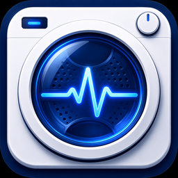

# ioBroker.laundrylens

[](https://www.npmjs.com/package/iobroker.laundrylens)
[](https://opensource.org/licenses/MIT)

Self-learning ioBroker adapter for automatic detection of washing machine, dryer and dishwasher cycles via smart plug power measurement. Recognizes running programs, estimates remaining time and sends Telegram notifications – fully local, no cloud.

---

## How it works

LaundryLens records the power consumption curve of each cycle and compares it against stored program profiles using segment-weighted correlation and a DTW-lite algorithm. Confidence is accumulated over multiple matching rounds before a program is accepted, which prevents single outliers from triggering a wrong match. Remaining time is estimated dynamically based on both elapsed time and the current energy rate – not just a fixed average.

The adapter is self-learning: there are no pre-built profiles. Every program is trained on your specific device. Recognition improves with each completed cycle.

---

## Features

- Cycle detection via state machine (OFF → STARTING → RUNNING ↔ PAUSED → ENDING)
- Self-learning program matching (segment-weighted correlation + DTW tiebreak)
- Score accumulation over multiple rounds with device-specific confidence thresholds
- Override lock: manually selected programs are not overwritten by background matching
- Adaptive remaining time estimation combining time-based and energy-rate signals
- Admin UI with expandable cycle list, inline power graph (canvas), phase legend, trim and split per touch/drag
- Telegram notifications with configurable update thresholds, placeholders (`{progress}`, `{prevTime}`, `{state:objectId}` for any ioBroker data point) and conditional text blocks
- Also supports Pushover, Signal, WhatsApp, Matrix, notify-my-android, Prowl, and email (via [ioBroker.email](https://github.com/iobroker-community-adapters/ioBroker.email)) as notification targets
- Multiple devices: one instance per device (washing machine, dryer, …)
- One plug for a washing machine and a dishwasher that never run at the same time: the detected program tells which of them is running
- Widget for ioBroker.vis-2 and tile for ioBroker.devices with state, program, phase and remaining time
- Localized, ready-to-display text data points (`phaseText`, `stateText`, `programText`) alongside the language-neutral internal ones, for dropping straight into a VIS dashboard

---

## Requirements

- ioBroker with js-controller ≥ 6.0.11
- Node.js ≥ 22
- ioBroker.admin ≥ 8.0.0
- A smart plug or power meter adapter providing a watt data point per device (e.g. [Shelly EM](https://www.shelly.com/en/products/shop/shelly-em))

---

## Installation

Install **LaundryLens** via the ioBroker Admin adapter list (tab "Adapters"), then create a separate adapter instance for each device and select the watt data point in the instance configuration.

---

## Configuration

Each instance has the following settings:

| Setting | Description |
|---|---|
| Device name | Display name for this device |
| Device type | `washing_machine`, `dishwasher`, `dryer`, `washer_dryer` or `washer_dishwasher` (affects phase detection logic, see [One plug for two machines](#one-plug-for-a-washing-machine-and-a-dishwasher)) |
| Power sensor (W) | ioBroker data point providing watt values |
| Power threshold (W) | Minimum wattage to consider the device as running |
| End power threshold (W) | Optional. A running cycle ends only when the power stays at or below this level for the off delay, for example 0 W for a dishwasher that draws a few watts in quiet phases. Empty = same as the power threshold |
| Off delay (min) | Time to wait after power drops before ending the cycle |
| Start energy gate (Wh) | Minimum energy consumed before matching starts (filters short spikes) |
| Duration tolerance | Allowed deviation from learned average duration (0.05–0.5) |
| Matching interval (min) | How often matching runs during a cycle |
| Match confirmations | Number of consecutive rounds a match must hold before being accepted |
| Auto-confirm threshold (%) | Confidence at which a match is confirmed automatically |
| Instant-confirm threshold (%) | Confidence at which a match is accepted immediately (2 rounds in a row) |
| Program detection threshold (%) | Minimum confidence for a candidate to be considered at all |
| Notify on probable match | Send a notification even before a match is officially confirmed |
| Ignore anti-crease | Ignore anti-crease phases at the end of dryer cycles |

The detection threshold is a trade-off: lower means faster notifications but a higher risk of wrong matches.

---

## One plug for a washing machine and a dishwasher

With the device type `washer_dishwasher`, one plug can power both machines, as long as they never run at the same time. Two running machines add up to one power curve, which can't be told apart.

1. Select the device type, and give the device a name that fits both.
2. In the tab "Programs", choose the machine for each program. Programs learned before default to the washing machine, so move the dishwasher programs once. Their recorded cycles get the matching phases.

The detected program then decides which machine is running: the phases, the `appliance` data point and the `{device}` placeholder of notifications follow it. Until the program is known, there is no phase yet and `{device}` is the name of the device, which also applies to the start notification. The off delay is shared by both machines, so it has to fit the longer one (8 min by default).

---

## Data points per device

| Data point | Type | Description |
|---|---|---|
| `state` | string | off / starting / running / paused / ending (language-neutral internal key, meant for automations) |
| `stateText` | string | Same as `state`, but as ready-to-display, localized text (e.g. "Running ⚙️" / "Läuft ⚙️") - see [`displayLanguage`](#configuration) |
| `running` | boolean | Simple on/off indicator |
| `appliance` | string | Running machine as a language-neutral key: the device type, or on a shared plug `washing_machine` / `dishwasher` as soon as the program is known (empty before that) |
| `program` | string | Detected program name |
| `programText` | string | Same as `program`, but with the `detecting...` placeholder localized (a confirmed program is your own saved name, passed through unchanged) |
| `confidence` | number | Match confidence in % |
| `timeRemaining` | number | Estimated remaining time in seconds |
| `totalDuration` | number | Estimated total cycle duration in seconds |
| `cycleProgress` | number | Cycle progress 0–100 % |
| `phase` | string | Current cycle phase (language-neutral internal key, e.g. `washing`, `dryer_drying`) |
| `phaseText` | string | Same as `phase`, but as ready-to-display, localized text with an emoji (e.g. "🫧 Washing" / "🫧 Wäscht") |
| `lastCycleProgram` | string | Program of the last completed cycle |
| `lastCycleDuration` | number | Duration of the last cycle in minutes |
| `lastCycleEnergy` | number | Energy consumed in the last cycle in Wh |
| `availablePrograms` | string (JSON) | Array of all saved program names, e.g. for external dropdowns |

`phase`/`state`/`program` are meant for automations/scripts and use fixed, language-neutral values that never change with your ioBroker language - use the matching `*Text` data point instead if you want to show status directly in a VIS dashboard without building your own translation table. The language for `phaseText`/`stateText`/`programText` defaults to the ioBroker system language, and can be overridden per device with the "Display language" setting.

---

## Widgets

The adapter brings a widget for ioBroker.vis-2 and a tile for ioBroker.devices. They show the state, program, phase and remaining time of a device, with a progress ring. A click shows all details, including the last cycle and the number of cycles to review. The widgets only read: confirming a cycle stays in the admin tab.

| Host | Widget | Layouts |
|------|--------|---------|
| ioBroker.vis-2 | Widget set "LaundryLens" | Automatic by size, compact, bar, wide, everything |
| ioBroker.devices | Tile "LaundryLens" | 1x1, 2x1, 2x½ |

In vis-2, add the widget from the set "LaundryLens". In ioBroker.devices, use "Add widget" in the edit mode. In both, choose the device from the list in the settings of the widget. The status, phase and program texts appear as the adapter writes them to `stateText`, `phaseText` and `programText`, so they follow the language of the system and the "no emoji" option.

The web component `<iob-laundrylens-device>` of [`@iobroker/web-components`](https://github.com/ioBroker/web-components) shows the same views in other hosts. It takes the object ID of the device, for example `laundrylens.0.device_0_97io`. It is not tested in other hosts yet.

## Using data points in notification messages

Besides the built-in placeholders (`{device}`, `{program}`, `{duration}`, `{energy}`, `{startTime}`, `{endTime}`, `{progress}`, `{prevTime}`), a notification message template can include the current value of **any** ioBroker data point with:

```
{state:objectId}
```

For example, to include the current outside temperature and electricity price in a "done" message:

```
🧺 {device} done!
⏱️ Total runtime: {duration} min
🌡️ Outside: {state:0_userdata.0.outsideTemp}°C
💶 Price: {state:0_userdata.0.electricityPrice} ct/kWh
```

This also works inside the conditional `[...]` blocks: `[🌡️ Outside: {state:0_userdata.0.outsideTemp}°C]` disappears from the message entirely if that data point is empty or doesn't exist, exactly like it would for an empty built-in placeholder. A missing or unreadable object ID never breaks the rest of the message - it just resolves to nothing.

---

## Getting started tips

- Let the device run at least 3–5 cycles per program before expecting reliable detection.
- Start with fewer programs. The fewer profiles you have, the higher the match accuracy.
- Use the **Cycles tab** in the admin UI to review past cycles, trim noise from the start/end of a recorded trace, or split a trace that captured two programs.
- Use the **Export** function before any update to back up your learned profiles and cycle history.

---

## Changelog

### **WORK IN PROGRESS**

### 0.7.1 (2026-11-20)
- New: optional end power threshold per device, for appliances with quiet phases of a few watts ([#76](https://github.com/backfisch88/ioBroker.laundrylens/issues/76))
- Fix: recipient "All (broadcast)" showed an empty field ([#77](https://github.com/backfisch88/ioBroker.laundrylens/issues/77))

### 0.7.0 (2026-11-17)
- New: one plug for a washing machine and a dishwasher (device type `washer_dishwasher`, data point `appliance`) by [GermanBluefox](https://github.com/GermanBluefox) ([#66](https://github.com/backfisch88/ioBroker.laundrylens/pull/66))
- New: widget for ioBroker.vis-2, tile for ioBroker.devices and the web component `<iob-laundrylens-device>` by [GermanBluefox](https://github.com/GermanBluefox) ([#66](https://github.com/backfisch88/ioBroker.laundrylens/pull/66))
- Fix: checker findings (`common.adminUI.tab`, Dependabot for the widget folders)

### 0.6.0 (2026-11-13)
- BREAKING: requires ioBroker.admin 8 or newer
- Changed: admin tab rebuilt with React 19 by [GermanBluefox](https://github.com/GermanBluefox) ([#65](https://github.com/backfisch88/ioBroker.laundrylens/pull/65)); follows the Admin theme, duotone icons, phone layout
- Fix: dishwasher heating detected from 800 W (by GermanBluefox, [#66](https://github.com/backfisch88/ioBroker.laundrylens/pull/66))
- Fix: renamed device kept the old name in its channel object (by GermanBluefox, [#66](https://github.com/backfisch88/ioBroker.laundrylens/pull/66))
- Fix: `lastCycle` and `lastCycleProgram` after a correction (by GermanBluefox, [#66](https://github.com/backfisch88/ioBroker.laundrylens/pull/66))
- Fix: some admin tab messages were always German

### 0.5.0 (2026-11-12)
- New: light/dark theme in the admin tab
- Changed: SVG icons instead of emoji, new adapter icon
- Fix: programs table on small screens

### 0.4.44 (2026-11-08)
- Fix: kWh when splitting, trimming and merging cycles
- Fix: admin error messages translated

### 0.4.43 (2026-11-08)
- Changed: merge with the previous cycle via one button

### 0.4.42 (2026-11-08)
- New: merge 2-3 cycles into one (Cycles tab)

Older changelog entries can be found in CHANGELOG_OLD.md.

---

## Credits

The new admin tab in version 0.6.0 is the work of [GermanBluefox](https://github.com/GermanBluefox). He rebuilt it with React 19 as a JSON tab ([#65](https://github.com/backfisch88/ioBroker.laundrylens/pull/65)) and found and fixed the dishwasher, renamed device and `lastCycle` problems ([#66](https://github.com/backfisch88/ioBroker.laundrylens/pull/66)). Since the pull requests could no longer be merged after other changes in `main`, I took over his commits with him as author and added my icons and the phone layout on top. Thank you for the great work!

In version 0.7.0, [GermanBluefox](https://github.com/GermanBluefox) added the shared plug for a washing machine and a dishwasher and the widget for ioBroker.vis-2, the tile for ioBroker.devices and the web component ([#66](https://github.com/backfisch88/ioBroker.laundrylens/pull/66)). He also tested them on his own system and found and fixed the empty machine column in the programs table. Thank you again!

---

## Contributing

Issues and pull requests are welcome: [Issues](https://github.com/backfisch88/ioBroker.laundrylens/issues)

---

## License

MIT License

Copyright (c) 2026 backfisch88 <henrik.schoenhofen@icloud.com>

Permission is hereby granted, free of charge, to any person obtaining a copy
of this software and associated documentation files (the "Software"), to deal
in the Software without restriction, including without limitation the rights
to use, copy, modify, merge, publish, distribute, sublicense, and/or sell
copies of the Software, and to permit persons to whom the Software is
furnished to do so, subject to the following conditions:

The above copyright notice and this permission notice shall be included in all
copies or substantial portions of the Software.

THE SOFTWARE IS PROVIDED "AS IS", WITHOUT WARRANTY OF ANY KIND, EXPRESS OR
IMPLIED, INCLUDING BUT NOT LIMITED TO THE WARRANTIES OF MERCHANTABILITY,
FITNESS FOR A PARTICULAR PURPOSE AND NONINFRINGEMENT. IN NO EVENT SHALL THE
AUTHORS OR COPYRIGHT HOLDERS BE LIABLE FOR ANY CLAIM, DAMAGES OR OTHER
LIABILITY, WHETHER IN AN ACTION OF CONTRACT, TORT OR OTHERWISE, ARISING FROM,
OUT OF OR IN CONNECTION WITH THE SOFTWARE OR THE USE OR OTHER DEALINGS IN THE
SOFTWARE.