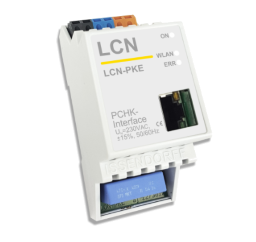
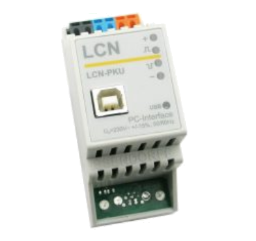

# ioBroker.lcn

[](https://www.npmjs.com/package/iobroker.lcn)
[](https://www.npmjs.com/package/iobroker.lcn)

[](https://nodei.co/npm/iobroker.lcn/)

This adapter allows to connect Local Control Network [LCN](https://www.lcn.eu/) to ioBroker.

## Supported Gateways
- LCN-PKE



- LCN-PKU with LCN-PCHK



**Don't forget that `ioBroker.lcn` will block one LCN Connection License.**

The configuration and modules will be automatically detected by scan, that must be triggered manually from the "Modules" tab of the configuration dialog and can be repeated any time again.

Requires admin >= 7.8.23 (the "Modules" tab uses the device manager).

## Types
The following read and write groups are supported:
- Analog values (output/input)
- Relays (output)
- Sensors (input)
- LEDs (output / input)
- Variables (input)

## Variables
To apply the valid convert functions to variables, the variables must have the valid roles. The following roles are supported:

- **value.temperature** - temperature in celsius
- **value.brightness** - Lux (I- input) in lux
- **value.speed.wind** - wind speed in m/s
- **value.voltage** - voltage in Volt
- **value.current** - current in Ampere
- **value.sun.azimuth** - sun azimuth
- **value.sun.elevation** - sun elevation

Without one of these roles the raw value is shown. Exception: `VAR02` and `VAR03` (usually R1Var and R2Var of the regulators) are shown in °C, as in the versions before. When the role of a variable is changed, the adapter reads its value again from the module.

Modules with a firmware before 170206 have only 3 variables (TVar, R1Var, R2Var). They are created as `VARS.VAR01`-`VARS.VAR03`. Modules, that were scanned with an older version of the adapter, must be scanned again ("Scan again" in the device manager), so the adapter detects the firmware.

The modules send the values of the variables not always by themselves. The option "Read variables every (min)" in the advanced settings reads the variables of all modules cyclically (`0` = off). The variables are read one after another, so with many modules one cycle can take some time.

## Display
For every device you can activate if it has display or not (device manager: "Module settings").

## Regulator (Regler)
For every device you can activate if it has regulators or not (device manager: "Module settings").

## Output relays
For every device you can define how many output relays (0-8) must be created (device manager: "Module settings").

## Settings
- Reconnect interval(sec) - how often the adapter tries to connect. Default every 30 seconds. 
- Connect timeout(ms) - how long adapter waits for connection response inclusive authentication. Default 6 seconds. 
- Scan response timeout(ms) - how long adapter waits for answers by scan of modules.
- Response timeout(ms) - timeout for control commands
- Ping Interval(sec) - how often adapter sends ping requests 
- Ping response timeout(ms) - timeout for ping requests
- Read variables every (min) - read the variables of all modules cyclically. `0` = off (default)
- IN/OUT Relays are the same - if the "out" and "in" relays are the same thing or if these relays are different ones. 
```
// =====================  Same relays =============================
//                                    +-------+
// ----------------- OUT -----------> |       |
//                                    | Relay |
// <----------------- IN ------------ |       |
//                                    +-------+
// 
// 
// ======================  Different relays =======================
//                                    +-------+
//                                    |       |
// ----------------- OUT -----------> | Relay |
//                                    |       |
//                                    +-------+
// 
//                                    +--------+
//                                    | Sensor |
// <----------------- IN ------------ |   or   |
//                                    | Relay  |
//                                    +--------+
```

## How to use
After the first start, the devices must be scanned. Open the "Modules" tab of the configuration dialog and press the scan button (magnifier icon) of the device manager.
Enter the highest module address that must be scanned (e.g. `250`) or a range like `5-30`.

If the bus has segment couplers, enter the segments that must be scanned, separated by comma (e.g. `0, 5, 7`). `0` is the own segment (the segment the gateway is connected to), all other segments are addressed by their segment ID. The segments are scanned one after another. The modules get the IDs `S<segment>.M<module>`, e.g. `lcn.0.S005.M010`.

Every found module has the following actions:
- **Module settings** - number of output relays, display and regulators
- **Scan again** - read name, comment, serial number and states of this module again (in the segment of the module)

## Message API
- `sendTo('lcn.0', 'scan', { max: '250', segment: 0 }, result => ...)` - scan one segment of the bus (`max` can be `"max"` or `"min-max"`, `segment` is optional: `0` = own segment, otherwise the segment ID). Result: `{ total, _new }` or `{ error }`
- `sendTo('lcn.0', 'getAll', null, devices => ...)` - list of all modules `[{ id, common, native }]`
- `lcn.0.scan.manual` - write `*` to read the states of all modules or `S0:6` to read the status of segment 0, module 6

## ToDO
- Configuration dialog to define type of variables.

<!--
	Placeholder for the next version (at the beginning of the line):
	### **WORK IN PROGRESS**
-->
## Changelog
### 4.0.0-beta.3 (2026-11-03)
- (bluefox) Fixed: `VAR02` and `VAR03` were converted twice, if a role like `value.temperature` was set. Without such a role they are still shown in °C
- (bluefox) Fixed: the scan wrote the values of the variables without the conversion of their role
- (bluefox) The value of a variable is read again from the module, when its role is changed

### 4.0.0-beta.2 (2026-11-03)
- (bluefox) Fixed: commands could get stuck in the queue, if several commands waited behind a command, that waits for an answer
- (bluefox) Fixed: variables of modules with a firmware before 170206 (only 3 variables) were not created. These modules must be scanned again (#22)
- (bluefox) Added option to read the variables of all modules cyclically (#22)
- (bluefox) Values without the number of the variable are ignored now. Before, the adapter logged an error for `MEASURES.MEASURE`

### 4.0.0-beta.1 (2026-11-03)
- (bluefox) Modules in other segments can be scanned: the scan dialog accepts a list of segments (#53)

### 4.0.0-beta.0 (2026-11-03)
- (bluefox) Breaking change: Adapter requires admin >= 7.8.23 now
- (bluefox) The adapter was refactored to TypeScript
- (bluefox) The configuration dialog was migrated to JsonConfig. The modules are scanned and configured in the device manager
- (bluefox) Fixed: the adapter reconnected to LCN after it was stopped and did not finish the stop correctly
- (bluefox) Fixed: `ir.lowbat` was never set
- (bluefox) Fixed: finger sensor codes were written into `ir.serial` instead of `finger.code`
- (bluefox) Fixed: a failed authentication on LCN-PCHK was not recognized
- (bluefox) Fixed: regulator states of scanned modules were recreated on every change of the device object
- (bluefox) Fixed: writing a state, whose object cannot be read, could crash the adapter

### 3.0.2 (2026-11-03)
- (copilot) Adapter requires node.js >= 22.19.0 now
- (ioBroker-Bot) Adapter requires js-controller >= 6.0.11 now.
- (bluefox) Fixed parsing of logic operation (SUM) status messages. Invalid objects like `SUMS.SUMSUM1000_undefined` were created, and the adapter ran into an endless loop with high CPU load. The invalid objects are deleted on start. New states are `SUMS.SUM01`...`SUMS.SUM04`.
- (bluefox) Migrated the GitHub workflow to the ioBroker testing actions with npm trusted publishing
- (bluefox) Removed unused dependency `jsonwebtoken` and modernized the code

## License
The MIT License (MIT)

Copyright (c) 2018-2024 Denis Haev <dogafox@gmail.com> Private License
Copyright (c) 2025-2026 Denis Haev <dogafox@gmail.com> MIT License

Permission is hereby granted, free of charge, to any person obtaining a copy
of this software and associated documentation files (the "Software"), to deal
in the Software without restriction, including without limitation the rights
to use, copy, modify, merge, publish, distribute, sublicense, and/or sell
copies of the Software, and to permit persons to whom the Software is
furnished to do so, subject to the following conditions:

The above copyright notice and this permission notice shall be included in all
copies or substantial portions of the Software.

THE SOFTWARE IS PROVIDED "AS IS", WITHOUT WARRANTY OF ANY KIND, EXPRESS OR
IMPLIED, INCLUDING BUT NOT LIMITED TO THE WARRANTIES OF MERCHANTABILITY,
FITNESS FOR A PARTICULAR PURPOSE AND NONINFRINGEMENT. IN NO EVENT SHALL THE
AUTHORS OR COPYRIGHT HOLDERS BE LIABLE FOR ANY CLAIM, DAMAGES OR OTHER
LIABILITY, WHETHER IN AN ACTION OF CONTRACT, TORT OR OTHERWISE, ARISING FROM,
OUT OF OR IN CONNECTION WITH THE SOFTWARE OR THE USE OR OTHER DEALINGS IN THE
SOFTWARE.