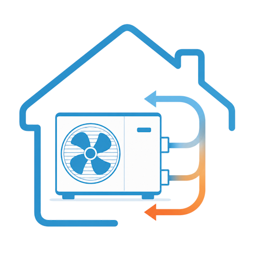

# ioBroker.luxtronik2-controller

**Tests:** 

## luxtronik2-controller adapter for ioBroker

**100% local monitoring, control, and optimization** for heat pumps with [Luxtronik 2.x / 3.x controllers](https://www.alpha-innotec.com/en/products/accessories/control/luxtronik) (Alpha Innotec, Novelan, Buderus, Siemens, etc.) — completely **cloud-free**.

Communicates directly via **Native TCP (Port 8889)** and optionally combines it with **Modbus TCP (Hybrid Mode)** to write parameters directly into volatile RAM without EEPROM flash wear. Includes built-in **PV surplus automation**, live **COP/JAZ calculation**, intelligent cycle optimization, and smart pump control (HUP & ZIP).

**Manual:** [English](/#/docs/adapterref/iobroker.luxtronik2-controller/documentation/readme_en.md) · [Deutsch](/#/docs/adapterref/iobroker.luxtronik2-controller/documentation/readme_de.md)

> **💡 No LAN cable near your heat pump? No problem!**
> If your Luxtronik 2.0 controller only has a free USB port instead of a nearby network socket, you can easily connect it via Wi-Fi using the clever **USB 2.0 powered WiFi/Ethernet Bridge** project by _obermolch_. It powers itself directly from the controller's USB port and bridges the connection wirelessly without extra wall power supplies.
> Check out the full guide and community discussion here: [ioBroker Forum: USB 2.0 powered WiFi/Ethernet Bridge für Luxtronik 2.0](https://forum.iobroker.net/topic/85773/usb-2-0-powered-wifi-ethernet-bridge-f%C3%BCr-luxtronik-2-0).

**If you like this project and want to support its development, feel free to drop a tip here: https://paypal.me/TJahnke**

### Features

#### 🔌 Communication & Operating Modes

- **3 Flexible Operating Modes:** Switch seamlessly between safe **Read-Only** (monitoring only, all hardware writes blocked), **Native Write** (Port `8889`), and **Modbus Hybrid** mode.
- **Native TCP & WebSocket Communication:** Direct local connection via classic TCP (`8888` / `8889`) or WebSockets (`8214`) with broad compatibility across V1.x, V2.x, and V3.x firmwares (dynamic scaling factors and adaptive write-queue timing).
- **Hybrid Modbus TCP Support (0% Flash Wear):** Writes volatile parameters (target temperatures, heating curves, operating modes) and coils directly into controller RAM via Modbus TCP (Port `502`) without wearing out the EEPROM flash memory, while continuing to read full telemetry over the native port. Active Modbus states are automatically tagged with `(Modbus)` in the object tree.

#### ☀️ PV Automation & Efficiency

- **PV Surplus Management (PV-Ready):** Fully integrated solar surplus automation that uses your live grid feed-in to raise heating and/or hot water setpoints (wear-free via Modbus TCP):
    - **Dynamic Sequence Priority:** Continuously monitors live temperatures and reroutes surplus between hot water and heating once the prioritized target reaches saturation.
    - **Hysteresis & Smart Timers:** Customizable start/stop delays and a dedicated stop threshold (Schmitt trigger logic) prevent self-cancelling feedback loops when the heat pump ramps up.
    - **Battery Prioritization:** Optionally includes home battery charging power in the surplus calculation to prioritize the heat pump as thermal storage.
    - **Hardware Cycle Protection:** Waits for active heating or hot water cycles to finish naturally before reverting setpoints when solar yield drops, protecting the compressor.
- **COP & JAZ (Efficiency Calculator):** Live efficiency tracking (_Today_, _Last 7 Days_, _Current Month_, _Current Year_), automatically split into _Heating_, _Hot Water_, and _Total_. Supports internal Luxtronik counters or high-precision external meters (e.g., Shelly 3EM, M-Bus heat meters) with persistent storage (`hidden.cop_buckets`) and anti-flapping zero-drop protection.

#### 🛡️ Hardware Protection & Smart Optimization

- **Hardware & EEPROM Flash Protection:**
    - **Read-Before-Write Cache:** Intercepts and blocks redundant write commands if the controller already holds the target value.
    - **Flash Write Counters:** Transparently tracks daily (`write_cycles_today`) and cumulative (`write_cycles_total`) EEPROM write operations.
    - **Idle Defaults & Interactive Heat Curve:** Automatically restores safe baseline settings in standby, featuring a live interactive SVG heat curve preview in the Admin UI.
    - **Firmware `.90` Crash Shield:** Automatically detects buggy manufacturer firmwares (`V1.90` / `V2.90`) and blocks network writes to prevent hardware crashes.
- **Compressor Protection (Cycle Optimization):** Intelligently couples heating and domestic hot water (DHW) cycles to prevent unnecessary compressor stops and starts.
- **Dynamic HUP Control (Auto-PWM Detection):** Automatically scales the 0–10V control voltage of the heating circulation pump (HUP) based on the supply/return temperature spread. PWM-controlled pumps are automatically detected and bypassed.
- **Smart 3-Way Circulation Pump (ZIP) Control:**
    - Choose between **Internal Luxtronik Controller**, **External Actor** (e.g., Shelly with 0% flash wear), or **Modbus TCP (Coil 7)**.
    - Trigger circulation on-demand via ioBroker motion sensors/buttons (with anti-cycling cooldown) or synchronously during hot water generation.
    - Includes live virtual status (`Virtual_ZIP_Status`) and a real-time remaining runtime countdown in seconds (`Virtual_ZIP_Remaining_Time`).

#### 📊 Monitoring, Diagnostics & Customization

- **Integrated Actions (Macros):** Pre-defined triggers for forced heating (`Zwangsheizen`), forced hot water (`Zwangswarmwasser`), circulation (`Activate_Zip`), manual idle resets (`Setze_Vorgabewerte`), and full raw data dumps (`Dump_Raw_To_Log`).
- **Smart Object Management & Visibility Filter:** Queries hardware visibility flags (Command `3005`) on startup to hide unsupported components (cooling, solar, ventilation, uninstalled mixing circuits) and cleanly removes deselected datapoints and empty folders on restart.
- **Custom Datapoints:** Flexibly add custom telemetry values (Index `3004`) and writable parameters (Index `3003`) via the Admin UI, including custom scaling factors, units, and automatic Unix timestamp formatting.
- **Extended Status Texts & Calculations:** Live calculation of temperature spread, thermal/electrical energy sums, and translated clear-text system states (German & English).
- **Intelligent Notifications & Firmware Checks:** Dispatches error logs, connectivity alerts, and critical shutdowns (e.g., flow rate issues) to **Telegram** and the **ioBroker Notification Center** (with 60-minute anti-spam cooldown & live test button). Also supports scheduled (Cron) and manual firmware update checks including changelog retrieval.
- **Automated DTA Backup:** One-click links and Cron-scheduled downloads of internal `.dta` diagnostic logs directly from the heat pump to `0_userdata.0/luxtronik_backups` for analysis in tools like _OpenDTA_.

## Acknowledgements & History

This project builds upon the preliminary work of existing open-source projects. Special thanks go to:

- **[Bouni](https://github.com/bouni/luxtronik-2):** Whose pioneering work and code developments form the essential foundation for communication with Luxtronik controllers.
- **[BenPru](https://github.com/BenPru/luxtronik) & rhammen:** A special thanks to BenPru and rhammen for their continuous further development regarding the access and control of the Luxtronik controller. Without their dedication, efforts, and ideas, this adapter would not have reached the advanced state it is in today. _(If you appreciate their work, feel free to buy them a coffee! ☕) [BenPru](https://github.com/sponsors/BenPru) [rhammen](https://github.com/sponsors/rhammen)_

## ⚠️ Warning

Some settings provided by this integration can affect the performance of your heat pump. Misconfigurations can cause the controller to enter a fault state, which requires a manual on-site reset.

This project aims to protect your heat pump by restricting the configuration options to safe values. However, no guarantees can be made. Please be careful, consult your Luxtronik manual, and do not change any settings that you do not fully understand.

## 🔧 Compatibility

The integration allows you to monitor and control heat pumps with a Luxtronik2 controller. It works locally without internet access.
It was and is being tested with an LWD50A (LD5) from Alpha Innotec.
It is used by manufacturers such as:

- Alpha Innotec,
- Siemens,
- Novelan,
- Roth,
- Elco,
- Buderus,
- Nibe,
- Wolf Heiztechnik.

## ⚠️ Disclaimer ⚠️

_This project is not affiliated with Alpha Innotec, Novelan, ait-deutschland GmbH, or any other company. It is a personal project that is maintained in spare time. Use at your own risk._

## Installation

> **Note for Raspberry Pi / ARM users:**
> You might see red error messages in the installation log related to `node-gyp`, `serialport`, or `usocket`. These are optional dependencies and can be completely ignored. The network-based control (TCP) of the Luxtronik will still work without any issues.

//### **WORK IN PROGRESS**

## Changelog
### 1.0.3 (2026-11-18)

- Fixed daily COP reset in `copManager.ts` so Heating and Hot Water values reset to `0` after midnight until an active cycle starts

### 1.0.2 (2026-11-17)

- Fixed `node:` protocol imports (`node:fs`, `node:path`) and repository checker lint issues
- Completed and synchronized i18n translations across all supported languages
- Fixed `jsonConfig` label keys in `generateConfig.ts` to prevent inline language object overrides during build

### 1.0.1 (2026-11-16)

- **Update of i10n files**

### 1.0.0 (2026-11-16)

**STABLE**

### 0.25.2 (2026-11-16)

- **Fix i18n**

## License

MIT License

Copyright (c) 2026 TbsJah <github.tbsjah@googlemail.com>

Permission is hereby granted, free of charge, to any person obtaining a copy
of this software and associated documentation files (the "Software"), to deal
in the Software without restriction, including without limitation the rights
to use, copy, modify, merge, publish, distribute, sublicense, and/or sell
copies of the Software, and to permit persons to whom the Software is
furnished to do so, subject to the following conditions:

The above copyright notice and this permission notice shall be included in all
copies or substantial portions of the Software.

THE SOFTWARE IS PROVIDED "AS IS", WITHOUT WARRANTY OF ANY KIND, EXPRESS OR
IMPLIED, INCLUDING BUT NOT LIMITED TO THE WARRANTIES OF MERCHANTABILITY,
FITNESS FOR A PARTICULAR PURPOSE AND NONINFRINGEMENT. IN NO EVENT SHALL THE
AUTHORS OR COPYRIGHT HOLDERS BE LIABLE FOR ANY CLAIM, DAMAGES OR OTHER
LIABILITY, WHETHER IN AN ACTION OF CONTRACT, TORT OR OTHERWISE, ARISING FROM,
OUT OF OR IN CONNECTION WITH THE SOFTWARE OR THE USE OR OTHER DEALINGS IN THE
SOFTWARE.