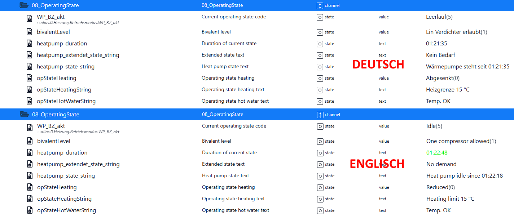

## Adapter Instance Configuration

After installing the adapter, the configuration interface opens. It is organized into structured tabs to make setting up and optimizing your heat pump as intuitive and clear as possible.

---

### 1. Tab: Connection

Configure basic network parameters for communicating with the Luxtronik controller and select the adapter display language.

#### Connection Settings

- **IP Address (Host):** Enter the local IP address of your heat pump on your network (e.g. `192.168.178.81`).
- **Heat Pump Port:** The communication port of the controller.
    - `8889` = Standard port for classic TCP communication (typically firmware V1.x / V2.x / V3.x).
    - `8214` = WebSocket port (typically required for newer systems running firmware > V3.81).
- **Polling Interval (seconds):** Specifies how frequently the adapter queries live telemetry and parameters from the heat pump (Minimum: 10 seconds, Default: 30 seconds).

> ⚠️ **IMPORTANT POLLING INTERVAL TIP:**
> Do **not** set this value too low! Polling too frequently overburdens the heat pump's internal CPU with network requests. This causes high CPU load and makes the controller extremely sluggish (both on the physical display and over the network). A setting between **30 and 60 seconds** is strongly recommended.

#### Options

- **Language for texts and values:** Choose the language (`English` or `Deutsch`) used for operating states, status messages, error logs, and selection values created in the ioBroker object tree.

_Example: When heating domestic water, the adapter translates state codes to `Hot water` (English) or `Warmwasser` (German)._

---

### 2. Tab: Modbus (Hybrid)

Standard parameter adjustments made via port `8889` or `8214` write to the Luxtronik's internal EEPROM/flash memory, which has a limited number of lifetime write cycles.

The **Hybrid Mode (Modbus TCP)** provides the best of both worlds:

- **Reading:** All detailed telemetry, temperature sensors, and operating hours continue to be read via the native socket (`8889` / `8214`).
- **Writing (0% Flash Wear):** Selected volatile variables (such as target setpoints, heating curves, and pump triggers) are written directly into controller RAM via **Modbus TCP** without causing EEPROM degradation.

#### Settings

- **Enable Modbus TCP:** Activates the hybrid routing pipeline. Upon startup, the adapter runs a pre-check verification query to ensure the Modbus interface is reachable.
- **Modbus Port:** Default is `502` (must also be enabled in your Luxtronik network settings).
- **Select Holding Registers (Parameters):** Check which setpoints should be routed volatilely over Modbus (e.g. _Target return temperature_, _Outside temperature_, _Operating mode heating/hot water_, _Heating curve end point/parallel offset_, _Fixed return temperature target_, _Hot water target Wunschwert_).
- **Select Coils (Switches):** Choose which outputs can be triggered directly via Modbus coils (e.g. _BUP_, _HUP_, _Fan VEN_, _Circulation pump ZIP (Coil 7)_, _ZUP_, _SLP_, _Watchdog Modbus_, _Reset Error_).

> 💡 **Object Tree Transparency:** Datapoints mapped to write volatilely via Modbus automatically receive the **`(Modbus)`** name suffix in the ioBroker tree.

---

### 3. Tab: Idle Defaults (Flash Memory Protection)

To protect the Luxtronik controller from flash wear, writing optimizations only execute while an active cycle (heating or hot water) is underway.

As soon as the heat pump returns to **Idle (Standby)**, this feature resets all temporarily altered values back to your defined safe baseline defaults.

> 💡 **Strong Recommendation:**
> Enabling idle defaults is strongly recommended if you use the **Intelligent Cycle Optimization (Hot Water + Heating)** and/or **Dynamic HUP Control**!

- **Force default values during idle:** Enables the automatic fallback routine whenever standby is detected.
- **Default values: Heating:** Fill in the baseline values of your system (_Base point (°C)_, _End point (°C)_, _Heating hysteresis (K)_, and baseline _HUP Min / Nom_ voltages for heating).
- **Default values: Hot water:** Baseline values for domestic water (_HW Target (°C)_, _HW Hysteresis (K)_, and baseline _HUP Min / Nom_ voltages for hot water).
- **Interactive Heat Curve Preview:** Entering Base and End points generates an SVG curve preview with tooltips for each outdoor degree between -20°C and +20°C. _(Special thanks to [mnemotron.de](https://www.mnemotron.de/lux/heatcurve.html) for inspiration!)_

---

### 4. Tab: Efficiency / COP

Calculates Coefficient of Performance (**COP**) and Seasonal Performance Factor (**JAZ**) values across multiple timeframes (**Today**, **Last 7 Days**, **Current Month**, **Current Year**) — categorized by **Total**, **Heating**, and **Hot Water**.

- **Enable COP / Efficiency calculation:** Activates tracking. Snapshots and calculation buckets are safely preserved across restarts inside `hidden.cop_buckets`.
- **1. Electrical Energy (Power Consumption):**
    - _Internal (Luxtronik estimates):_ Uses the internal electrical meter estimates of the controller.
    - _External Object ID (e.g. Shelly):_ Link an external calibrated energy meter datapoint (Total kWh, e.g. Shelly 3EM).
- **2. Thermal Energy (Heat Generation):**
    - _Internal (Luxtronik meters):_ Uses internal thermal generation calculations.
    - _External Object ID (e.g. M-Bus meter):_ Link an external heat meter datapoint (WMZ Total kWh).

---

### 5. Tab: Cycle Optimization

By default, Luxtronik controllers handle heating and domestic hot water (DHW) cycles as isolated operations. This frequently causes the compressor to shut down immediately after heating water, only to restart a few minutes later for space heating. This adapter links cycles to keep the compressor running continuously.

- **Enable intelligent cycle optimization:** Activates cross-cycle coordination (can also be toggled via `Actions.Regelung_Aktiv`).
    - **Trigger Rule (Pre-ignition):** If `(DHW Target - DHW Actual) ≥ (DHW Hysteresis - 1.5 K)` **AND** `Heating Return ≤ Return Target` and outdoor heating threshold is inactive, heating starts immediately with Return Target set to **35°C** to force compressor engagement.
    - **Transition to Hot Water:** Once heating return reaches target and hot water is depleted by > 2 K, hot water target temperature is raised temporarily to force compressor handoff into hot water without stopping.
- **Heating after hot water:** Keeps the return target elevated at 35°C during water heating so the compressor immediately transitions into home heating without shutdown.

> ⚠️ **Important Note:** Always enable **"Force default values during idle"** in the _Idle Defaults_ tab when using cycle optimization!

---

### 6. Tab: HUP (Heating Circulation Pump)

Dynamic voltage regulation for controllable **0–10V heating circulating pumps (HUP)** based on temperature spread (Delta T between supply and return). Pump voltage scales gradually during active heating cycles (once the compressor has run for at least 10 minutes) to keep spread within target boundaries.

> ⚠️ **Prerequisites:**
>
> 1. **Hardware & PWM Detection:** Use only if your pump connects via an analog **0–10V signal** from the Luxtronik board. If configured for **PWM** (`heating_max_circ_pump_speed > 0`), the adapter automatically detects this and bypasses 0–10V regulation.
> 2. **System Types:** Ideal spread depends on heating emitters. **Underfloor heating (UFH)** typically targets **3 to 5 K**, while standard **radiators** generally target **7 to 10 K**.
> 3. **Hardware Voltage Scale:** Select the multiplier matching your firmware:
>     - `100` for Standard / Firmware V2.x (`1000 = 10.0 V`)
>     - `10` for Firmware V3.x, e.g. LWCV 82 (`100 = 10.0 V`)

#### Parameters

- **Enable dynamic HUP spread control:** Activates dynamic regulation.
- **Target Temperature Spread & Intervals:** Define _Minimum spread (K)_, _Maximum spread (K)_, and the evaluation _Adjustment interval (minutes)_ (Default: 10 min).
- **Voltage Boundaries:** Define _Lower limit (V)_, _Upper limit (V)_, and _Step size (V)_ (e.g. `0.25 V`).

---

### 7. Tab: Circulation Pump (ZIP)

The domestic hot water circulation pump (ZIP) provides immediate hot water at taps, but running it continuously causes significant storage tank heat loss. This tab cleanly separates **trigger logic** from **hardware control**.

#### 1. How is your circulation pump (ZIP) controlled? (`zip_control_mode`)

Select your physical control path from the dropdown menu — non-applicable settings hide automatically:

- **Via Luxtronik controller (Internal):** The adapter triggers the pump through the internal manual/deaeration command (in standby) or timer tables.
    - ⚠️ _Note:_ Causes flash memory write cycles on the controller (4 to 14 writes per run). If an external relay draws operating power directly from the Luxtronik ZIP output terminal, uncheck _"Disable base ZIP values"_.
- **Via external actor (e.g. Shelly) – _Recommended_:** The physical Luxtronik output is permanently disabled (`00:00` / `0 min ON`) and the adapter commands your smart relay (Shelly, Zigbee switch, etc.) directly over ioBroker ➔ **0% Flash Wear!**
- **Via Modbus TCP (Hybrid):** The pump is controlled with 0% flash wear directly via **Modbus Coil 7** (requires active Modbus in the _Modbus_ tab) ➔ **0% Flash Wear!**

#### 2. Options & Defaults

- **Disable base ZIP values (Set Luxtronik timers to 0):** Overwrites internal Luxtronik timers on startup with `00:00` (`OFF: 60 min / ON: 0 min`) to permanently silence the internal schedule.
- **Allow ZIP optimization:** Enables time- and demand-driven execution.
- **ZIP duration ON (s):** Pump run duration when triggered (Default: `120 s`).
- **ZIP duration OFF (s):** Anti-cycling cooldown duration before another run is permitted (Default: `1200 s` = 20 min).
- **ZIP duration ON Hot water operation (s):** In wear-free modes (Actor or Modbus), the pump can run synchronously alongside domestic hot water generation (Default: `600 s`).

#### 3. Motion Sensors & External Relays

- **Actively use motion sensors:** Expands a table to link motion sensors or wall buttons (boolean datapoints, e.g. bathroom/kitchen). Motion immediately triggers a run (subject to cooldown).
- **External relays/actors:** (Visible only in _External actor_ mode) Table to link external switch datapoints (e.g. `shelly.0...Switch`).

> 💡 **Virtual Datapoints for Visualizations (VIS / Lovelace):**
> Under `Information.03_Outputs`, two live datapoints are always updated regardless of control mode:
>
> - `Virtual_ZIP_Status`: Boolean state indicating whether a circulation cycle is running (`true`/`false`).
> - `Virtual_ZIP_Remaining_Time`: A **live countdown in seconds** tracking the remaining run duration of the active ZIP cycle!

---

### 8. Tab: Datapoints / Objects

Configure which datapoints and categories the adapter should create and maintain in the ioBroker tree. Disabled datapoints and empty folders are pruned on startup.

- **Automatically hide unsupported hardware parameters (`filter_visibility`):** When enabled (default), the adapter reads hardware capability flags on startup (Command `3005`) and hides unsupported components (e.g. Cooling, Solar, Ventilation, or uninstalled mixing circuits).
- **Categories & Single Datapoints:** Toggle entire folders (e.g. `Information.01 Temperatures` to `Information.16 Efficiency` and `Settings.01` to `Settings.12`) or individual datapoints.
- **System-Critical Datapoints:** Essential inputs and outputs required by internal algorithms (e.g. Return temperature, operating state, flash write counters `write_cycles_today` / `write_cycles_total`) are greyed out and always active.

---

### 9. Tab: Notifications

Monitors the **error log**, **outage log** (detecting heat pump alarms and **water flow issues** with a 60-minute anti-spam cooldown), and **controller connectivity**.

- **Send error messages via Telegram:** Dispatches structured alarm notifications (including error code, description, and timestamp) via a selected **Telegram instance**.
- **Receiver (Name / Chat ID - Optional):** Target recipient username or numeric chat ID (leave blank to notify all known users).
- **Show errors as notification (bell) too:** Logs errors directly into the native **ioBroker Notification Center** (bell icon in Admin UI).
- **Button "TEST: SEND LATEST ERROR":** Reads the newest error log entry (or creates a mock verification alert) and dispatches it immediately.

---

### 10. Tab: Updates (Firmware)

The adapter can automatically check the official Alpha Innotec download portal for new firmware versions for your heat pump.

- **Check for firmware updates automatically:** Enables the background check.
- **Update check schedule:** A freely definable cron job (Default: `0 12 * * *` = Daily at 12:00 PM).
- **Send Telegram notification on new update:** Informs you directly via Telegram as soon as a new version including the changelog is available.
- **Manual check:** You can trigger the update check manually at any time using the new `Information.12_SystemInfo.check_firmware` button in the object tree.

> 💡 **Note:** The collected results (available version, update indicator for visualizations, and the official release notes) are stored by the adapter under `Information.12_SystemInfo`.

---

### 11. Tab: PV / Surplus

Integrated "PV-Ready" control: Uses your surplus solar power to turn the heat pump into a thermal battery. As soon as your solar system feeds enough power into the grid, the adapter automatically and wear-free (via Modbus RAM) raises the setpoints for hot water and/or heating.

- **Enable PV surplus management:** Activates the logic.
- **Datapoint for current grid power:** Link the live datapoint of your smart meter or inverter (e.g. SMA, Shelly 3EM, Kostal).
- **Include battery charging power (Prioritize Heat Pump):** Optional datapoint for your home battery. If the battery is currently charging with solar power, this energy is treated as "usable surplus". The heat pump acts as the primary thermal battery, intercepting the power before it flows into the chemical battery.
- **Activation (Boost):**
    - Define the _Surplus threshold_ (e.g. 2000 Watts) and a _Minimum duration_ (e.g. 5 minutes) to prevent short-cycling during variable cloud cover.
    - Specify how many Kelvin the hot water and heating curve offset should be increased by.
    - **Boost Priority (Sequence):** Choose whether the power is routed _Simultaneously_, _Hot Water first_, or _Heating first_. The intelligent saturation check automatically reroutes the remaining power during the boost as soon as the prioritized target reaches its maximum temperature.
- **Deactivation (Reset):**
    - **Stop threshold (Schmitt trigger logic):** Prevents the classic feedback loop. If the surplus drops due to the power consumption of the starting heat pump, the boost is not cancelled as long as this separate threshold (e.g. 0 Watts = grid draw) is not undershot.
    - **Delay before reset:** Prevents an immediate shutdown if the sun is briefly covered by a cloud.
    - **Finish active cycle to base target after reset (Hardware Protection):** If the solar surplus drops, the setpoint is not reset abruptly. The adapter intelligently waits until the current heating or hot water cycle has naturally finished its regular (lower) target to avoid abruptly stalling the compressor.
      

---

### 12. Tab: Custom Values (Custom)

If your heat pump exposes unique sensor indices not covered in standard mappings, define custom objects stored under the **`Custom`** tree:

- **Active:** Toggles the custom datapoint.
- **Luxtronik ID (Index):** Raw array index number (Tip: click `Actions.Dump_Raw_To_Log` to output all available indices to the ioBroker log).
- **Data Source:**
    - _Telemetry (`rawValues`):_ Read-only telemetry from command `3004`.
    - _Parameter (`rawParams`):_ Configuration parameters from command `3003` – created as **writable (`write: true`)**!
- **Name, Data type, Factor & Unit:** Assign display name, choose type (`Number`, `Text`, `True/False`, `Date/Time (Unix)`), multiplier factor (e.g. `0.1`), and measurement unit (e.g. `°C`).

---

### 13. Tab: Backup & Diagnostics

Download system log archives (`.dta` files) directly from the heat pump web server and analyze them graphically on your PC using tools such as **[OpenDTA](https://sourceforge.net/projects/opendta/)**.

#### Manual Download

- **Live DTA (`/NewProc`):** Forces the heat pump to compile a fresh memory dump immediately and downloads it in your browser.
- **Existing DTA (`/proclog`):** Downloads the last auto-saved system log from the controller (often 2–3 hours old).

#### Automated DTA Backup

- **Enable automatic DTA download:** Automatically pulls live DTA logs in the background (with fallback to `/procdta`).
- **Schedule (Cron):** Execution schedule (Default: `0 2 * * *` — nightly at 02:00 AM).
- **Storage Location:** Files are saved with timestamps (`dta_live_YYYY-MM-DDTHH-mm-ss.dta`) in the ioBroker storage system under **`0_userdata.0/luxtronik_backups`**.

---

## 🛡️ Built-in Hardware Protection

1. **Read-Before-Write Protection (`safeRawWrite` / `writePumpSafe`):** Before transmitting any write command over port `8889`/`8214`, the adapter verifies against its parameter cache. If the controller is already at the target value, the write is suppressed.
2. **Flash Write Counters:** Transparent tracking under `Information.12_SystemInfo` via `write_cycles_today` (resets at midnight) and `write_cycles_total`.
3. **Firmware `.90` Crash Shield:** Vendor firmwares `V1.90` and `V2.90` suffer from a known manufacturer bug causing hardware crashes during network parameter writes. If a `.90` firmware is detected, network writes are blocked with a log warning.

---

## 🛠 Troubleshooting

### 1. Note for Raspberry Pi / ARM Users (Installation Log)

Red compilation errors in the installation log regarding **`node-gyp`**, **`serialport`**, or **`usocket`** can be **safely ignored**.
These belong to optional serial communication dependencies (Modbus RTU). Because this adapter communicates entirely over the network (TCP / WebSockets), network functionality remains completely unaffected.

### 2. Raw TCP Test Script (`Test_Script.ts`)

If you experience network communication drops or write timeouts on older controller revisions (e.g. `Timeout writing TCP parameter 105`), use the diagnostic script `Test_Script.ts` located in the `Scripte` repository directory. It communicates over raw TCP sockets independently from the adapter to verify controller write acceptance.

#### Running in ioBroker:

1. 🛑 **IMPORTANT:** Stop **all** running Luxtronik adapter instances in ioBroker! Older controllers permit only one active network socket at a time.
2. Paste the contents of `Test_Script.ts` into a new ioBroker **JavaScript Adapter** script (select _TypeScript_).
3. Update the `HOST` constant at the top of the script with your heat pump's IP address.
4. Start the script and monitor the ioBroker log output.

#### Diagnostic Results:

- **✅ SUCCESS:** The script finishes quickly and the controller confirms the write command. Your hardware and firmware accept remote TCP writes properly.
- **❌ TIMEOUT / ERROR:** The script times out or is rejected. The controller hardware interface is physically denying network socket writes. Typical causes include port exhaustion (competing connections from Loxone, FHEM, or other smart home hubs), manufacturer firmware locks, or an unresponsive controller network module (often resolved by power cycling the heat pump).