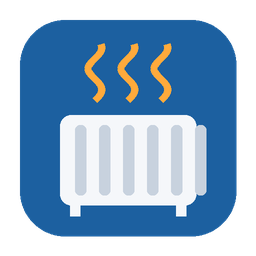

# ioBroker.mill-local

*Read this in another language: [Deutsche Kurzbeschreibung](/#/docs/adapterref/iobroker.mill-local/README_de.md).*

Connect **Mill Generation 3** devices ([Mill International AS](https://millnorway.com/)) to ioBroker through their **local REST API** – no cloud,
no Mill account, no app. Works for every Generation 3 device with the local API:

| Device kind | Detected by | Extra values |
|---|---|---|
| Wi-Fi Socket Gen 3 | model name (`Mill HeaterGen3Socket`) / `additional-socket-mode` | humidity, additional socket mode |
| Panel heater Gen 3 | model name / `limited-heating-power`, `pid-parameters` | power limit |
| Convection heater Gen 3 | model name | – |
| Oil heater Gen 3 | model name / `oil-heater-power` | power level 40/60/100 % |

The adapter detects the kind from the model name reported by `GET /status` and additionally probes the
optional endpoints, so it also copes with model names it does not know yet. Several devices per instance
are supported. Generation 1 and 2 devices have no local API and are not supported (use the cloud-based
solutions for them).

## Features

- **Every value exists exactly once.** Writable values carry the device value (ack=true) and are display and
  actuator at the same time – there is no separate read-only copy.
- `control.*`: target temperature (Normal), operation mode (the four Mill modes plus **`Switch`**), on/off of the
  thermostat, restart
- **On/off like a thermostat** (see below): ON returns to the last thermostat mode, OFF always switches off;
  permanent heating without thermostat only in the operation mode `Switch`
- `settings.*` (writable): calibration offset, child lock, commercial lock, display unit, predictive heating,
  cloud communication (after a restart of the device), hysteresis above/below target, Comfort/Sleep/Away
  temperatures, open window detection and its five parameters, oil heater power level, panel power limit,
  additional socket mode, time zone offset, controller type (PID only for panel heaters), commercial lock
  limits, PID parameters (panel heaters), **weekly program, one-off timers and vacation** (readable JSON, see
  below); `info.customName` renames the device
- Read-only: room temperature (calibrated and raw), humidity (sockets), **active target temperature** (the value the
  device regulates to right now, e.g. of the running weekly program period), heating power, control signal,
  heating now (relay), **active lock**, open window detected, cloud connection
- Estimated energy (`energy.total/today/yesterday`, kWh) from the power readings
- **Control is on by default**; switched off, `control.*` and `settings.*` become read-only (with read-only
  roles) and `control.restart` is not created
- Every value is validated (range, step, list of values) before anything is sent
- Network search (the devices do not announce themselves via mDNS), automatic re-discovery by MAC address
  when a device changes its IP
- Optional API key (devices switched to HTTPS)

## Configuration

1. **Devices** – enter the IP address of each device, or enter a network (e.g. `192.168.1.0/24`) and press
   **Search devices**, then save. The MAC address is filled in by the search; with it the adapter can find
   a device again after an address change.
2. **Polling** – status every 30 s (temperature, power, mode), settings every 600 s, request timeout 5 s.
   Values outside the limits (10–3600 s, 60–86400 s, 1–30 s) are corrected with a **warning in the log** that
   names the value used; so is a timeout that is not shorter than the polling interval. See
   *Connection and polling* below.
3. **Control** – enabled by default. Unticking *Enable control* makes `control.*` and `settings.*`
   read-only. The optional API key is stored encrypted and used for every device row with *API key* ticked.

## Objects

Each device is created as `mill-local.0.<mac>` (12 hex digits) with the channels `info`, `sensor`, `status`,
`control`, `settings` and `energy`. `<device>.refresh` reads a device immediately. States of older versions
that are no longer part of the model (e.g. `status.operationMode` next to `control.operationMode`) are removed
on start.
`info.connection` is `true` while **at least one** configured device is reachable (see below).

### Connection and polling

- **Reachable** means: the device answered the last poll with valid data. A poll is `GET /control-status` and
  `GET /set-temperature` (Normal); every *settings interval* the settings are read as well. Requests to one
  device are sent **one after the other** (the device handles one request at a time); several devices are polled
  independently and with a staggered start.
- A request fails on: no connection, no answer within the timeout (also a device that accepts the connection and
  never answers, or trickles data), HTTP error, an answer that is not JSON or empty, an answer with a `status`
  other than `ok`, or a `control-status` without operation mode and temperature. A failed poll **changes no value**
  – all states keep their last valid value (with ack) and timestamp.
- After **three failed polls in a row** the device counts as offline: `<mac>.info.online = false`, a warning in
  the log (once, with the reason) and, if enabled, the search for its MAC in the network (at most every 30 min).
  The first valid answer sets it online again (info in the log).
- **`info.connection`** is `true` while at least one configured device is reachable, `false` when none is (or
  no device is configured). Which device is offline shows `<mac>.info.online` (also on the device card).
- **Commands** are queued behind a running poll and sent right after it; readings that started before a command
  never overwrite its result, the device is read again immediately afterwards. When the instance stops, the
  running request is aborted and queued commands are **not** sent.
- The devices cannot push changes: a change at the device (buttons, app) appears with the next poll.

## Device manager

The instance supports the ioBroker **device manager** (tab *Devices* in admin). Each configured device gets a
card for the **running operation** only: name and model, reachability, the fault report of the device as a
warning, an *open window detected* indicator, room temperature, humidity (sockets), operation mode, target
temperature, current power (W) and the estimated energy of today. All values are on the card itself.

- **On/off** is a toggle in the status line; its symbol and text follow the state
  `status.switchedOn` (off = operation mode *Off*, or *Switch* with the relay open). A click asks for
  confirmation. It does the same as `control.power`: *off* switches off, *on* returns to the last thermostat
  mode (default *Control individually*); in the mode *Switch* it opens and closes the relay. Never permanent
  heating from *Off* or from a thermostat mode.
- **Operation mode** (select) and **target temperature** (slider, sent once it rests for 1 s) stay usable
  while the heater is off; choosing a mode other than *Off* switches it on.

- **Weekly program** (calendar button): a week grid, one row per weekday from 0 to 24 h; every block is a period
  with its temperature, e.g. *Comfort (22 °C)*. Drag a border (15-minute steps; with the keyboard: arrow keys, Shift
  = 1 h, Delete removes it), click a block to change its period or to split it, double-click to split at that point,
  copy and paste whole days. The temperatures of Comfort, Sleep, Away and Normal can be changed in the legend.
  *OK* writes the program (at most 64 switching points); if the device does not run the weekly program yet, the
  adapter asks whether to activate it. The page is plain HTML (`admin/weekly.html`) in the dialog.

Controls exist only while control is enabled. The card writes the existing states (ack=false), so the same
validation applies as for scripts – only the documented operation modes are ever sent.

There are deliberately **no configuration actions** on the cards (no search, add, remove or address change);
devices are still configured in the instance settings. A device that has never answered appears with its
name and address only. After adding devices or enabling control, reload the device list.

## Notes and pitfalls

- **The device acknowledges every operation mode with `"ok"` and switches itself OFF for unknown values.**
  The adapter therefore only sends the documented modes (`Control individually`, `Weekly program`,
  `Independent device`, `Off`). The device reports the off mode as `OFF`; the adapter shows `Off`.
- The device handles one request at a time; the adapter queues all requests per device.
- An operation mode the adapter does not know (the API description lists `Invalid`) is shown as reported in
  `control.operationMode`, counts as switched off and is logged once as a warning. It is never sent;
  `control.power` = ON returns to the last thermostat mode.
- In `Independent device` a one-off timer of the type `Off` / `AlwaysHeating` reports the same values as `Switch`
  with the relay open / closed (`set_temperature` 0 / 99). The adapter tells them apart with the timers it read
  (the last timer that has passed); a timer set at the device shows up with the next settings poll. Derived from
  the API description, not checked on a real device yet.
- In the mode `Independent device` a new target temperature only takes effect with
  `set-temperature-in-independent-mode-now`; the adapter sends it automatically.
- `POST /open-window` and `POST /hysteresis-parameters` need the complete parameter set; the adapter reads the
  current values first and only changes the one that was written.
- **On/off:** `control.power` (role `switch.power`) is the on/off of the **thermostat**, as visualisations
  (Material, Alexa, Lovelace …) expect it next to the target temperature, and the same as the toggle on the device
  card. **ON** returns to the last thermostat mode (`Control individually`, `Weekly program` or `Independent
  device`; default `Control individually`) – in a thermostat mode nothing is sent. **OFF** sets the operation mode
  `Off`. Read: `true` = switched on (same as `status.switchedOn`). Whether the relay is closed right now is
  `status.heating`.
- **Permanent heating without thermostat only in the operation mode `Switch`** (an adapter mode): written to
  `control.operationMode`, it starts with the relay open; in this mode `control.power` closes (ON) and opens (OFF)
  the relay, regardless of weekly program and target temperature. `Switch` = `Independent device` with the relay
  forced via `set-temperature-in-independent-mode-now` 99 (on) / 0 (off) – verified on a Wi-Fi Socket Gen 3. To
  heat by thermostat again, choose a thermostat mode. `current_power` is 0 W when nothing is plugged into a
  socket, and `switched_on` stayed `false` while the relay was closed; the adapter therefore uses the control
  signal.
- **Until 0.3.x** `control.power = true` switched to `Switch` with the relay closed (permanent heating) and the
  read value was the relay. Scripts that used `control.power` as "heating now" read `status.heating` instead.
- **Type detector:** the device (and its `control` channel) is detected as one thermostat: setpoint
  `control.targetTemperature`, actual temperature `sensor.temperature`, humidity, on/off `control.power`. The
  preset temperatures of `settings.*`, the raw temperature and the active target therefore use the roles
  `level` / `value` (with unit °C).
- **Time, weekly program, timers, vacation:** the device has no battery-backed clock and no API to set the time.
  After every start it asks **`pool.ntp.org`** via NTP (observed in the DNS log; with cloud communication off it
  queries nothing else). **Before that it checks the internet connection with an ICMP ping to `4.2.2.1`** (built
  in; observed on a Wi-Fi Socket Gen 3): without a default gateway it assumes x.x.x.1, and without a ping reply it
  never asks for the time. DHCP option 42 (NTP server) is not used. Fully local setup that works: gateway via
  DHCP, firewall allows only ICMP echo from the device to `4.2.2.1` (everything else to the internet blocked),
  and `pool.ntp.org` points to a local NTP server, e.g. with a DNS rewrite for the IoT clients only (AdGuard:
  `||pool.ntp.org^$dnsrewrite=NOERROR;A;<ntp-server>,client=<iot-net>`). The device then repeats the DNS
  query about every 2 minutes. Check: a weekly program entry switches at the expected minute. The time zone
  is a separate setting (`timezone-offset`, 1440 = not set); with *Keep the device's time zone in line with
  ioBroker* (default) the adapter sets it from the ioBroker host, also across daylight saving changes.
  - `settings.weeklyProgram`: `[{"day":"Mon","time":"06:30","type":"Comfort"}, …]` – types Comfort, Sleep, Away,
    Normal, Off, AlwaysHeating; stored as minutes since Monday 00:00; active in the mode `Weekly program`.
  - `settings.timers`: `[{"time":"2026-10-19T06:30","type":"Normal"}, …]` (local time) – types Normal, Off,
    AlwaysHeating; active in the mode `Independent device`.
  - `settings.vacation`: `{"start":"2026-12-24T08:00","end":"2027-01-02T18:00"}`, `{}` = none.
  All three are stored and run inside the device; the adapter only reads and writes them.
- A poll that was already running when a command arrived no longer turns the state back to the old value
  (readings older than the command are discarded, the device is read again right afterwards).
- The device only accepts the display unit in the documentation's spelling `Farenheit`; the adapter shows and
  takes `Fahrenheit` and translates it. `Fahrenheit` itself is acknowledged with `ok` and ignored.
- Not offered on purpose: `set-api-key` (irreversible without factory reset), soft/hard reset, OTA update
  (needs a firmware URL and internet), Wi-Fi configuration, `ablecloud-message`, `max-heater-power` (power meter
  calibration, cannot be read back).
- **No internet needed:** the local API and the mode `Control individually` work without internet. The weekly
  program and timers need the correct time, which the device only gets from the internet after a restart
  (it has no battery-backed clock). Cloud communication can be disabled on the device; it is shown in
  `settings.cloudCommunication`.
- **API key:** after `POST /set-api-key` the device switches to HTTPS with a self-signed certificate (the
  adapter does not verify it) and expects the key in the header `Authentication`. The adapter never sets a
  key itself – removing one requires a factory reset. Devices with an API key are not found by the search.
- Energy values are an **estimate** (power × time between two polls); gaps are not counted.
- ioBroker in Docker: works in a bridge network, the adapter only opens outgoing HTTP connections.

## PV surplus

Mill heaters are a simple load for surplus control (e.g. with a script):

- **Oil heaters:** `settings.oilHeaterPower` sets the power level (40, 60 or 100 % of the nominal power; 0 is also
  accepted by the API). Raise it with surplus, lower it without. The device keeps regulating to the target
  temperature – the level only limits the power.
- **Panel heaters:** `settings.limitedHeatingPower` limits the power in 1 % steps (10–100 %); the same principle
  with a finer granularity.
- **Wi-Fi Socket and every other device:** switch the thermostat on and off with `control.power` (keeps the target
  temperature), or use the operation mode `Switch` for a plain load: `control.power` then closes and opens the
  relay without thermostat.
- Write such values only when they change, not on every surplus calculation (the device answers one request at a
  time; every command is followed by a read). Check the result in `status.power` (W) and the estimated energy.

## Migration from ioBroker.millheater

1. Open the instance settings of mill-local, tab *Devices*, and press **Take over from millheater**. The adapter
   reads every `millheater.<n>` instance (address, polling intervals, timeout) and the MAC address and name from
   its states, and fills the device table (an existing row with the same MAC or address is updated, not
   duplicated). Intervals outside the limits of mill-local are adjusted to them.
2. Save, then **stop the millheater instance(s)**: a Mill device answers one request at a time, two adapters
   polling the same device run into timeouts.
3. Point scripts, visualisations and aliases to the new IDs (`<mac>` = MAC address, 12 hex digits):

| millheater (`millheater.<n>.`) | mill-local (`mill-local.<n>.<mac>.`) | Note |
|---|---|---|
| `control-status.ambient_temperature` | `sensor.temperature` | |
| `control-status.raw_ambient_temperature` | `sensor.temperatureRaw` | |
| `control-status.set_temperature` (write) | `control.targetTemperature` | Normal temperature, also readable while off |
| `control-status.set_temperature` (read) | `status.activeTargetTemperature` | empty (not 0) while off |
| `control-status.operation_mode` | `control.operationMode` | `Off` instead of `OFF`, plus `Switch` |
| `control-status.current_power` | `status.power` | |
| `control-status.control_signal` | `status.controlSignal` | |
| `control-status.switched_on` | `status.heating` | relay closed (from the control signal) |
| `control-status.lock_active` | `status.lockActive` | |
| `control-status.open_window_active_now` | `status.openWindowActive` + `settings.openWindowDetection` | two booleans instead of a text |
| `control-status.connected_to_cloud` | `status.cloudConnected` | |
| `settings.temperature_calibration_offset` | `settings.calibrationOffset` | |
| `settings.heating_level_percentage` | `settings.oilHeaterPower` | oil heaters |
| `settings.limited_heating_power` | `settings.limitedHeatingPower` | panel heaters |
| `settings.additional_mode` | `settings.additionalSocketMode` | Wi-Fi Socket |
| `status.name` | `info.model` | |
| `status.custom_name` | `info.customName` | writable |
| `status.version` | `info.firmware` | |
| `status.mac_address` | `info.mac` | |
| `status.operation_key` | `info.operationKey` | |
| `info.connection` | `info.connection` / `<mac>.info.online` | per instance / per device |

The history of the old states is not transferred.

## Difference to ioBroker.millheater

[ioBroker.millheater](https://github.com/webbummler/ioBroker.millheater) also uses the local API and supports
the same Generation 3 device kinds (convection, oil and panel heaters, Wi-Fi Socket). It runs one device per
instance and focuses on target temperature, operation mode, calibration and power level (e.g. for PV surplus
control), with thorough tests and documentation. **mill-local** runs **several devices per instance** with network
search and re-discovery by MAC address, covers **every setting the local API can change** (locks, hysteresis, open
window, preset temperatures, weekly program, timers, vacation, time zone, PID …), humidity of the Wi-Fi Socket,
a plain on/off mode without thermostat, an energy estimate and device manager cards. Neither adapter needs a Mill
account or the cloud.

## Visualisation (vis)

The adapter brings its own **vis 1 widgets** (set *mill-local*): device card, phone card, room temperature with target
− / +, values, operation mode, weekly program (display), today's periods of several devices, total power and a
**history chart** (room temperature, target as step line, current power as area, humidity of the Wi-Fi socket; 24 h or
7 days). Ready-made views for overview, detail page and phone are in [`vis-templates/`](/#/docs/adapterref/iobroker.mill-local/vis-templates/README.md).
Light and dark, texts in eleven languages.

The chart reads recorded values from any history adapter (`history`, `influxdb`, `sql`; attribute *History instance*,
empty = default). **The adapter switches no recording on** – switch it on in the object tree (gear icon) for
`sensor.temperature`, `status.activeTargetTemperature`, `status.power`, `sensor.humidity` (Wi-Fi socket) and optionally
`control.targetTemperature` of each device.

## Development and tests

- `npm test` – package and unit tests; `npm run lint` – ESLint 9 (flat config of `@iobroker/eslint-config`).
- `IOB_CONTROLLER=latest npm run test:integration` – starts a js-controller with the adapter against simulated
  devices (`test/fakeMill.js`): Wi-Fi socket, panel, oil and convection heater, weekly program / timers / vacation
  with a movable device clock and without NTP, open window, child lock, unknown operation modes, invalid answers,
  timeouts, dropped connections, restart, the operation-mode trap and the shutdown with a request on the wire.
- `node test/simulator.js --base 18000 --pid sim.pid` – four simulated devices (ports 18001–18004) with a room
  that warms up while the device heats, for trying the adapter without hardware. `GET http://127.0.0.1:18000/` shows
  them, `POST http://127.0.0.1:18000/<n>` with e.g. `{"windowOpen": true}` or `{"offline": true}` changes the
  simulation; stop with `kill $(cat sim.pid)`. Not part of the npm package.

## Sources

- Official API description: [Mill-International-AS/Generation_3_REST_API](https://github.com/Mill-International-AS/Generation_3_REST_API)
  (API version 0x220727; partly outdated or wrong – the adapter follows what real devices do)
- Behaviour cross-checked with the Home Assistant integration
  [`mill`](https://github.com/home-assistant/core/tree/dev/homeassistant/components/mill) (Apache-2.0) and
  [pyMillLocal](https://github.com/Danielhiversen/pyMillLocal) (MIT). No code was copied.
- Ideas and test scenarios from [ioBroker.millheater](https://github.com/webbummler/ioBroker.millheater) by
  webbummler (MIT): active target temperature, active lock, the description of connection and polling, the PV
  surplus notes and the failure scenarios of the tests (invalid answers, timeout, write during a poll, shutdown
  with a request on the wire), the validation of the timing values in the admin form (value ranges and the
  rule *timeout < polling interval*, not saved while invalid) and the handling of the reported mode `Invalid`. The
  tests were written anew for this adapter; no code was copied.

## Changelog

<!--
	Placeholder for the next version (at the beginning of the line):
	### **WORK IN PROGRESS**
-->
### 0.4.1 (2026-11-20)

- (Immanuel) Fix: the integration test failed on hosts in UTC (time zone offset -0 instead of 0); no functional changes
  compared to 0.4.0.

### 0.4.0 (2026-11-20)

- (Immanuel) **Breaking:** `control.power` is now the on/off of the thermostat, as visualisations expect it: ON returns
  to the last thermostat mode, OFF switches off. Permanent heating without thermostat only in the operation mode
  `Switch` (there `control.power` is the relay). The relay is the new state `status.heating`.
- (Immanuel) New states `status.activeTargetTemperature` (empty instead of 0 while off) and `status.lockActive`.
- (Immanuel) Type detector: exactly one thermostat per device (setpoint `control.targetTemperature`, actual
  temperature `sensor.temperature`).
- (Immanuel) `info.connection` is true while at least one device is reachable.
- (Immanuel) Clear warnings for invalid timing settings; empty or invalid answers keep the last values; the
  shutdown aborts the running request and drops queued commands.
- (Immanuel) Takeover from ioBroker.millheater (button in the instance settings), migration table in the README.
- (Immanuel) Weekly program on the device card as a week grid: draggable switching points, periods with their
  temperatures, copy/paste days, keyboard operation; asks after OK whether to activate the weekly program.
- (Immanuel) Unknown reported operation modes (e.g. `Invalid`) count as off and are logged once.
- (Immanuel) Admin form: timing values are checked (ranges, timeout shorter than the polling interval) and not
  saved while invalid.
- (Immanuel) Upgrade notice for the changed meaning of `control.power` (admin message on the update and one
  warning per device in the log).
- (Immanuel) vis widgets (set *mill-local*) with ready-made views (overview, detail page with weekly program and history
  chart, phone) in `vis-templates/`; the history chart reads any history adapter and switches no recording on.
- (Immanuel) Cards and objects: "Current power" instead of "Heating power" for `status.power`.
- (Immanuel) Requires js-controller 7.0.7 or newer.
- (Immanuel) Tests: simulator for Wi-Fi socket, panel, oil and convection heater with weekly program, timers,
  vacation, device clock, open window, child lock and connection loss; `test/simulator.js` for a demo instance.
- (Immanuel) Ideas and test scenarios from ioBroker.millheater by webbummler, MIT.

### 0.3.0 (2026-11-12)

- Device manager support (`@iobroker/dm-utils`, suggested by mcm1957 in issue #2): one card per device for the
  running operation – model, reachability, fault report, open-window indicator, room temperature, humidity,
  heating power and energy today; on/off toggle with confirmation, operation mode and target temperature
  directly on the card (also while off). No configuration actions.
- New state `status.switchedOn`: false only when the heater is off (mode *Off*, or *Switch* with the relay open).

### 0.2.2 (2026-10-23)

- Roles: operation mode, display unit, predictive heating and controller type use the role `text`
  (`level.mode` is not a valid role). With control disabled, the values get read-only roles and the restart
  button is left out.
- Configured intervals are also checked in the adapter (same limits as the admin UI, never above the timer
  limit); `info.connection` is reset when the adapter stops.
- Translations: remaining texts that were identical to English are translated; tab bar layout for small screens.
- Manufacturer link in the README; versions before 0.2.0 moved to CHANGELOG_OLD.md.

### 0.2.1 (2026-10-23)

-   Release via GitHub Actions with npm provenance (no functional changes).

### 0.2.0 (2026-10-23)

- First public release (functionally the same as 0.1.4): published on GitHub and npm, test data anonymised.

Older entries (versions before the first public release) are in CHANGELOG_OLD.md.

## Trademark

Mill is a trademark of Mill International AS. This adapter is an independent project and is neither
affiliated with nor endorsed by Mill International AS.

## License

MIT License

Copyright (c) 2026 Immanuel <github@freitag.online>

Permission is hereby granted, free of charge, to any person obtaining a copy of this software and associated
documentation files (the "Software"), to deal in the Software without restriction, including without limitation
the rights to use, copy, modify, merge, publish, distribute, sublicense, and/or sell copies of the Software, and
to permit persons to whom the Software is furnished to do so, subject to the following conditions:

The above copyright notice and this permission notice shall be included in all copies or substantial portions of
the Software.

THE SOFTWARE IS PROVIDED "AS IS", WITHOUT WARRANTY OF ANY KIND, EXPRESS OR IMPLIED, INCLUDING BUT NOT LIMITED TO
THE WARRANTIES OF MERCHANTABILITY, FITNESS FOR A PARTICULAR PURPOSE AND NONINFRINGEMENT. IN NO EVENT SHALL THE
AUTHORS OR COPYRIGHT HOLDERS BE LIABLE FOR ANY CLAIM, DAMAGES OR OTHER LIABILITY, WHETHER IN AN ACTION OF CONTRACT,
TORT OR OTHERWISE, ARISING FROM, OUT OF OR IN CONNECTION WITH THE SOFTWARE OR THE USE OR OTHER DEALINGS IN THE
SOFTWARE.