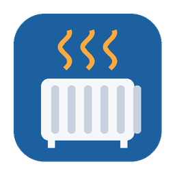

# ioBroker.mill-local

*Read this in another language: [Deutsche Kurzbeschreibung](/#/docs/adapterref/iobroker.mill-local/README_de.md).*

Connect **Mill Generation 3** devices ([Mill International AS](https://millnorway.com/)) to ioBroker through their **local REST API** – no cloud,
no Mill account, no app. Works for every Generation 3 device with the local API:

| Device kind | Detected by | Extra values |
|---|---|---|
| Wi-Fi Socket Gen 3 | model name (`Mill HeaterGen3Socket`) / `additional-socket-mode` | humidity, additional socket mode |
| Panel heater Gen 3 | model name / `limited-heating-power`, `pid-parameters` | power limit |
| Convection heater Gen 3 | model name | – |
| Oil heater Gen 3 | model name / `oil-heater-power` | power level 40/60/100 % |

The adapter detects the kind from the model name reported by `GET /status` and additionally probes the
optional endpoints, so it also copes with model names it does not know yet. Several devices per instance
are supported. Generation 1 and 2 devices have no local API and are not supported (use the cloud-based
solutions for them).

## Features

- **Every value exists exactly once.** Writable values carry the device value (ack=true) and are display and
  actuator at the same time – there is no separate read-only copy.
- `control.*`: target temperature (Normal), operation mode (the four Mill modes plus **`Switch`**), on/off, restart
- **ON always switches on, OFF always switches off** (see below)
- `settings.*` (writable): calibration offset, child lock, commercial lock, display unit, predictive heating,
  cloud communication (after a restart of the device), hysteresis above/below target, Comfort/Sleep/Away
  temperatures, open window detection and its five parameters, oil heater power level, panel power limit,
  additional socket mode, time zone offset, controller type (PID only for panel heaters), commercial lock
  limits, PID parameters (panel heaters), **weekly program, one-off timers and vacation** (readable JSON, see
  below); `info.customName` renames the device
- Read-only: room temperature (calibrated and raw), humidity (sockets), heating power, control signal,
  open window detected, cloud connection
- Estimated energy (`energy.total/today/yesterday`, kWh) from the power readings
- **Control is on by default**; switched off, `control.*` and `settings.*` become read-only (with read-only
  roles) and `control.restart` is not created
- Every value is validated (range, step, list of values) before anything is sent
- Network search (the devices do not announce themselves via mDNS), automatic re-discovery by MAC address
  when a device changes its IP
- Optional API key (devices switched to HTTPS)

## Configuration

1. **Devices** – enter the IP address of each device, or enter a network (e.g. `192.168.1.0/24`) and press
   **Search devices**, then save. The MAC address is filled in by the search; with it the adapter can find
   a device again after an address change.
2. **Polling** – status every 30 s (temperature, power, mode), settings every 600 s, request timeout 5 s.
   The devices cannot push changes; a device counts as offline after three failed polls in a row.
3. **Control** – enabled by default. Unticking *Enable control* makes `control.*` and `settings.*`
   read-only. The optional API key is stored encrypted and used for every device row with *API key* ticked.

## Objects

Each device is created as `mill-local.0.<mac>` (12 hex digits) with the channels `info`, `sensor`, `status`,
`control`, `settings` and `energy`. `<device>.refresh` reads a device immediately. States of older versions
that are no longer part of the model (e.g. `status.operationMode` next to `control.operationMode`) are removed
on start.
`info.connection` is `true` when all configured devices are reachable.

## Device manager

The instance supports the ioBroker **device manager** (tab *Devices* in admin). Each configured device gets a
card for the **running operation** only: name and model, reachability, the fault report of the device as a
warning, an *open window detected* indicator, room temperature, humidity (sockets), operation mode, target
temperature, heating power (W) and the estimated energy of today. All values are on the card itself.

- **On/off** is a toggle in the status line; its symbol and text follow the new state
  `status.switchedOn` (off = operation mode *Off*, or *Switch* with the relay open). A click asks for
  confirmation. *Off* writes `control.power = false`; *on* returns to the last active operation mode
  (a thermostat mode, or *Switch* with the relay closed) – never permanent heating from a thermostat mode.
- **Operation mode** (select) and **target temperature** (slider, sent once it rests for 1 s) stay usable
  while the heater is off; choosing a mode other than *Off* switches it on.

Controls exist only while control is enabled. The card writes the existing states (ack=false), so the same
validation applies as for scripts – only the documented operation modes are ever sent.

There are deliberately **no configuration actions** on the cards (no search, add, remove or address change);
devices are still configured in the instance settings. A device that has never answered appears with its
name and address only. After adding devices or enabling control, reload the device list.

## Notes and pitfalls

- **The device acknowledges every operation mode with `"ok"` and switches itself OFF for unknown values.**
  The adapter therefore only sends the documented modes (`Control individually`, `Weekly program`,
  `Independent device`, `Off`). The device reports the off mode as `OFF`; the adapter shows `Off`.
- The device handles one request at a time; the adapter queues all requests per device.
- In the mode `Independent device` a new target temperature only takes effect with
  `set-temperature-in-independent-mode-now`; the adapter sends it automatically.
- `POST /open-window` and `POST /hysteresis-parameters` need the complete parameter set; the adapter reads the
  current values first and only changes the one that was written.
- **On/off:** `control.power` shows whether the output is switched on (relay closed). **ON always switches
  on** and puts the device into the manual mode **`Switch`**: relay closed, regardless of thermostat, weekly
  program and target temperature (none of the Mill modes does that by itself – `Control individually` and
  `Independent device` both regulate to a target temperature). **OFF always switches off**: in `Switch` the relay
  opens, in every other mode the device goes to `Off`. To heat by thermostat again, choose an operation mode
  such as `Control individually`. `Switch` = `Independent device` with the relay forced via
  `set-temperature-in-independent-mode-now` 99 (on) / 0 (off) – verified on a Wi-Fi Socket Gen 3.
  `current_power` is 0 W when nothing is plugged into a socket, and `switched_on` stayed `false` while the relay
  was closed; the adapter therefore uses the control signal.
- **Time, weekly program, timers, vacation:** the device has no battery-backed clock and no API to set the time.
  After every start it asks **`pool.ntp.org`** via NTP (observed in the DNS log; with cloud communication off it
  queries nothing else). **Before that it checks the internet connection with an ICMP ping to `4.2.2.1`** (built
  in; observed on a Wi-Fi Socket Gen 3): without a default gateway it assumes x.x.x.1, and without a ping reply it
  never asks for the time. DHCP option 42 (NTP server) is not used. Fully local setup that works: gateway via
  DHCP, firewall allows only ICMP echo from the device to `4.2.2.1` (everything else to the internet blocked),
  and `pool.ntp.org` points to a local NTP server, e.g. with a DNS rewrite for the IoT clients only (AdGuard:
  `||pool.ntp.org^$dnsrewrite=NOERROR;A;<ntp-server>,client=<iot-net>`). The device then repeats the DNS
  query about every 2 minutes. Check: a weekly program entry switches at the expected minute. The time zone
  is a separate setting (`timezone-offset`, 1440 = not set); with *Keep the device's time zone in line with
  ioBroker* (default) the adapter sets it from the ioBroker host, also across daylight saving changes.
  - `settings.weeklyProgram`: `[{"day":"Mon","time":"06:30","type":"Comfort"}, …]` – types Comfort, Sleep, Away,
    Normal, Off, AlwaysHeating; stored as minutes since Monday 00:00; active in the mode `Weekly program`.
  - `settings.timers`: `[{"time":"2026-10-19T06:30","type":"Normal"}, …]` (local time) – types Normal, Off,
    AlwaysHeating; active in the mode `Independent device`.
  - `settings.vacation`: `{"start":"2026-12-24T08:00","end":"2027-01-02T18:00"}`, `{}` = none.
  All three are stored and run inside the device; the adapter only reads and writes them.
- A poll that was already running when a command arrived no longer turns the state back to the old value
  (readings older than the command are discarded, the device is read again right afterwards).
- The device only accepts the display unit in the documentation's spelling `Farenheit`; the adapter shows and
  takes `Fahrenheit` and translates it. `Fahrenheit` itself is acknowledged with `ok` and ignored.
- Not offered on purpose: `set-api-key` (irreversible without factory reset), soft/hard reset, OTA update
  (needs a firmware URL and internet), Wi-Fi configuration, `ablecloud-message`, `max-heater-power` (power meter
  calibration, cannot be read back).
- **No internet needed:** the local API and the mode `Control individually` work without internet. The weekly
  program and timers need the correct time, which the device only gets from the internet after a restart
  (it has no battery-backed clock). Cloud communication can be disabled on the device; it is shown in
  `settings.cloudCommunication`.
- **API key:** after `POST /set-api-key` the device switches to HTTPS with a self-signed certificate (the
  adapter does not verify it) and expects the key in the header `Authentication`. The adapter never sets a
  key itself – removing one requires a factory reset. Devices with an API key are not found by the search.
- Energy values are an **estimate** (power × time between two polls); gaps are not counted.
- ioBroker in Docker: works in a bridge network, the adapter only opens outgoing HTTP connections.

## Difference to ioBroker.millheater

[ioBroker.millheater](https://github.com/webbummler/ioBroker.millheater) also uses the local API, but with a
different scope: one heater per instance (IP address or host name), oil and panel heaters, focused on target
temperature, operation mode and power level (e.g. for PV surplus control). **mill-local** covers all
Generation 3 devices with the local API including the **Wi-Fi Socket** (humidity, socket mode) and convection
heaters, **several devices per instance** with network search and re-discovery by MAC address, **every setting the
local API can change** (locks, hysteresis, open window, preset temperatures, weekly program, timers, vacation,
time zone, PID …), a plain on/off mode without thermostat and an energy estimate. Neither adapter needs a Mill
account or the cloud.

## Sources

- Official API description: [Mill-International-AS/Generation_3_REST_API](https://github.com/Mill-International-AS/Generation_3_REST_API)
  (API version 0x220727; partly outdated or wrong – the adapter follows what real devices do)
- Behaviour cross-checked with the Home Assistant integration
  [`mill`](https://github.com/home-assistant/core/tree/dev/homeassistant/components/mill) (Apache-2.0) and
  [pyMillLocal](https://github.com/Danielhiversen/pyMillLocal) (MIT). No code was copied.

## Changelog

<!--
	Placeholder for the next version (at the beginning of the line):
	### **WORK IN PROGRESS**
-->

### 0.3.0 (2026-11-12)

- Device manager support (`@iobroker/dm-utils`, suggested by mcm1957 in issue #2): one card per device for the
  running operation – model, reachability, fault report, open-window indicator, room temperature, humidity,
  heating power and energy today; on/off toggle with confirmation, operation mode and target temperature
  directly on the card (also while off). No configuration actions.
- New state `status.switchedOn`: false only when the heater is off (mode *Off*, or *Switch* with the relay open).

### 0.2.2 (2026-10-23)

- Roles: operation mode, display unit, predictive heating and controller type use the role `text`
  (`level.mode` is not a valid role). With control disabled, the values get read-only roles and the restart
  button is left out.
- Configured intervals are also checked in the adapter (same limits as the admin UI, never above the timer
  limit); `info.connection` is reset when the adapter stops.
- Translations: remaining texts that were identical to English are translated; tab bar layout for small screens.
- Manufacturer link in the README; versions before 0.2.0 moved to CHANGELOG_OLD.md.

### 0.2.1 (2026-10-23)

-   Release via GitHub Actions with npm provenance (no functional changes).

### 0.2.0 (2026-10-23)

- First public release (functionally the same as 0.1.4): published on GitHub and npm, test data anonymised.

Older entries (versions before the first public release) are in CHANGELOG_OLD.md.

## Trademark

Mill is a trademark of Mill International AS. This adapter is an independent project and is neither
affiliated with nor endorsed by Mill International AS.

## License

MIT License

Copyright (c) 2026 Immanuel <github@freitag.online>

Permission is hereby granted, free of charge, to any person obtaining a copy of this software and associated
documentation files (the "Software"), to deal in the Software without restriction, including without limitation
the rights to use, copy, modify, merge, publish, distribute, sublicense, and/or sell copies of the Software, and
to permit persons to whom the Software is furnished to do so, subject to the following conditions:

The above copyright notice and this permission notice shall be included in all copies or substantial portions of
the Software.

THE SOFTWARE IS PROVIDED "AS IS", WITHOUT WARRANTY OF ANY KIND, EXPRESS OR IMPLIED, INCLUDING BUT NOT LIMITED TO
THE WARRANTIES OF MERCHANTABILITY, FITNESS FOR A PARTICULAR PURPOSE AND NONINFRINGEMENT. IN NO EVENT SHALL THE
AUTHORS OR COPYRIGHT HOLDERS BE LIABLE FOR ANY CLAIM, DAMAGES OR OTHER LIABILITY, WHETHER IN AN ACTION OF CONTRACT,
TORT OR OTHERWISE, ARISING FROM, OUT OF OR IN CONNECTION WITH THE SOFTWARE OR THE USE OR OTHER DEALINGS IN THE
SOFTWARE.