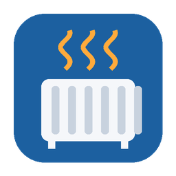

# ioBroker.mill-local – Kurzbeschreibung auf Deutsch

Die vollständige Dokumentation steht in der englischen [README](/#/adapters/mill-local).

Der Adapter bindet Mill-Geräte der **Generation 3** ([Mill International AS](https://millnorway.com/)) (Panel-, Konvektions- und Ölheizungen sowie die
WLAN-Steckdose) über ihre **lokale API** ein – ohne Cloud, Konto oder App. Mehrere Geräte je Instanz,
Geräteart wird automatisch erkannt, Netzwerksuche und Wiederfinden nach Adresswechsel über die MAC-Adresse.

- **Jeden Wert gibt es nur einmal.** `control.*` (Solltemperatur, Betriebsart, Ein/Aus) und `settings.*` (alle
  Einstellungen, die die API ändern kann) zeigen den Gerätewert und sind direkt beschreibbar.
- **Steuerung ist ab Werk ein**; ausgeschaltet sind `control.*` und `settings.*` nur lesbar (mit Nur-Lese-Rollen),
  `control.restart` entfällt.
- **Ein/Aus wie beim Thermostat:** `control.power` EIN kehrt in die letzte Thermostat-Betriebsart zurück
  (sonst `Control individually`), AUS setzt die Betriebsart `Off` – wie der Umschalter auf der Gerätekarte und so,
  wie Material, Alexa oder Lovelace ihn neben der Solltemperatur verstehen. **Dauerheizen ohne Thermostat nur in
  der Betriebsart `Switch`**: dort schließt/öffnet `control.power` das Relais. Ob das Relais gerade zu ist, zeigt
  `status.heating` (bis 0.3.x war das der Lesewert von `control.power`, und EIN schaltete auf Dauerheizen).
- **Neu in 0.4.0:** `status.activeTargetTemperature` (aktiver Sollwert, z. B. aus dem Wochenprogramm; leer statt 0,
  solange aus), `status.lockActive` (aktive Sperre), `status.heating`.
- **Verbindung und Abfrage:** Erreichbar heißt, das Gerät hat die letzte Abfrage gültig beantwortet. Eine
  fehlgeschlagene Abfrage (keine/ungültige/leere Antwort, Zeitüberschreitung, HTTP-Fehler) ändert keinen Wert;
  nach drei Fehlschlägen in Folge ist das Gerät offline (`<mac>.info.online`). `info.connection` ist `true`,
  solange **mindestens ein** Gerät erreichbar ist. Befehle warten hinter einer laufenden Abfrage; beim Beenden
  wird die laufende Anfrage abgebrochen und Wartendes nicht mehr gesendet. Unsinnige Intervalle in der
  Konfiguration werden mit Warnung im Log korrigiert.
- **PV-Überschuss:** Ölradiatoren über `settings.oilHeaterPower` (40/60/100 %), Panelheizungen über
  `settings.limitedHeatingPower` (10–100 %), alle Geräte über `control.power` bzw. die Betriebsart `Switch`. Nur bei
  Änderung schreiben.
- **Uhrzeit:** Das Gerät holt sie nur per NTP von `pool.ntp.org` – und nur, wenn vorher ein Ping an `4.2.2.1`
  beantwortet wird (fest eingebaut; ohne Gateway nimmt es x.x.x.1 an). Rein lokal: Gateway per DHCP, Firewall
  erlaubt nur ICMP vom Gerät an `4.2.2.1`, `pool.ntp.org` per DNS auf einen lokalen NTP-Server lenken. Die
  Zeitzone setzt der Adapter aus ioBroker. Wochenprogramm, Einzeltimer und Urlaub
  sind als JSON les- und schreibbar.
- **Falle:** Das Gerät quittiert jede Betriebsart mit „ok“ und schaltet sich bei unbekannten Werten AUS – der
  Adapter sendet deshalb nur die dokumentierten Betriebsarten.
- **Ohne Internet:** Lokale API und Betriebsart „Control individually“ laufen ohne Internet; Wochenprogramm
  und Timer brauchen die Uhrzeit, die das Gerät nur aus dem Internet holt.
- **Geräteverwaltung (Reiter „Geräte“ im Admin):** je Gerät eine Karte für den laufenden Betrieb – Erreichbarkeit,
  Modell, Störungsmeldung, Anzeige „Fenster offen“, Raumtemperatur, Feuchte, Betriebsart, Solltemperatur,
  aktuelle Leistung (W) und geschätzte Energie heute. Ein/Aus ist ein Umschalter in der Statuszeile mit Rückfrage
  (folgt dem Datenpunkt `status.switchedOn`; „Ein“ kehrt in die letzte Thermostat-Betriebsart zurück, in `Switch`
  schaltet er das Relais).
  Betriebsart und Solltemperatur sind auch im ausgeschalteten Zustand bedienbar, eine Betriebsart außer „Aus“
  schaltet ein (alles nur bei eingeschalteter Steuerung). **Wochenprogramm** (Kalender-Knopf): Wochenraster Mo–So,
  0–24 Uhr, Blöcke je Abschnitt mit Temperatur (z. B. „Komfort (22 °C)“); Grenzen ziehen (15 min, Tastatur: Pfeile),
  Block anklicken zum Ändern/Teilen, Tage kopieren; Temperaturen der Abschnitte in der Legende. Nach OK fragt der
  Adapter, ob das Wochenprogramm aktiviert werden soll. Bewusst keine Konfiguration auf
  den Karten – Geräte werden weiter in den Instanzeinstellungen eingetragen.
- Eine unbekannte gemeldete Betriebsart (die API-Beschreibung nennt `Invalid`) wird angezeigt, zählt als aus und
  wird einmal gewarnt; gesendet wird sie nie.
- **Tests ohne Gerät:** `test/fakeMill.js` simuliert Steckdose, Panel-, Öl- und Konvektionsheizung samt
  Wochenprogramm, Timern, Urlaub, Geräteuhr, Fenster offen, Kindersicherung und Verbindungsabbrüchen;
  `node test/simulator.js` startet vier simulierte Geräte für eine Probe-Instanz (siehe englische README).
- Die Energiewerte sind geschätzt (Leistung × Zeit zwischen zwei Abfragen).
- **Unterschied zu `millheater`:** Jener Adapter nutzt ebenfalls die lokale API und unterstützt dieselben Gen-3-
  Gerätearten (Konvektor, Öl, Panel, WLAN-Steckdose), mit einem Gerät je Instanz und Schwerpunkt auf Sollwert,
  Betriebsart, Kalibrierung und Leistungsstufe. `mill-local` kann mehrere Geräte je Instanz samt Suche, alle über
  die API änderbaren Einstellungen, Luftfeuchte der Steckdose, Energieschätzung und Gerätekarten.
- **Umstieg von `millheater`:** In den Instanzeinstellungen (Reiter „Geräte“) übernimmt der Knopf **„Aus millheater
  übernehmen“** Adresse, MAC, Name und Intervalle aller `millheater`-Instanzen in die Gerätetabelle. Danach speichern
  und die millheater-Instanzen anhalten (das Gerät beantwortet nur eine Anfrage gleichzeitig). Die Zuordnung
  alte ID → neue ID steht als Tabelle in der englischen README („Migration from ioBroker.millheater“).
- **Visualisierung (vis 1):** eigene Widgets (Satz *mill-local*) – Gerätekarte, Handykarte, Raumtemperatur mit Soll
  − / +, Werte, Betriebsart, Wochenprogramm (Anzeige), heutige Abschnitte, Gesamtleistung und ein **Verlaufsdiagramm**
  (Raumtemperatur, Soll als Stufenlinie, aktuelle Leistung als Fläche, Luftfeuchte der Steckdose; 24 h oder 7 Tage).
  Fertige Ansichten in [`vis-templates/`](/#/docs/adapterref/iobroker.mill-local/vis-templates/README.md). Datenquelle frei wählbar (history, influxdb, sql);
  **die Aufzeichnung schaltet der Anwender ein**, nicht der Adapter: im Objektbaum am Zahnrad für
  `sensor.temperature`, `status.activeTargetTemperature`, `status.power`, `sensor.humidity` (Steckdose) und optional
  `control.targetTemperature`.